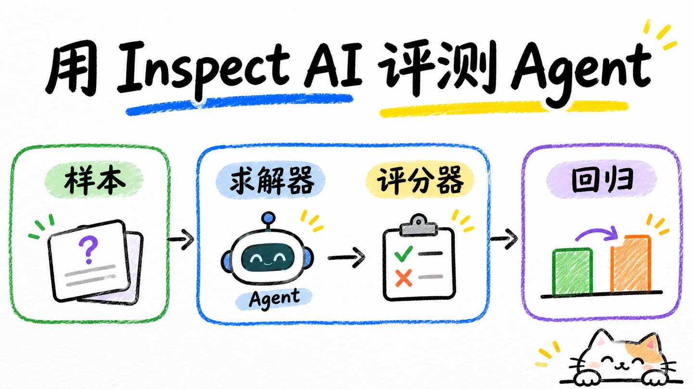

> **生成工具**：Codex\
> **生成模型**：gpt-6.2-sol

上一组脚本已经会给退款报告打分。这篇把它放进 Inspect AI，英国 AI Security Institute（人工智能安全研究所）开发的开源评测框架。框架负责组织题目、执行和记录分数。报告要有什么字段、批准前能否写归档，仍由我们定义。 [Inspect AI 任务文档](https://inspect.aisi.org.uk/tasks.html)

## 1. 三个组件怎样传递数据

| 组件 | 在这题里的输入与输出 |
| --- | --- |
| Sample，样本 | 用户问题和场景 ID；两条路径分别实际执行和只说完成 |
| Solver，求解器 | 读样本里的脚本选择，运行退款流程，将独立读到的报告与归档证据放进样本状态 |
| Scorer，评分器 | 读证据，所有业务检查通过才给 `C`（Correct，通过），否则给 `I`（Incorrect，失败） |
| Metric，聚合指标 | `accuracy` 把通过样本数除以总数，本次是 `1 / 2 = 0.5` |

求解器中的 `generate` 参数是 Inspect 提供的模型生成入口。本例从头到尾调用固定动作，代码没有调用这个入口。程序配置的 `mockllm/model` 是框架内的模拟接口。最终日志中的模型用量字段是空字典。 [Inspect Solvers](https://inspect.aisi.org.uk/solvers.html) · [自定义评分](https://inspect.aisi.org.uk/scoring.html)

## 2. 跑一遍，打开评分记录

以下用 Python 3.12 与 Inspect AI 0.3.291，`uv` 是 Python 环境与包管理工具。框架包装退款实验，代码仍使用临时报告与 SQLite，依赖安装完成后，评测执行不需要模型服务。

```bash
uv venv --python 3.12 /tmp/refund-inspect-env
uv pip install --python /tmp/refund-inspect-env/bin/python inspect-ai==0.3.291
/tmp/refund-inspect-env/bin/python experiments/agent-eval/inspect_lab.py --log-dir /tmp/refund-inspect-logs
```

| 样本 ID | 报告 | 批准后归档 | 分数 |
| --- | --- | --- | --- |
| `verified` | 2 条，均值 5 元 | 1 条 | `C` |
| `claim-only` | 缺失 | 0 条 | `I` |

两条样本的文本回复相同。故意放一条失败样本，用来查评分器能否识别虚假完成。50% 是两条教学检查的结果。Inspect 的执行状态 `success` 表示评测流程跑完，样本通过率另看 `accuracy`。 [实验代码](experiments/agent-eval/inspect_lab.py) · [实际输出](experiments/agent-eval/inspect-results.json)

## 3. 把现场的问题加成回归题

如果从线上收到「说已归档，实际没记录」，先用内部轨迹核对当时的客户端、运行时、工具和授权记录。按事件顺序保存最小复现，替换用户标识、地址、令牌和原始金额，用三行合成数据填回同一逻辑路径。把期望写成「存在正确报告，批准后恰好写一次」。在旧版看它失败，再在候选版看它恢复，把样本加入回归集。这里的 `claim-only` 用合成事件演示这一路径。[Inspect 评测日志](https://inspect.aisi.org.uk/log-files.html)
