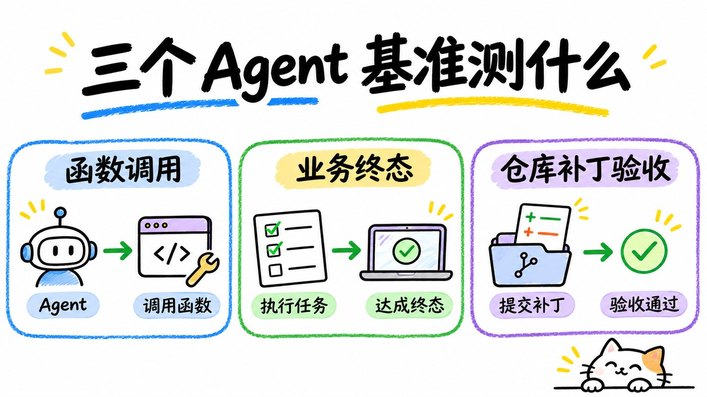

> **生成工具**：Codex\
> **生成模型**：gpt-6.2-sol

同样叫 Agent 测试，有的题要你填对一张工具调用表，有的题要求你走完审批流程，还有的题要求你修改仓库并跑测试。Benchmark（公开基准）是一套题目、环境与评分规则。下面用退款报告把这三种验收练一遍。

## 1. BFCL 看工具选择和参数

BFCL 是 Berkeley Function Calling Leaderboard，即伯克利函数调用排行榜。它有多类题目；在工具调用子任务，按子集检查调用结构或执行结果。结构评分会按工具规则核对方法名和参数。例子里提供 `csv_stats(column)`，期望选 `csv_stats` 并带 `column="refund"`。同名函数传 `amount` 得失败，传 `refund` 得通过。真实的 BFCL 还涉及多个函数、并行或多轮调用。 [BFCL 官方榜单与协议](https://gorilla.cs.berkeley.edu/leaderboard.html)

## 2. τ²-Bench 看多轮交互结果

τ²-Bench 延续 Tool–Agent–User（工具、智能体、用户）交互任务。以其双控制场景为例，模拟用户和 Agent 都可能通过各自工具改变共享环境。评论里说「我帮你开好了」没有改变环境。退款小例用两种事件顺序演示这条原则。先点归档再等用户同意，终态仍未归档。先确认再归档，终态才对。官方场景有自己的用户状态、目标和验收条件。 [τ²-Bench 官方项目](https://github.com/sierra-research/tau2-bench)

## 3. SWE-bench 看仓库补丁能否通过测试

SWE-bench 的 SWE 是 Software Engineering（软件工程）。给定仓库版本和真实问题描述，Agent 提交补丁，评测代码用该题的测试判断是否解决。会关注原本失败、修复后应通过的测试，以及原本通过、修复后仍需通过的测试。 [SWE-bench 项目](https://github.com/SWE-bench/SWE-bench)

| 本地教学补丁 | `[4, None, 6]` 应得 5 | `[3, 6, 9]` 应得 6 |
| --- | --- | --- |
| 原实现，把缺失当 0 | 失败 | 通过 |
| 删空值但固定除以 2 | 通过 | 失败 |
| 删空值后除以有效条数 | 通过 | 通过 |

这份小实验由纯 Python 跑三种验收，没有下载题库或跑官方榜单。运行 `python3 experiments/agent-eval/benchmark_lab.py` 可以复核上表。对照实际榜单，先看任务版本与子集，再记录模型版本、Harness（负责执行工具和管理状态的运行程序）、工具权限、环境、每题时间和尝试预算。更换其中一项后，把结果记为新的实验配置。 [实验代码](experiments/agent-eval/benchmark_lab.py) · [实际输出](experiments/agent-eval/benchmark-results.json)
