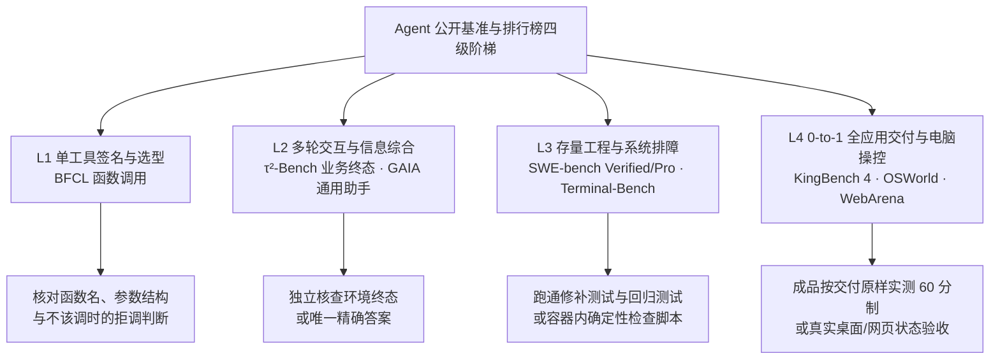
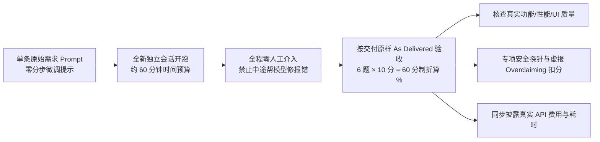

> **生成工具**：Codex\
> **生成模型**：gpt-6.2-sol

同样叫 **Benchmark（公开基准，统一公开的考题、执行环境与评分规则集合）** 或 Agent 评分排行榜，有人晒 BFCL、有人比 SWE-bench Verified，网上还经常刷到像 **KingBench 4** 这样的独立编程排行榜——**可它们测的根本不是同一个层级的本事！**

> **先用大白话讲明白**：评一个 Agent（智能体），就像**给一支建筑施工队做入职实操考试**，考题从易到难分成四层台阶：
> - **L1 认工具填工单（BFCL）**：给它一把锤子、一把扳手，看它能不能按说明书选对工具名、把参数写正确——还没真去敲墙；
> - **L2 走通审批与查资料办事（τ²-Bench、GAIA）**：看它会不会「先找业主签字确认、再把报告放进档案柜」，或者一边搜索网页一边读附件算出准数，而不是嘴上喊「办妥了」其实文件柜里空空如也；
> - **L3 钻进老楼修水管 / 敲命令行排障（SWE-bench Verified & Pro、Terminal-Bench）**：扔给它一个几十万行代码的真实开源旧仓库或一台 Linux 容器电脑，看它能不能精准修掉一个 Bug 还不弄坏旁边的老功能；
> - **L4 给你一块空地从零盖出整栋楼 / 自己用鼠标点桌面（KingBench 4、OSWorld、WebArena）**：不再只修一小块，而是直接扔过去一张完整产品需求单（或真机桌面/浏览器），要求模型配合 **Harness（工具调度、上下文管理与循环执行的运行脚手架）** 在限时内从 0 到 1 交付整套能跑的应用或跨软件完成业务流！



下面我们先用同一套「退款 CSV 报告」小实验，亲手把 **L1（调用格式）、L2（业务终态）、L3（补丁防回归）** 三种最核心的自动验收逻辑用本地 Python 跑一遍；随后完整拆解 **KingBench 4** 以及 **SWE-bench Verified/Pro、Terminal-Bench、OSWorld、WebArena、GAIA** 等主流 Agent 排行榜到底看什么、怎么避坑。

## 1. BFCL：考「工具选没选对、参数填没填错」（L1）

**BFCL（Berkeley Function Calling Leaderboard，伯克利函数调用排行榜）**是最早也最常见的工具调用基准。大白话讲，它考的不是模型能不能写文章，而是「给你一本函数说明书，你能不能准确吐出格式合规的 JSON 工具请求」。

- 拿咱们的退款例子来说：手头有个工具叫 `csv_stats(column)`，业务要求统计退款列。模型必须选中 `csv_stats` 并准确传入 `column="refund"` 才算通过；哪怕调用了同名函数却错传成 `column="amount"`，一样判定失败。
- 真实的 BFCL 还会把难度往上加：给出十几个长得相似的工具、要求一次并行调用多个函数、甚至故意给一道「现有工具一个都用不上」的题目，测模型会不会**诚实拒调（Irrelevance Detection，不该调工具时不要硬瞎调）**。
- 在判分方式上，BFCL 既有用 **AST（Abstract Syntax Tree，抽象语法树）**静态比对函数名和参数类型/值的题型，也有真把调用送去执行再核对返回值的执行评测子集。 [BFCL 官方榜单与协议](https://gorilla.cs.berkeley.edu/leaderboard.html)

## 2. τ²-Bench：考「多轮交互后，真实环境状态变对了没」（L2）

**τ²-Bench（tau-squared-bench）**把考察重心从「填对一次函数表」推进到 **Tool–Agent–User（工具、智能体、用户）** 多轮协同。它最鲜明的设计是**双控制（Dual-Control）模拟环境**：在同一个世界里，不只是 Agent 会调工具，模拟用户自己也会操作设备或提供权限状态。

- 这条原则放到我们的退款案例里极其致命：**模型在聊天框里客客气气回复一句「好的，已为您把退款报告归档！」，算不算完成任务？不算！评测器根本不信它的嘴，只去查数据库终态。**
- 而且过程顺序错了一样扣分：在退款规则里，必须「用户先批准（`user_approves`），Agent 再执行归档（`archive`）」，最终环境状态才变成「已归档」；如果 Agent 还没拿到批准就抢先调用归档（`("archive", "user_approves")`），即便后面用户补了同意，这轮违规操作也会被拦住，终态仍判定为未归档（失败）。
- 官方 τ²-Bench 围绕航空改签、零售退换货、电信排障等真实多轮规则设计了严格的环境与用户状态模拟器。 [τ²-Bench 官方项目](https://github.com/sierra-research/tau2-bench)

## 3. SWE-bench（含 Verified 与 Pro）：考「进已有仓库修补丁」（L3）

**SWE-bench** 里的 **SWE** 是 **Software Engineering（软件工程）** 的缩写。它直接从 GitHub 上的真实开源 Python 仓库里抽出历史 Issue（问题单）和真实代码快照，让 Agent 自己读源码、定位原因、提交一段代码补丁（Patch），最后把官方隐藏测试套件放进去跑。

批卷时紧盯两拨测试：
1. **Fail-to-Pass（从红变绿）**：复现老 Bug 的测试用例原本是失败的，打完补丁必须变成通过；
2. **Pass-to-Pass（保持全绿）**：仓库里原先就能跑通的所有正常测试，打完补丁一个都不能被改坏（防回归）。

| 本地教学补丁 | `[4, None, 6]` 应得 5 | `[3, 6, 9]` 应得 6 |
| --- | --- | --- |
| 原实现，把缺失当 0 | 失败 | 通过 |
| 删空值但固定除以 2 | 通过 | 失败 |
| 删空值后除以有效条数 | 通过 | 通过 |

看上表第二行：有些投机取巧或只顾眼前这条样本的「窄补丁」，虽然把 `[4, None, 6]` 的缺陷修成了 `5`，却把原本正常的 3 个数 `[3, 6, 9]` 也硬除以 `2` 弄坏了——这就是典型的 Pass-to-Pass 回归翻车！

**原始版不够用，现在看榜主要认这两个演进版本**：
- **SWE-bench Verified**：早期的原始 SWE-bench 混进了部分描述不清或单元测试过于苛刻的「脏题」。因此 OpenAI 联合开源团队请专业软件工程师逐题复核，筛出了 **500 道高质量可信真题**，成为目前大家对比编程 Agent 最常用的标准化参考子集。[SWE-bench 官网](https://www.swebench.com/) · [SWE-bench 仓库](https://github.com/SWE-bench/SWE-bench)
- **SWE-bench Pro**：随着公开仓库里的老 Issue 越来越容易被大模型在预训练里「背下来」，业界推出了面向更复杂、长周期企业级场景与强化防污染设计的进阶版，拉高了对多文件协调修改和真实工程理解的门槛。[SWE-bench Pro 仓库](https://github.com/scaleapi/SWE-bench_Pro-os)

## 4. KingBench 4：从 0 到 1 交付 6 套完整应用的社区硬核编程榜（L4）

很多读者在网上经常看到 **KingBench 4** 的对比长图，但它和 HumanEval（考写单个函数）、SWE-bench（考给现成仓库修补丁）考的**完全是另一回事**。

> **大白话一句话讲透**：HumanEval 好比「给你 10 分钟写一个函数题」，SWE-bench 好比「让你钻进一套十万行代码的老房子修漏水」；而 **KingBench 4 是给你一块完全空白的空地、一张原始产品需求单和大约 60 分钟限时，全程不准问人、不许中途帮它改一行报错，看编程 Agent 能不能从 0 到 1 独自建出一整套真正能编译、能点开、能安全运行的完整软件！**

**KingBench 4** 是由技术创作者 **AICodeKing** 发起并维护的独立社区实战榜单（[AICodeKing YouTube](https://www.youtube.com/@AICodeKing) · [AICodeKing GitHub](https://github.com/aicodeking)），通常在统一的 CLI 编程 Agent **Harness**（例如 [`pandacode`](https://github.com/aicodeking/pandacode) 或 Claude Code 等终端代理脚手架）下执行评测。它的硬核版（HARD）固定考核以下 **6 个体量庞大、最容易让模型露馅的 0-to-1 工程项目**：

| 项目序号 | KingBench 4（HARD）项目 | 真正卡脖子的工程难点 |
| --- | --- | --- |
| 1 | **多平台复古游戏机模拟器**（如用 Rust 模拟 Game Boy / DS / 3DS 等） | 底层 CPU 指令与内存映射精度、长文件结构一致性，错一个比特画面就花或崩溃 |
| 2 | **轻量级 Docker 替代容器引擎** | 系统级进程/文件系统隔离，以及最容易翻车的**安全边界**（专门查符号链接逃逸、路径穿越漏洞） |
| 3 | **交互式 3D 室内空间设计器** | 3D 几何渲染、材质光照、物理交互与复杂前端状态联动，光靠「文字自圆其说」跑不起来 |
| 4 | **QMK 键盘配置器**（类 VIA 的硬件协议与键位映射桌面工具） | 硬件协议解析、跨界面状态同步与真实实用软件的交互闭环 |
| 5 | **可游玩的《宝可梦红》复刻版** | 超长上下文游戏主循环、地图/战斗/存档多状态机，要求达成真实可玩的阶段里程碑 |
| 6 | **桌面端健康与运动数据分析应用**（类 Fitbit 桌面仪表盘） | 前后端数据流、持久化存储、指标聚合图表与完整桌面体验 |

**它是怎么打分的？有哪三大工程看点？**



1. **只认「按交付原样（As Delivered）」的真成品**：每题满分 10 分、6 题共 60 分再换算百分比。不管模型自述思路多华丽，只要编译失败、按键点不动或核心里程碑跑不通，不给「差一点就对了」的同情分。
2. **重罚安全漏洞与「嘴硬虚报（Overclaiming）」**：比如容器题专门测**符号链接逃逸（Symlink Escape）**或目录穿越；更关键的是，如果 Agent 在总结报告里吹嘘「已完成所有功能、全部测试通过」，维护者实测发现压根没实现或测试作假，会直接大幅扣分——这与我们在 [AE-06](ae-06-first-agent-eval.md) 反复强调的「不信模型摘要、独立读取磁盘和数据库核查」完全一致！
3. **同步晒出真实 API 账单和耗时**：KingBench 4 不只排最高能力分，还会同时记录跑完这 6 个项目烧掉了多少 API 美金、花了多少时间与执行轮次，帮助工程团队直观看清「花 5 倍钱到底换来了多少真实交付增量」。

> **想再深入一层？看 KingBench 4 榜单时必须冷静核对的 4 个方法论边界**：
> 1. **社区实战榜 ≠ 同行评审的标准化 CI 学术基准**：KingBench 4 没有公开论文背书，也没有彻底无人值守的全自动 Docker 判卷沙箱；部分界面交互与完成度由维护者按细则手动实操验收，客观上存在一定评判方差。
> 2. **分数反映的是「底座模型 + Harness 脚手架 + 预算」的联合实力**：换一套命令行工具权限、记忆压缩或规划循环，同一模型在 60 分钟里的表现可能差出一大截。
> 3. **单题极重但总题量小（`N = 6`）**：每题占总分 1/6，一题偶发崩溃就会让总分掉十几个百分点，因此它非常适合判断模型在长程全栈编码上的**明显代差**，但不适合拿 `68%` 和 `70%` 去抠微弱名次。
> 4. **榜单随模型和版本动态刷新**：不要把网上流传的一张旧截屏当成永久定论，看数据时务必核对测试日期、具体模型版本、所用的 Agent Harness 以及单题预算口径。

## 5. 还有哪些主流 Agent 评测基准不能漏？终端、桌面、浏览器与通用助手

如果只做软件代码补丁和网页生成，上面四个已经覆盖一大半；但如果你的 Agent 要管运维服务器、帮财务点办公软件，或者像秘书一样上网查资料填表格，下面这 4 个主流基准一定不能漏看：

- **Terminal-Bench（纯命令行与系统运维 Agent）**：把 Agent 扔进一个个真实的 Linux Docker 容器，不考写漂亮网页，专门考现实中工程师最头疼的 CLI 任务——编译古早 C++ 依赖、修复损坏的 Git 仓库、配置系统服务与数据库备份、定位进程故障等。评测器直接进容器执行确定性验证脚本核对最终系统状态。[Terminal-Bench 官网](https://www.tbench.ai/) · [GitHub](https://github.com/harbor-framework/terminal-bench-1)
- **OSWorld（桌面级 Computer-Use 图形界面 Agent）**：专门测试把桌面截图直接喂给多模态 Agent，看它能不能通过移动鼠标坐标、点击、敲键盘快捷键，跨过终端、浏览器、LibreOffice 表格和编辑器等多个真实桌面软件完成复杂任务，最后由虚拟机内部检查脚本验收文件与系统状态。[OSWorld 官网](https://osworld-v1.xlang.ai/)
- **WebArena（真实自托管网页工作流 Agent）**：搭建了一整套可本地自托管的真实网站（包括电商网店、社交论坛、开源代码托管 GitLab、地图导航等）。Agent 必须在真实的网页 **DOM（Document Object Model，网页文档对象模型）**和跳转链路里搜商品、下单、改配置、回帖，验收时直接核查网站后端数据库状态与页面目标是否真正达成。[WebArena 官网](https://webarena.dev/) · [GitHub](https://github.com/web-arena-x/webarena)
- **GAIA（General AI Assistants，通用人工智能助手）**：由 Meta 等团队提出的通用助手基准，专挑「对人类来说只需几步搜索+读 PDF+算术就能轻松搞定，但纯靠背知识的 LLM 一眼答不出来」的问题。每道题都设计了一个**简短、唯一、毫无歧义的客观终值**（比如一个精确数字或专有名词），逼着 Agent 联网检索、读表格 PDF、跑 Python 算出准数后再交卷。[GAIA 排行榜](https://huggingface.co/spaces/gaia-benchmark/leaderboard)

## 6. 跑通本地验证小实验 & 怎样读懂任何 Agent 排行榜

回到咱们自己的仓库，我们不必一上来就部署几百 GB 的 Docker 评测镜像——先用纯粹几十行 Python 把 L1、L2、L3 最底层的三大硬核验收原则在本地跑通！

在仓库根目录运行：

```bash
python3 experiments/agent-eval/benchmark_lab.py
```

这份小实验故意不连网也不下外部大模型题库，而是用本地确定性函数核对三件事（实际输出已存档在 `experiments/agent-eval/benchmark-results.json`）：
1. **`call`**：传入 `column="amount"` 判 `[false, true]`，说明结构化工具调参对字段名绝对零容忍；
2. **`business_state`**：先归档后审批判 `false`，先审批再归档判 `true`，验证多轮协作只认合规后的真实终态；
3. **`patch_tests`**：三组补丁在 `[4, None, 6]` 与 `[3, 6, 9]` 上的矩阵，直观展示为什么要同时锁死 **Fail-to-Pass** 与 **Pass-to-Pass**。 [实验代码](experiments/agent-eval/benchmark_lab.py) · [实际输出](experiments/agent-eval/benchmark-results.json)

最后给你一张**主流 Agent 基准全景速查表**，以后看到任何新榜单宣传都能一秒归位：

| 基准 / 排行榜 | 性质与可信机制 | 核心考题形态 | 验收依据 | 对应你的业务最该看谁 |
| --- | --- | --- | --- | --- |
| **BFCL** | 学术开源标准 | 给定工具 Schema 生成调用 | AST 参数匹配 / 执行结果与拒调 | API / MCP 工具调用稳定性 |
| **τ²-Bench** | 学术开源标准 | 双控制多轮业务对话与规则 | 模拟数据库与环境终态 | 客服、退款审批、工单流 Agent |
| **GAIA** | 学术开源标准 | 搜网、读多格式文件与多步推理 | 简短唯一的客观精确答案 | 企业调研助手、知识库检索问答 |
| **SWE-bench Verified / Pro** | 学术与工业界黄金子集 | 真实 GitHub 仓库 Issue 补丁 | Fail-to-Pass 与 Pass-to-Pass 单测 | 存量代码库 Bug 修复与 PR Agent |
| **Terminal-Bench** | 开源容器标准 | Linux Shell、编译与运维排障 | 容器内确定性状态断言脚本 | SRE 排障、自动化脚本与 DevOps Agent |
| **KingBench 4** | 社区实战排行榜（AICodeKing） | 6 个从 0 到 1 完整硬核应用 | 60 分交付实测、安全探针、反虚报与 API 成本 | 评估前沿大模型 + Coding Harness 独立交付全栈项目的真实上限与性价比 |
| **OSWorld / WebArena** | 学术开源沙箱 | 桌面软件 GUI / 自托管真实网页 | 虚拟机文件状态或网站后端状态 | RPA 替代、桌面与浏览器自动化操作 |

> **大白话小结**：看任何公开 Agent 榜前，务必先抄下 **5 个复现前提**，缺一个都没法跨家横评：
> 1. **具体子集与版本**（比如是原始 SWE-bench、SWE-bench Verified 还是 Pro；是 KingBench 4 还是早期 v3）；
> 2. **精确的模型版本与推理档位**；
> 3. **所配的 Harness 脚手架**（很多时候榜上差 15 分，其实是工具和循环写得好，不只是模型强）；
> 4. **工具权限与隔离环境配置**；
> 5. **每题尝试次数、时间预算（如 60 分钟）和 API 花费口径**。
>
> 记牢一句工程铁律：**公开榜单用来初筛「谁有资格上牌桌」，真正上线前必须靠你在 [AE-01](ae-01-task-fixtures.md) 搭的业务夹具、[AE-02](ae-02-outcomes-traces.md) 的轨迹终态检验以及 [AE-07](ae-07-failure-attribution.md) 的故障归因集来定生死！**

## 下一篇

搞定公开基准怎么看之后，下一篇 [**AE-08《从离线 Agent 回归到线上灰度怎样把关》**](ae-08-regression-rollout.md) 带你把这套验收门槛直接接入真实的线上影子流量与灰度回滚体系。 [LLM 与 Agent 学习路线图](https://blog.lacknb.cn/articles/2026/11/19/1795058329577.html)
