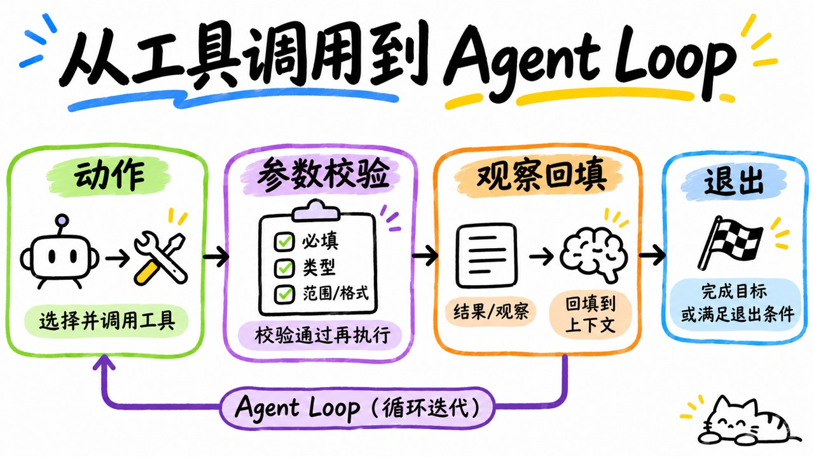

> **生成工具**：Codex\
> **生成模型**：gpt-6.2-sol

退款 CSV 的数据行是 `4`、`NA`、`6`。用户说「统计有效条数和均值，生成报告，确认后归档」。模型先提出读表，程序计算后把两项结果交回模型，模型再决定如何答复。把这几个环节反复接起来，就有了 Agent Loop（智能体循环）。

## 1. 每轮有三个交接点

| 环节 | 本次输入与输出 |
| --- | --- |
| 模型决策 | 收到用户任务和工具说明，提出 `csv_stats(column="refund")`，调用 ID 为 `c-1` |
| 工具执行 | 运行时验证工具、列名、调用 ID 和授权，计算 `{"count":2,"mean":"5"}` |
| 观察回填 | Observation（工具执行结果）带 `c-1` 回到下一轮，模型提出结束报告 |

均值以字符串传递是本例的十进制数表示，避免在 JSON 里隐式丢失精度。模型可以选择工具或报告结果。运行时决定请求是否合规，并把真实执行状态留在持久化记录。用户未确认时，报告可展示，归档调用被拒绝。 [Anthropic 的 Agent 架构](https://www.anthropic.com/research/building-effective-agents)

```text
模型动作 → 校验参数与授权 → 执行工具 → 按调用 ID 回填结果
        → 下一轮，或进入等待确认、澄清、失败、取消等状态
```

## 2. 明确哪些情况让循环退出

对这份表，读完后收到 `final` 会进入 `awaiting_approval`（等待审批）。若没有工具结果就给最终结论，程序退出为 `failed`。输入缺失时可以进入 `needs_input`。取消先于下一次工具执行检查。每轮开始前检查步骤上限和剩余预算，两者都可独立阻止继续消耗。

可用脚本模型按顺序吐出固定动作，验收运行时的判定和工具配对。实际生产预算可拆为模型计费 Token、工具次数与总时限。本例每轮扣一单位，只验证预算生效的位置。

```bash
python3 experiments/agent-runtime/runtime.py --out /tmp/agent-runtime.json
```

固定脚本覆盖正常报告、澄清、无证据最终答案、非法列名、越过审批、重复调用 ID、取消、步数限制和预算限制。报告通过检查后仍停在等待审批。下一节把这一轮实际交给模型的上下文做成可回放快照。 [运行脚本](experiments/agent-runtime/runtime.py) · [事件与验收](experiments/agent-runtime/runtime-results.json)

[返回 LLM 与 Agent 学习路线图](https://blog.lacknb.cn/articles/2026/11/19/1795058329577.html)
