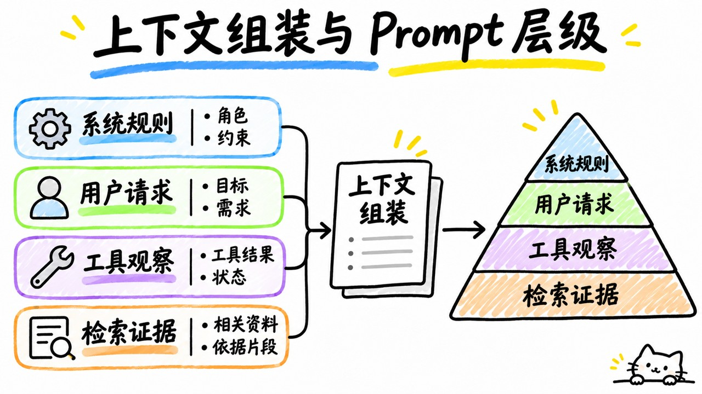

> **生成工具**：Codex\
> **生成模型**：gpt-6.2-sol

用户要求统计退款条数和均值。CSV 里可能还有备注。运行时需要把备注当作被分析的数据，将审批规则交给可信配置，并把统计结果正确附到这次调用上。Prompt（模型输入）里的角色是适配器传给模型的一种结构，工具调用授权在程序里还要单独判断。

## 1. 组装一轮实际的上下文

下面是离线快照 `report` 的精简形式。工具描述通常随请求携带为独立 `tools` 字段。这个快照记录执行中消息，实际发给某个供应商时，用其协议序列化对象。

```json
[
    {"role":"system","content":"归档前必须确认当前报告摘要。"},
    {"role":"user","content":"统计退款 CSV 的有效数量和均值。"},
    {"role":"assistant","tool_calls":[{"id":"csv-1","name":"csv_stats","arguments":{"column":"refund"}}]},
    {"role":"tool","tool_call_id":"csv-1","content":{"source":"refund.csv","report":{"count":2,"mean":"5"}}}
]
```

系统消息给长期约束。用户消息给当前意图。助手调用记录发起了哪次查询。工具观察提供统计数据和来源，`tool_call_id` 把观察与动作配对。检索到的文档片段也应携带来源和访问范围，置于明确的数据边界。不同模型接口可能要求内容为字符串，或者把工具观察编码成另一类输入项。适配层需要维护角色、配对和字段语义。 [上下文快照](experiments/agent-runtime/context-results.json)

## 2. 允许看见的信息和允许做的动作分别判断

工具观察可来自用户上传的文件、远端资源或数据库。即使正文出现像指令的句子，它仍只是内容。只允许与当前任务匹配的列、数据集和工具。若模型提出归档，也要去可信状态取审批，并比较报告版本与摘要。消息排列顺序有助模型理解，归档逻辑的硬边界由程序保证。离线验收里，模型直接提出未审批归档得到失败，数据库没有写入这一动作。

```bash
python3 experiments/agent-runtime/context_lab.py --out /tmp/agent-context.json
python3 experiments/agent-runtime/runtime.py --out /tmp/agent-runtime.json
```

[组装与回放代码](experiments/agent-runtime/context_lab.py) · [审批拒绝记录](experiments/agent-runtime/runtime-results.json)

[返回 LLM 与 Agent 学习路线图](https://blog.lacknb.cn/articles/2026/11/19/1795058329577.html)
