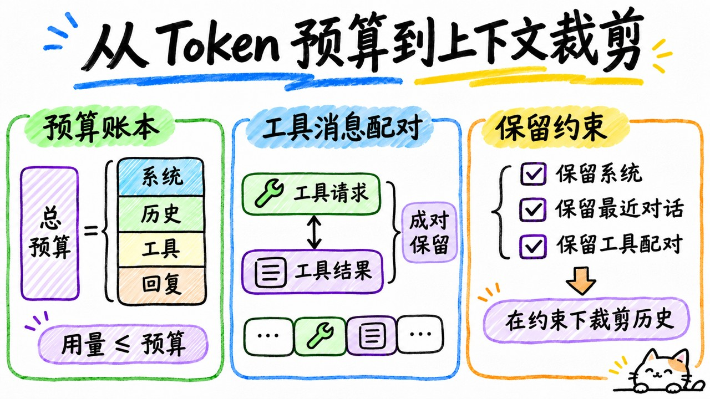

> **生成工具**：Codex\
> **生成模型**：gpt-6.2-sol

退款任务开始前，用户和助手查过天气。现在只有退款统计需要继续，多余历史占走窗口。上下文裁剪是在模型收到请求前删去特定输入。它应优先保留执行仍依赖的事实、约束和结构。

## 1. 先算可以交给历史多少空间

```text
窗口 120 - 输出预留 30 - 安全余量 10 = 可用输入 80
必需内容 = 系统约束 20 + 当前目标 18 + 工具定义 14 = 52
可选上下文剩余 = 80 - 52 = 28
```

单位是教学用的 Token 成本。真实接口需要用对应 Tokenizer（分词器）、模板和工具 Schema（参数结构）计数，还要为自动加入的格式或并行工具结果留余量。本次固定成本用来验证选择逻辑。

| 可选组 | 预算成本 | 取舍 |
| --- | ---: | --- |
| 旧天气问答 | 21 | 删除 |
| 统计工具调用与观察 | 18 | 成组保留 |
| 本轮小预览 | 10 | 保留 |

可选组原来共 49，裁掉 21 后正好剩 28。删除一组后仍要检查供应商协议是否要求先有与工具结果对应的调用。若只留下 tool 消息，模型可能无法识别它来自哪次动作，接口也可能拒绝请求。

## 2. 把应该保持的行为做成回放断言

固定输入运行前后都从相同统计证据得到 `count=2, mean=5`。将「审批规则仍在」「工具调用配对未拆」「业务报告结果一致」分开测试。若必需部分已经超过预算，先外置大产物或返回需要缩小范围的状态，不按相反优先级硬截。实际负载还要监测裁剪比例和缺证据失败类型。

```bash
python3 experiments/agent-runtime/context_lab.py --out /tmp/agent-context.json
```

[固定预算与结果](experiments/agent-runtime/context-results.json) · [上下文工程参考](https://www.anthropic.com/research/effective-context-engineering-for-ai-agents)

[返回 LLM 与 Agent 学习路线图](https://blog.lacknb.cn/articles/2026/11/19/1795058329577.html)
