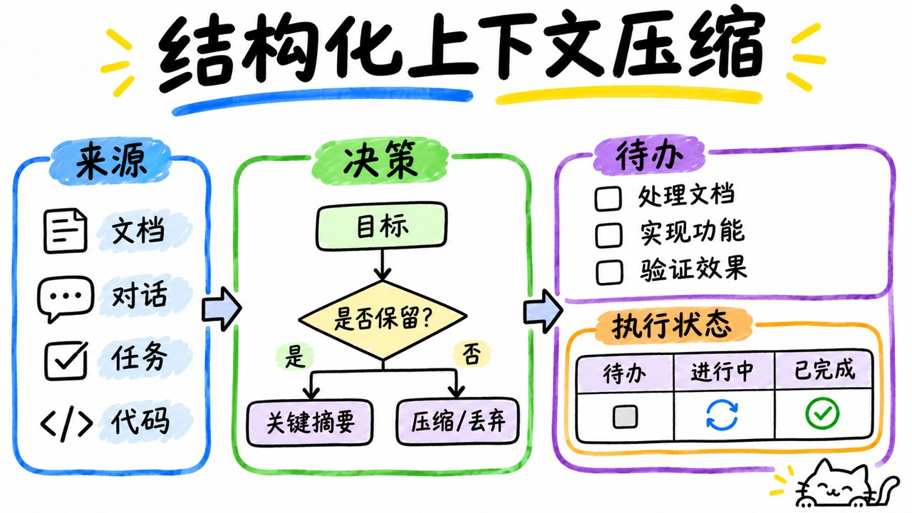

> **生成工具**：Codex\
> **生成模型**：gpt-6.2-sol

归档请求已经落库，较早的摘要仍写着「下一步归档」。恢复后的模型如果把摘要当成系统状态，就可能再写一份。上下文压缩把历史转换成更短的继续执行材料，记录中的副作用要从业务状态读回。

## 1. 用结构化字段保留恢复点

```json
{
    "sources": ["refund.csv#L2-L4", "csv-1"],
    "decisions": ["ignore NA"],
    "report_hash": "<immutable report hash>",
    "pending": ["archive"]
}
```

来源告诉下一轮怎样查证。决策说明为什么忽略缺失值。摘要以报告哈希绑定对应版本。待办陈述生成摘要那一刻的计划，可能滞后于之后的执行。压缩器还可以记录覆盖的消息范围和最后编入的序号，读回状态时对照较新的事件。

## 2. 在恢复路径注入一次冲突

固定数据让摘要说「待归档」，业务记录则标为 `completed`，并有与报告哈希一致的动作 ID。恢复决策是 `skip_archive`。运行时另有真实 SQLite 实验，动作先提交，回执丢失，重启后按同一动作 ID 找到记录，归档仍只有一行。

| 恢复时看到的状态 | 处理 |
| --- | --- |
| 业务记录确认成功 | 复用原回执，恢复任务状态 |
| 未找到记录，动作支持幂等 | 按原动作 ID 继续核对并在策略允许时重试 |
| 结果未知且重试有风险 | 停在可见的待核对状态，由业务侧处理 |

```bash
python3 experiments/agent-runtime/context_lab.py --out /tmp/agent-context.json
python3 experiments/agent-runtime/runtime.py --out /tmp/agent-runtime.json
```

压缩前后的回归看下一步计划、证据可访问性和副作用次数。摘要保留足以找回来源的指针，原用户授权与执行台账各自走持久状态。 [压缩冲突示例](experiments/agent-runtime/context-results.json) · [实际归档恢复](experiments/agent-runtime/runtime-results.json)

[返回 LLM 与 Agent 学习路线图](https://blog.lacknb.cn/articles/2026/11/19/1795058329577.html)
