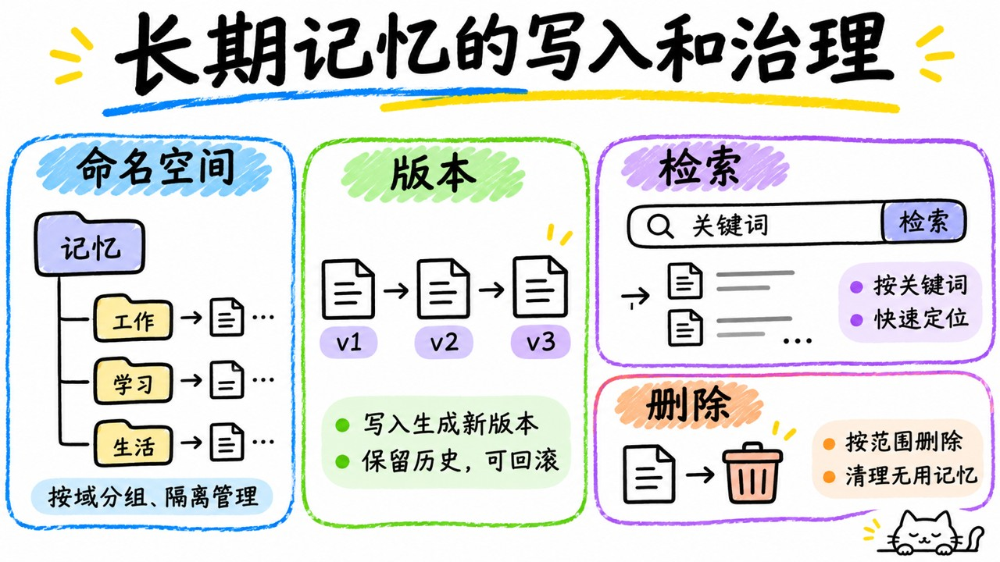

> **生成工具**：Codex\
> **生成模型**：gpt-6.2-sol

同一个用户先说「退款表金额保留两位小数」，之后明确改成一位。新会话应该看到新偏好。另一团队碰巧有同名用户，也可能选择显示百分比。长期记忆让相关偏好跨会话可用，同时要有可核对的写入来源、更新与删除路径。

## 1. 从明确意图写入权威记录

记忆主键用 `(tenant, user, preference_key)`，同时记录值、来源、版本与删除状态。实验让显式用户偏好写入第 1 版，随后用版本条件更新到第 2 版。模型凭推测提出「这个用户大概喜欢另一种格式」时拒绝写入。真实系统可进一步定义默认保留期、修改权限和可审计的来源。

检索结果先按当前身份隔离。索引可以返回旧版本候选，运行时还要读取权威记录并匹配版本，删除状态也在这一层判断。记忆可影响展示格式，用户在当前消息给出新要求时按当前意图处理。

## 2. 用一个有残留索引的实验验证删除

| 步骤 | 结果 |
| --- | --- |
| 用户明确改成一位小数 | 本租户只返回第 2 版 |
| 同名用户从另一租户查询 | 得到自己团队的百分比偏好 |
| 仍拿旧版本条件再次写入 | 更新失败 |
| 删除本租户偏好 | 返回空，索引里仍有三条历史候选 |

三条历史候选含两个作用域中的不同版本。实验的最终读取能阻止旧值越权返回。真实数据的删除还要覆盖全文、向量索引、备份和衍生材料的生命周期。应用层立刻过滤与存储后台的物理删除各自验收。

```bash
python3 experiments/agent-runtime/context_lab.py --out /tmp/agent-context.json
```

[隔离和删除结果](experiments/agent-runtime/context-results.json) · [记忆结构参考](https://docs.langchain.com/oss/python/concepts/memory)

[返回 LLM 与 Agent 学习路线图](https://blog.lacknb.cn/articles/2026/11/19/1795058329577.html)
