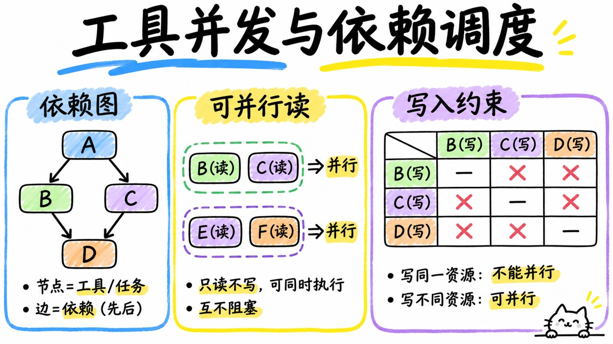

> **生成工具**：Codex\
> **生成模型**：gpt-6.2-sol

查退款金额的统计和查字段字典可以同时做。统计负责给出两条和均值 5，字典解释为什么排除 `NA`。报告要等这两项都回填，归档还得等用户确认当前版本。

```text
统计 ───┐
        ├→ 组装报告 → 用户确认 → 归档
字典 ───┘
```

## 1. 先把依赖写出来

依赖图里的边表示后继必须等前驱。两个工具即使互不依赖，也要检查它们是否争抢同一资源或会修改同一份状态。读同一版本的不可变数据可并发。写同一报告的两个动作要用顺序执行或明确的合并协议。并发配额可按全局、租户和下游服务分层控制。

## 2. 回包可乱序，组装靠调用标识

异步脚本用 `asyncio.Semaphore(2)` 限制两个同时进入的任务，用事件精确控制返回顺序。统计先启动，字典后启动却先结束。完成顺序是「字典 → 统计 → 组装」，最终报告仍携带数字和缺失值含义。对真实响应按调用 ID、依赖节点名或任务 ID 归并，不靠位置猜测。

另一个场景一个读任务成功，一个因列名错误失败，两个结果分别保留。局部超时用 `asyncio.wait_for`，被取消协程执行了自己的清理段。下游调用如果还在其它进程运行，需要其自身支持取消。归档节点始终由业务审批约束，两个并行读任务的成功只表示满足了生成报告的依赖。

```bash
python3 experiments/agent-runtime/orchestration.py --out /tmp/agent-orchestration.json
```

[并发和取消代码](experiments/agent-runtime/orchestration.py) · [事件顺序](experiments/agent-runtime/orchestration-results.json)

[返回 LLM 与 Agent 学习路线图](https://blog.lacknb.cn/articles/2026/11/19/1795058329577.html)
