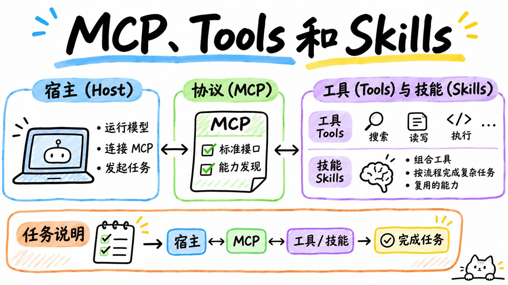

> **生成工具**：Codex\
> **生成模型**：gpt-6.2-sol

退款助手想知道怎样算均值。它要读规则文件，还要让程序查询正确的列。规则文档提供步骤，统计工具能执行动作，宿主通过协议联系工具服务器。这三个抽象对应 Tool、MCP 和 Skill。

| 名称 | 在退款案例里的角色 |
| --- | --- |
| Tool（工具） | `csv_stats` 接收列名，程序计算条数和均值 |
| MCP（Model Context Protocol，模型上下文协议） | Host 持有 Client，Client 通过 MCP 发现工具、读资源和发起调用 |
| Agent Skill（智能体技能） | `SKILL.md` 告诉助手哪些任务该用这套报告口径，并在需要时读参考说明 |

## 1. 沿一轮动作走过去

宿主从 Skill 的任务说明了解如何处理缺失和零值。模型提议查询 `refund`。本例的宿主先做授权与参数确认，再让 MCP Client 给 Server 发 `tools/call`。Server 返回 `{"source":"refund-fixture","count":2,"mean":"5"}`。宿主整理成有来源的观察，供下一轮写报告。资源 `report://refund/dictionary` 可以另行读取，提供列和缺失值说明。工具也可以在宿主进程里直接实现，MCP 用于让两个组件按约定交接。

## 2. 执行决定归各层负责

选择使用哪个工具可以由模型参与，连接和工具授权由宿主执行，Server 还需按自己的数据与调用范围校验。Skill 里的文字说明不会自动获得文件权限或归档权。MCP 服务器也可独立维护运行时约束，防止同一批工具被不同宿主使用时扩大范围。

```bash
python -m pip install mcp==1.27.0
python experiments/agent-runtime/mcp_lab.py --out /tmp/mcp-report.json
```

[协议调用与结果](experiments/agent-runtime/mcp-results.json) · [退款 Skill](experiments/agent-runtime/skills/refund-report-fixture/SKILL.md) · [MCP 架构](https://modelcontextprotocol.io/docs/learn/architecture) · [Agent Skills 规范](https://agentskills.io/specification)

[返回 LLM 与 Agent 学习路线图](https://blog.lacknb.cn/articles/2026/11/19/1795058329577.html)
