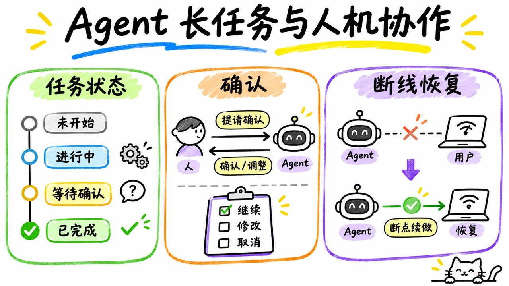

> **生成工具**：Codex\
> **生成模型**：gpt-6.2-sol

用户上传退款 CSV 后离开。报告统计已生成，用户回到网页才确认下一步。HTTP 连接可以断开，任务还会停在清晰的状态。核心流程是一张可持久化的状态机，而不是一条需要一直保持的聊天连接。

```text
ready → awaiting_approval → approved → completed
          ↘ cancelled        ↘ 等待回执核对
```

## 1. 报告、批准和归档分别落记录

报告完成时存摘要和值，再发含版本的等待状态。批准请求带任务 ID、用户身份和报告哈希。系统核对它对应当前候选，再持久化批准。归档使用由租户、任务和报告版本决定的业务动作 ID。工作进程（Worker）重启后查状态、报告与回执，就能继续或停止。

页面重连时可先读状态快照，再从最后收到的事件序号接着展示。显示事件和执行允许分开。重复出现一条「批准」界面事件，不能让后端再次发起归档。副作用在运行日志中的时间和在业务存储中的终态也可能短暂不同，恢复时按回执核对。

## 2. 验证用户回来时看到旧版会怎样

脚本先在 `awaiting_approval` 关闭 SQLite，再打开同一任务。旧报告哈希被拒，当前哈希通过。归档提交后故意丢掉回执。重启读到 `approved`，按动作 ID 查到写入后恢复为 `completed`，归档行数仍是 1。这个用例验证的是数据库状态恢复和重复写防护。真实 Worker 停止与恢复另在 Temporal 实验核对。

```bash
python3 experiments/agent-runtime/runtime.py --out /tmp/agent-runtime.json
```

增加事件投递时可让状态和待发事件同事务提交，消费者按稳定 ID 去重。遇到用户取消，尚未执行的步骤可以停止，已提交的副作用按业务回执确认并按规则处理。 [长任务 Harness 参考](https://www.anthropic.com/research/effective-harnesses-for-long-running-agents) · [持久化恢复记录](experiments/agent-runtime/runtime-results.json)

[返回 LLM 与 Agent 学习路线图](https://blog.lacknb.cn/articles/2026/11/19/1795058329577.html)
