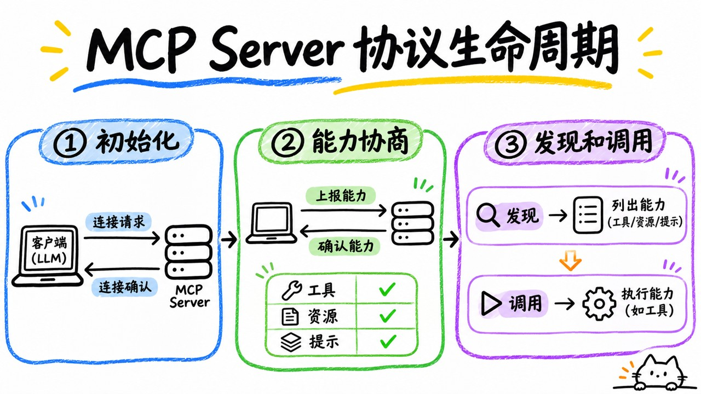

> **生成工具**：Codex\
> **生成模型**：gpt-6.2-sol

应用要向另一进程查询退款统计。应用是 Host（宿主），每个连接有一个 Client（客户端），另一端是提供能力的 Server（服务端）。本文固定 MCP（Model Context Protocol）修订 `2025-11-25`，使用 JSON-RPC 2.0，即以方法、参数与 ID 表示的调用消息格式。

## 1. 首次连接先握手

| 顺序 | 方法 | 发生什么 |
| --- | --- | --- |
| 1 | `initialize` | Client 送协议版本、身份信息与声明的能力 |
| 2 | 初始化结果 | Server 返回协商版本、自身能力与服务信息 |
| 3 | `notifications/initialized` | Client 告知握手已完成，此通知无请求 ID |
| 4 | `tools/list` | 查询统计工具名称和输入 Schema |
| 5 | `tools/call` | 发 `csv_stats` 和 `column=refund`，按同一个 ID 读回结果 |

实验消息中，`id=1` 是初始化，`id=2` 查列表，`id=3` 调工具。返回的结构化统计为两条、均值 5。Resources（资源）给客户端可读的数据或文档，例如数据字典。Prompts（提示模板）提供用户或客户端可请求的消息模板。支持哪些能力要看初始化结果。 [生命周期规范](https://modelcontextprotocol.io/specification/2025-11-25/basic/lifecycle) · [实际收发记录](experiments/agent-runtime/mcp-results.json)

## 2. 传输换掉，方法的含义仍可对照

stdio 是用子进程的标准输入和标准输出传送消息。协议消息使用换行分隔，日志写 stderr（标准错误输出），避免破坏协议流。Streamable HTTP 是远程连接用的 HTTP 传输，客户端对统一端点提交 JSON-RPC，响应可按请求与实现返回 JSON 或 SSE（服务器发送事件）。会话 ID、协议版本头和授权按本修订要求处理。远程端要单独安排身份认证、请求来源和资源作用域。HTTP 服务行为在这一篇按规范解释，实际收发记录来自 stdio。 [传输规范](https://modelcontextprotocol.io/specification/2025-11-25/basic/transports)

```bash
python -m pip install mcp==1.27.0
python experiments/agent-runtime/mcp_lab.py --out /tmp/mcp-report.json
```

[官方 Python SDK](https://github.com/modelcontextprotocol/python-sdk/tree/v1.27.0) · [服务端、原始客户端和 SDK 客户端](experiments/agent-runtime/mcp_lab.py)

[返回 LLM 与 Agent 学习路线图](https://blog.lacknb.cn/articles/2026/11/19/1795058329577.html)
