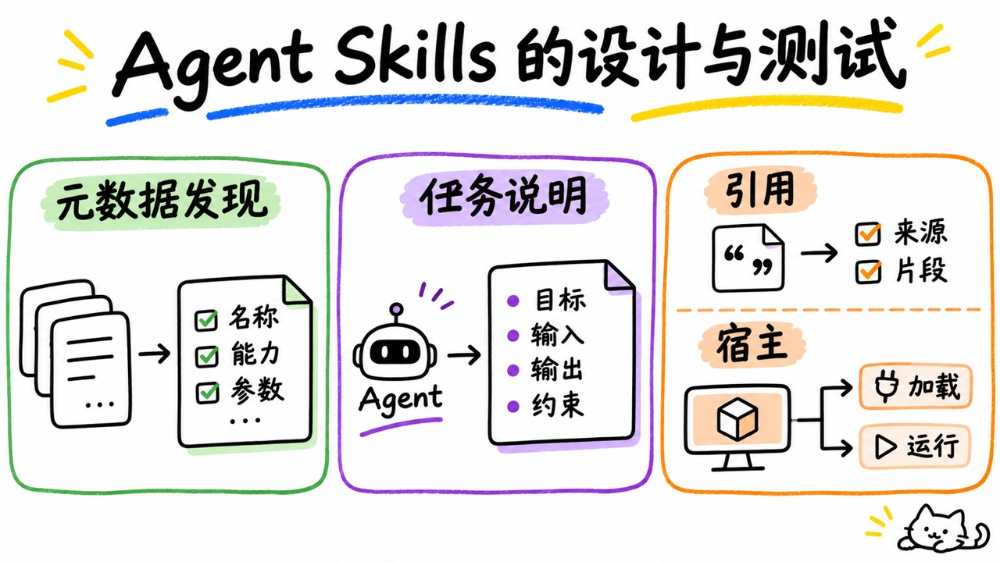

> **生成工具**：Codex\
> **生成模型**：gpt-6.2-sol

报表经常要遵守同一口径。有效金额包含零，缺失值不参加均值，展示结果还得留下来源。可以用一个 Agent Skill（智能体技能）把这些步骤写成小包，让宿主需要时取用。

## 1. 先写什么时候用，再写怎么做

`refund-report-fixture/SKILL.md` 的 YAML 元数据包含名称、描述和版本。描述明确列出退款 CSV、有效条数、均值和审批前报告。正文只交代四步，并把详细算例放在 `references/report-contract.md`。这样宿主先发现少量元数据，命中后读正文，再按需读参考。在规范里，`name` 和 `description` 是必需字段，`metadata.version` 是本项目自选的约定。 [Agent Skills 规范](https://agentskills.io/specification) · [Codex 技能文档](https://learn.chatgpt.com/docs/build-skills)

## 2. 把验证拆成发现、选择、执行三层

| 验收 | 本次覆盖 |
| --- | --- |
| 宿主发现 | Pi v0.70.0 的 `loadSkillsFromDir` 返回名称和描述，Codex CLI 0.167.0 通过 app-server 的 `skills/list` 报告已启用的仓库技能 |
| 自动选择 | 要用真实模型分别跑退款统计、相近反例和显式点名，本次只检查宿主发现 |
| 业务与权限 | `4, NA, 6` 计算为两条和均值 5，未审批归档在运行时被拒绝 |

实验把同一个包复制到独立的临时 Git 项目。Pi 使用指定目录加载，Codex 读取仓库 `.agents/skills`。没有发送模型调用，也没有把样例安装进全局配置。正式上线时选一个固定版本，避免改规则、提示和期望结果后无法定位回归。技能说明可以提示核验和待审批，实际许可始终由工具与宿主核对。 [Pi 固定版技能加载器](https://github.com/earendil-works/pi/blob/v0.70.0/packages/coding-agent/src/core/skills.ts) · [Codex App Server](https://learn.chatgpt.com/docs/app-server) · [两宿主发现输出](experiments/agent-runtime/skills-results.json)

样例规则可直接阅读。脚本需要本机已有 Codex CLI、Pi v0.70.0 源码，以及在该检出祖先目录安装的 `tsx`、`ignore` 与 `yaml`。 [技能正文](experiments/agent-runtime/skills/refund-report-fixture/SKILL.md) · [发现脚本](experiments/agent-runtime/skills_lab.py) · [运行时权限验证](experiments/agent-runtime/runtime-results.json)

[返回 LLM 与 Agent 学习路线图](https://blog.lacknb.cn/articles/2026/11/19/1795058329577.html)
