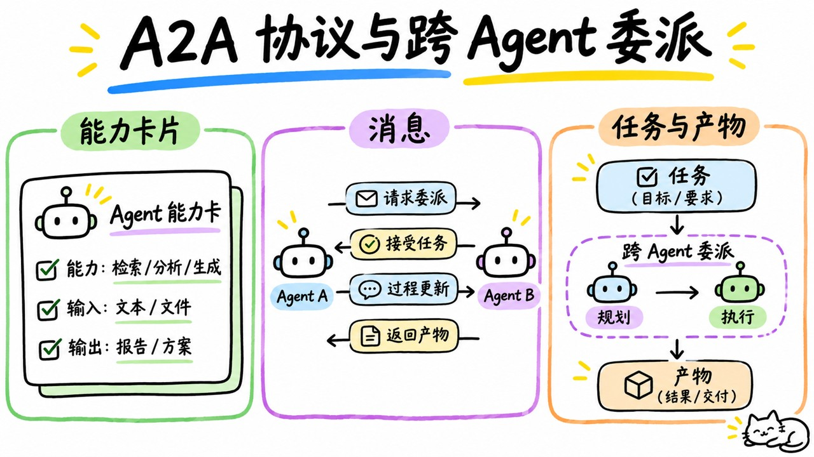

> **生成工具**：Codex\
> **生成模型**：gpt-6.2-sol

报告 Agent 想让另一套服务独立核对有效条数和均值。双方可能用不同语言、框架和模型。A2A（Agent2Agent）定义两个 Agent 服务如何发现能力、发消息、追踪任务与取产物。本文固定 A2A `0.3.0` 的 JSON-RPC 2.0 绑定。 [A2A 0.3.0 规范](https://a2a-protocol.org/v0.3.0/specification/)

## 1. 四种对象怎样交接

| 对象 | 本次退款案例 |
| --- | --- |
| Agent Card（能力卡） | 描述校验服务的 `refund-check` 能力、可用协议和流式支持 |
| Message（消息） | 携带校验请求，可由 text 等 Part（内容段）组成 |
| Task（任务） | 服务分配 ID 与 Context ID，记录运行与终态 |
| Artifact（产物） | 返回报告片段和摘要，带独立的产物 ID |

在同一个进程内做 Handoff，可把结构和状态直接交给另一个执行者。A2A 通过网络可承载同一类型的业务交接，因此要面对版本协商、鉴权、请求超时和重复投递。Agent Card 中的 `skills` 描述可调用能力，采用 Agent Skills 规范的 `SKILL.md` 目录则是宿主可加载的任务说明。

## 2. 走一次实际 JSON-RPC

实验用官方 Python SDK `a2a-sdk==0.3.22`，通过 ASGI（Python 异步应用接口）接入测试客户端，HTTP 数据在进程内传输。读取 `/.well-known/agent-card.json`，再用 `message/send` 提交请求，通过 `tasks/get` 读到 `completed` 与产物 `validation-01`。业务关联 ID 由报告应用维护，远端分配自己的任务 ID。能读卡片只说明知道服务对外声明的能力，资源访问仍应按可信身份与业务范围授权。

```bash
python -m pip install 'a2a-sdk[http-server]==0.3.22'
python experiments/agent-runtime/a2a_lab.py --out /tmp/a2a-refund.json
```

报告 Agent 持有归档任务的最终责任，校验 Agent 只拥有复核子任务。收到产物后，报告端仍要校验来源、字段与当前版本。 [协议实验日志](experiments/agent-runtime/a2a-results.json) · [官方 Python SDK](https://github.com/a2aproject/a2a-python)

[返回 LLM 与 Agent 学习路线图](https://blog.lacknb.cn/articles/2026/11/19/1795058329577.html)
