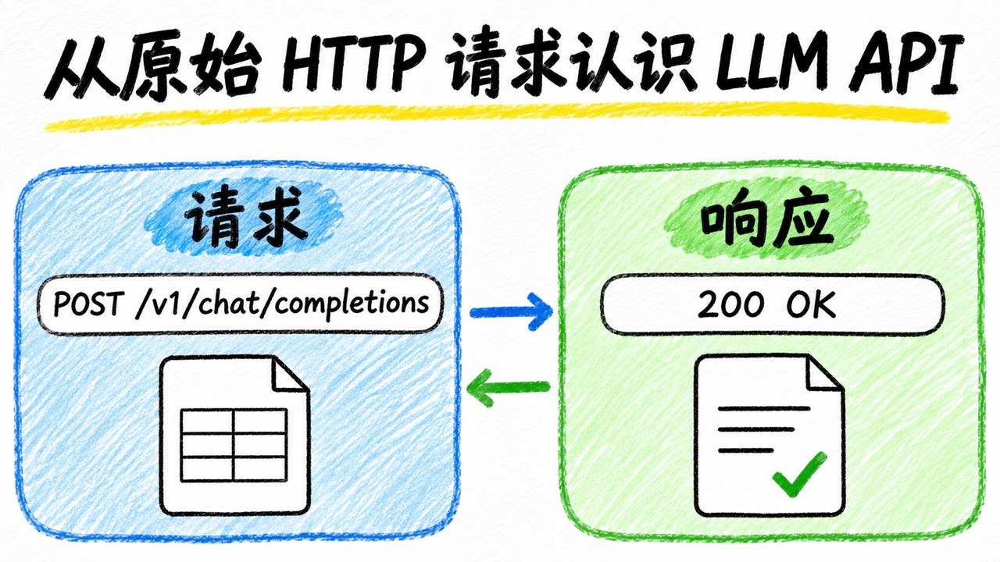
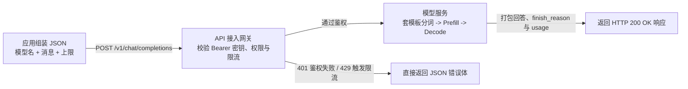

在第一专题里，我们看清了模型内部如何分词、算注意力并吐出字。可真正在公司写业务代码时，模型通常跑在远方的 GPU 服务器上——你的程序怎么把三行退款数据寄给它，再把报告取回来？

假设收到三条退款记录，业务规则就一句话：**空金额要排除，金额为 0 的记录要保留**。写成 CSV（Comma-Separated Values，逗号分隔值）长这样：

```csv
id,amount
1,10
2,
3,0
```

先自己口算一遍标准答案：第 2 行缺失，第 1 行 `10` 和第 3 行 `0` 参与计算——有效金额 **2** 条，缺失 **1** 条，均值 **(10 + 0) ÷ 2 = 5**。如果把空行误当成 `0`，分母就会变成 `3`，均值错算成 `3.33`。等会儿拿这三个数去验收模型回复！

> **先用大白话讲明白**：调大语言模型 API（应用程序编程接口），本质上就像**给远方的算账大师寄一封格式严格的挂号信（HTTP 请求）**：
> - **信封（请求头 Headers）**：写明收件主机（`Host`）、你的身份通行证（`Authorization: Bearer 密钥`）、以及里面信纸用的语言（`Content-Type: application/json`）。
> - **信纸（请求体 JSON Body）**：写清找哪位大师（`model`）、你要问的任务和数据（`messages`）、让不让它多打草稿（`reasoning_effort`）以及最多写几个字（`max_completion_tokens`）。
> - **回信（HTTP 响应）**：大师写好报告装回信封寄给你，信封右上角还顺便贴了**查件流水号**（`x-request-id`）、**今天剩余额度**（`x-ratelimit-*`）以及**停笔原因**（`finish_reason`）。



这一篇先用最原始的 `curl` 和纯 Python 标准库，不套任何花哨的官方 SDK，让你彻底看穿请求包里的每一行字段。

## 1. 先拆开一封原始 HTTP 请求信封

下面是发给 OpenAI Chat Completions 接口的原始 `HTTP/1.1` 请求（实际用 `curl` 发送时，它还会自动补上记录正文长度的 `Content-Length` 等传输头）：

```http
POST /v1/chat/completions HTTP/1.1
Host: api.openai.com
Authorization: Bearer <API_KEY>
Content-Type: application/json

{
  "model": "gpt-6-luna",
  "messages": [
    {
      "role": "user",
      "content": "请按退款金额生成一句报告，忽略空值并保留 0。报告包含有效金额条数、缺失条数和均值。\nid,amount\n1,10\n2,\n3,0"
    }
  ],
  "reasoning_effort": "none",
  "max_completion_tokens": 128,
  "stream": false
}
```

空行上面是**请求头**，空行下面是 **JSON 请求体**。逐行读一遍各自的分工：

| 位置 | 大白话解释它在这次请求里的作用 |
| --- | --- |
| `POST /v1/chat/completions HTTP/1.1` | **请求行**：用 `POST` 方法把包裹递到 `/v1/chat/completions` 这个接口路径。 |
| `Host: api.openai.com` | **收件地址**：真实线上永远走 `https://`（由 **TLS** 传输层安全协议加密防窃听）。 |
| `Authorization: Bearer <API_KEY>` | **门卫通行证**：`Bearer` 意思是「持票即有效」。服务端靠密钥识别你是哪个项目、扣谁的钱。**千万别把真密钥写死在代码仓库或截图里**，一律从环境变量读取。 |
| `Content-Type: application/json` | **信纸格式声明**：告诉服务端「下面正文是 JSON，请按 JSON 解析」。 |
| `model` | **指定模型代号**：这里挑支持该接口的 `gpt-6-luna`，你的项目还得有它的访问权限。 |
| `messages` | **对话消息列表**：目前只有一条 `user` 消息。JSON 里的 `\n` 解码后恢复成换行，模型依然能看清 CSV 的行边界。 |
| `reasoning_effort` 与 `max_completion_tokens` | 前者设 `none` 表示简单统计不用额外思考；后者把输出上限卡在 `128` Token（注意同时含可见文本和后台推理 Token）。 |
| `stream: false` | **整包一次拿回**：先别逐字推流，等模型写完全部内容打包成一个完整 JSON 一起返回（流式留在 [API-05](api-05-sse-streaming-tools.md) 细讲）。 |

[OpenAI API 概览](https://developers.openai.com/api/reference/overview) · [Chat Completions 接口参考](https://developers.openai.com/api/reference/resources/chat/subresources/completions/methods/create) · [GPT-6 Luna 说明](https://developers.openai.com/api/docs/models/gpt-6-luna)

## 2. 从回信里看懂答案、停笔原因和 Token 账单

下面是本机教学服务返回的完整 HTTP 响应样例（报告与计数均已排版）：

```http
HTTP/1.1 200 OK
Content-Type: application/json; charset=utf-8
x-request-id: req_demo_ok
x-ratelimit-remaining-requests: 59

{
  "id": "chatcmpl-demo",
  "object": "chat.completion",
  "created": 0,
  "model": "gpt-6-luna",
  "choices": [
    {
      "index": 0,
      "message": {
        "role": "assistant",
        "content": "有效金额 2 条，缺失 1 条，均值为 5。"
      },
      "logprobs": null,
      "finish_reason": "stop"
    }
  ],
  "usage": {
    "prompt_tokens": 72,
    "completion_tokens": 19,
    "total_tokens": 91
  }
}
```

看回信必须盯住四个关键地方，少查一个都容易上线踩坑：
1. **HTTP 状态码 `200 OK` 只说明通信成功，不代表算术算对了！** 就算模型把均值错写成 `3.33`，HTTP 状态照样是 `200 OK`。协议成功和业务正确必须分开验。
2. **排查身份证 `x-request-id` 与限流头**：`x-request-id` 是这次网关请求的唯一流水号（响应体里的 `id` 标识这次生成结果），出 bug 找客服或查日志全靠它；`x-ratelimit-remaining-requests` 告诉你当前时间窗口还能发几条请求。
3. **正文与停笔原因 `finish_reason`**：回复放在 `choices[0].message.content`。`finish_reason: "stop"` 意味着模型觉得自己说完了自然收笔；如果看到 `"length"`，说明刚才的 `128` 预算被耗光了，报告可能正写到一半就被一刀砍断！
4. **账单 `usage`**：`prompt_tokens`（72）是输入总词元，`completion_tokens`（19）是输出词元，合计 `91`。算成本得查该模型输入输出各自的 Token 单价（以及是否含缓存或推理 Token 明细），别拿字节数或汉字数拍脑袋算。

## 3. 用 curl 发一次，再在本机模拟 200 / 401 / 429

新建一个空目录，执行下面命令保存 `request.json` 并定义一个方便重复观察响应头、响应体和 HTTP 状态码的函数 `call_api`（兼容 Bash 和 Zsh）：

```bash
cat > request.json <<'JSON'
{
  "model": "gpt-6-luna",
  "messages": [
    {
      "role": "user",
      "content": "请按退款金额生成一句报告，忽略空值并保留 0。报告包含有效金额条数、缺失条数和均值。\nid,amount\n1,10\n2,\n3,0"
    }
  ],
  "reasoning_effort": "none",
  "max_completion_tokens": 128,
  "stream": false
}
JSON

call_api() {
  local base_url="$1"
  local api_key="$2"
  shift 2

  curl --silent --show-error --http1.1 --max-time 30 \
    --dump-header response.headers --output response.json \
    --write-out 'HTTP %{http_code}\n' \
    --header "Authorization: Bearer ${api_key}" \
    --header 'Content-Type: application/json' \
    --data-binary @request.json \
    "$@" "${base_url}/v1/chat/completions"
}
```

> **容易踩的坑**：注意我们故意没有加 `curl -f`（`--fail`）。如果加了 `-f`，服务器返回 `401` 或 `429` 时 `curl` 会直接吞掉 JSON 错误详情，让你看不到 `error.code` 和 `Retry-After`；而不加 `-f` 时，哪怕拿到 `401`，`curl` 的退出码依然是 `0`——所以脚本里**一定要用 `--write-out '%{http_code}'` 检查实际 HTTP 状态码**！

### 路径 A（可选）：直接打真实 OpenAI 接口

如果终端已配置 `OPENAI_API_KEY` 且账号拥有示例模型权限，可以跑一次真实请求（会消耗 API 额度）并查看结果是否算出 **2 条、1 条和 5**：

```bash
call_api https://api.openai.com "${OPENAI_API_KEY:?请先设置 OPENAI_API_KEY}" &&
cat response.headers &&
python3 -m json.tool response.json
```

### 路径 B（零成本必跑）：在本机模拟三种典型响应

把下面代码保存为 `mock_api.py`，在另一个终端运行 `python3 mock_api.py`（仅监听本机 `127.0.0.1:8765`，教学密钥固定为 `demo-key`；`X-Demo-Case` 仅作为本机触发 429 限流的教学开关）：

```python
import json
from http.server import BaseHTTPRequestHandler, HTTPServer


class DemoAPI(BaseHTTPRequestHandler):
    protocol_version = "HTTP/1.1"

    def send_json(self, status, body, headers):
        payload = json.dumps(body, ensure_ascii=False).encode("utf-8")
        self.send_response(status)
        self.send_header("Content-Type", "application/json; charset=utf-8")
        self.send_header("Content-Length", str(len(payload)))
        for name, value in headers.items():
            self.send_header(name, value)
        self.end_headers()
        self.wfile.write(payload)

    def do_POST(self):
        request_body = self.rfile.read(int(self.headers.get("Content-Length", "0")))
        if self.path != "/v1/chat/completions":
            self.send_json(404, {"error": {"message": "Unknown path"}}, {})
            return
        if self.headers.get("Authorization") != "Bearer demo-key":
            error = {"code": "invalid_api_key", "message": "Demo key is invalid"}
            self.send_json(401, {"error": error}, {"x-request-id": "req_demo_auth"})
            return
        if self.headers.get("X-Demo-Case") == "rate-limit":
            error = {"code": "slow_down", "message": "Demo rate limit reached"}
            headers = {"Retry-After": "2", "x-request-id": "req_demo_limit"}
            self.send_json(429, {"error": error}, headers)
            return
        try:
            request = json.loads(request_body)
        except ValueError:
            self.send_json(400, {"error": {"message": "Invalid JSON"}}, {})
            return
        if not isinstance(request, dict) or not isinstance(request.get("model"), str):
            self.send_json(400, {"error": {"message": "Expected a model ID"}}, {})
            return

        answer = {
            "id": "chatcmpl-demo",
            "object": "chat.completion",
            "created": 0,
            "model": request["model"],
            "choices": [{
                "index": 0,
                "message": {
                    "role": "assistant",
                    "content": "有效金额 2 条，缺失 1 条，均值为 5。",
                },
                "logprobs": None,
                "finish_reason": "stop",
            }],
            "usage": {"prompt_tokens": 72, "completion_tokens": 19, "total_tokens": 91},
        }
        headers = {"x-request-id": "req_demo_ok", "x-ratelimit-remaining-requests": "59"}
        self.send_json(200, answer, headers)


with HTTPServer(("127.0.0.1", 8765), DemoAPI) as server:
    print("Listening on http://127.0.0.1:8765", flush=True)
    server.serve_forever()
```

回到第一个终端连续发出三次测试：

```bash
call_api http://127.0.0.1:8765 demo-key
python3 -m json.tool --no-ensure-ascii response.json

call_api http://127.0.0.1:8765 wrong-key
cat response.json
printf '\n'

call_api http://127.0.0.1:8765 demo-key --header 'X-Demo-Case: rate-limit'
cat response.headers
cat response.json
printf '\n'
```

你依次会看到：`200`（正常报告）、`401`（`invalid_api_key`）和 `429`（`slow_down`，且响应头写明 `Retry-After: 2` 要求客户端至少等 2 秒再重发）。实验完毕在服务端终端按 `Ctrl+C` 退出。

## 4. 收到报错先查哪？线上排查速查表

> **想再深入一层？** 遇到接口报错时，先看有没有收到 HTTP 响应：如果有，按状态码大类 + 错误体里的 `error.code` + `x-request-id` 顺藤摸瓜；若中间经过了网关或代理，代理报错甚至可能返回一段 HTML 页面，解析 JSON 前务必先检查 `Content-Type`！

| 现象 / 状态码 | 第一时间查什么？怎么处理？ |
| --- | --- |
| `400 Bad Request` | JSON 语法不对、字段类型错了、或选中的模型压根不支持你传的某个参数（如温度/推理强度）。修好请求再发，重试没用。 |
| `401 Unauthorized` | 密钥没加载进环境变量、`Authorization: Bearer ...` 前缀漏写、或密钥已失效。 |
| `403` / `404` | URL 路径拼错、模型 ID 拼错、或当前项目无权访问该模型（无权限有时也会伪装成 404）。 |
| **`429`（临时限流）** | 发太快撞上 RPM/TPM 限制！优先看响应头 `Retry-After` 等够时间；没有则用「指数退避 + 随机抖动」限次重试。 |
| **`429`（余额耗尽）** | 看 `error.code` 是不是类似 `credit_balance_exhausted`（账户没钱或撞支出封顶）。**原地退避重试一万次也没用**，得去充值或提额。 |
| `500` / `503` | 对面服务临时开小差，保留 `x-request-id` 后有限重试（若带 `Retry-After` 照等）；记住每次重发成功都会重新计费。 |
| 连不上 / 读取超时 | 查 DNS、TLS、代理；尤其注意**读取超时**时，请求可能已经送到服务端跑完了，盲目重试容易导致动作重复执行或双倍扣费。 |

[OpenAI API 错误码文档](https://developers.openai.com/api/docs/guides/error-codes) · [限流与退避指南](https://developers.openai.com/api/docs/guides/rate-limits)

## 下一篇

单轮一问一答跑通了，如果用户在聊天窗口里追问一句「为什么均值是 5？」，服务器会自动记住上一轮的 CSV 和回答吗？下一篇 [API-02《OpenAI Chat Completions 的消息协议》](api-02-chat-completions-messages.md) 拆解多轮对话必须回传哪些消息，并对比漏传历史时的翻车现象。系列入口见 [LLM 与 Agent 学习路线图](llm-agent-learning-roadmap.md)。
