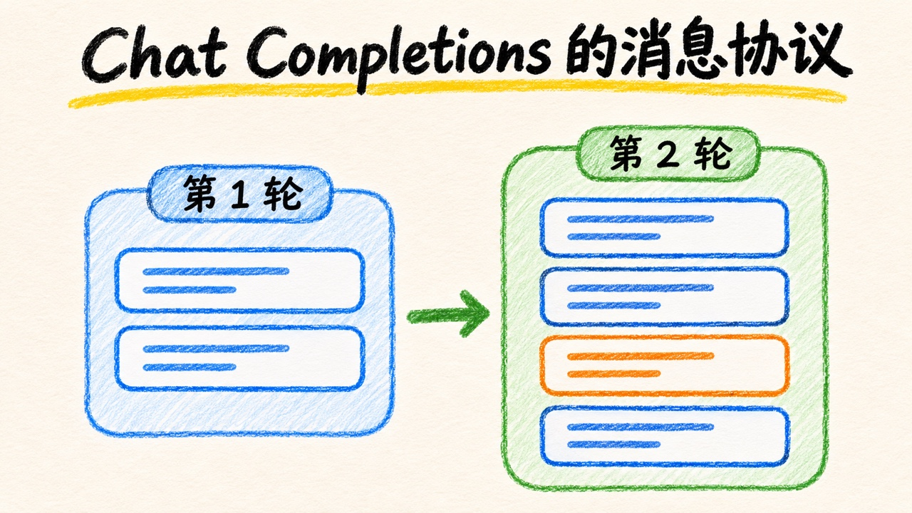

在 [API-01《从原始 HTTP 请求认识 LLM API》](api-01-raw-http-request.md) 里，我们把三行退款 CSV 交给模型，得到了一句报告：「有效金额 2 条，缺失 1 条，均值为 5。」现在用户在同一个聊天窗口里追问：「为什么均值是 5？」

应用要解决的问题是，**第二次发出 `POST /v1/chat/completions` 时，哪几条消息必须一起发？** 这句话提到了 5，但没有说原始金额是什么，也没有说明如何处理空值。要解释这份报告，得能找回参与计算的两条记录：10 和 0。所以分母是 2，计算过程是 **(10 + 0) ÷ 2 = 5**。

本篇沿用上一章的非流式 HTTP 请求。读者需要看过 JSON 的对象和数组，实验只用 Python 3 标准库。

## 1. 第一轮发送两条消息

请求沿用 `gpt-6-luna`。这次把应用长期维护的规则放在 `developer` 消息里，把本轮任务和数据放在 `user` 消息里。两条消息按下面的顺序出现在请求体中：

```json
{
  "model": "gpt-6-luna",
  "reasoning_effort": "none",
  "max_completion_tokens": 128,
  "stream": false,
  "store": false,
  "messages": [
    {
      "role": "developer",
      "content": "你是退款报表助手。忽略空金额，保留 0。"
    },
    {
      "role": "user",
      "content": "请用一句话报告有效金额条数、缺失条数和均值。\nid,amount\n1,10\n2,\n3,0"
    }
  ]
}
```

`messages` 是有序数组。每条文本消息有 `role`（角色）和 `content`（内容）。角色由应用在 JSON 字段中指定，CSV 里的文字始终是这条 `user` 消息的内容。这里用字符串承载纯文本，有些角色和模型也支持把内容写成多个带类型的内容块。下表列出接下来会遇到的角色。

| `role` | 由谁提供 | 在退款案例中的作用 |
| --- | --- | --- |
| `developer` | 接入 API 的应用 | 定义应用级的统计口径。第二轮仍按这条规则处理空值和 0。 |
| `user` | 用户，或由应用代表用户传入 | 提交首轮任务和三行 CSV，或在下一轮提出追问。 |
| `assistant` | 模型生成，应用将被选中的回复写入历史 | 让下一轮知道用户正在引用哪一句报告。 |
| `tool` | 应用执行工具后构造 | 带着对应调用 ID 回传工具结果。API-04 会展开这个过程。 |

参考文档对较新的模型使用 `developer` 表达应用级指令。读旧代码时还会遇到用于类似目的的 `system` 角色，接入时按所选模型的协议填写。 [Chat Completions 请求字段与消息类型](https://developers.openai.com/api/reference/resources/chat/subresources/completions/methods/create#body-parameters) · [GPT-6 Luna 模型说明](https://developers.openai.com/api/docs/models/gpt-6-luna)

从 [F-01《Tokenizer 与 Chat Template》](https://blog.lacknb.cn/articles/2026/11/19/1795068393122.html) 的视角看，消息数组是客户端的接口结构。服务在接收后，按模型所需格式组织输入并编码成 Token。本篇能直接核对的是应用交给服务的角色、内容和顺序。

## 2. 从候选回复中选一条写入历史

HTTP 层返回 `200 OK` 后，应用读取 JSON 响应。下面摘出首轮响应的关键字段，ID 和正文都来自本机教学样例：

```json
{
  "id": "chatcmpl-demo-first",
  "choices": [
    {
      "index": 0,
      "message": {
        "role": "assistant",
        "content": "有效金额 2 条，缺失 1 条，均值为 5。"
      },
      "finish_reason": "stop"
    }
  ]
}
```

`choices` 是这次生成的候选列表。`index: 0` 是候选编号。请求省略了候选数量参数，这个例子取唯一一项。`message` 是应用可以展示的消息，`finish_reason` 表示这一项为何停止生成。对这个只接收正常文本的示例，应用检查结束原因、是否拒答和正文，再从选中的消息提取 `role` 与 `content`。

| `finish_reason` | 这时如何处理 |
| --- | --- |
| `stop` | 自然结束或命中预设停止序列。确认有合适的文本，再按业务验收报告里的条数和均值。 |
| `length` | 达到生成长度上限。把文本标为未完成，等用户重试或调整预算。 |
| `content_filter` | 有内容因过滤被省略。应用按此状态处理结果。 |
| `tool_calls` | 模型提出工具调用。应用需要进入工具处理流程，见 API-04。 |

响应里的 `message.refusal` 还可能携带拒答信息，因此 `stop` 只是一次结束信号。协议中也有旧版的 `function_call` 终止原因。 [Chat Completions 响应字段与终止原因](https://developers.openai.com/api/reference/resources/chat/subresources/completions/methods/create#returns)

## 3. 第二轮要带上哪些信息？

第二次仍然 `POST /v1/chat/completions`，模型和生成参数沿用第一轮。此时请求体中的 `messages` 变成下面四条：

```json
[
  {
    "role": "developer",
    "content": "你是退款报表助手。忽略空金额，保留 0。"
  },
  {
    "role": "user",
    "content": "请用一句话报告有效金额条数、缺失条数和均值。\nid,amount\n1,10\n2,\n3,0"
  },
  {
    "role": "assistant",
    "content": "有效金额 2 条，缺失 1 条，均值为 5。"
  },
  {
    "role": "user",
    "content": "为什么均值是 5？"
  }
]
```

这四条分别提供**规则、数据、上一轮结论、当前问题**。去掉 CSV，服务所收到的文本就没有 10 和 0 这两个具体的金额。只留 CSV 和追问，可以重算金额，但前一轮已经向用户展示的措辞就不在本次输入中了。缺失的信息有时可以推断，应用仍应核对模型回答用了哪些事实和证据。

Chat Completions 的应用端负责组装每次请求的对话历史。示例中的 `store: false` 是接口的生成结果存储设置。响应的 `id` 标识本次生成；即使选择存储一条生成结果，下一次创建 Chat Completion 时依然要在 `messages` 中提供所需历史。 [OpenAI 的迁移指南与会话状态对照](https://developers.openai.com/api/docs/guides/migrate-to-responses)

一次简单的保存顺序是：读取当前会话历史，把新的 `user` 消息追加到本次请求的副本，成功拿到可用的回复后，把新问题与被选中的 `assistant` 回复一起加入历史。以下实验把历史放在当前 Python 进程的列表里。如果应用支持重新打开聊天，就按会话 ID 持久化角色、内容和顺序。响应 ID、用量和失败原因也可另行记录，方便排查。对话增长后，根据本轮任务选取仍相关的消息，保留关键业务规则和证据，并用响应中的 `usage.prompt_tokens` 观察回传成本。

## 4. 在本机对照完整历史和只发追问

在一个空目录里把下面的第一段保存为 `chat.py`。它先打印请求体，再提交 HTTP 请求。普通模式发两次请求，第二次使用第一次实际收到的 `assistant` 文本。`--latest-only` 模式保持应用规则和追问相同，只省略首轮用户消息和回复。

```python
import argparse
import json
import os
from urllib.request import Request, urlopen

DEVELOPER = {"role": "developer", "content": "你是退款报表助手。忽略空金额，保留 0。"}
FIRST = (
    "请用一句话报告有效金额条数、缺失条数和均值。\n"
    "id,amount\n1,10\n2,\n3,0"
)
FOLLOW_UP = "为什么均值是 5？"


def ask(history, question, base_url, key):
    user = {"role": "user", "content": question}
    payload = {
        "model": "gpt-6-luna",
        "reasoning_effort": "none",
        "max_completion_tokens": 128,
        "stream": False,
        "store": False,
        "messages": [*history, user],
    }
    body = json.dumps(payload, ensure_ascii=False, indent=2)
    print("POST /v1/chat/completions", body, sep="\n")
    request = Request(
        f"{base_url}/v1/chat/completions",
        data=body.encode("utf-8"),
        headers={"Authorization": f"Bearer {key}", "Content-Type": "application/json"},
        method="POST",
    )
    with urlopen(request, timeout=30) as response:
        result = json.load(response)
        print(f"HTTP {response.status}")

    choice = result["choices"][0]
    message = choice["message"]
    reason = choice["finish_reason"]
    content = message.get("content")
    print(f"{result['id']} · {reason}")
    if (
        reason != "stop"
        or message.get("role") != "assistant"
        or message.get("refusal")
        or not isinstance(content, str)
        or not content.strip()
    ):
        raise RuntimeError("这一轮没有可写入历史的完整文本")

    assistant = {"role": message["role"], "content": content}
    history.extend([user, assistant])
    print(content, end="\n\n")


def main():
    parser = argparse.ArgumentParser()
    parser.add_argument("--live", action="store_true", help="调用真实接口并消耗 API 用量")
    parser.add_argument("--latest-only", action="store_true", help="省略上一轮消息")
    args = parser.parse_args()

    base_url = "https://api.openai.com" if args.live else "http://127.0.0.1:8765"
    key = os.environ["OPENAI_API_KEY"] if args.live else "demo-key"
    history = [DEVELOPER]
    if not args.latest_only:
        ask(history, FIRST, base_url, key)
    ask(history, FOLLOW_UP, base_url, key)


if __name__ == "__main__":
    main()
```

把第二段保存为 `mock_chat.py`，从另一个终端运行 `python3 mock_chat.py`。**这个本机服务用固定答案演示协议**。它只检查当前请求里的消息，第一轮的结果由客户端保存，再在第二轮回传。因为每次检查的是明确的角色序列和内容，验证结果可以复现。

```python
import json
from http.server import BaseHTTPRequestHandler, HTTPServer

from chat import DEVELOPER, FIRST, FOLLOW_UP

REPORT = "有效金额 2 条，缺失 1 条，均值为 5。"


class DemoChat(BaseHTTPRequestHandler):
    def do_POST(self):
        if self.path != "/v1/chat/completions":
            self.send_error(404)
            return
        body = self.rfile.read(int(self.headers["Content-Length"]))
        messages = json.loads(body)["messages"]
        first = {"role": "user", "content": FIRST}
        previous = {"role": "assistant", "content": REPORT}
        follow_up = {"role": "user", "content": FOLLOW_UP}

        if messages == [DEVELOPER, first]:
            case = "first"
            text = REPORT
        elif messages == [DEVELOPER, first, previous, follow_up]:
            case = "with-history"
            text = "空金额排除，10 和 0 都计入，所以 (10 + 0) ÷ 2 = 5。"
        elif messages == [DEVELOPER, follow_up]:
            case = "latest-only"
            text = "请提供参与统计的金额，我才能核对均值。"
        else:
            self.send_error(400, "Unexpected message sequence")
            return

        result = {
            "id": f"chatcmpl-demo-{case}",
            "choices": [{
                "index": 0,
                "message": {"role": "assistant", "content": text},
                "finish_reason": "stop",
            }],
        }
        data = json.dumps(result, ensure_ascii=False).encode("utf-8")
        self.send_response(200)
        self.send_header("Content-Type", "application/json; charset=utf-8")
        self.send_header("Content-Length", str(len(data)))
        self.end_headers()
        self.wfile.write(data)


if __name__ == "__main__":
    with HTTPServer(("127.0.0.1", 8765), DemoChat) as server:
        print("Listening on http://127.0.0.1:8765", flush=True)
        server.serve_forever()
```

回到第一个终端，依次运行：

```bash
python3 chat.py
python3 chat.py --latest-only
```

每次请求会先打印完整 JSON。核对下面三次响应，特别是两种追问模式发出的消息数：

| 请求 | `messages` | 本机服务返回 |
| --- | --- | --- |
| 普通模式首轮 | `developer → user` | `chatcmpl-demo-first`，得到报告。 |
| 普通模式第二轮 | `developer → user → assistant → user` | `chatcmpl-demo-with-history`，能用 10 和 0 解释均值。 |
| 只发追问的对照 | `developer → user` | `chatcmpl-demo-latest-only`，提示缺少原始金额。 |

三次都返回 HTTP 200 和 `finish_reason: "stop"`。两个追问的业务结果不同，差别可以直接在打印出的请求体里看到。真实模型面对缺少证据的追问还可能给出猜测，所以**验收时查计算有没有使用有据可查的数值**，别只检查是否得到了回复。本机验证结束后，在服务终端按 `Ctrl+C` 退出。

已经配置 `OPENAI_API_KEY` 且项目有模型权限时，可以选跑 `python3 chat.py --live`。这会向 OpenAI 发送两次请求并产生用量。核对第二次打印的第三条消息是否等于首轮实际返回的正文，再检查模型是否用 10 和 0 解释了分母。模型回复措辞可能变化。

## 下一篇

接下来按路线图行序进入 [**API-10《Prompt Engineering 的可复现对照实验》**](api-10-prompt-comparison.md)。用这份退款报告比较朴素提示、明确统计口径和加入示例后的表现，再用固定数据检查格式、业务正确率和输入 Token。 [LLM 与 Agent 学习路线图](https://blog.lacknb.cn/articles/2026/11/19/1795058329577.html)
