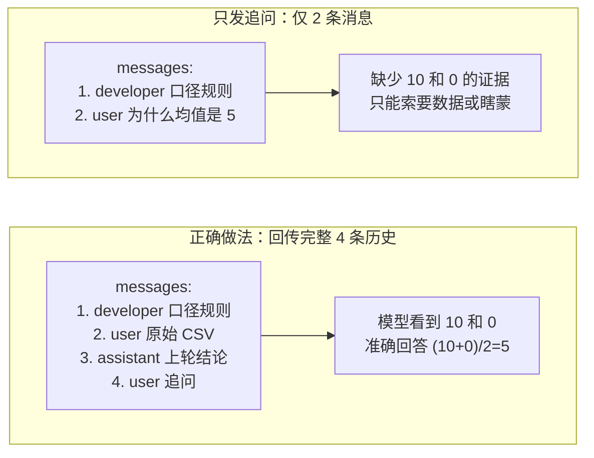

在 [API-01《从原始 HTTP 请求认识 LLM API》](api-01-raw-http-request.md) 里，我们拿到了满意的第一轮报告：「有效金额 2 条，缺失 1 条，均值为 5。」紧接着，用户在同一个聊天框里追问了一句：**「为什么均值是 5？」**

这时候应用开发最常犯的错误，就是以为像用普通数据库一样，第二轮只把「为什么均值是 5？」发过去就行了。**如果真这么干，模型立刻一头雾水！** 要能解释清楚 `(10 + 0) ÷ 2 = 5`，它必须再次亲眼看到第 1 轮的原始 CSV 数据、口径规则和自己刚说过的那句话。

> **先用大白话讲明白**：**Chat Completions 接口是完全「无状态（Stateless）」的，就像一位记忆只有 7 秒的金鱼大师！**
> - 每当你合上一次 HTTP 请求，服务器转身就把刚才聊过什么忘得干干净净（哪怕你开了 `store: true` 存储记录供事后查看，下一轮依然不会自动帮你拼进输入里）。
> - 所以**保存聊天记录和拼接上下文的责任，全都在你自己的应用程序手里**：聊到第 2 轮，你的应用必须把「**系统规矩 + 第 1 轮问题 + 第 1 轮回答 + 第 2 轮新追问**」一共 4 条消息，按顺序打包成 `messages` 数组重新寄过去！



下面全篇只用 Python 3 标准库在本机模拟两轮完整请求与翻车对照。

## 1. 第一轮发出去的 2 条消息与四种角色

第二轮之前，第一轮发给 `POST /v1/chat/completions` 的请求体有两条消息：应用长期口径放在 `developer`，本次提问和 CSV 放在 `user`：

```json
{
  "model": "gpt-6-luna",
  "reasoning_effort": "none",
  "max_completion_tokens": 128,
  "stream": false,
  "store": false,
  "messages": [
    {
      "role": "developer",
      "content": "你是退款报表助手。忽略空金额，保留 0。"
    },
    {
      "role": "user",
      "content": "请用一句话报告有效金额条数、缺失条数和均值。\nid,amount\n1,10\n2,\n3,0"
    }
  ]
}
```

`messages` 是一个按发言时间排队的数组，每条都有 `role`（谁说的）和 `content`（说了啥）。在 [F-01](f-01-tokenizer-chat-template.md) 里我们看过模型底层拿的是模板拼好的剧本，而在 API 协议这一层，**就是由你按下面四个标准角色来排剧本**：

| `role` 角色名 | 由谁写进去？ | 在退款场景里干什么用？ |
| --- | --- | --- |
| **`developer`** | 开发者（应用后台） | 定应用级规矩（例如「空金额忽略，0 保留」）。读老代码时常看到同作用的 `system`，按具体模型文档选用。 |
| **`user`** | 最终用户 | 提交首轮任务与三行 CSV，或者发来新一轮追问。 |
| **`assistant`** | 模型回复后再由应用回填 | 告诉下一轮模型「你刚才已经说过这句结论了」。 |
| **`tool`** | 应用执行完工具后回填 | 带着工具调用 ID 把本地函数算出的数字交回模型（详见 [API-04](api-04-function-calling-structured-outputs.md)）。 |

[Chat Completions 消息字段文档](https://developers.openai.com/api/reference/resources/chat/subresources/completions/methods/create#body-parameters) · [GPT-6 Luna 说明](https://developers.openai.com/api/docs/models/gpt-6-luna)

## 2. 收到首轮回答：先看 `finish_reason`，别无脑存历史！

拿到 `HTTP 200 OK` 后，先看精简后的响应结构：

```json
{
  "id": "chatcmpl-demo-first",
  "choices": [
    {
      "index": 0,
      "message": {
        "role": "assistant",
        "content": "有效金额 2 条，缺失 1 条，均值为 5。"
      },
      "finish_reason": "stop"
    }
  ]
}
```

`choices` 是一个数组（因为有些场景可一次请求生成多份候选），通常读 `choices[0]`。但千万别拿到响应就一把塞进聊天历史！必须先核对 **`finish_reason`（终止原因）** 与是否触发了 `message.refusal` 拒答：

| `finish_reason` | 发生了什么？应用应该怎么办？ |
| --- | --- |
| **`stop`** | 正常讲完停笔（或命中预设停止词）。确认正文非空、没拒答后，把这条 `assistant` 消息写入历史。 |
| **`length`** | 半路撞到 `max_completion_tokens` 上限被砍断了！文本很可能写到一半没闭合，标成未完成，**不要直接当成品放进历史误导下一轮**。 |
| **`content_filter`** | 触发安全内容过滤，部分内容被屏蔽。按安全降级策略提示用户。 |
| **`tool_calls`** | 模型这轮没直接给用户看文字，而是提议要调用工具函数（旧接口还可能有 `function_call`）。需执行工具后回填再请求下一轮。 |

[Chat Completions 响应定义](https://developers.openai.com/api/reference/resources/chat/subresources/completions/methods/create#returns)

## 3. 第二轮到底要打包寄出哪四条消息？

现在用户在前端问出「为什么均值是 5？」，你的后端程序在再次 `POST /v1/chat/completions` 时，要把首轮全部历史加新问题拼成下面 4 条：

```json
[
  {
    "role": "developer",
    "content": "你是退款报表助手。忽略空金额，保留 0。"
  },
  {
    "role": "user",
    "content": "请用一句话报告有效金额条数、缺失条数和均值。\nid,amount\n1,10\n2,\n3,0"
  },
  {
    "role": "assistant",
    "content": "有效金额 2 条，缺失 1 条，均值为 5。"
  },
  {
    "role": "user",
    "content": "为什么均值是 5？"
  }
]
```

少一条都不行：
- **少了第 1 条 `developer`**：模型忘了「空值排除、保留 0」的业务口径。
- **少了第 2 条 `user`**：原始 CSV 没了，模型压根不知道参与计算的是 `10` 和 `0`。
- **少了第 3 条 `assistant`**：模型不知道自己上一轮具体汇报过哪句话、用的是什么措辞。

> **容易踩的坑（Token 账单越滚越大）**：在应用层保存历史的标准顺序是：**拿到本轮完整有效的回复后，才把本轮的 `(user问题, assistant回答)` 一并追加到持久化会话里**（防止中途报错失败时，历史里留下一堆没头没尾的孤立提问）。另外，由于每一轮都要把前面全部历史重新寄给模型，随着对话轮数增加，响应里的 `usage.prompt_tokens` 会像滚雪球一样越滚越大——后面第 6 章的 `AGT-04` 会教你怎么安全裁剪过期历史！ [OpenAI 会话状态对比指南](https://developers.openai.com/api/docs/guides/migrate-to-responses)

## 4. 在本机对照实验：完整历史 vs 只发追问

新建一个空目录，把客户端代码保存为 `chat.py`（普通模式跑两轮；加 `--latest-only` 参数故意漏掉第 1 轮问题和回复，只发规则与追问；加 `--live` 可选连真实接口）：

```python
import argparse
import json
import os
from urllib.request import Request, urlopen

DEVELOPER = {"role": "developer", "content": "你是退款报表助手。忽略空金额，保留 0。"}
FIRST = (
    "请用一句话报告有效金额条数、缺失条数和均值。\n"
    "id,amount\n1,10\n2,\n3,0"
)
FOLLOW_UP = "为什么均值是 5？"


def ask(history, question, base_url, key):
    user = {"role": "user", "content": question}
    payload = {
        "model": "gpt-6-luna",
        "reasoning_effort": "none",
        "max_completion_tokens": 128,
        "stream": False,
        "store": False,
        "messages": [*history, user],
    }
    body = json.dumps(payload, ensure_ascii=False, indent=2)
    print("POST /v1/chat/completions", body, sep="\n")
    request = Request(
        f"{base_url}/v1/chat/completions",
        data=body.encode("utf-8"),
        headers={"Authorization": f"Bearer {key}", "Content-Type": "application/json"},
        method="POST",
    )
    with urlopen(request, timeout=30) as response:
        result = json.load(response)
        print(f"HTTP {response.status}")

    choice = result["choices"][0]
    message = choice["message"]
    reason = choice["finish_reason"]
    content = message.get("content")
    print(f"{result['id']} · {reason}")
    if (
        reason != "stop"
        or message.get("role") != "assistant"
        or message.get("refusal")
        or not isinstance(content, str)
        or not content.strip()
    ):
        raise RuntimeError("这一轮没有可写入历史的完整文本")

    assistant = {"role": message["role"], "content": content}
    history.extend([user, assistant])
    print(content, end="\n\n")


def main():
    parser = argparse.ArgumentParser()
    parser.add_argument("--live", action="store_true", help="调用真实接口并消耗 API 用量")
    parser.add_argument("--latest-only", action="store_true", help="省略上一轮消息")
    args = parser.parse_args()

    base_url = "https://api.openai.com" if args.live else "http://127.0.0.1:8765"
    key = os.environ["OPENAI_API_KEY"] if args.live else "demo-key"
    history = [DEVELOPER]
    if not args.latest_only:
        ask(history, FIRST, base_url, key)
    ask(history, FOLLOW_UP, base_url, key)


if __name__ == "__main__":
    main()
```

把本机模拟服务端保存为 `mock_chat.py`（注意它把判断逻辑写死了按消息序列严格匹配，以便复现协议差别），在另一个终端运行 `python3 mock_chat.py`：

```python
import json
from http.server import BaseHTTPRequestHandler, HTTPServer

from chat import DEVELOPER, FIRST, FOLLOW_UP

REPORT = "有效金额 2 条，缺失 1 条，均值为 5。"


class DemoChat(BaseHTTPRequestHandler):
    def do_POST(self):
        if self.path != "/v1/chat/completions":
            self.send_error(404)
            return
        body = self.rfile.read(int(self.headers["Content-Length"]))
        messages = json.loads(body)["messages"]
        first = {"role": "user", "content": FIRST}
        previous = {"role": "assistant", "content": REPORT}
        follow_up = {"role": "user", "content": FOLLOW_UP}

        if messages == [DEVELOPER, first]:
            case = "first"
            text = REPORT
        elif messages == [DEVELOPER, first, previous, follow_up]:
            case = "with-history"
            text = "空金额排除，10 和 0 都计入，所以 (10 + 0) ÷ 2 = 5。"
        elif messages == [DEVELOPER, follow_up]:
            case = "latest-only"
            text = "请提供参与统计的金额，我才能核对均值。"
        else:
            self.send_error(400, "Unexpected message sequence")
            return

        result = {
            "id": f"chatcmpl-demo-{case}",
            "choices": [{
                "index": 0,
                "message": {"role": "assistant", "content": text},
                "finish_reason": "stop",
            }],
        }
        data = json.dumps(result, ensure_ascii=False).encode("utf-8")
        self.send_response(200)
        self.send_header("Content-Type", "application/json; charset=utf-8")
        self.send_header("Content-Length", str(len(data)))
        self.end_headers()
        self.wfile.write(data)


if __name__ == "__main__":
    with HTTPServer(("127.0.0.1", 8765), DemoChat) as server:
        print("Listening on http://127.0.0.1:8765", flush=True)
        server.serve_forever()
```

回到第一个终端分别跑两次对照：

```bash
python3 chat.py
python3 chat.py --latest-only
```

每次都会先打印完整 JSON，对照结果如下：

| 发起的请求 | 发送的 `messages` 序列 | 本机返回 ID 与业务效果 |
| --- | --- | --- |
| 普通模式第 1 轮 | `developer → user` | `chatcmpl-demo-first`：成功生成首次报告 |
| 普通模式第 2 轮 | `developer → user → assistant → user` | `chatcmpl-demo-with-history`：**用 10 和 0 算出 `(10+0)÷2=5` 解释清楚** |
| `--latest-only` 对照 | `developer → user`（漏了首轮） | `chatcmpl-demo-latest-only`：**拿不到金额证据，只能请你重新提供数字** |

三次通信全都返回 `HTTP 200` 与 `finish_reason: "stop"`——但业务上完全一个在天堂、一个在地下！真实的大模型在拿不到历史证据时甚至不会老实要数字，而是会硬着头皮编出假数字（幻觉），所以调试多轮对话出岔子时，第一件事永远是**把真实发出去的完整 `messages` JSON 打印出来核对**。

## 下一篇

搞清了怎么发多轮消息之后，开发里最常遇到的问题变成：「提示词改了三版，究竟哪一版真变好了，还是我瞎感觉变好了？」下一篇按路线图行序进入 [API-10《Prompt Engineering 的可复现对照实验》](api-10-prompt-comparison.md)，拿 6 条硬核边界测试题把三个版本的提示词拉出来跑 18 次，看清小模型到底是卡在格式还是卡在算术！系列入口见 [LLM 与 Agent 学习路线图](llm-agent-learning-roadmap.md)。
