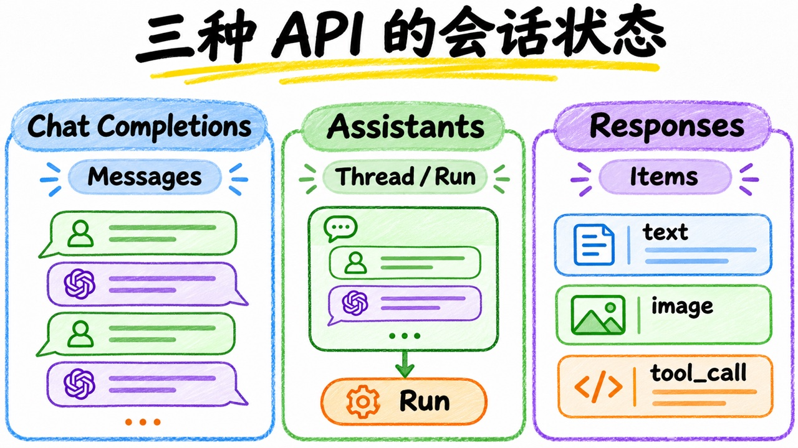

用户上传三条退款记录，金额依次为 10、空、0。第一轮请模型写报告，第二轮问为什么均值是 5。再让模型调用应用的 `summarize_refunds` 函数算一次。三种接口面对的是同一个任务。读它们的协议时，先问两件事：**上下文保存在哪里？一次生成交回什么对象？**

[API-02](api-02-chat-completions-messages.md) 介绍了怎样在应用里保存消息。[API-10](api-10-prompt-comparison.md) 里的「空值排除、零值保留」继续作为业务规则。本篇的 Assistants 部分用来读遗留代码。OpenAI 已于 2026 年 8 月 26 日关闭 Assistants API。 [官方 Assistants 迁移说明](https://developers.openai.com/api/docs/assistants/migration)

## 1. 三种接口各把状态放在哪里？

| 接口 | 主要对象 | 第二轮如何继续 | 自定义函数的执行者 |
| --- | --- | --- | --- |
| Chat Completions | `messages` 输入、`choices` 候选输出 | 应用把已有的消息和新问题放回 `messages` | 应用 |
| Assistants（已退役） | Assistant 配置、Thread、Run | 在已有 Thread 中写入新消息，再创建 Run | 应用执行自定义函数，并把结果提交给等待它的 Run |
| Responses | `input` 和 `output` 中的类型化 Item | 可回传 Item，也可按场景选 `previous_response_id` 或 Conversations API | 应用处理自定义函数。内置工具按各自协议运行 |

**Thread（线程）**是服务端保存的消息容器。**Run（运行）**是让指定 Assistant 在这个 Thread 上处理一次任务的执行记录。旧代码常见顺序为创建 Thread、添加用户消息、创建 Run、观察 Run 状态、读取新消息。需自定义函数时，旧 Run 会到达 `requires_action`，应用读取待调用工具并提交工具输出，再等待结果。一个 Thread 可以先后有多次 Run。

**Item（条目）**是 Responses 使用的输入输出单元。普通消息、推理记录、函数调用和函数结果有各自的类型。用相同的退款任务观察，类型差异会直接出现在 JSON 里。 [Responses 迁移指南](https://developers.openai.com/api/docs/guides/migrate-to-responses)

## 2. 两轮文字的字段怎样迁移？

第一轮 Chat Completions 请求带 `developer` 和 `user` 消息，响应中从 `choices[0].message` 取回复。第二轮应用回传这两条消息、上一轮助手回复和「为什么均值是 5？」。[API-02](api-02-chat-completions-messages.md) 记录了完整请求。

Responses 使用 `POST /v1/responses`。同一请求可以把业务规则放在 `instructions`，把用户文字放在 `input`：

```json
{
  "model": "gpt-6-luna",
  "reasoning": {"effort": "none"},
  "instructions": "你是退款报表助手。忽略空金额，保留 0。",
  "input": "请用一句话报告有效金额条数、缺失条数和均值。\nid,amount\n1,10\n2,\n3,0"
}
```

以下是精简的 Responses 响应示意，ID 用教学值：

```json
{
  "id": "resp_demo_1",
  "status": "completed",
  "output": [
    {
      "id": "msg_demo_1",
      "type": "message",
      "role": "assistant",
      "status": "completed",
      "content": [
        {"type": "output_text", "text": "有效金额 2 条，缺失 1 条，均值为 5。", "annotations": []}
      ]
    }
  ]
}
```

手读原始 HTTP 响应时，在 `output` 中查 `type: "message"` 的助手消息，再读其 `content` 中的 `output_text`。部分 SDK（Software Development Kit，软件开发工具包）提供聚合好的 `output_text` 属性，原始协议仍由 Item 与内容块组成。输出可能还包含其他 Item，遍历类型比固定取 `output[0]` 更稳。

第二轮若由应用保持上下文，就把首轮用户 Item、首轮响应的完整 `output`、本轮用户 Item 按序作为新 `input`，并再次给出 `instructions`。如果改用 `previous_response_id`，新请求用上一响应 ID 提供上下文，只需传新输入，但上一响应的 `instructions` 不会自动带到新请求。另一种方式是创建持久的 Conversation，后续以 `conversation` 引用其上下文。在一次请求中，`previous_response_id` 和 `conversation` 分别是两种续接方式。选择服务端存储时，也需要考虑项目的数据保留设置。 [会话状态](https://developers.openai.com/api/docs/guides/conversation-state) · [Responses 创建接口](https://developers.openai.com/api/reference/resources/responses/methods/create)

## 3. 同一个自定义函数怎样来回一次？

假定函数已经定义为 `summarize_refunds`，参数 `{"amounts":[10,null,0]}`。应用用实际代码算出 `{"count":2,"missing":1,"mean":5}`。这里对照调用 ID 怎样越过两次 HTTP 请求。下面的形状只保留关键字段，定义与校验会在 API-04 展开。

| 阶段 | Chat Completions | Responses |
| --- | --- | --- |
| 函数声明 | `tools[].function` 放 `name`、`parameters` 等 | 这些字段直接在 `tools[]` 的函数对象上 |
| 模型提议调用 | `choices[0].message.tool_calls[]`，其中 `id` 形如 `call_1` | `output[]` 中出现 `type: "function_call"`，用 `call_id` 关联 |
| 应用追加执行结果 | `{"role":"tool","tool_call_id":"call_1","content":"..."}` | `{"type":"function_call_output","call_id":"call_1","output":"..."}` |
| 服务继续生成 | 回传先前的助手工具调用消息，以及结果消息 | 用手动回传时保留原调用 Item，再追加函数结果 Item |

Responses 的 `function_call` Item 可以同时有 `id` 和 `call_id`。前者标识 Item，后者匹配结果。两种协议里的参数都是需要解析和校验的 JSON 字符串。函数返回后再调用接口，模型才能依据结果组织面向用户的文字。Chat Completions 的 `finish_reason: "tool_calls"` 表示返回了调用提议。Responses 客户端读取输出 Item，发现函数调用后再推进。 [官方工具迁移对照](https://developers.openai.com/api/docs/guides/migrate-to-responses#5-update-function-definitions-and-outputs)

## 4. 离线验收对话与函数 ID

把下面保存为 `migration_check.py` 并运行 `python3 migration_check.py`。它使用合成响应检查应用侧的上下文组装与结果关联。真实接口的请求和回包字段可以用 [API-01](api-01-raw-http-request.md) 的 HTTP 方法观察。示例里的 `responses_second` 是第二轮请求的 `input`，顶层设置沿用上面的请求。

```python
import json

rules = "忽略空金额，保留 0。"
question = "报告退款统计。\nid,amount\n1,10\n2,\n3,0"
follow_up = "为什么均值是 5？"
answer = "有效金额 2 条，缺失 1 条，均值为 5。"

chat_first = [{"role": "developer", "content": rules},
              {"role": "user", "content": question}]
chat_reply = {"choices": [{"message": {"role": "assistant", "content": answer}}]}
chat_second = [*chat_first, chat_reply["choices"][0]["message"],
               {"role": "user", "content": follow_up}]

response_items = [{
    "type": "message", "id": "msg_demo_1", "role": "assistant", "status": "completed",
    "content": [{"type": "output_text", "text": answer, "annotations": []}],
}]
responses_second = [
    {"role": "user", "content": question},
    *response_items,
    {"role": "user", "content": follow_up},
]
assert chat_second[2]["content"] == responses_second[1]["content"][0]["text"]

arguments = '{"amounts":[10,null,0]}'
chat_call = {"id": "call_1", "type": "function",
             "function": {"name": "summarize_refunds", "arguments": arguments}}
responses_call = {"type": "function_call", "id": "fc_1", "call_id": "call_1",
                  "name": "summarize_refunds", "arguments": arguments}

amounts = json.loads(responses_call["arguments"])["amounts"]
valid = [value for value in amounts if value is not None]
summary = {"count": len(valid), "missing": len(amounts) - len(valid),
           "mean": sum(valid) / len(valid) if valid else None}
text = json.dumps(summary)
chat_tool = {"role": "tool", "tool_call_id": chat_call["id"], "content": text}
responses_tool = {"type": "function_call_output", "call_id": responses_call["call_id"],
                  "output": text}

assert chat_tool["tool_call_id"] == responses_tool["call_id"]
assert responses_tool["call_id"] != responses_call["id"]
assert json.loads(chat_tool["content"]) == json.loads(responses_tool["output"])
assert summary == {"count": 2, "missing": 1, "mean": 5}
print("两轮上下文保留同一条报告，工具结果关联到", responses_tool["call_id"], summary)
```

预期输出包含 `call_1` 和 `{'count': 2, 'missing': 1, 'mean': 5.0}`。把 Responses 的结果 `call_id` 错填成 `fc_1`，第一个关联断言就会失败。实际迁移时，可以拿同一批输入做这种断言，再分别验证正文、工具调用与终态，对齐业务结果。

## 下一篇

[**API-04《Function Calling 与 Structured Outputs》**](api-04-function-calling-structured-outputs.md) 会补齐工具定义、参数校验和结果回填，再把退款报告的格式约束与执行函数分开练习。 [LLM 与 Agent 学习路线图](https://blog.lacknb.cn/articles/2026/11/19/1795058329577.html)
