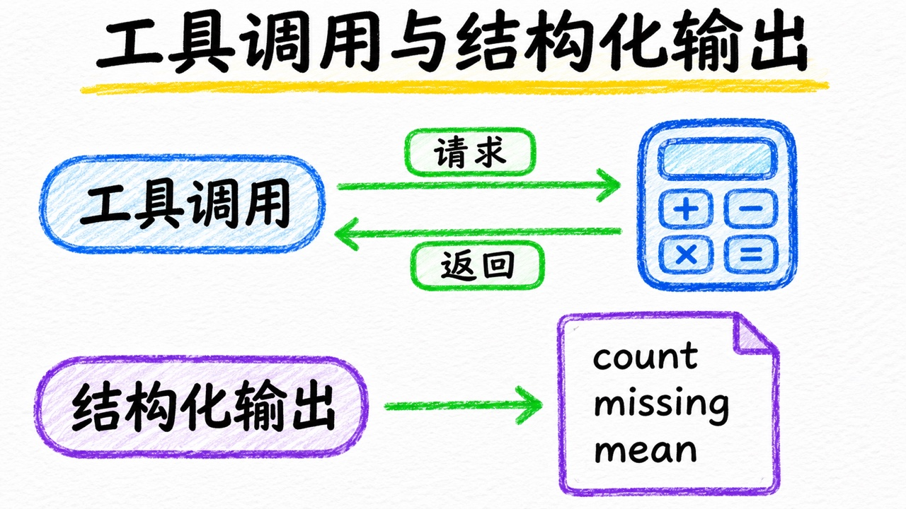

退款金额是 10、空、0。如果报告的均值必须按代码算，应用可以让模型提议调用 `summarize_refunds`，再把程序算出的 **(10 + 0) ÷ 2 = 5** 交回模型。如果应用随后还需要从答复里读出 `count`、`missing` 和 `mean`，可以给最终输出一份结构约定。这一篇先完成两次 HTTP 请求之间的工具往返，再核对最终报告。

**Function Calling（函数调用）**是模型把想执行的函数名和参数交给应用的协议。**Structured Outputs（结构化输出）**是让模型在支持的条件下按给定结构生成输出的一组能力。这里用 **JSON Schema** 描述允许的 JSON 字段、类型和必填项。它可以用于声明函数参数，也可以用于定义最终报告的形状。 [OpenAI 函数调用指南](https://developers.openai.com/api/docs/guides/function-calling) · [Structured Outputs 指南](https://developers.openai.com/api/docs/guides/structured-outputs)

## 1. 从工具定义到调用提议

沿用 [API-03](api-03-openai-api-evolution.md) 的 Responses 协议。函数定义放在首轮 `POST /v1/responses` 的 `tools` 数组中。参数对象只有 `amounts`，元素可以是数字或 `null`。空值用 `null` 表示，实际的 0 仍是数字。

```json
{
  "type": "function",
  "name": "summarize_refunds",
  "description": "计算退款金额的有效条数、缺失条数和均值，保留 0，排除 null。",
  "strict": true,
  "parameters": {
    "type": "object",
    "properties": {
      "amounts": {"type": "array", "items": {"type": ["number", "null"]}}
    },
    "required": ["amounts"],
    "additionalProperties": false
  }
}
```

`strict: true` 让支持该能力的模型按接口所支持的 Schema 子集生成参数。示例中所有声明字段都列入 `required`，并关闭额外属性。客户端仍要按注册工具和业务约束校验参数。例如数组可解析也不代表数据属于当前会话，布尔值也不应被计算程序当成金额。 [严格函数参数要求](https://developers.openai.com/api/docs/guides/function-calling#strict-mode)

模型提出调用时，在响应 `output` 中找 `function_call` 条目：

```json
{
  "type": "function_call",
  "id": "fc_refund_1",
  "call_id": "call_refund_1",
  "name": "summarize_refunds",
  "arguments": "{\"amounts\":[10,null,0]}"
}
```

`arguments` 是字符串，先解析，再检查函数名和数据。通过校验后，应用执行函数，把程序输出序列化，构造 `function_call_output`。这里按会话中的同一份 CSV 做来源核对，其他请求传入的金额即使类型合法也会被拒绝。

## 2. 结果按调用 ID 回填

用于第二次请求的 `input` 由原始用户输入、上一响应中需要延续的完整 `output`，再加应用新生成的工具结果组成。结果的关联键和字符串值如下：

```json
{
  "type": "function_call_output",
  "call_id": "call_refund_1",
  "output": "{\"count\":2,\"missing\":1,\"mean\":5.0}"
}
```

若模型提出多次调用，每次都返回各自的结果，用 `call_id` 对应。即使两个调用使用同名函数，ID 也各自独立。下面的实验一并覆盖合法、坏类型和过期数据。可预期的参数错误回成一条与该调用关联的错误结果，应用由此保留其它调用的成功结果。

## 3. 最终报告也可以约定形状

第二次请求可以通过 Responses 的 `text.format` 指定最终报告格式。这里的 `strict` 作用在最终生成的文本结构。工具定义里的同名字段约束的是工具参数。Chat Completions 对应配置放在 `response_format` 下，参数形状见官方迁移指南。

```json
{
  "text": {
    "format": {
      "type": "json_schema",
      "name": "refund_report",
      "strict": true,
      "schema": {
        "type": "object",
        "properties": {
          "count": {"type": "integer"},
          "missing": {"type": "integer"},
          "mean": {"type": ["number", "null"]}
        },
        "required": ["count", "missing", "mean"],
        "additionalProperties": false
      }
    }
  }
}
```

报告 `{"count":3,"missing":0,"mean":3.33}` 可以通过这份 Schema，业务上仍算错。应用要按已执行的工具结果核对字段值。读取 Responses 时，还要检查 `status`、是否出现 `refusal` 内容以及是否还有待处理的函数调用，再尝试解析 `output_text`。模型拒答或达到输出预算时，可能没有一份可用的最终报告。 [结构化输出迁移对照](https://developers.openai.com/api/docs/guides/migrate-to-responses#6-update-structured-outputs-definitions)

## 4. 单机验证错误参数和多调用

把下面保存为 `tool_roundtrip.py` 后运行 `python3 tool_roundtrip.py`。它用合成的调用条目跑真实的统计函数，验证同一轮里三个结果仍各自关联。

```python
import json
import math

CSV_AMOUNTS = [10, None, 0]
TOOL_NAME = "summarize_refunds"


def is_amount(value):
    return (
        value is None
        or type(value) is int
        or (type(value) is float and math.isfinite(value))
    )


def execute(call):
    if call["name"] != TOOL_NAME:
        raise ValueError("unknown tool")
    args = json.loads(call["arguments"])
    if not isinstance(args, dict) or set(args) != {"amounts"}:
        raise ValueError("expected amounts")
    amounts = args["amounts"]
    if not isinstance(amounts, list) or not all(map(is_amount, amounts)):
        raise ValueError("amounts must contain finite numbers or null")
    if amounts != CSV_AMOUNTS:
        raise ValueError("amounts do not match this CSV")
    valid = [amount for amount in amounts if amount is not None]
    return {
        "count": len(valid),
        "missing": len(amounts) - len(valid),
        "mean": sum(valid) / len(valid) if valid else None,
    }


def respond(call):
    try:
        result = execute(call)
    except ValueError as error:
        result = {"error": str(error)}
    return {
        "type": "function_call_output",
        "call_id": call["call_id"],
        "output": json.dumps(result),
    }


calls = [
    {"type": "function_call", "call_id": "call_ok", "name": TOOL_NAME,
     "arguments": '{"amounts":[10,null,0]}'},
    {"type": "function_call", "call_id": "call_bad_type", "name": TOOL_NAME,
     "arguments": '{"amounts":[10,null,false]}'},
    {"type": "function_call", "call_id": "call_wrong_csv", "name": TOOL_NAME,
     "arguments": '{"amounts":[10,0,0]}'},
]
outputs = [respond(call) for call in calls]
by_id = {item["call_id"]: json.loads(item["output"]) for item in outputs}
expected = {"count": 2, "missing": 1, "mean": 5}
assert by_id["call_ok"] == expected
assert by_id["call_bad_type"]["error"] == "amounts must contain finite numbers or null"
assert by_id["call_wrong_csv"]["error"] == "amounts do not match this CSV"
for call_id, result in by_id.items():
    print(call_id, result)
```

`call_ok` 的均值是 `5.0`，其余两项带各自的错误说明。上面的来源校验是为了说明应用怎样限定参数。本例的真实执行流程中，与其要求模型逐个抄回金额，也可以让工具只接收应用签发的文件引用，由工具按权限读取对应版本的 CSV，减少数据抄错的来源。

## 下一篇

[**API-09《约束解码如何生成符合 Schema 的结构化输出》**](api-09-constrained-decoding.md) 会用一个小状态机展示，选出每个 Token 之前，解码器怎样缩小候选范围。 [LLM 与 Agent 学习路线图](https://blog.lacknb.cn/articles/2026/11/19/1795058329577.html)
