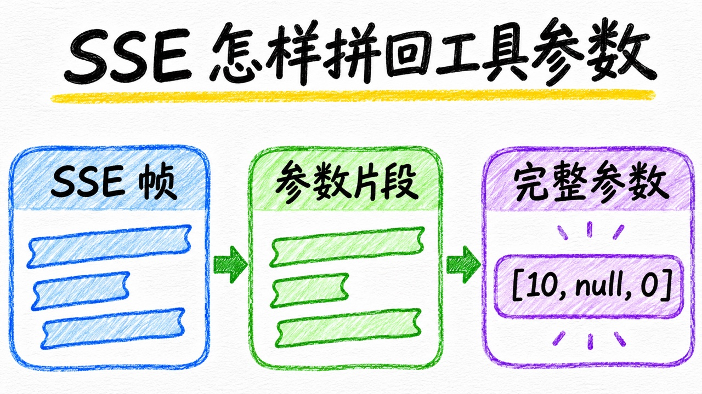
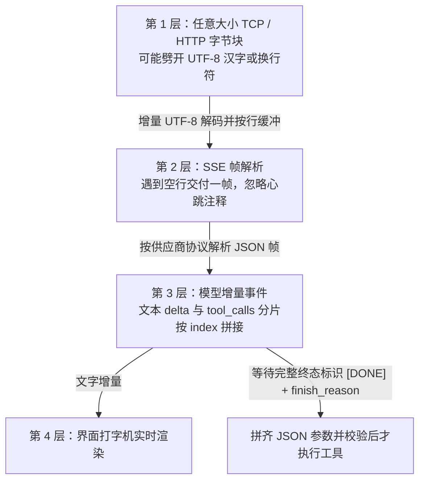

在 [API-04](api-04-function-calling-structured-outputs.md) 里，调用退款统计函数是一次性拿到完整参数 `{"amounts":[10,null,0]}`。但为了界面体验不转圈死等，线上几乎都会打开 `stream: true`。

一旦开启流式，客户端手里抓到的往往先是一半 `{"amounts":[10,`，过 50 毫秒才又来一半 `null,0]}`！甚至连一个汉字「正」的三个 UTF-8 字节都有可能被网络拆在两批数据包里送达。此时谁要是手快直接在半路上 `json.loads()` 或执行工具，程序当场就崩！

> **先用大白话讲明白**：接收大模型的流式响应，就像**拆一套层层套娃的四层快递包裹**，每层只管好自己的边界：
> 1. **第 1 层 · TCP/HTTP 原始字节块（拆外箱）**：网络按字节流吐数据，哪怕一次只给你吐 **1 个字节**，也得用增量编码器先耐心地把碎字节拼回完整汉字（防半个汉字乱码）。
> 2. **第 2 层 · SSE 帧（拆内袋）**：Server-Sent Events 用**空行**当分隔符把字节流切成一个个独立事件帧（忽略 `:` 开头的心跳注释）。
> 3. **第 3 层 · 模型增量协议（拆零件）**：按具体接口（Chat Completions 的 `delta` 或 Responses 的类型化 `type`）把碎文字或碎参数 `arguments` 按编号接回原位。
> 4. **第 4 层 · 业务与界面交付（拼完再开箱）**：文字碎块**可以立刻一个字一个字画在屏幕上**给用户看；但**工具参数必须等全部零件收齐、且正式收到结束总信号（如 `[DONE]` 或 `response.completed`）并校验无误后，才准真正调用函数！**



[WHATWG SSE 标准](https://html.spec.whatwg.org/multipage/server-sent-events.html) · [Chat Completions 流式参考](https://developers.openai.com/api/reference/resources/chat/subresources/completions/streaming-events)

## 1. 先看原始 SSE 帧里藏着什么（Chat Completions）

打开 `stream: true` 后，服务器返回的不再是 `application/json`，而是 `Content-Type: text/event-stream`。

下面两条相邻的 SSE 帧（为了阅读省略了无关外层字段）把一次 `summarize_refunds` 调用拆成了两半：第 1 帧给了调用 ID `call_1`、函数名和参数前半截；第 2 帧只给了相同 `index: 0` 下参数的后半截：

```text
data: {"choices":[{"index":0,"delta":{"tool_calls":[{"index":0,"id":"call_1","type":"function","function":{"name":"summarize_refunds","arguments":"{\"amounts\":[10,"}}]},"finish_reason":null}]}

data: {"choices":[{"index":0,"delta":{"tool_calls":[{"index":0,"function":{"arguments":"null,0]}"}}]},"finish_reason":null}]}

```

> **容易踩的坑**：
> 1. **必须用 `(choice_index, tool_call_index)` 复合键来拼接**：同一轮模型可能同时提议调用 2 个工具，它们的分片会穿插在先后帧里到达；而且只有首片才带 `id` 和 `name`，后续分片里经常只有 `index` 和 `arguments`！
> 2. **为什么收到看起来闭合的 `}` 还不敢直接运行工具？** 因为万一后面紧接着半路断网了，或者模型本来后面还跟着第二条联动指令，你提前执行就是残缺事务！必须同时见到 `finish_reason: "tool_calls"` 且等到最终流结束标志 `data: [DONE]` 才放行。若开启了流式用量，结束前还会额外飘过一帧 `choices: []` 只带 `usage` 的统计包，解析时别直接假定 `choices[0]` 一定存在。 [Chat Completions 接口文档](https://developers.openai.com/api/reference/resources/chat/subresources/completions/methods/create)

## 2. Chat Completions vs Responses 流式事件怎么对照？

同样走底层的 SSE 传输，两代 OpenAI 接口只是第 3 层「模型事件形状」长相不同：Responses 把每个小动作都写进了显式的 `type` 事件名里，省去了自己猜哪个字段非空：

| 要处理的动作 | Chat Completions (`delta`) | Responses (`event.type`) | 应用怎么用？ |
| --- | --- | --- | --- |
| **拿一点显示文字** | `delta.content` | `response.output_text.delta` | 立刻追加到页面流式展示 |
| **攒一点工具参数** | `delta.tool_calls[].function.arguments` | `response.function_call_arguments.delta` | 按 `output_index` / Item ID 把碎片字符串接上去 |
| **单个工具参数攒完** | 后续看到 `finish_reason: "tool_calls"` | `response.function_call_arguments.done` 或 `output_item.done` | 参数串收齐了，**但还要等整条响应终态！** |
| **整次流正式收尾** | 收到 `data: [DONE]` | 收到 `response.completed`（或 `incomplete`/`failed`） | 真正确认流没半路摔断，交出完整结果 |

> **小提示**：Responses 里收到某个 `function_call_arguments.done` 只代表**这一个函数参数块发完了**，不代表整个 HTTP 响应安安全全走完；依然要读到响应级的 `response.completed`（或按需处理 `incomplete`/断线错误）再触发副作用。 [Responses 流式指南](https://developers.openai.com/api/docs/guides/streaming-responses) · [Responses 流式事件参考](https://developers.openai.com/api/reference/resources/responses/streaming-events)

## 3. 极限压测实验：故意「1 个字节 1 个字节」喂进解析器！

把下面代码保存为 `stream_tools.py`，只用 Python 3 标准库运行 `python3 stream_tools.py`。为了逼出所有跨块隐藏 bug，脚本故意把带有中文 `"正在核对。"`、心跳注释 `: heartbeat`、分片工具调用、`\r\r` 换行符的字节流**每次只切 1 个字节**喂进去！

```python
import codecs
import json


def events(chunks):
    decoder = codecs.getincrementaldecoder("utf-8-sig")()
    line_chars = []
    data = []
    previous_cr = False
    for chunk in chunks:
        for char in decoder.decode(chunk):
            if previous_cr and char == "\n":
                previous_cr = False
                continue
            previous_cr = char == "\r"
            if char not in ("\r", "\n"):
                line_chars.append(char)
                continue
            line = "".join(line_chars)
            line_chars.clear()
            if not line:
                if data:
                    yield "\n".join(data)
                    data.clear()
                continue
            field, sep, value = line.partition(":")
            if field == "data":
                data.append(value.removeprefix(" ") if sep else "")
    decoder.decode(b"", final=True)
    # 流断开时，未由空行结束的帧不交给模型协议解析器。


def read_chat(chunks, cancelled=lambda: False):
    text = []
    calls = {}
    reasons = {}
    done = False
    for data in events(chunks):
        if cancelled():
            return "cancelled", "".join(text), []
        if data == "[DONE]":
            done = True
            break
        packet = json.loads(data)
        for choice in packet["choices"]:
            index = choice["index"]
            delta = choice["delta"]
            if index == 0 and delta.get("content"):
                text.append(delta["content"])
            for partial in delta.get("tool_calls", []):
                key = (index, partial["index"])
                call = calls.setdefault(key, {"parts": []})
                function = partial.get("function", {})
                if "id" in partial:
                    call["id"] = partial["id"]
                if "name" in function:
                    call["name"] = function["name"]
                call["parts"].append(function.get("arguments", ""))
            if choice.get("finish_reason"):
                reasons[index] = choice["finish_reason"]

    if cancelled():
        return "cancelled", "".join(text), []
    if not done or 0 not in reasons:
        return "interrupted", "".join(text), []
    tools = []
    if reasons[0] == "tool_calls":
        for (choice_index, _), call in sorted(calls.items()):
            if choice_index == 0:
                tools.append((call["id"], call["name"], json.loads("".join(call["parts"]))))
    return reasons[0], "".join(text), tools


def frame(delta, reason=None):
    body = {"choices": [{"index": 0, "delta": delta, "finish_reason": reason}]}
    return ("data: " + json.dumps(body, ensure_ascii=False) + "\r\n\r\n").encode()


payload = b"".join([
    b": heartbeat\r\n\r\n",
    frame({"content": "正在核对。"}),
    frame({"tool_calls": [{
        "index": 0, "id": "call_1", "type": "function",
        "function": {"name": "summarize_refunds", "arguments": '{"amounts":[10,'},
    }]}),
    frame({"tool_calls": [{"index": 0, "function": {"arguments": "null,0]}"}}]}),
    frame({}, "tool_calls"),
])
full = payload + b"data: [DONE]\r\n\r\n"
one_byte = (full[i:i + 1] for i in range(len(full)))
status, text, tools = read_chat(one_byte)
assert status == "tool_calls" and text == "正在核对。"
assert tools == [("call_1", "summarize_refunds", {"amounts": [10, None, 0]})]
assert read_chat([payload]) == ("interrupted", text, [])
assert read_chat([full], cancelled=lambda: True) == ("cancelled", "", [])
assert list(events([b"data: a\ndata: b\n\n"])) == ["a\nb"]
assert list(events([b"data: final\r", b"\r"])) == ["final"]
assert list(events([b"data: unfinished\n"])) == []
print(status, text, tools)
```

> **想再深入一层？** 盯住代码里三个实战保命细节：
> 1. **`codecs.getincrementaldecoder("utf-8-sig")()`**：专门记住上一个字节块剩下的半截中文 UTF-8 字节，等下一字节进来拼成完整字符再吐出（直接对每块调用 `chunk.decode("utf-8")` 在流式下一定会概率性炸 `UnicodeDecodeError`！）。
> 2. **删掉 `[DONE]` 帧的测试**（第 148 行）：哪怕前面的 JSON 参数已经看着完美闭合且收到了 `finish_reason: "tool_calls"`，只要没见到 `[DONE]` 就直接断流，函数也老实返回 `("interrupted", "正在核对。", [])`，**绝不把没确认完的工具调用丢去执行**！
> 3. **用户点「停止生成」取消时**：真实客户端要立刻关掉底层 HTTP 连接中止读取省流量，把界面上已经打出的字标成未完成，**万一断网要重试，务必先查上一轮工具到底执行没执行过**（防重复扣款/写入）。

## 下一篇

摸透了 OpenAI 的非流式与流式协议后，工程里几乎避不开的另一家主流模型协议就是 Anthropic Claude。它的接口不再把 `system` 塞进 `messages`、也不分 `function_call` 与 `tool` 角色，而是全部统一装进「内容块（Content Blocks）」！请看下一篇 [API-06《Anthropic Messages API 的内容块与事件》](api-06-anthropic-messages.md)。系列入口见 [LLM 与 Agent 学习路线图](llm-agent-learning-roadmap.md)。
