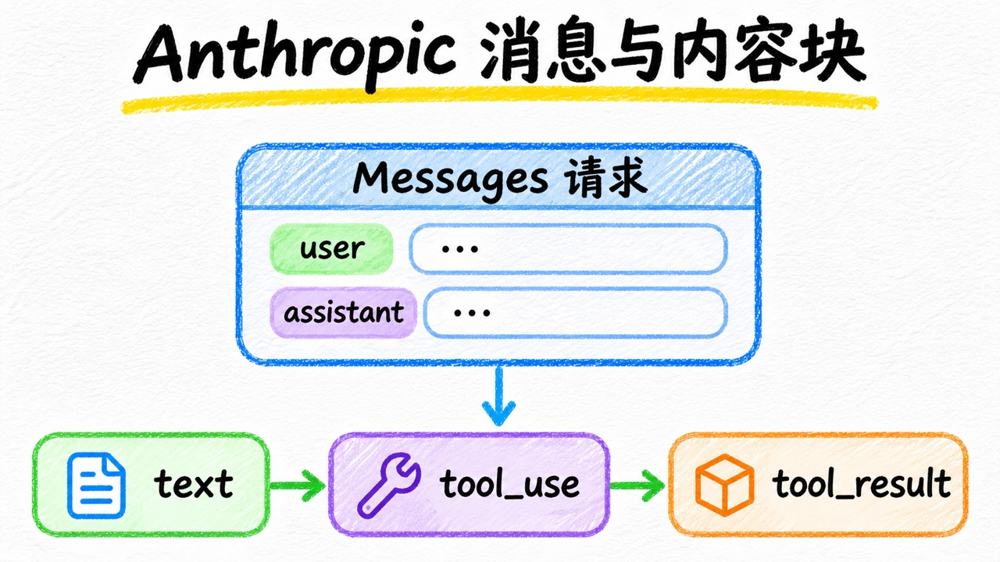
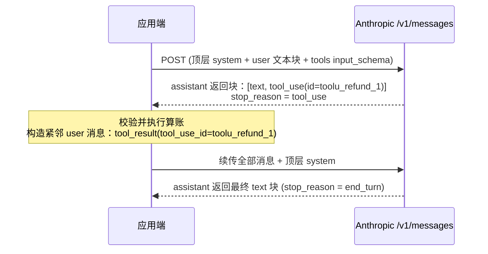

同样的三行退款 CSV（`10, 空, 0`），这次我们改连 Anthropic Claude 的接口 `POST /v1/messages`，让它一样调用 `summarize_refunds` 算账。

刚从 OpenAI 转过来的开发者第一次接 Claude 时，几乎都会被两件事卡住报错：为什么 `messages` 里写 `"role": "system"` 被拒了？为什么回填工具结果不能用 `"role": "tool"`，偏偏要发一条 `"role": "user"`？

> **先用大白话讲明白**：如果说 OpenAI 像分门别类放不同餐具，**Anthropic Messages 接口就像一个「只允许放 `user` 和 `assistant` 轮流交替的积木便当盒（Content Blocks）」**：
> - **规则贴盒盖外面**：应用指令直接写在最外层的 **`system`** 字段里，不准混进 `messages` 数组里。
> - **盒子里全装积木块（`content[]`）**：每条消息不再只是纯文本，而是一排积木块——助手可以同一回合先摆一块 `text` 积木说「我来统计」，紧接着再摆一块 `tool_use` 积木提出「请帮我调工具」。
> - **工具结果装进 `user` 盒子里寄回**：应用算完账后，**必须**用一条新的 **`user` 消息**，在里面放一块 `tool_result` 积木并贴上对应的 `tool_use_id` 紧跟在后面，保证 `user → assistant → user` 严格交替！



[Claude Messages API 文档](https://platform.claude.com/docs/en/api/messages) · [Anthropic 工具回填规范](https://platform.claude.com/docs/en/agents-and-tools/tool-use/handle-tool-calls)

## 1. 先拆一份原始 `POST /v1/messages` 请求

下面是一条符合 Anthropic `2026-10-21` API 版本的原始 HTTP 请求（注意密钥头部叫 `x-api-key`，而且必须带版本头 `anthropic-version`）：

```http
POST /v1/messages HTTP/1.1
Host: api.anthropic.com
x-api-key: <ANTHROPIC_API_KEY>
anthropic-version: 2026-10-21
Content-Type: application/json

{
  "model": "claude-opus-5-5",
  "max_tokens": 256,
  "system": "生成退款报告。空金额排除，0 保留。",
  "messages": [{
    "role": "user",
    "content": [{"type":"text","text":"请调用统计工具。\nid,amount\n1,10\n2,\n3,0"}]
  }],
  "tools": [{
    "name": "summarize_refunds",
    "description": "按金额数组统计有效条数、缺失条数和均值。",
    "input_schema": {
      "type": "object",
      "properties": {"amounts": {"type":"array","items":{"type":["number","null"]}}},
      "required": ["amounts"],
      "additionalProperties": false
    }
  }]
}
```

留心四个硬要求（少一个就会吃 `400 Bad Request`）：
1. **`max_tokens` 是必填项**：不像某些接口可省略，Anthropic 要求必须显式指定最大输出预算。
2. **`system` 在最外层**：放顶层字段里，绝对不要在 `messages` 里塞 `{"role": "system", ...}`。
3. **工具参数图纸叫 `input_schema`**：定义时叫 `input_schema`，等模型响应时里面填好参数的字段叫 **`input`**（而且直接已经是解析好的 JSON 对象，不用像 OpenAI 那样拿 JSON 字符串再二次解析，除非是在流式状态下拼接碎片）。
4. **注意 API 版本差异**：比如 `2026-10-21` 这个版本已经从 Messages 请求里移除了 `temperature`、`top_p`、`top_k` 参数，升级接口版本头时必须核对参数白名单。 [Claude API 版本说明](https://platform.claude.com/docs/en/api/versioning)

## 2. 从 `tool_use` 块到紧邻的 `tool_result` 块

第一轮响应回来，一条 `assistant` 消息里可以同时包含文字安抚和工具提议两块积木，`stop_reason` 明确告诉你 `"tool_use"`：

```json
{
  "role": "assistant",
  "content": [
    {"type": "text", "text": "我来统计。"},
    {
      "type": "tool_use",
      "id": "toolu_refund_1",
      "name": "summarize_refunds",
      "input": {"amounts": [10, null, 0]}
    }
  ],
  "stop_reason": "tool_use"
}
```

你的应用在本地校验并算出 `(10 + 0) ÷ 2 = 5` 后，构造下一轮请求时必须**原封不动保留上面这条完整 assistant 消息**，紧跟着插进一条新的 `user` 消息回传结果块：

```json
{
  "role": "user",
  "content": [{
    "type": "tool_result",
    "tool_use_id": "toolu_refund_1",
    "content": "{\"count\":2,\"missing\":1,\"mean\":5}"
  }]
}
```

> **容易踩的坑（Anthropic 回填铁律）**：
> 1. **紧邻且全量对应**：如果刚才 `assistant` 里提议了 2 个工具，紧接着的那一条 `user` 消息里必须一口气塞全这 2 个对应的 `tool_result` 块——如果中间插了别的对话、或者漏了一个 ID，接口直接报错拒绝！
> 2. **排序要求**：同一条 `user` 消息里既要交 `tool_result` 积木又想附带用户补充文字时，**`tool_result` 块必须排在 `text` 块前面**；如果工具执行失败，在结果块里加上 `"is_error": true` 告诉模型报错原因。

把两家核心字段放在一起做个随手速查表：

| 同样的业务语义 | Anthropic Messages | OpenAI Chat Completions |
| --- | --- | --- |
| **应用指令** | 顶层 `system` 字段 | `messages` 里的 `developer`（或旧 `system`） |
| **模型提议调用** | `assistant.content[]` 里的 `tool_use` 块（`input` 是字典对象） | `assistant.tool_calls[]`（`arguments` 是 JSON 字符串） |
| **应用交回结果** | 紧邻 `user.content[]` 里的 `tool_result` 块，靠 `tool_use_id` 匹配 | 独立的 `role: "tool"` 消息，靠 `tool_call_id` 匹配 |
| **为何停笔** | `stop_reason`（如 `tool_use`、`end_turn`） | `finish_reason`（如 `tool_calls`、`stop`） |

## 3. 打开流式后，分清「块 `index`」和「工具 `id`」

加上 `"stream": true` 后，Anthropic 依然走 [API-05](api-05-sse-streaming-tools.md) 讲过的 SSE 帧，只是每个事件都有明确名字，按这 6 步走完：

| SSE 事件类型 | 这次案例里负责什么？ |
| --- | --- |
| `message_start` | 开启一整条回复，带出消息 ID 和初始输入用量 |
| `content_block_start` / `delta` / `stop` (`index: 0`) | 第一块积木（普通文本 `'我来统计。'`）逐字流出并封口 |
| `content_block_start` (`index: 1`) | **第二块积木开张**！记录它是 `tool_use`，记下工单号 **`id: "toolu_refund_1"`**（此时 `input` 还是空的 `{}`） |
| 多次 `input_json_delta` (`index: 1`) | 吐出 `partial_json` 碎片字符串，按 **`index: 1`** 拼接到这块积木名下 |
| `content_block_stop` (`index: 1`) | 这块积木参数碎片收齐，可解析出完整 `input` |
| `message_delta` + `message_stop` | 读到 `stop_reason: "tool_use"` 并确认整条消息平安到达终点！ |

> **关键职责分清（千万别写混！）**：
> **`index`（`0`, `1`...）只在当前这次 SSE 流里负责把碎片拼回同一块积木**；一旦流结束要去算账并准备下一次 HTTP 请求回填结果时，靠的是 **`tool_use.id`（`"toolu_refund_1"`）**！真实流里还常夹杂 `ping` 心跳或未知新增事件，代码里对未知事件要学会忽略跳过，别一遇到就崩溃。 [Anthropic 流式文档](https://platform.claude.com/docs/en/build-with-claude/streaming)

## 4. 动手实验：流式重建积木块，并跟 OpenAI 互转一圈再回填

把下面代码存为 `claude_blocks.py`，只用标准库运行 `python3 claude_blocks.py`。它先从流式事件拼出工具提议，故意转成 OpenAI Chat Completions 格式再转回 Anthropic 验证等价性，算出结果后构造 `tool_result`，最后故意掐掉最后一条 `message_stop` 校验不完整流绝不交付：

```python
import json

events = [
    {"type": "content_block_start", "index": 1, "content_block": {
        "type": "tool_use", "id": "toolu_refund_1", "name": "summarize_refunds", "input": {},
    }},
    {"type": "content_block_delta", "index": 1, "delta": {
        "type": "input_json_delta", "partial_json": '{"amounts":[10,',
    }},
    {"type": "content_block_delta", "index": 1, "delta": {
        "type": "input_json_delta", "partial_json": 'null,0]}',
    }},
    {"type": "content_block_stop", "index": 1},
    {"type": "message_delta", "delta": {"stop_reason": "tool_use"}},
    {"type": "message_stop"},
]


def rebuild(events):
    pending = {}
    calls = {}
    stop_reason = None
    for event in events:
        kind = event["type"]
        index = event.get("index")
        if kind == "content_block_start" and event["content_block"]["type"] == "tool_use":
            pending[index] = []
            calls[index] = dict(event["content_block"])
        elif kind == "content_block_delta" and index in pending:
            delta = event["delta"]
            if delta["type"] == "input_json_delta":
                pending[index].append(delta["partial_json"])
        elif kind == "content_block_stop" and index in pending:
            raw = "".join(pending.pop(index))
            if raw:
                calls[index]["input"] = json.loads(raw)
        elif kind == "message_delta":
            stop_reason = event["delta"].get("stop_reason")
        elif kind == "message_stop" and stop_reason == "tool_use" and not pending:
            return [calls[index] for index in sorted(calls)]
    raise RuntimeError("tool turn incomplete")


call, = rebuild(events)
chat = {"id": call["id"], "type": "function", "function": {
    "name": call["name"], "arguments": json.dumps(call["input"], separators=(",", ":")),
}}
restored = {"id": chat["id"], "type": "tool_use", "name": chat["function"]["name"],
            "input": json.loads(chat["function"]["arguments"])}
assert restored == call
assert restored["input"] == {"amounts": [10, None, 0]}

values = restored["input"]["amounts"]
valid = [value for value in values if value is not None]
summary = {"count": len(valid), "missing": len(values) - len(valid),
           "mean": sum(valid) / len(valid) if valid else None}
reply = {"role": "user", "content": [{
    "type": "tool_result", "tool_use_id": restored["id"], "content": json.dumps(summary),
}]}
assert reply["content"][0]["tool_use_id"] == call["id"]
assert summary == {"count": 2, "missing": 1, "mean": 5}
try:
    rebuild(events[:-1])
except RuntimeError:
    print("缺少消息终态：不会交付工具调用")
else:
    raise AssertionError("truncated stream was accepted")
print(json.dumps(reply, ensure_ascii=False))
```

## 下一篇

我们刚刚已经能看出：OpenAI Responses、Chat Completions 和 Anthropic Messages 各自用不同的字段讲同一件事。实际工程里往往需要随时切换不同厂家的模型——难道每切一次模型就要把业务代码重写一遍吗？下一篇 [API-07《模型协议适配与能力矩阵》](api-07-provider-adapters.md) 教你怎么搭一层干净的「统一适配器」，既屏蔽字段差异、又不悄悄吞掉各家专属能力！系列入口见 [LLM 与 Agent 学习路线图](llm-agent-learning-roadmap.md)。
