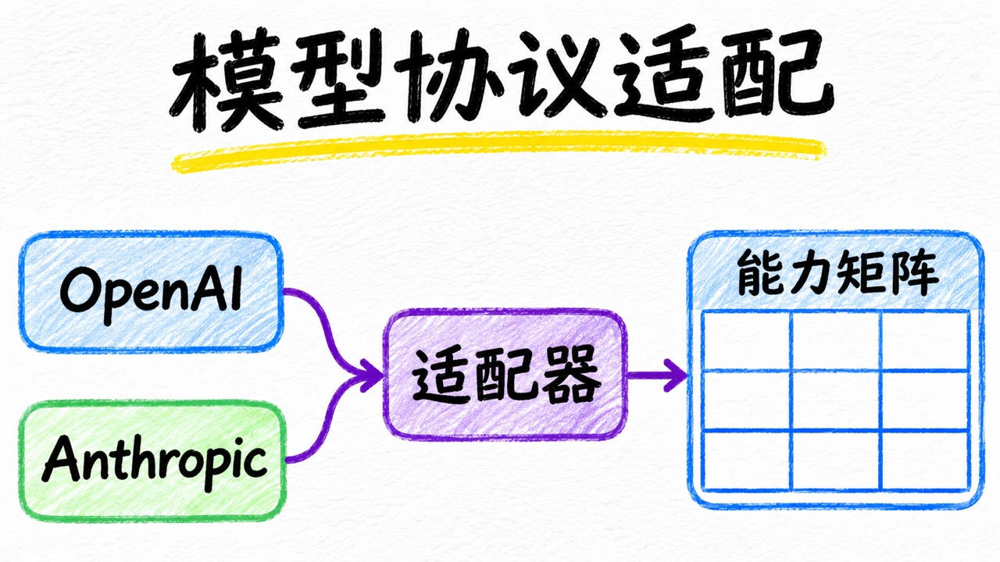

同一个退款任务需要输出一句报告，也可能先调用 `summarize_refunds`。金额是 10、空、0，程序结果是有效 2 条、缺失 1 条、均值 5。切换模型供应商后，应用仍想用同一段代码控制工具执行和界面更新。难点在于两家把「可显示文本」「准备执行工具」「可继续的会话」放在不同字段里。

**协议适配器**负责把应用意图编码为供应商请求，再把供应商事件还原为应用能消费的类型。**能力矩阵**是「某个模型、某个端点及版本支持哪些行为」的记录。两者合起来回答：这项能力怎么调用、现在能不能用？先修参见 [API-05](api-05-sse-streaming-tools.md) 和 [API-06](api-06-anthropic-messages.md)。

## 1. 从真正需要的输入和输出出发

以这个退款应用为例，可以先定义下面的最小协议：

| 内部对象 | 应用使用的内容 | 边界 |
| --- | --- | --- |
| `Request` 和 `Message` | 应用指令、按序消息、文本或图片块、工具定义、可选输出 Schema | 供应商专用字段进入对应适配器配置。 |
| `TextDelta` | 可展示文本，以及 Item 或块索引 | 文本增量按相应流归并，保留位置。 |
| `ToolReady` | 调用 ID、工具名、已解析的参数 | 只在供应商相应终态后交付，再由执行器校验权限和业务参数。 |
| `Usage` | 输入、输出及可选缓存读写计数 | 字段缺失保留为未知。跨供应商对比前确认用量定义。 |
| `Failure` | HTTP 状态、供应商错误码、限流等待信息、请求 ID | 根据实际错误码和应用状态决定是否重试。 |

编码请求时，OpenAI Responses 可把应用指令放在 `instructions`，用 `input` 表达消息和工具结果。Anthropic Messages 用顶层 `system` 与 `messages`，结果块放在新的 user 消息里。公共类型便于业务使用。供应商原始 Item 或内容块仍要保留，例如后续续接可能需要完整的工具和推理对象，调试也需要原始错误类型。 [Responses 迁移指南](https://developers.openai.com/api/docs/guides/migrate-to-responses) · [Claude Messages API](https://platform.claude.com/docs/en/api/messages)

> **实践建议**：先用供应商的官方 SDK（软件开发工具包）完成认证、传输和基础流读取，再在应用层做小的能力适配。对本机实验可直接放入合成帧。这样可以独立验证映射，又能追溯真正的请求字段。

## 2. 能力矩阵按端点、型号和版本记录

下面是本例的**文档核对表**。两列是具体组合，部署前还须用项目账号验证权限、模型和请求样本。两家都支持某能力，也可能限制字段或组合用法。

| 能力及验收样本 | OpenAI Responses，`gpt-6-luna` | Anthropic Messages，`claude-opus-5-5` / `2026-10-21` |
| --- | --- | --- |
| 文本与流式 | 用同一条任务核对 `output_text.delta` 拼接与响应终态 | 核对 `text_delta` 拼接与 `message_stop` |
| 自定义工具 | 校验 `function_call` 和 `function_call_output.call_id` 往返 | 校验 `tool_use` 与紧邻的 `tool_result.tool_use_id` 往返 |
| 图片输入 | 将同一张合成退款表截图作为 `input_image`，检查数字 10 和 0 | 将截图作为 `image` 内容块，核对同一组数据 |
| 结构化最终文本 | 用 `text.format` 的 Schema 检查类型，另验业务值与截断 | 用 `output_config.format` 的 JSON Schema，核对模型和版本支持范围 |
| 两轮上下文续接 | 验证 `previous_response_id` 续接或完整 Item 重放 | 本例直接调用 `/v1/messages`，由应用回传消息历史，单独记录是否采用其它会话能力 |
| 速率与错误 | 记录 `x-request-id`、HTTP 状态、`error.code`，区分余额和临时限流 | 记录 `request-id`、HTTP 状态、`error.type` 与等待提示，流内也可能出现错误 |

本例可把请求「需要服务端响应 ID 续接」设为能力门槛。对于只配置了消息历史重放的适配器，先拒绝该配置，然后由应用显式选择重放历史。不需要把不支持的选项悄悄去掉。图片、工具和 Schema 同时使用时，也用真实的组合请求验证。 [GPT-6 Luna 模型说明](https://developers.openai.com/api/docs/models/gpt-6-luna) · [Claude 结构化输出](https://platform.claude.com/docs/en/build-with-claude/structured-outputs) · [Claude API 错误](https://platform.claude.com/docs/en/api/errors)

## 3. 最小实验，统一结果并保留原始数据

以下代码先编码一条图文用户消息及输出 Schema，再接收两家接口的合成**非流式**响应，以及已经由传输层解出的各一条文本增量。存为 `provider_adapters.py` 后运行 `python3 provider_adapters.py`。工具结果从完整响应提取，交给执行器前仍要做 [API-04](api-04-function-calling-structured-outputs.md) 的业务校验。图像 URL 用来检查编码形状，脚本会保留该字符串，不会下载图片。

```python
from dataclasses import dataclass
import json


@dataclass
class UserMessage:
    text: str
    image_url: str


def encode(vendor, message, schema, previous_response_id=None):
    format_spec = {"type": "json_schema", "schema": schema}
    if vendor == "openai":
        request = {
            "model": "gpt-6-luna",
            "input": [{"role": "user", "content": [
                {"type": "input_text", "text": message.text},
                {"type": "input_image", "image_url": message.image_url, "detail": "auto"},
            ]}],
            "text": {"format": dict(format_spec, name="report", strict=True)},
        }
        if previous_response_id:
            request["previous_response_id"] = previous_response_id
        return request
    if vendor != "anthropic" or previous_response_id:
        raise ValueError("selected adapter cannot continue by OpenAI response ID")
    return {
        "model": "claude-opus-5-5", "max_tokens": 256,
        "messages": [{"role": "user", "content": [
            {"type": "text", "text": message.text},
            {"type": "image", "source": {"type": "url", "url": message.image_url}},
        ]}],
        "output_config": {"format": format_spec},
    }


@dataclass
class Turn:
    text: str
    calls: list
    usage: dict
    raw: dict


def text_delta(vendor, event):
    if vendor == "openai" and event["type"] == "response.output_text.delta":
        return event["output_index"], event["delta"]
    if vendor == "anthropic" and event["type"] == "content_block_delta":
        delta = event["delta"]
        if delta["type"] == "text_delta":
            return event["index"], delta["text"]
    return None


def adapt_openai(response):
    if response["status"] != "completed":
        raise ValueError(f"OpenAI response status: {response['status']}")
    items = response["output"]
    text = "".join(
        block["text"] for item in items if item["type"] == "message"
        for block in item["content"] if block["type"] == "output_text"
    )
    calls = [
        (item["call_id"], item["name"], json.loads(item["arguments"]))
        for item in items if item["type"] == "function_call"
    ]
    return Turn(text, calls, response.get("usage") or {}, response)


def adapt_anthropic(response):
    reason = response["stop_reason"]
    if reason not in {"end_turn", "tool_use", "stop_sequence"}:
        raise ValueError(f"Anthropic stop reason: {reason}")
    blocks = response["content"]
    text = "".join(block["text"] for block in blocks if block["type"] == "text")
    calls = [
        (block["id"], block["name"], block["input"])
        for block in blocks if block["type"] == "tool_use"
    ]
    return Turn(text, calls, response.get("usage") or {}, response)


def failure(vendor, status, headers, body):
    error = body.get("error", {})
    code_field = "code" if vendor == "openai" else "type"
    id_header = "x-request-id" if vendor == "openai" else "request-id"
    normalized_headers = {name.lower(): value for name, value in headers.items()}
    return {
        "vendor": vendor, "status": status, "code": error.get(code_field),
        "request_id": normalized_headers.get(id_header),
        "retry_after": normalized_headers.get("retry-after"),
        "raw": body,
    }


openai = {"status": "completed", "output": [
    {"type": "message", "content": [{"type": "output_text", "text": "开始核对。"}]},
    {"type": "function_call", "call_id": "call_1", "name": "summarize_refunds",
     "arguments": '{"amounts":[10,null,0]}'},
], "usage": {"input_tokens": 80, "output_tokens": 15}}
anthropic = {"stop_reason": "tool_use", "content": [
    {"type": "text", "text": "开始核对。"},
    {"type": "tool_use", "id": "toolu_1", "name": "summarize_refunds",
     "input": {"amounts": [10, None, 0]}},
], "usage": {"input_tokens": 82, "output_tokens": 18, "cache_read_input_tokens": 0}}

left, right = adapt_openai(openai), adapt_anthropic(anthropic)
assert left.text == right.text
assert left.calls[0][1:] == right.calls[0][1:] == (
    "summarize_refunds", {"amounts": [10, None, 0]},
)
assert left.calls[0][0] != right.calls[0][0]
assert right.usage["cache_read_input_tokens"] == 0
assert left.usage.get("cache_read_input_tokens") is None
assert left.raw is openai and right.raw is anthropic

o_event = {"type": "response.output_text.delta", "output_index": 0, "delta": "有效"}
a_event = {"type": "content_block_delta", "index": 0,
           "delta": {"type": "text_delta", "text": "有效"}}
assert text_delta("openai", o_event) == text_delta("anthropic", a_event) == (0, "有效")
credit = failure("openai", 429, {"X-Request-Id": "req_demo"},
                 {"error": {"code": "credit_balance_exhausted"}})
rate = failure("anthropic", 429, {"Retry-After": "2", "Request-Id": "req_demo_a"},
               {"error": {"type": "rate_limit_error"}})
assert (credit["code"], rate["code"], rate["retry_after"]) == (
    "credit_balance_exhausted", "rate_limit_error", "2",
)

message = UserMessage("检查图中有几条有效退款", "https://example.com/refunds.png")
schema = {"type": "object", "properties": {"count": {"type": "integer"}},
          "required": ["count"], "additionalProperties": False}
o_request = encode("openai", message, schema, "resp_demo_previous")
a_request = encode("anthropic", message, schema)
assert o_request["input"][0]["content"][1]["image_url"] == message.image_url
assert a_request["messages"][0]["content"][1]["source"]["url"] == message.image_url
assert o_request["text"]["format"]["schema"] == a_request["output_config"]["format"]["schema"]
assert o_request["previous_response_id"] == "resp_demo_previous"
try:
    encode("anthropic", message, schema, "resp_demo_previous")
except ValueError:
    pass
else:
    raise AssertionError("unexpected cross-provider state continuation")
print("文本与工具参数可统一；调用 ID、缓存用量和失败语义各自保留。")
```

两家交给执行器的函数名和参数一致，调用 ID 保持为原来的两个值。输入 80 与 82 Token 是合成用量，数量本身无需对齐。真正对接时为每家保存固定响应样本，再跑文本、图像、工具、结构化输出、断流和错误的验收。模型切换时先使用能力矩阵过滤能接单的配置，接下来才比较质量、延迟和用量。

## 下一篇

[**API-08《实时语音 Agent 的双向流》**](api-08-realtime-voice-agent.md) 会把文字流扩展为持续采集和播放的音频链路，实测一次打断怎样清空播放队列。 [LLM 与 Agent 学习路线图](https://blog.lacknb.cn/articles/2026/11/19/1795058329577.html)
