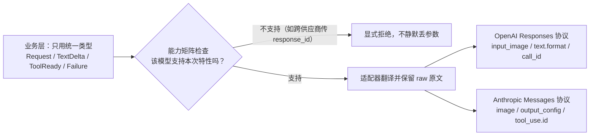

我们的退款统计程序已经在生产上跑顺了。某天老板说：我们要同时接入 OpenAI 和 Anthropic，甚至以后还要接本地 vLLM，业务代码能不能**只写一套**，切换模型只改个配置名？

可看了前几篇就知道，两家的「方言」差异不小：OpenAI Responses 用 `instructions`、`input_image`、`function_call.call_id`；Anthropic Messages 用顶层 `system`、`image` 块、`tool_use.id`；连 `429` 限流错误码放在 `error.code` 还是 `error.type` 都不一样！如果把这些判断全用 `if/else` 散落在业务代码里，很快就会变成一团没人敢改的乱麻。

> **先用大白话讲明白**：解决多模型接入靠两件法宝——**「适配器（Adapter）」+「能力矩阵（Capability Matrix）」**：
> 1. **协议适配器（万能转换插头）**：上层业务只跟一套干净的内部对象打交道（比如 `TextDelta` 表示吐出的文字、`ToolReady` 表示收齐的工具调用、`Usage` 表示用量账单、`Failure` 表示错误）。适配器负责在发出前把内部意图「翻译」成各自供应商的方言，收到响应后再统一翻译回来——**同时口袋里保留一份原始响应 `raw`，以防续接对话或查错时要用**。
> 2. **能力矩阵（电器电压核对表）**：千万别假装所有模型「能力完全一样」！能力矩阵白纸黑字记着「哪家、哪个版本支不支持图片、Schema 或服务端会话 ID 续接」。如果业务硬要使用不支持的特性，**直接明确报错拦截，绝不要为了凑合跑通悄悄把参数丢掉！**



先修建议看 [API-05 流式解析](api-05-sse-streaming-tools.md) 和 [API-06 Anthropic 内容块](api-06-anthropic-messages.md)。

## 1. 先定义一套业务真正关心的内部类型

设计适配器最忌讳照搬某一家供应商的全部复杂字段。站在退款统计业务角度，应用真正需要消费的就这五件事：

| 内部对象名称 | 上层业务拿到什么？ | 设计边界（千万别写漏） |
| --- | --- | --- |
| **`Request` / `Message`** | 业务指令、对话消息列表、图文块、工具清单、可选输出 Schema | 各家特有的开关放进独立 `provider_options`，别污染主模型 |
| **`TextDelta`** | 可直接往屏幕追加的一小段文字 + 所在块索引 | 多块并发流式输出时靠索引对号归并 |
| **`ToolReady`** | 调用单号 ID、工具名、解析好的字典参数 | **必须等到流式终态确认后再交付**，再做权限和来源校验 |
| **`Usage`** | 输入 Token、输出 Token、以及可选的缓存读写细分 | 某家没报的字段留成 `None`（未知），**不要用 0 假装测量了** |
| **`Failure`** | HTTP 状态码、统一抽象错误码、`Retry-After`、请求追踪 ID | **请求头名先小写归一化**（HTTP/1.1 与 HTTP/2 大小写习惯不同） |

> **工程实战建议**：不要自己从零用 `socket` 或裸写网络重连去封装 HTTP——先用两家官方维护好的 SDK 搞定认证、SSL、传输超时和基础流拆包，**在官方 SDK 上面再套一层薄薄的几十行协议适配器**，既稳又能保留原始对象调试！ [Responses 迁移指南](https://developers.openai.com/api/docs/guides/migrate-to-responses) · [Claude Messages API](https://platform.claude.com/docs/en/api/messages)

## 2. 能力矩阵：精确到「接口路径 + 模型名 + API 版本」

光在表格里写「OpenAI 支持结构化输出」远远不够！必须写明**「哪一个接口 + 哪一个具体模型 + 哪一个日期版本 + 用哪组测试样本验过」**，上线前全部跑通一遍：

| 验收项目 | OpenAI Responses（`gpt-6-luna`） | Anthropic Messages（`claude-opus-5-5` / `2026-10-21`） |
| --- | --- | --- |
| **流式纯文本** | 拼接 `response.output_text.delta` 并核对终态 | 拼接 `text_delta` 并核对 `message_stop` |
| **自定义工具** | 校验 `function_call` 与 `function_call_output.call_id` | 校验 `tool_use` 与紧邻 `tool_result.tool_use_id` |
| **图片输入** | 把退款截图挂成 `input_image`，核对看清 10 和 0 | 把截图挂成 `image` 块，核对同一结果 |
| **结构化输出** | 配 `text.format` 校验 JSON Schema | 配 `output_config.format`，核对支持的版本范围 |
| **多轮会话续接** | 支持 `previous_response_id` 或完整 Item 重放 | 本例直连 `/v1/messages`，由应用重放消息历史 |
| **限流与报错** | 抓 `x-request-id` 与 `error.code` | 抓 `request-id` 与 `error.type`（留意流中途也可能抛错） |

> **容易踩的坑（绝不做「静默降级」）**：假如业务请求传了 OpenAI 专有的 `previous_response_id` 想在服务端续接历史，但当前路由被切到了直连 `/v1/messages` 的 Anthropic 适配器——这时候绝不能偷偷把这个字段删掉直接发出去（否则模型全忘了前几轮对话，结果还以为接上了！），而应该像下面代码一样**直接抛出 `ValueError` 拒绝执行**，提醒上层改走「重放完整消息历史」路径。 [GPT-6 Luna 说明](https://developers.openai.com/api/docs/models/gpt-6-luna) · [Claude 结构化输出](https://platform.claude.com/docs/en/build-with-claude/structured-outputs) · [Claude 错误码](https://platform.claude.com/docs/en/api/errors)

## 3. 最小完整实验：双向编码、解码与错误归一化

把下面代码存为 `provider_adapters.py`，只用标准库运行 `python3 provider_adapters.py`。它完整走通了：把带截图和 JSON Schema 的请求编成两家协议、提取两家流式文本增量、解析工具调用并保留 `raw`、把两家不同字段的 `429` 限流统一成规范 `Failure` 结构，并拦截跨供应商无效状态参数：

```python
from dataclasses import dataclass
import json


@dataclass
class UserMessage:
    text: str
    image_url: str


def encode(vendor, message, schema, previous_response_id=None):
    format_spec = {"type": "json_schema", "schema": schema}
    if vendor == "openai":
        request = {
            "model": "gpt-6-luna",
            "input": [{"role": "user", "content": [
                {"type": "input_text", "text": message.text},
                {"type": "input_image", "image_url": message.image_url, "detail": "auto"},
            ]}],
            "text": {"format": dict(format_spec, name="report", strict=True)},
        }
        if previous_response_id:
            request["previous_response_id"] = previous_response_id
        return request
    if vendor != "anthropic" or previous_response_id:
        raise ValueError("selected adapter cannot continue by OpenAI response ID")
    return {
        "model": "claude-opus-5-5", "max_tokens": 256,
        "messages": [{"role": "user", "content": [
            {"type": "text", "text": message.text},
            {"type": "image", "source": {"type": "url", "url": message.image_url}},
        ]}],
        "output_config": {"format": format_spec},
    }


@dataclass
class Turn:
    text: str
    calls: list
    usage: dict
    raw: dict


def text_delta(vendor, event):
    if vendor == "openai" and event["type"] == "response.output_text.delta":
        return event["output_index"], event["delta"]
    if vendor == "anthropic" and event["type"] == "content_block_delta":
        delta = event["delta"]
        if delta["type"] == "text_delta":
            return event["index"], delta["text"]
    return None


def adapt_openai(response):
    if response["status"] != "completed":
        raise ValueError(f"OpenAI response status: {response['status']}")
    items = response["output"]
    text = "".join(
        block["text"] for item in items if item["type"] == "message"
        for block in item["content"] if block["type"] == "output_text"
    )
    calls = [
        (item["call_id"], item["name"], json.loads(item["arguments"]))
        for item in items if item["type"] == "function_call"
    ]
    return Turn(text, calls, response.get("usage") or {}, response)


def adapt_anthropic(response):
    reason = response["stop_reason"]
    if reason not in {"end_turn", "tool_use", "stop_sequence"}:
        raise ValueError(f"Anthropic stop reason: {reason}")
    blocks = response["content"]
    text = "".join(block["text"] for block in blocks if block["type"] == "text")
    calls = [
        (block["id"], block["name"], block["input"])
        for block in blocks if block["type"] == "tool_use"
    ]
    return Turn(text, calls, response.get("usage") or {}, response)


def failure(vendor, status, headers, body):
    error = body.get("error", {})
    code_field = "code" if vendor == "openai" else "type"
    id_header = "x-request-id" if vendor == "openai" else "request-id"
    normalized_headers = {name.lower(): value for name, value in headers.items()}
    return {
        "vendor": vendor, "status": status, "code": error.get(code_field),
        "request_id": normalized_headers.get(id_header),
        "retry_after": normalized_headers.get("retry-after"),
        "raw": body,
    }


openai = {"status": "completed", "output": [
    {"type": "message", "content": [{"type": "output_text", "text": "开始核对。"}]},
    {"type": "function_call", "call_id": "call_1", "name": "summarize_refunds",
     "arguments": '{"amounts":[10,null,0]}'},
], "usage": {"input_tokens": 80, "output_tokens": 15}}
anthropic = {"stop_reason": "tool_use", "content": [
    {"type": "text", "text": "开始核对。"},
    {"type": "tool_use", "id": "toolu_1", "name": "summarize_refunds",
     "input": {"amounts": [10, None, 0]}},
], "usage": {"input_tokens": 82, "output_tokens": 18, "cache_read_input_tokens": 0}}

left, right = adapt_openai(openai), adapt_anthropic(anthropic)
assert left.text == right.text
assert left.calls[0][1:] == right.calls[0][1:] == (
    "summarize_refunds", {"amounts": [10, None, 0]},
)
assert left.calls[0][0] != right.calls[0][0]
assert right.usage["cache_read_input_tokens"] == 0
assert left.usage.get("cache_read_input_tokens") is None
assert left.raw is openai and right.raw is anthropic

o_event = {"type": "response.output_text.delta", "output_index": 0, "delta": "有效"}
a_event = {"type": "content_block_delta", "index": 0,
           "delta": {"type": "text_delta", "text": "有效"}}
assert text_delta("openai", o_event) == text_delta("anthropic", a_event) == (0, "有效")
credit = failure("openai", 429, {"X-Request-Id": "req_demo"},
                 {"error": {"code": "credit_balance_exhausted"}})
rate = failure("anthropic", 429, {"Retry-After": "2", "Request-Id": "req_demo_a"},
               {"error": {"type": "rate_limit_error"}})
assert (credit["code"], rate["code"], rate["retry_after"]) == (
    "credit_balance_exhausted", "rate_limit_error", "2",
)

message = UserMessage("检查图中有几条有效退款", "https://example.com/refunds.png")
schema = {"type": "object", "properties": {"count": {"type": "integer"}},
          "required": ["count"], "additionalProperties": False}
o_request = encode("openai", message, schema, "resp_demo_previous")
a_request = encode("anthropic", message, schema)
assert o_request["input"][0]["content"][1]["image_url"] == message.image_url
assert a_request["messages"][0]["content"][1]["source"]["url"] == message.image_url
assert o_request["text"]["format"]["schema"] == a_request["output_config"]["format"]["schema"]
assert o_request["previous_response_id"] == "resp_demo_previous"
try:
    encode("anthropic", message, schema, "resp_demo_previous")
except ValueError:
    pass
else:
    raise AssertionError("unexpected cross-provider state continuation")
print("文本与工具参数可统一；调用 ID、缓存用量和失败语义各自保留。")
```

> **想再深入一层？** 留意上面对 `usage` 的严谨处理：Anthropic 报了 `cache_read_input_tokens: 0`，适配器如实保留；OpenAI 这条响应里没带这个字段，`left.usage.get(...)` 保持为 `None`——跨供应商比对成本和耗时前，必须统一先核清各家的计费口径，不能拿两份残缺数字直接相减！

## 下一篇

到现在为止，我们的通信方式都是「你问一句（HTTP POST）、它吐完再轮到你（SSE 单向流）」。可要是换成**打电话一样的实时语音助手**——模型嘴里正念着「均值为五……」，用户突然插嘴打断「为什么是五？」——单向 HTTP 流立刻不够用了！请看本专题最后一篇 [API-08《实时语音 Agent 的双向流》](api-08-realtime-voice-agent.md)，用浏览器合成音实测一次毫秒级音频打断。系列入口见 [LLM 与 Agent 学习路线图](llm-agent-learning-roadmap.md)。
