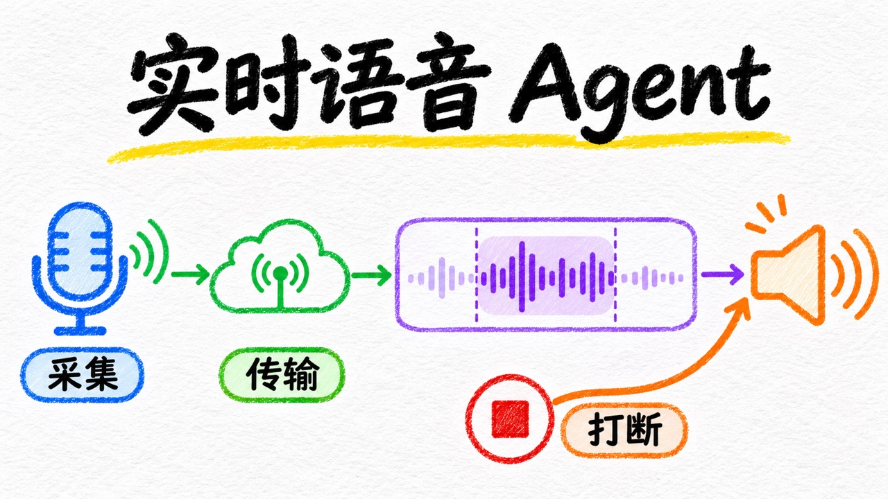

模型正在朗读「有效金额两条，缺失一条，均值为五」。用户听到一半，插话问「为什么是五？」。应用要同时接收麦克风输入、让旧回答停止播放，再处理新问题。生成停止时，已经缓冲的音频还可能在播，因此要观察播放队列。

[F-09](https://blog.lacknb.cn/articles/2026/11/20/1795161444330.html) 讲过一条消息怎样携带不同内容块，[API-05](api-05-sse-streaming-tools.md) 跟踪单个 HTTP 响应的增量。语音会话让客户端同时上传音频和接收媒体或事件，因此需要跟踪两条链路。 [OpenAI Realtime 会话指南](https://developers.openai.com/api/docs/guides/realtime-conversations)

## 1. 从麦克风到扬声器

```text
上行：麦克风 → 浏览器采集 → 双向连接 → 输入缓冲区 → 语音活动检测
下行：模型音频 → 双向连接 → 远端媒体轨或本地队列 → 扬声器
控制：用户开口事件 → 停止旧回答 → 清理尚未播放的内容 → 新一轮
```

**VAD（Voice Activity Detection，语音活动检测）**判断一段音频里何时开始或结束说话。服务端可以发出 `input_audio_buffer.speech_started` 和 `input_audio_buffer.speech_stopped`。基于静音的检测使用声音和时长判断边界。支持语义检测的会话还能用内容推断一句话有没有说完。两种检测都会影响等待时间、误切分和插话体验。

**播放队列**保存已收到但还没播出的片段。测量时区分「服务已经生成」「客户端收到」「扬声器已经播出」三个进度。如果收到 1,200 ms、只播了 400 ms，插话后剩余 800 ms 应丢弃。服务端对话也需按所用传输修正，以便下一轮正确识别用户听到的内容。

## 2. 两种连接各负责什么？

| 要做的事 | 浏览器 WebRTC | 应用 WebSocket |
| --- | --- | --- |
| 建立连接 | 浏览器用 `RTCPeerConnection` 生成 SDP（Session Description Protocol，会话描述协议）offer，经应用后端或短期凭据完成握手 | 应用建立双向 WebSocket，服务端提供认证与会话配置 |
| 发送麦克风音频 | `getUserMedia` 取得本地媒体轨，加入连接 | 应用自行采集、转码和分块，通过 `input_audio_buffer.append` 发送音频字节的 Base64 表示 |
| 接收模型音频 | 浏览器接收远端媒体轨并播放，数据通道可传控制事件 | 按文档处理 `response.output_audio.delta`，解码、排队和播放 |
| 遇到插话 | 按 VAD 配置处理自动打断。自行控制时发送适用的取消和 `output_audio_buffer.clear` 事件 | 停止本地播放，清队列，按已播放毫秒数发 `conversation.item.truncate`，并按配置处理仍在生成的响应 |
| 缓冲由谁管理 | WebRTC 负责媒体传输与常见实时网络适配 | 应用负责缓冲、播放进度和晚到片段的丢弃策略 |

WebRTC（Web Real-Time Communication，网页实时通信）接入一般从申请麦克风权限开始，再建立 `RTCPeerConnection` 和事件数据通道，拿到 SDP answer 后设置为远端描述。正式接入用应用后端或短期凭据，长期 API 密钥留在后端。

**PCM（Pulse-Code Modulation，脉冲编码调制）**把音量采样值表示为数值。以 WebSocket 的单声道、24 kHz、16 位 PCM 为例，每秒采 24,000 点，每点 2 字节，20 ms 的音频块是 **24,000 × 0.020 × 2 = 960 字节**。Base64 是把二进制表示为文本的编码。会话配置决定格式和采样率。若把 WAV 作为输入，先解码出所需 PCM，文件头不能当音频片段发出。 [OpenAI WebRTC 接入](https://developers.openai.com/api/docs/guides/realtime-webrtc) · [OpenAI WebSocket 接入](https://developers.openai.com/api/docs/guides/realtime-websocket)

## 3. 一次插话按什么顺序走？

用 WebSocket 跟踪正在播的旧回答，客户端已记下 `item_id` 和 `content_index`，也能查询已经播了多少毫秒：

1. 收到开口事件，记下本地时刻和这条音频的已播时长。
2. 停止本地播放器，丢弃旧回答的待播片段，标记旧回答失效，用来过滤晚到的增量。
3. 若模型还在生成且未自动取消，发送 `response.cancel`。再给音频条目发送下面的截断事件，令服务端上下文保留实际已播放的部分。
4. 继续处理用户的新语音，等新回答到来再建立新队列。

```json
{
  "type": "conversation.item.truncate",
  "item_id": "item_demo_old_answer",
  "content_index": 0,
  "audio_end_ms": 400
}
```

在 OpenAI 的 WebRTC 路径，服务端管理输出缓冲，可按会话设置自动中断并修正未播内容。手动管理时，对应的缓冲区清空事件是 `output_audio_buffer.clear`。取消生成、清除缓冲、同步对话历史影响的是三个不同状态。测试插话时分别检查。 [OpenAI Realtime 打断流程](https://developers.openai.com/api/docs/guides/realtime-conversations)

## 4. 在浏览器里测一次本地停止

把下面保存成 `interrupt.html`，用浏览器打开后点击「开始」。实验用 **440 Hz 合成音**模拟正在读的回复，提前排入三个片段，再在播放约 400 ms 时模拟用户开口。页面会打印从开口信号到音频节点收到 `ended` 事件的时间，并检查待播和晚到的数据是否被丢弃。实验用合成音，所以没有麦克风权限和 API Key 依赖。

**Web Audio** 是浏览器的音频处理接口。用 `AudioContext.currentTime` 算音频图中已经播过的时长，用 `performance.now()` 算主线程事件间隔。后者包含事件派发与回调调度，物理输出设备的静音时刻需要另测。

```html
<!doctype html>
<html lang="zh-CN">
<meta charset="utf-8">
<title>语音打断实验</title>
<button id="start">开始</button>
<pre id="log" aria-live="polite"></pre>
<script>
const button = document.querySelector("#start");
const log = document.querySelector("#log");
const sleep = ms => new Promise(resolve => setTimeout(resolve, ms));

button.onclick = async () => {
  button.disabled = true;
  log.textContent = "";
  const ctx = new AudioContext();
  try {
    await ctx.resume();
    const gain = ctx.createGain();
    gain.gain.value = 0.06;
    gain.connect(ctx.destination);

    const turnId = "refund-report";
    let cancelled = false;
    const queue = [];
    function enqueue(id, time) {
      if (cancelled || id !== turnId) return false;
      const oscillator = ctx.createOscillator();
      oscillator.frequency.value = 440;
      oscillator.connect(gain);
      oscillator.start(time);
      oscillator.stop(time + 0.75);
      queue.push({ oscillator, time });
      return true;
    }

    const start = ctx.currentTime + 0.05;
    for (let i = 0; i < 3; i++) enqueue(turnId, start + i * 0.75);
    const deadline = performance.now() + 3000;
    while (ctx.currentTime < start + 0.4) {
      if (performance.now() > deadline) throw new Error("音频时钟未推进");
      await sleep(10);
    }

    const interruptedAt = performance.now();
    const stopTime = ctx.currentTime;
    cancelled = true;
    const active = queue.find(({time}) => time <= stopTime && stopTime < time + 0.75);
    const queued = queue.filter(({time}) => time > stopTime);
    if (!active) throw new Error("没有正在播放的片段，请让页面保持前台重试");
    const ended = new Promise(resolve => {
      active.oscillator.onended = () => resolve(performance.now());
    });
    const played = Math.max(0, Math.round((stopTime - start) * 1000));
    [active, ...queued].forEach(({oscillator}) => oscillator.stop(stopTime));
    queue.length = 0;

    const droppedLate = !enqueue(turnId, stopTime + 1);
    const latency = (await ended) - interruptedAt;
    log.textContent = [
      "已播时长（音频图）：" + played + " ms",
      "打断信号 → ended 回调：" + latency.toFixed(1) + " ms",
      "丢弃待播片段：" + queued.length,
      "拒绝旧回答的晚到片段：" + droppedLate,
    ].join("\n");
  } catch (error) {
    log.textContent = error.message;
  } finally {
    await ctx.close();
    button.disabled = false;
  }
};
</script>
</html>
```

一次无界面 Chrome 157 实测在已播 **403 ms** 时触发打断，**1.4 ms** 后收到 `ended` 回调，丢弃两段待播音频，并拒绝晚到的旧片段。在桌面浏览器里运行时能先听到一小段音。`ended` 回调时延会随浏览器和负载变化。测端到端打断时，分别记下用户实际开口、VAD 事件抵达以及设备输出静音的时刻。最后一个时间点可通过音频回录校对。 [Web Audio 音频节点与 ended 事件](https://www.w3.org/TR/webaudio/#AudioScheduledSourceNode)

## 下一部分

第三部分从 **LE-07《第一篇，什么是评测，如何跑通第一条用例》** 开始。继续用这份退款 CSV，做一个最小评分器，分别验收格式、有效金额条数和均值。 [LLM 与 Agent 学习路线图](https://blog.lacknb.cn/articles/2026/11/19/1795058329577.html)
