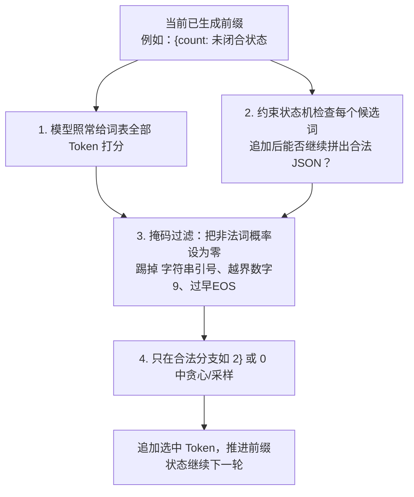

三行退款记录是 `10, 空, 0`，正确答案有效条数是 `2`。在前面 [API-10](api-10-prompt-comparison.md) 跑小模型时，模型动不动就在 JSON 外面套一层代码围栏，或者把 `2` 写成字符串 `"2"`——明明我们在 [API-04](api-04-function-calling-structured-outputs.md) 里写了 JSON Schema，为什么开了 `strict: true` 之后模型就乖乖不写围栏、绝不写 `"2"` 了？

秘密就在推理引擎每吐出一个 Token 的瞬间所做的拦截，这门技术叫**约束解码（Constrained Decoding）**。

> **先用大白话讲明白**：普通生成就像做无拘无束的自由填空，词表里 15 万个词只要得分高都能被抽中；而**约束解码就像拿了一把镂空「填表尺」压在试卷上**——
> - 模型原本依然照常给所有 15 万个字打出各自得分；
> - 但在**选词抽签的那一刹那**，约束状态机看一眼已经写出来的前缀（比如 `{"count":`），把所有**「写上去就会立刻破坏 JSON 格式或违反 Schema」的字（比如引号 `"`、不在列表里的 `9`、还没写完括号就出现的 `<EOS>`）强行蒙黑抹成零概率**；
> - 这样模型就只能在剩下的合法候选（比如 `2}` 或 `0`）里选一个，**在结构上做到百发百中**！



[OpenAI Structured Outputs](https://developers.openai.com/api/docs/guides/structured-outputs)

## 1. 把范围缩到极小，手算一遍每步怎么「踢出非法词」

为了只用纸笔看懂，把教学 JSON Schema 缩成极简版：只允许输出 `count` 一个整数字段，且只允许枚举值 `[0, 2]`：

```json
{
  "type": "object",
  "properties": {"count": {"type": "integer", "enum": [0, 2]}},
  "required": ["count"],
  "additionalProperties": false
}
```

如果去掉多余空白，整个宇宙里只有两个彻底合法的字符串：**`{"count":0}`** 和 **`{"count":2}`**（业务上只有 `2` 对，`0` 是算错但格式完全合法）。

假设模型现在已经写到了前缀 `{"count":`，下面看下一轮得分最高的前五个候选词怎么挨个过安检门：

| 候选 Token 文字 | 模型给的原始分数 | 追加进前缀后还能完成合法 JSON 吗？ | 约束状态机裁决 |
| --- | ---: | --- | --- |
| `"`（双引号） | **10**（最高分） | `{"count":"` → 开启字符串，违背整数规定 | **踢掉（置为 `-∞`）** |
| `9` | 9 | `{"count":9` → 不在枚举 `[0, 2]` 里 | **踢掉** |
| `2}` | **8** | `{"count":2}` → **一口气填完数字并闭合对象** | **放行！** |
| `0` | 7 | `{"count":0` → 后面还能接 `}` 闭合 | **放行！** |
| `<EOS>`（结束符） | 6 | 对象大括号还没闭合，直接结束属于坏 JSON | **踢掉** |

看清分权了吗？**「谁分数高」依然由大模型决定；「谁有资格上桌参加评选」由约束状态机一票否决**！按 [F-04](f-04-autoregressive-sampling.md) 贪心选择，原本想选高分引号 `"` 的冲动被硬生生按住，最终从放行列表里挑中最高分的 `2}`；哪怕采样抽签不幸抽中了 `0`，凑出来的也是结构合法的 `{"count":0}`。

## 2. 自由生成、JSON 模式、Schema 约束和应用校验四层对比

很多同学不知道这四种做法该选哪一种，拿退款统计对比一次就彻底分清：

| 方式 | 它能帮你挡住什么错？ | 挡不住什么（应用还必须自己干啥）？ |
| --- | --- | --- |
| **自由生成** | 全靠提示词自觉，啥都挡不住 | 连是否可解析、缺字段、写围栏全都得靠代码自己兜底 |
| **JSON 模式（`json_object`）** | 保证吐出来的文本符合通用 JSON 语法（不至于多写中文废话） | **挡不住字段名写错、类型写成字符串、或输出超长半途截断** |
| **Schema 约束（`json_schema`）** | 在引擎支持的子集内，死锁字段名、类型、必填和枚举范围 | **照样挡不住 `{"count":0}` 这种业务算错、超预算截断和安全拒答！** |
| **应用层业务校验** | 拿到完整输出后，用代码查 `status`、核对业务真值与来源 | 校验挂了得由应用自己决定重试、报明确错误或转人工 |

> **想再深入一层？** 真实词表里的 Token 经常跨过好几个字符边界（比如上面例子的 `2}` 就同时跨了值和右花括号两个语法节点），还要处理 JSON 字符串转义、任意空白空格和深层嵌套对象，因此生产级引擎（如 vLLM、OpenAI 底层）会提前把 JSON Schema 编译成有限状态机（FSM）或下推自动机，甚至对词表预先建好合法掩码索引，避免每吐一个字都遍历十几万个词！接不同引擎的 `structured_outputs` 前，务必查阅该引擎版本的支持特性表（有些不支持正则回溯或递归 Schema）。 [vLLM Structured Outputs 文档](https://docs.vllm.ai/en/latest/features/structured_outputs/)

## 3. 用标准库 Python 演示状态机筛词与 6 种结果识别

把下面代码保存为 `decode_constraints.py`，只用标准库运行 `python3 decode_constraints.py`：

```python
import json

LEGAL = ('{"count":0}', '{"count":2}')
EOS = "<eos>"

STEPS = [
    ['报告：', '{', EOS],
    ['"count":', '"total":', EOS],
    ['"2"', '9', '2}', '0', EOS],
    [EOS, '}'],
]


def allowed(prefix, token):
    if token == EOS:
        return prefix in LEGAL
    extension = prefix + token
    return any(target.startswith(extension) for target in LEGAL)


def decode(steps):
    prefix = ""
    for ranked in steps:
        candidates = [token for token in ranked if allowed(prefix, token)]
        if not candidates:
            return "no-transition", prefix
        token = candidates[0]
        print(repr(prefix), "允许", candidates, "选择", repr(token))
        if token == EOS:
            return "completed", prefix
        prefix += token
    return "output-limit", prefix


def assess(status, text):
    if status != "completed":
        return status
    try:
        value = json.loads(text)
    except ValueError:
        return "bad-json"
    if (
        not isinstance(value, dict) or set(value) != {"count"}
        or type(value["count"]) is not int or value["count"] not in (0, 2)
    ):
        return "bad-schema"
    return "ok" if value["count"] == 2 else "wrong-count"


completed = decode(STEPS)
wrong_steps = [*STEPS[:2], ['0', '2}'], ['}'], [EOS]]
assert assess(*completed) == "ok"
assert assess(*decode(wrong_steps)) == "wrong-count"
assert assess(*decode(STEPS[:2])) == "output-limit"
assert assess("completed", '{"count":"2"}') == "bad-schema"
assert assess("completed", '报告：有两条') == "bad-json"
assert assess("refusal", "") == "refusal"
print("结构成功、业务错误、截断和拒答均能区分")
```

看脚本里故意测的几种失败分支，上线接结构化输出时每一种都要照顾到：
1. **第一轮**模型最想吐的是中文闲聊 `'报告：'`，状态机直接把它踢掉，迫使它从 `'{'` 开局；
2. **`wrong_steps` 分支**：哪怕一步不差遵守了约束解码走到终点，拿到的是 `{"count":0}`，最终依然被应用层判为 **`wrong-count`**；
3. **`STEPS[:2]` 模拟 `output-limit`**：万一设的 `max_output_tokens` 太小，生成半截停在 `'{"count":'` 就撞天花板截断了，此时**约束解码救不了你**，必须先看响应状态 `status != "completed"`（如 Responses 的 `incomplete`），不要傻傻把半截字符串喂给 `json.loads`！
4. **`refusal` 拒答**：模型拒绝回答时走专门的拒答内容块，同样不会强迫硬凑业务 JSON。

## 下一篇

解决了「结构长啥样」之后，在实际产品里用户等不了几秒钟整包返回，几乎全都开着 `stream: true` 打字机流式输出。可如果模型边打字边调用工具，参数被拆成了一截一截碎片、甚至一个中文字符劈成两个网络包到达，程序怎么接才不会半路崩溃？请看下一篇 [API-05《SSE 和流式工具调用》](api-05-sse-streaming-tools.md)。系列入口见 [LLM 与 Agent 学习路线图](llm-agent-learning-roadmap.md)。
