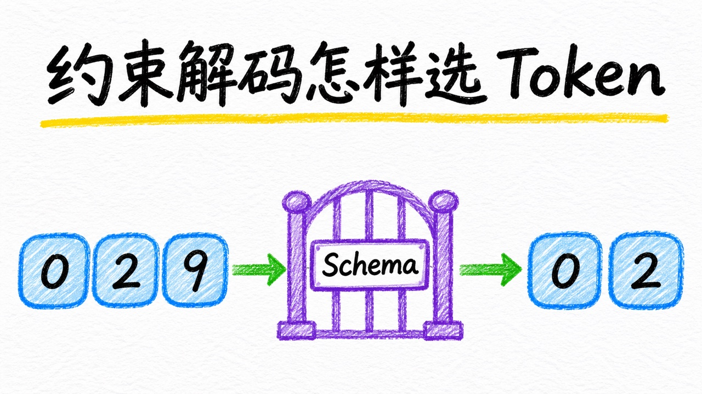

三条退款记录有 10、空、0。业务上有两条有效金额。为把关键机制放大，先让模型只交出一项 `count`，并约定这个教学例子只接受 0 和 2。若它输出 `{"count":"2"}`，这已经是合法 JSON，但 `"2"` 是字符串。若它输出 `{"count":0}`，结构能通过，统计仍然错了。

[API-04](api-04-function-calling-structured-outputs.md) 用 JSON Schema 描述报告形状。本篇继续往模型生成过程里看。**约束解码（constrained decoding）**指每一步都根据输出约束过滤候选，然后才从可行候选里选下一个 Token。Token 是模型用于生成文本的单位，可以覆盖一个字符，也可以覆盖一段文本。 [OpenAI Structured Outputs](https://developers.openai.com/api/docs/guides/structured-outputs)

## 1. 先把约束缩小到能手算的范围

教学 Schema 是：

```json
{
  "type": "object",
  "properties": {"count": {"type": "integer", "enum": [0, 2]}},
  "required": ["count"],
  "additionalProperties": false
}
```

`enum` 限定枚举值。`required` 指定字段必须出现。`additionalProperties: false` 关闭额外字段。真实 JSON 还允许无关空白等写法，例如 `{ "count": 2 }`。为了手算，以下只跟踪两个紧凑字符串 **`{"count":0}`** 和 **`{"count":2}`**。两条路径都符合 Schema，只有后者符合这份 CSV 的业务事实。

假设模型已经生成 `{"count":`。下面按教学分数从高到低列出五个候选：

| 候选 Token 的文字 | 原始分数 | 追加后还能完成一条允许的输出？ |
| --- | ---: | --- |
| `"2"` | 10 | 否。引号开始了字符串。 |
| `9` | 9 | 否。这个整数不在枚举里。 |
| `2}` | 8 | 是。一个 Token 同时写入整数和右花括号。 |
| `0` | 7 | 是。接下来补右花括号即可。 |
| EOS | 6 | 否。当前对象还没有完结。 |

**EOS（End of Sequence，序列结束）**是生成结束标记。把不可行候选屏蔽，再做 F-04 讲的贪心选择，分数最高的可行项是 `2}`。如果采样选了 `0`，也能得到另一条合法结构。一般流程是「模型给候选分数 → 约束状态排除非法候选 → 采样或贪心 → 更新约束状态」。分数来自模型，是否允许来自约束，两者各有职责。

## 2. 自由生成、JSON 模式和 Schema 分别约束什么？

| 方式 | 约束对象 | 本例要继续检查什么 |
| --- | --- | --- |
| 自由生成 | 提示只描述期望，生成允许一般文本 | 是否能解析、字段结构、业务数值 |
| JSON 模式 | 要求结果是有效 JSON，仍要处理异常终止 | 字段类型、必填项、枚举与业务数值 |
| Schema 约束 | 在支持的模型和 Schema 子集内规定生成结构 | 拒答、截断、服务状态及业务数值 |
| 应用校验 | 在拿到输出后执行代码 | 校验失败时重试、请求澄清或返回明确错误 |

工程实现通常把语法或 Schema 转成可持续推进的状态，再根据词表中每个 Token 解码后的内容算出可行候选。因为一个 Token 可能跨过多个字符边界，候选判断要覆盖它的完整内容。生产实现还需处理字符串转义、空白、嵌套和更大的词表。不同引擎支持的 Schema 特性和正则实现可能不同，接入时要以所用版本的请求接口和限制为准。OpenAI Responses 用 `text.format` 描述结构化文本。vLLM 的当前官方文档展示了 OpenAI 兼容接口中的 `structured_outputs` 扩展以及可选后端。 [OpenAI 与 JSON 模式对照](https://developers.openai.com/api/docs/guides/structured-outputs) · [vLLM Structured Outputs](https://docs.vllm.ai/en/latest/features/structured_outputs/)

## 3. 最小实验，逐步打印允许的 Token

把下面保存为 `decode_constraints.py`，运行 `python3 decode_constraints.py`。这段代码的词表和分数是手写的，使用前缀匹配模拟最小约束状态。它把同样的候选分数用于合法结构和数值错误两组路径，并检查向上层暴露的结果状态。

```python
import json

LEGAL = ('{"count":0}', '{"count":2}')
EOS = "<eos>"

STEPS = [
    ['报告：', '{', EOS],
    ['"count":', '"total":', EOS],
    ['"2"', '9', '2}', '0', EOS],
    [EOS, '}'],
]


def allowed(prefix, token):
    if token == EOS:
        return prefix in LEGAL
    extension = prefix + token
    return any(target.startswith(extension) for target in LEGAL)


def decode(steps):
    prefix = ""
    for ranked in steps:
        candidates = [token for token in ranked if allowed(prefix, token)]
        if not candidates:
            return "no-transition", prefix
        token = candidates[0]
        print(repr(prefix), "允许", candidates, "选择", repr(token))
        if token == EOS:
            return "completed", prefix
        prefix += token
    return "output-limit", prefix


def assess(status, text):
    if status != "completed":
        return status
    try:
        value = json.loads(text)
    except ValueError:
        return "bad-json"
    if (
        not isinstance(value, dict) or set(value) != {"count"}
        or type(value["count"]) is not int or value["count"] not in (0, 2)
    ):
        return "bad-schema"
    return "ok" if value["count"] == 2 else "wrong-count"


completed = decode(STEPS)
wrong_steps = [*STEPS[:2], ['0', '2}'], ['}'], [EOS]]
assert assess(*completed) == "ok"
assert assess(*decode(wrong_steps)) == "wrong-count"
assert assess(*decode(STEPS[:2])) == "output-limit"
assert assess("completed", '{"count":"2"}') == "bad-schema"
assert assess("completed", '报告：有两条') == "bad-json"
assert assess("refusal", "") == "refusal"
print("结构成功、业务错误、截断和拒答均能区分")
```

运行第一轮时，初始候选里的「报告：」被排除。状态走到 `{"count":` 时，只剩 `2}` 和 `0`。选中 `2}` 后，下一步允许 EOS。第二轮把 0 放到可行候选的首位，输出可以完整结束，最后被业务校验判为 `wrong-count`。`STEPS[:2]` 模拟输出预算只够写字段名前缀，上层读到 `output-limit`，不把它交给 JSON 解析器。真实 Responses 的状态名和原因字段按接口读取，例如 `status: "incomplete"` 及相应 `incomplete_details`。拒答则看对应内容类型。

## 下一篇

[**API-05《SSE 和流式工具调用》**](api-05-sse-streaming-tools.md) 将把工具参数拆成多个增量，跟踪从响应字节到完整 JSON 的拼接过程。 [LLM 与 Agent 学习路线图](https://blog.lacknb.cn/articles/2026/11/19/1795058329577.html)
