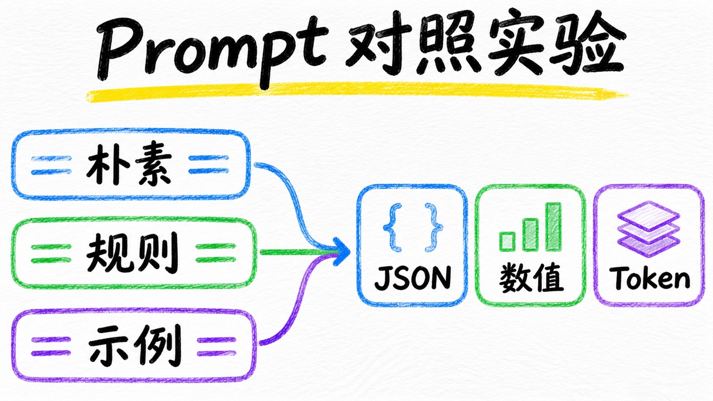

在 [API-02《OpenAI Chat Completions 的消息协议》](api-02-chat-completions-messages.md) 里，我们把「忽略空金额，保留 0」作为规则发给模型。现在把这段规则删掉，再加回来，最后加两个示例。它们分别能解决什么问题？这个问题靠一条看起来顺眼的回复回答不了。

**Prompt Engineering（提示词工程）**在这里指设计模型看到的指令、上下文和示例，再用固定样本观察修改有什么效果。三组都做同一件事：读退款 CSV，返回有效条数、缺失条数和均值。先用程序定好预期结果，再让模型答题。

## 1. 同一份 CSV，三个提示版本

以 API-01 的三行数据为例。金额是 10、空、0，有效两条，缺失一条，平均值是 **(10 + 0) ÷ 2 = 5**。期望返回：

```json
{"count": 2, "missing": 1, "mean": 5}
```

三组都拿到同样的列名和输出要求。字段 `count`、`missing` 是行数，`mean` 是与输入相同单位的金额。每次只改变一处提示内容：

| 版本 | 共同格式要求之上的变化 | 这一步比较什么 |
| --- | --- | --- |
| V0 朴素 | 只让模型统计有效条数、缺失条数和均值 | 模型怎样自行理解「有效」 |
| V1 规则 | 加上空值排除、零值保留、无有效值时填 `null` | V1 对比 V0，观察明确统计口径后的变化 |
| V2 示例 | 保留 V1 全部规则，再加两个输入和输出示例 | V2 对比 V1，观察示例带来的增量和额外输入长度 |

V2 的做法叫 **few-shot prompting（少样本提示）**，把少量示范放进本次模型输入。两个示例覆盖「空值与 0 同时出现」和「全部缺失」。下面的留出样本另有自己的金额和行组合，示范中的行内容不会原样参与打分。 [OpenAI 提示词工程指南](https://developers.openai.com/api/docs/guides/prompt-engineering)

## 2. 在请求前写好评分条件

**留出样本**是实验评分用的数据。先决定这六条样本和正确结果，再运行三种提示。这样看到失败时可以分析原因。若根据这六条反复改提示，改完后需要另留一组未参与调试的数据来估计效果。

| 样本 | 按行列出的金额 | 期望 `count` | 期望 `missing` | 期望 `mean` |
| --- | --- | ---: | ---: | ---: |
| mixed | 10、空、0 | 2 | 1 | 5 |
| zero | 0、0 | 2 | 0 | 0 |
| all-empty | 空、空、空 | 0 | 3 | `null` |
| negative | -4、空、-2 | 2 | 1 | -3 |
| fraction | 1、4 | 2 | 0 | 2.5 |
| single | 空、7、空、空 | 1 | 3 | 7 |

CSV（Comma-Separated Values，逗号分隔值）的每行都有 ID，所以空金额会写作 `2,` 这种形式，整行仍然存在。评分分三栏：

1. **格式通过率** = 符合约定的输出数 ÷ 全部试次数。输出必须是一个原样可解析的 JSON 对象，只有三个字段，类型正确，金额是有限数或 `null`。Markdown 围栏包住的 JSON 在这个严格接口里算格式失败。
2. **业务正确率** = 三项都等于参考结果的输出数 ÷ 全部试次数。格式失败计 0。出现 `{"count":3,"missing":0,"mean":3.33}` 时，格式可通过，业务仍失败。
3. **输入 Token**取聊天模板编码后的输入长度。Token 是模型切分文本后处理的单位，计数包含消息包装和提示示例。脚本汇报各组平均长度，同时保留每条的整数计数。这里是本地模型输入长度，在线接口的计费字段要读对应供应商的用量。

真实退款金额通常需要确定小数精度和舍入规则。本次测试的均值都是整数、半整数或 `null`，评分使用直接相等，便于读者手算。 [OpenAI 评测实践指南](https://developers.openai.com/api/docs/guides/evaluation-best-practices)

## 3. 跑同一模型做 18 次生成

沿用 F-01 的 Qwen2.5-0.5B-Instruct 和同一权重版本。把下方 Python 代码保存为 `compare_prompts.py`。运行它需要 Python 3.12、PyTorch 和 Transformers，首次会下载公开权重。建议在独立虚拟环境执行。

```bash
python -m pip install "torch==2.11.0" "transformers[chat-template]==5.13.0" "tokenizers==0.22.2"
python compare_prompts.py
```

这里用 CPU 上的贪心解码（greedy decoding），每一步选分数最高的 Token。模型权重、数据、解码方式和输出上限 96 Token 都固定。每版对每条样本跑一次，适合观察失败模式。改成随机采样时，需要固定采样参数并为每条样本做多次试验。源码入口分别是 `apply_chat_template`、`model.generate` 和本文的 `grade`。 [Qwen 模型卡](https://huggingface.co/Qwen/Qwen2.5-0.5B-Instruct/tree/7ae557604adf67be50417f59c2c2f167def9a775)

```python
import json
import math
from pathlib import Path
from statistics import mean

MODEL = "Qwen/Qwen2.5-0.5B-Instruct"
REVISION = "7ae557604adf67be50417f59c2c2f167def9a775"
BASE = (
    '统计下面 CSV 的 amount 列。只输出一个 JSON 对象，'
    '字段为 count（有效条数）、missing（缺失条数）、mean（均值）。'
)
RULE = (
    '空金额计入 missing，从 count、总和和均值分母中排除。'
    '金额 0 要保留。mean 等于总和除以 count；count 为 0 时 mean 为 null。'
)
EXAMPLES = (
    '示例 1 输入：\nid,amount\n1,0\n2,\n3,6\n'
    '输出：{"count":2,"missing":1,"mean":3}\n'
    '示例 2 输入：\nid,amount\n1,\n'
    '输出：{"count":0,"missing":1,"mean":null}'
)
PROMPTS = {"V0": BASE, "V1": f"{BASE}\n{RULE}", "V2": f"{BASE}\n{RULE}\n{EXAMPLES}"}
CASES = {
    "mixed": ([10, None, 0], (2, 1, 5)),
    "zero": ([0, 0], (2, 0, 0)),
    "all-empty": ([None, None, None], (0, 3, None)),
    "negative": ([-4, None, -2], (2, 1, -3)),
    "fraction": ([1, 4], (2, 0, 2.5)),
    "single": ([None, 7, None, None], (1, 3, 7)),
}
FIELDS = ("count", "missing", "mean")


def csv_text(amounts):
    rows = [f"{i},{value if value is not None else ''}"
            for i, value in enumerate(amounts, 1)]
    return "\n".join(["id,amount", *rows])


def unique_fields(pairs):
    result = dict(pairs)
    if len(result) != len(pairs):
        raise ValueError("duplicate JSON key")
    return result


def grade(output, expected):
    try:
        parsed = json.loads(output, object_pairs_hook=unique_fields)
    except ValueError:
        return "invalid-json"
    if not isinstance(parsed, dict) or set(parsed) != set(FIELDS):
        return "wrong-fields"
    amount = parsed["mean"]
    finite_amount = (
        amount is None or type(amount) is int
        or (type(amount) is float and math.isfinite(amount))
    )
    if type(parsed["count"]) is not int or type(parsed["missing"]) is not int or not finite_amount:
        return "wrong-types"
    actual = tuple(parsed[key] for key in FIELDS)
    return "ok" if actual == expected else "wrong-values"


def main():
    import torch
    from transformers import AutoModelForCausalLM, AutoTokenizer, GenerationConfig

    torch.set_num_threads(4)
    tokenizer = AutoTokenizer.from_pretrained(MODEL, revision=REVISION)
    model = AutoModelForCausalLM.from_pretrained(MODEL, revision=REVISION, dtype=torch.float32)
    model.eval()
    config = GenerationConfig(
        max_new_tokens=96,
        do_sample=False,
        eos_token_id=model.generation_config.eos_token_id,
        pad_token_id=tokenizer.pad_token_id,
    )

    with Path("prompt-runs.jsonl").open("w", encoding="utf-8") as log:
        for version, instruction in PROMPTS.items():
            records = []
            for case, (amounts, expected) in CASES.items():
                csv = csv_text(amounts)
                messages = [{"role": "user", "content": f"{instruction}\n\n待统计 CSV：\n{csv}"}]
                batch = tokenizer.apply_chat_template(
                    messages, add_generation_prompt=True,
                    tokenize=True, return_dict=True, return_tensors="pt",
                )
                input_tokens = batch["input_ids"].shape[-1]
                with torch.inference_mode():
                    sequence = model.generate(**batch, generation_config=config)[0]
                generated = sequence[input_tokens:]
                output = tokenizer.decode(generated, skip_special_tokens=True).strip()
                record = {
                    "model": MODEL, "revision": REVISION, "version": version, "case": case,
                    "expected": dict(zip(FIELDS, expected)), "raw": output,
                    "input_tokens": input_tokens, "generated_tokens": len(generated),
                    "grade": grade(output, expected),
                }
                records.append(record)
                log.write(json.dumps(record, ensure_ascii=False) + "\n")

            formatted = sum(row["grade"] in {"ok", "wrong-values"} for row in records)
            correct = sum(row["grade"] == "ok" for row in records)
            avg_tokens = mean(row["input_tokens"] for row in records)
            print(
                f"{version} format={formatted}/{len(records)} "
                f"correct={correct}/{len(records)} input_mean={avg_tokens:.1f}"
            )


if __name__ == "__main__":
    main()
```

## 4. 一次本地实测，18 条回复都卡在格式

使用 Apple Silicon CPU、Python 3.12、PyTorch 2.11.0 和 Transformers 5.13.0 运行上述代码。这次在六条样本上的结果如下：

| 版本 | 格式通过 | 业务正确 | 平均输入 Token |
| --- | ---: | ---: | ---: |
| V0 朴素 | 0/6 | 0/6 | 80.2 |
| V1 规则 | 0/6 | 0/6 | 129.2 |
| V2 示例 | 0/6 | 0/6 | 191.2 |

混合样本 `mixed` 的输入依次是 82、131、193 Token。V0 把 JSON 放进代码围栏，围栏里写出 `count: 1` 和 `mean: 5.0`，均值对了而条数错了。V1 也输出围栏，条数改成 `2`、缺失改成 `1`，却把均值填为 `null`。V2 开头是中文操作步骤。这些是对失败文本的诊断，按预先定义的判定，三条都记为 `invalid-json`。在这次运行里，规则和示例增加了输入，但没有让任何一版通过严格接口。这个结果只覆盖所选模型、解码设置和这组六条数据。

### 保存失败样例

`prompt-runs.jsonl` 每行存一条 JSON 记录，包含版本、样本、原始回复、参考结果、输入长度和判定原因。脚本每次运行会重写这个文件。想只看失败，用下面的命令。之后做 LE-04 回归评测时，可以保留出错的输入、期望结果和对应版本。

```bash
python - <<'PY'
import json

with open("prompt-runs.jsonl", encoding="utf-8") as log:
    for line in log:
        row = json.loads(line)
        if row["grade"] != "ok":
            print(row["version"], row["case"], row["grade"], repr(row["raw"]))
PY
```

拿到结果后，先找 `wrong-values`。这种失败最容易被「能解析 JSON」误判为成功。再查 `invalid-json` 和 `wrong-types`，看是外面多了一层围栏，还是把数值写成字符串。若失败刚好生成了 96 个 Token，结合尾部内容判断是否受生成上限影响。选择提示版本时，比较它在哪些样本改善、在哪些样本退化，以及每轮多带了多少输入 Token。六条数据适合排查和回归，样本扩大后才适合估计生产通过率。

## 下一篇

[**API-03《从 Chat Completions、Assistants 到 Responses》**](api-03-openai-api-evolution.md) 会保留刚才的退款报告，把对话从 `messages` 映射到 Responses 的类型化条目，再追踪一次工具调用。 [LLM 与 Agent 学习路线图](https://blog.lacknb.cn/articles/2026/11/19/1795058329577.html)
