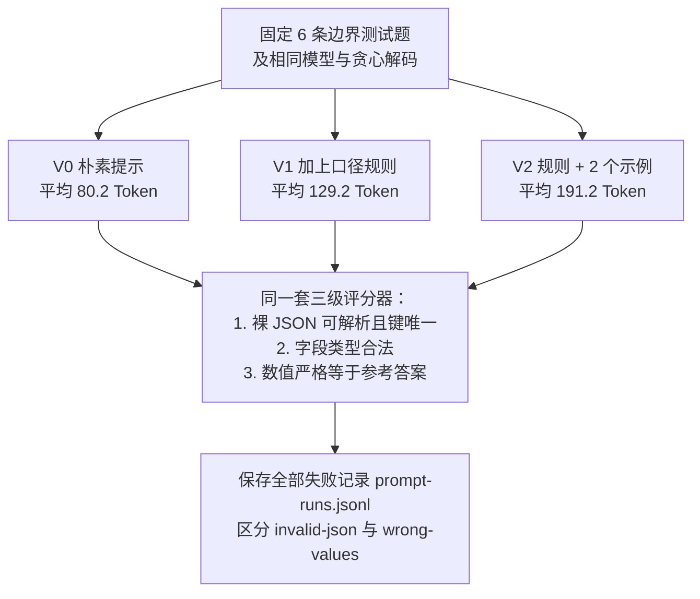

在 [API-02《OpenAI Chat Completions 的消息协议》](api-02-chat-completions-messages.md) 里，我们在指令里写了一句「忽略空金额，保留 0」。现实开发中，改提示词（Prompt）往往全凭感觉：「我再加几个示例是不是就稳了？去掉这句规则行不行？」

可真把模型跑起来，常常发现改完之后**这个例子看起来顺眼了，另一个边界例子却悄悄算错了，或者本来好好返回纯 JSON 忽然外面多了一层 Markdown 代码块围栏**！

> **先用大白话讲明白**：做 **Prompt Engineering（提示词工程）** 不能靠「试一句话看着挺好」拍脑袋，而要像化学做对照实验一样——**固定住模型、解码参数和同一批考题，每次只改一处变量，再拿同一把自动化尺子量结果**：
> - **V0（朴素版）**：只叫它「统计有效条数、缺失条数和均值」，看模型默认怎么理解「有效」；
> - **V1（加规则版）**：在 V0 基础上，一字不漏补清「空金额不算有效、0 必须算有效、全空时均值为 `null`」；
> - **V2（规则 + 示例版，即 Few-shot 少样本提示）**：在 V1 上再贴 2 个带标准格式的示范案例，看对格式和算术有没有帮助，同时记下多出来的输入 Token 成本。



## 1. 先立死规矩，再改提示词

继续沿用三行退款 CSV（`10, 空, 0`）：有效条数 `count` 是 **2**，缺失条数 `missing` 是 **1**，均值 `mean` 是 **(10 + 0) ÷ 2 = 5**。希望模型严格返回下面这样可以直接被程序读取的裸 JSON（JavaScript 对象表示法）：

```json
{"count": 2, "missing": 1, "mean": 5}
```

在运行任何一版提示前，先把 **6 条留出测试集（Holdout Cases）**和标准答案白纸黑字定死，专治各种边缘坑：

| 样本名 | 按行排列的金额 | 期望 `count` | 期望 `missing` | 期望 `mean` | 专测哪个坑？ |
| --- | --- | ---: | ---: | ---: | --- |
| `mixed` | `10, 空, 0` | 2 | 1 | 5 | 混合空值与 0（最经典易错题） |
| `zero` | `0, 0` | 2 | 0 | 0 | 全为 0 也是有效数据 |
| `all-empty` | `空, 空, 空` | 0 | 3 | **`null`** | 分母为 0 绝不能除以 0 报错或填 0 |
| `negative` | `-4, 空, -2` | 2 | 1 | -3 | 负数退款额照常算 |
| `fraction` | `1, 4` | 2 | 0 | 2.5 | 不能偷懒四舍五入截断小数 |
| `single` | `空, 7, 空, 空` | 1 | 3 | 7 | 只有 1 条有效数据时分母为 1 |

> **容易踩的坑（不要「对着考卷改提示」）**：做实验时可以拿这 6 条找问题，但如果你照着这 6 条的报错反复改提示直到 6/6 全过，这叫「过拟合考题」——真实上线前，必须另留一组从未参与调提示的数据再考一次。 [OpenAI 提示词工程指南](https://developers.openai.com/api/docs/guides/prompt-engineering) · [OpenAI 评测最佳实践](https://developers.openai.com/api/docs/guides/evaluation-best-practices)

## 2. 怎么区分「格式没对齐」和「算术算错了」？

很多评测脚本只跑一遍 `json.loads()` 能解析就欢呼通过——或者遇到带了 ```` ```json ```` 围栏的文本就干脆放水正则提取，从而掩盖了下游严格 API 根本解析失败的问题。这组实验把评分分成严格的三栏：

1. **格式通过率**：必须是**能直接解析的裸 JSON 对象**（带 Markdown 围栏直接判 `invalid-json`！同时拒绝重复键如 `{"count":3,"count":2}`），字段必须精准只有 `count`、`missing`、`mean`，且前两个是整数、均值是有限数字或 `null`。
2. **业务正确率**：格式先得通过，而且三个字段值一模一样才计对。像 `{"count":3,"missing":0,"mean":3.33}` 这种，格式能通过，业务会标成 `wrong-values`（失败！）。
3. **输入 Token 成本**：套进模型真实 Chat Template 编码后的总输入长度（提示词 + 示例 + CSV + 角色壳子）。示例贴得越多，每条请求就越贵、越慢。

## 3. 跑同一台本地小模型做 18 次生成

沿用 F-01 固定版本的 `Qwen/Qwen2.5-0.5B-Instruct`，把解码固定为纯贪心选择（`do_sample=False`，不掺杂随机抽签波动），输出预算固定 `96` 个 Token。保存为 `compare_prompts.py`（Python 3.12 + PyTorch 2.11 + Transformers 5.13.0）：

```bash
python -m pip install "torch==2.11.0" "transformers[chat-template]==5.13.0" "tokenizers==0.22.2"
python compare_prompts.py
```

```python
import json
import math
from pathlib import Path
from statistics import mean

MODEL = "Qwen/Qwen2.5-0.5B-Instruct"
REVISION = "7ae557604adf67be50417f59c2c2f167def9a775"
BASE = (
    '统计下面 CSV 的 amount 列。只输出一个 JSON 对象，'
    '字段为 count（有效条数）、missing（缺失条数）、mean（均值）。'
)
RULE = (
    '空金额计入 missing，从 count、总和和均值分母中排除。'
    '金额 0 要保留。mean 等于总和除以 count；count 为 0 时 mean 为 null。'
)
EXAMPLES = (
    '示例 1 输入：\nid,amount\n1,0\n2,\n3,6\n'
    '输出：{"count":2,"missing":1,"mean":3}\n'
    '示例 2 输入：\nid,amount\n1,\n'
    '输出：{"count":0,"missing":1,"mean":null}'
)
PROMPTS = {"V0": BASE, "V1": f"{BASE}\n{RULE}", "V2": f"{BASE}\n{RULE}\n{EXAMPLES}"}
CASES = {
    "mixed": ([10, None, 0], (2, 1, 5)),
    "zero": ([0, 0], (2, 0, 0)),
    "all-empty": ([None, None, None], (0, 3, None)),
    "negative": ([-4, None, -2], (2, 1, -3)),
    "fraction": ([1, 4], (2, 0, 2.5)),
    "single": ([None, 7, None, None], (1, 3, 7)),
}
FIELDS = ("count", "missing", "mean")


def csv_text(amounts):
    rows = [f"{i},{value if value is not None else ''}"
            for i, value in enumerate(amounts, 1)]
    return "\n".join(["id,amount", *rows])


def unique_fields(pairs):
    result = dict(pairs)
    if len(result) != len(pairs):
        raise ValueError("duplicate JSON key")
    return result


def grade(output, expected):
    try:
        parsed = json.loads(output, object_pairs_hook=unique_fields)
    except ValueError:
        return "invalid-json"
    if not isinstance(parsed, dict) or set(parsed) != set(FIELDS):
        return "wrong-fields"
    amount = parsed["mean"]
    finite_amount = (
        amount is None or type(amount) is int
        or (type(amount) is float and math.isfinite(amount))
    )
    if type(parsed["count"]) is not int or type(parsed["missing"]) is not int or not finite_amount:
        return "wrong-types"
    actual = tuple(parsed[key] for key in FIELDS)
    return "ok" if actual == expected else "wrong-values"


def main():
    import torch
    from transformers import AutoModelForCausalLM, AutoTokenizer, GenerationConfig

    torch.set_num_threads(4)
    tokenizer = AutoTokenizer.from_pretrained(MODEL, revision=REVISION)
    model = AutoModelForCausalLM.from_pretrained(MODEL, revision=REVISION, dtype=torch.float32)
    model.eval()
    config = GenerationConfig(
        max_new_tokens=96,
        do_sample=False,
        eos_token_id=model.generation_config.eos_token_id,
        pad_token_id=tokenizer.pad_token_id,
    )

    with Path("prompt-runs.jsonl").open("w", encoding="utf-8") as log:
        for version, instruction in PROMPTS.items():
            records = []
            for case, (amounts, expected) in CASES.items():
                csv = csv_text(amounts)
                messages = [{"role": "user", "content": f"{instruction}\n\n待统计 CSV：\n{csv}"}]
                batch = tokenizer.apply_chat_template(
                    messages, add_generation_prompt=True,
                    tokenize=True, return_dict=True, return_tensors="pt",
                )
                input_tokens = batch["input_ids"].shape[-1]
                with torch.inference_mode():
                    sequence = model.generate(**batch, generation_config=config)[0]
                generated = sequence[input_tokens:]
                output = tokenizer.decode(generated, skip_special_tokens=True).strip()
                record = {
                    "model": MODEL, "revision": REVISION, "version": version, "case": case,
                    "expected": dict(zip(FIELDS, expected)), "raw": output,
                    "input_tokens": input_tokens, "generated_tokens": len(generated),
                    "grade": grade(output, expected),
                }
                records.append(record)
                log.write(json.dumps(record, ensure_ascii=False) + "\n")

            formatted = sum(row["grade"] in {"ok", "wrong-values"} for row in records)
            correct = sum(row["grade"] == "ok" for row in records)
            avg_tokens = mean(row["input_tokens"] for row in records)
            print(
                f"{version} format={formatted}/{len(records)} "
                f"correct={correct}/{len(records)} input_mean={avg_tokens:.1f}"
            )


if __name__ == "__main__":
    main()
```

## 4. 一次扎心的本地实测：18 条全部失败，却教会我们怎么看错题

在 Apple Silicon CPU 上跑完上述 18 次生成后，汇总表长这样：

| 提示版本 | 裸 JSON 格式通过 | 业务完全正确 | 平均输入 Token |
| --- | ---: | ---: | ---: |
| **V0 朴素** | `0/6` | `0/6` | 80.2 |
| **V1 加规则** | `0/6` | `0/6` | 129.2 |
| **V2 加示例** | `0/6` | `0/6` | **191.2** |

看到 `0/6` 别慌——这恰恰是最宝贵的教学实证！我们用下面几行命令翻开刚才存下的原始错题本 `prompt-runs.jsonl` 看看怎么回事：

```bash
python - <<'PY'
import json

with open("prompt-runs.jsonl", encoding="utf-8") as log:
    for line in log:
        row = json.loads(line)
        if row["grade"] != "ok":
            print(row["version"], row["case"], row["grade"], repr(row["raw"]))
PY
```

拆开 `mixed` 样本（输入分别占 82、131、193 Token）发现三版各踩了不同的坑：
- **V0 朴素**：模型把 JSON 放进了 ```` ```json ... ``` ```` 代码围栏里，在严格接口下记作 `invalid-json`；而且里面写成了 `count: 1, mean: 5.0`（均值碰巧对、条数错了！）。
- **V1 加规则**：加了规则后，条数 `2` 和缺失 `1` 终于改对了，但依然包了围栏，还把均值填成了 `null`！
- **V2 加示例**：输入涨到了 193 Token，可 0.5B 的小模型不仅没更老实，反而先在开头输出了一段中文分析步骤才写答案！

> **大白话小结**：**光靠提示词和示例并不保证小模型乖乖吐出裸 JSON，有时越加示例反而越话痨、Token 还贵了一倍多！** 这也正是为什么后续我们需要学 [API-04](api-04-function-calling-structured-outputs.md) 的结构化输出 Schema、以及 [API-09](api-09-constrained-decoding.md) 的约束解码——从底层机制上锁死 JSON 结构；或者把算术干脆交给外部工具函数算，模型只负责调工具！把这批失败样例 `prompt-runs.jsonl` 留好，后面的 `LE-04` 回归门禁还会拿它反复验收。

## 下一篇

做好一轮轮单调稳定的实验对比后，下一步要搞清 OpenAI 家族的三代协议到底是怎么演变的——为什么从自己维护 `messages` 的 Chat Completions，中间出现了已退役的 Assistants，最终进化到如今以类型化条目为核心的 Responses？请看下一篇 [API-03《从 Chat Completions、Assistants 到 Responses》](api-03-openai-api-evolution.md)。系列入口见 [LLM 与 Agent 学习路线图](llm-agent-learning-roadmap.md)。
