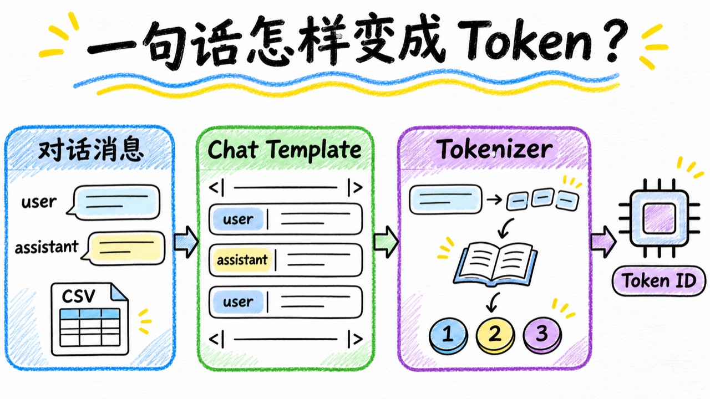
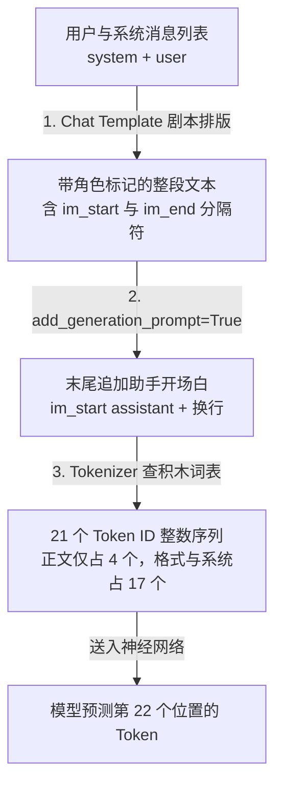
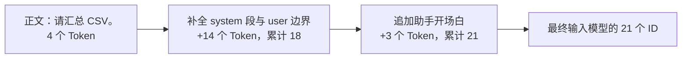

你在聊天框里只打了「请汇总 CSV。」六个字。可如果你把这次请求抓包拆开，会发现送进 Qwen2.5 模型的不是 6 个字，也不是 4 个词，而是一串 **21 个整数**。单独给「请汇总 CSV。」编码明明只有 **4 个整数**，多出来的 **17 个整数** 是从哪冒出来的？

> **先用大白话讲明白**：你可以把大语言模型想象成一个**只认识数字编号、不认识汉字和标点的超级算术机**。在它干活前，必须经过两道「翻译安检」：
> 1. **Chat Template（对话模板）—— 排好「剧本场记」**：光给台词，模型分不清哪句是系统规定、哪句是用户提问、现在轮到谁接话。对话模板就像剧组场记，给每句话贴上角色标签和起止分隔符，并在最后贴好一张「助手请开始接话」的牌子。
> 2. **Tokenizer（分词器）—— 查「积木编号本」**：拿到排好版的剧本后，分词器用一本事先编好的词典，把文字拆成大大小小的积木块（**Token**），再把每块积木查表换成一个整数编号（**Token ID**）。

下面我们用 Qwen2.5 的真实配置，从头到尾跑通这 21 个数字的诞生过程。只需要一台能跑 Python 的普通电脑（无需显卡）就能亲手验证。



## 1. 先把一句话拆成四个积木编号

先撇开角色和格式，只看用户输入的那一句「请汇总 CSV。」。如果一个字一个字地编数字，句子太长、计算太慢；如果整句话编成一个号，世上有无数句话，词典根本装不下。

于是工程师取了个折中：**按常见片段切分**。一个被切出来的小片段就叫一个 **Token（词元）**；记录所有常见片段和编号的对照表叫 **词表（Vocabulary）**；查表得到的整数叫 **Token ID（词元编号）**。后续神经网络算的，全都是这些编号对应的向量。

用 Qwen2.5 的 Tokenizer 切分「请汇总 CSV。」，它会被切成四块：

| 顺序 | Token 对应的文本 | Token ID | 大白话解释 |
| --- | --- | ---: | --- |
| 1 | `请` | 14880 | 常见单字，单独占一块 |
| 2 | `汇总` | 108788 | 高频双字词，直接打包成一块 |
| 3 | `␣CSV` | 27445 | `␣` 是空格；空格加英文缩写刚好在词表里有整块 |
| 4 | `。` | 1773 | 中文句号占一块 |

于是这 6 个字变成了 `[14880, 108788, 27445, 1773]` 这 4 个整数。

再用同一本 Qwen 词表试四个容易让人意外的小例子：

| 输入 | Token ID 序列 | 数量 | 为什么会这样切？ |
| --- | --- | ---: | --- |
| `你好` | `[108386]` | 1 | 高频词整合成 1 块，比拆成「你」「好」更省长度 |
| `Hello` | `[9707]` | 1 | 常见英文单词直接占 1 块 |
| `␣Hello` | `[21927]` | 1 | 前面多一个空格，整块变了，**编号也彻底变了** |
| `sum(x)` | `[1242, 2075, 8]` | 3 | 写代码时被切成了 `sum`、`(x`、`)` 三块 |

> **大白话小结**：Token 不是「字数」，也不是「英语单词数」。前面有没有空格、中英文混排、代码里的括号，都会改变切法。所以**算长度、算费用、卡上限，永远以目标模型自己的 Tokenizer 实测为准**，千万不能用 `len(text)` 拍脑袋估算。

> **想再深入一层？** 如果你目前只想建立直觉、能动手算 Token 数，跳过下面这段直接看第 2 节即可；如果你想搞懂词表是怎么训练出「合并规则」的，以及为什么代码里打印中文有时会出现 `ä½łå¥½` 这种奇怪字符，继续看下面这段拆解。

### 深入拆解：BPE 合并规则与 UTF-8 字节编码

现代大语言模型最常用的分词算法叫 **BPE（Byte Pair Encoding，字节对编码）**。你可以把训练词表的过程想象成**编一本不断升级的简写字典**：

1. 一开始，字典里只有最基础的 256 个字节（Byte，任何人类文字、Emoji、代码在计算机底层都是 UTF-8 字节序列，这样就**绝对不会出现「词典里查不到」的生僻字报错**）。
2. 训练词表时，程序在海量语料里统计哪两个相邻片段最常连在一起出现——比如 `汇` 和 `总` 经常黏在一起，就把 `汇总` 合成一个新条目放进词典、发一个新编号；`␣` 和 `CSV` 经常一起出现，也合成一块。
3. 重复合并几万到十几万次后，高频词和常见偏旁都变成了整块积木。真正拿来切分新文本时，Tokenizer 只按学好的优先级把相邻片段一路合并到不能再合为止。

至于不同模型之间编号能不能混用？**绝对不能**。比如 `14880` 在 Qwen2.5 里代表「请」，在 Llama 或 GPT 的词表里可能是完全不同的单词甚至乱码，因为每家训练词表时合并顺序和词表大小都不一样。

## 2. Chat Template 怎样交代谁在说话

应用里，发给大模型的聊天记录通常是一组带角色的消息列表：

```json
[
    {"role": "system", "content": "你是报表助手。"},
    {"role": "user", "content": "请汇总 CSV。"}
]
```

这里有两个角色：`system` 是应用在幕后给助手定的规矩，`user` 是用户说的话（如果之前聊过几轮，还会有 `assistant` 代表助手的历史回答）。可底层的语言模型本质上只会做「文字接龙」——你给它一段连续字符，它猜下一个字符。如果我们直接把两句话粘在一起送过去，模型根本分不清「哪句是规矩、哪句是提问、现在是不是该我回答了」。

**Chat Template（对话模板）**就是用来解决「谁在说话、说到哪结束」的格式剧本。把上面两条消息交给 Qwen2.5 的模板，并告诉它「接下来该助手说了」（`add_generation_prompt=True`），文本会被排成下面这样：

```text
<|im_start|>system
你是报表助手。<|im_end|>
<|im_start|>user
请汇总 CSV。<|im_end|>
<|im_start|>assistant
```

逐行看这段剧本的机关：
- `<|im_start|>` 和 `<|im_end|>` 是词表里专门预留的**特殊 Token（Special Token，控制标记）**，分别对应固定编号 `151644` 和 `151645`。普通用户文本几乎不会用到这种尖括号组合，模型看到它们就知道「一段角色发言开始了 / 结束了」。
- 前两段各自用 `<|im_start|>角色名\n内容<|im_end|>` 包得严严实实，说明这两句话已经说完。
- 最关键的是最后一行：`<|im_start|>assistant` 后面跟着一个换行，但**没有 `<|im_end|>`**！这就是参数 `add_generation_prompt=True` 追加的**生成提示（Generation Prompt）**——相当于给模型搭好了舞台开场白，逼着模型自然而然接着往下演「助手的台词」，直到它自己吐出 `<|im_end|>` 为止。

现在终于能把开篇的「4 → 18 → 21」账本一笔一笔算清楚了：

| 这一步往剧本里加了什么 | 新增 Token 数 | 累计总数 |
| --- | ---: | ---: |
| 用户正文「请汇总 CSV。」 | 4 | 4 |
| 系统人设整段（9 个）+ 用户段的起止标记、角色名与换行（5 个） | 14 | 18 |
| 末尾助手开场白 `<|im_start|>assistant\n`（`[151644, 77091, 198]`） | 3 | 21 |



> **容易踩的坑**：
> 1. **漏传 `add_generation_prompt=True`**：如果最后少了那 3 个开场白 Token，输入停在 `<|im_end|>`，模型接龙时很可能会自己编一个 `<|im_start|>user` 继续替你提问，而不是以助手身份回答！
> 2. **把模板文本又重复加了一遍特殊标记**：如果你先手工渲染出带 `<|im_start|>` 的字符串，再调用 `tokenizer.encode(rendered)` 时忘了关 `add_special_tokens=False`，有些模型会在开头/结尾再强行塞入一遍起止特殊标记，破坏剧本格式。

## 3. 动手在普通电脑跑一遍（看清 4 → 18 → 21）

准备 Python 3.10 或更新版本。以下命令适用于 macOS 和 Linux，会在当前目录建一个独立虚拟环境。首次运行会从 Hugging Face 拉取约几 MB 的 Tokenizer 词表与配置（**不下载大模型权重，纯 CPU 秒跑**）。

```bash
python3 -m venv .venv
source .venv/bin/activate
python -m pip install "transformers[chat-template]==5.13.0" "tokenizers==0.22.2"
```

Windows PowerShell 用 `py -m venv .venv` 创建环境，安装依赖和运行脚本时均用 `.\.venv\Scripts\python.exe` 代替 `python`。

把下面的代码保存为 `tokenizer_demo.py`。固定 `REVISION` 是为了保证每个人拉到的词表、模板和编号分毫不差，最后几行 `assert` 会在任何一步对不上时直接报错提醒。

```python
from transformers import AutoTokenizer

MODEL_ID = "Qwen/Qwen2.5-0.5B-Instruct"
REVISION = "7ae557604adf67be50417f59c2c2f167def9a775"
tokenizer = AutoTokenizer.from_pretrained(MODEL_ID, revision=REVISION)

samples = ("你好", "Hello", " Hello", "sum(x)", "请汇总 CSV。")
for text in samples:
    ids = tokenizer.encode(text, add_special_tokens=False)
    pieces = tokenizer.convert_ids_to_tokens(ids)
    decoded = tokenizer.decode(ids, clean_up_tokenization_spaces=False)
    print(f"{text!r} → {pieces} → {ids}（{len(ids)} Token）")
    assert decoded == text

messages = [
    {"role": "system", "content": "你是报表助手。"},
    {"role": "user", "content": "请汇总 CSV。"},
]

rendered = tokenizer.apply_chat_template(
    messages, tokenize=False, add_generation_prompt=True
)
with_prompt = tokenizer.apply_chat_template(
    messages, tokenize=True, return_dict=False, add_generation_prompt=True
)
without_prompt = tokenizer.apply_chat_template(
    messages, tokenize=True, return_dict=False, add_generation_prompt=False
)
body_only = tokenizer.encode(messages[-1]["content"], add_special_tokens=False)

print("\n模板渲染结果")
print(rendered, end="")
print("\n完整 IDs", with_prompt)
print("正文 / 无生成提示 / 有生成提示", len(body_only), len(without_prompt), len(with_prompt))

# 先渲染再编码，结果应和一步得到的 ID 序列完全相同。
assert with_prompt == tokenizer.encode(rendered, add_special_tokens=False)
assert with_prompt[:len(without_prompt)] == without_prompt
added_ids = with_prompt[len(without_prompt):]
print("模板追加的 IDs", added_ids)
# 边界检查：对比保留与跳过特殊标记时的解码差异。
print("保留特殊标记", repr(tokenizer.decode(added_ids, skip_special_tokens=False)))
print("跳过特殊标记", repr(tokenizer.decode(added_ids, skip_special_tokens=True)))
```

在脚本所在目录运行：

```bash
python tokenizer_demo.py
```

输出末尾应该看到完全相同的数字与片段：

```text
正文 / 无生成提示 / 有生成提示 4 18 21
模板追加的 IDs [151644, 77091, 198]
保留特殊标记 '<|im_start|>assistant\n'
跳过特殊标记 'assistant\n'
```

### 运行时最值得做的三个观察

1. **为什么 `你好` 打印出来是 `['ä½łå¥½']` 乱码？**
   这不是脚本写错了，而是字节级 BPE 分词器为了避免空格、换行和不可见字符干扰词表文本，内部把 UTF-8 的原始字节映射成了一套可见的 Unicode 替身字符。只要调用 `tokenizer.decode(ids)`，就能完整还原回 `'你好'`。注意：如果一个汉字占 3 个 UTF-8 字节但刚好被拆成了两个 Token，**单独解码其中 1 个 Token 可能会看到替换符 ``**，把整段序列一起 `decode()` 才会正常还原。
2. **两步编码与一步编码的等价检查**：
   代码中用 `assert` 验证了：`apply_chat_template(..., tokenize=True)` 一步拿到的序列，和「先 `tokenize=False` 渲染剧本文本，再 `encode(..., add_special_tokens=False)`」完全逐项相等。日常调试 Prompt 出了问题时，强烈建议先用 `tokenize=False` 把完整剧本打印出来肉眼核对一遍。
3. **试着自己加一轮对话**：
   在 `messages` 列表末尾加上 `{"role": "assistant", "content": "请上传文件。"}` 和 `{"role": "user", "content": "已上传。"}` 再跑一次。你会看到 `assistant` 出现了两次：第一次带着完整台词和 `<|im_end|>`（历史记忆），第二次只挂着开头（等待本轮新台词）。

## 4. 想看库里源码从哪里进？

> **想再深入一层？** 如果你已经明白 4 → 18 → 21 并跑通了脚本，这一篇的入门目标已经完成，可以直接跳往下一篇。如果你想追踪 Hugging Face Transformers 和 Qwen 仓库里究竟是哪几行代码把模板和分词器串起来的，可以按固定版本顺着下面三站阅读：

1. **看剧本模板在哪定义**：打开 [Qwen2.5-0.5B-Instruct 的 tokenizer_config.json](https://huggingface.co/Qwen/Qwen2.5-0.5B-Instruct/blob/7ae557604adf67be50417f59c2c2f167def9a775/tokenizer_config.json)，搜索 `chat_template`。你会看到一段 Jinja2 模板脚本，用 `for message in messages` 拼出每个角色段，最后由 `if add_generation_prompt` 决定要不要塞入 `<|im_start|>assistant\n`。
2. **看 Python 怎么把消息套进模板**：打开 [Transformers v5.13.0 的 tokenization_utils_base.py](https://github.com/huggingface/transformers/blob/v5.13.0/src/transformers/tokenization_utils_base.py#L3002)，定位 `PreTrainedTokenizerBase.apply_chat_template()` 和 `render_jinja_template()`。在 `tokenize=True` 分支里，能清楚看到它渲染出字符串后专门传入了 `add_special_tokens=False`。
3. **看词表和合并规则长什么样**：打开 [Qwen2.5 的 tokenizer.json](https://huggingface.co/Qwen/Qwen2.5-0.5B-Instruct/blob/7ae557604adf67be50417f59c2c2f167def9a775/tokenizer.json)，搜索 `added_tokens`（能找到编号 `151644` 和 `151645`）与 `model.merges`（能看到 BPE 合并规则列表）。

- 延伸阅读：[Hugging Face BPE 分词教程](https://huggingface.co/learn/llm-course/chapter6/5) · [Transformers 对话模板官方指南](https://huggingface.co/docs/transformers/v5.13.0/en/chat_templating)

## 下一篇

现在「请汇总 CSV。」已经变成了一排 21 个整整齐齐的整数编号。接下来看 [F-02《Transformer 如何从 Token 算出 logits》](f-02-transformer-logits.md)：模型拿到这 21 个编号后，怎么去查向量表、怎么让词与词互相看懂彼此的意思，最后又怎么算出「下一个字最可能是谁」的分数。系列完整导航见 [LLM 与 Agent 学习路线图](../../llm-agent-learning-roadmap.md)。
