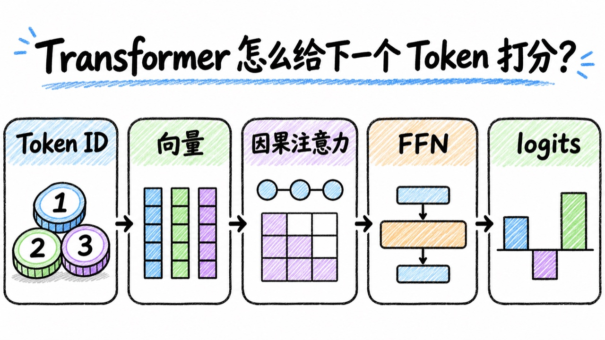
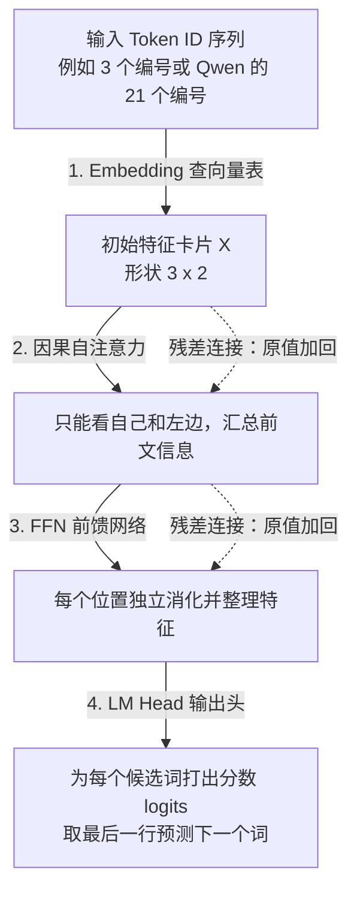
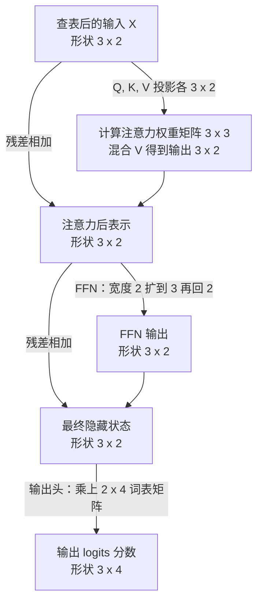

在 [F-01《Tokenizer 与 Chat Template》](f-01-tokenizer-chat-template.md) 里，我们把「请汇总 CSV。」和系统指令排成剧本，变成了 **21 个整数编号**。紧接着的问题是：模型怎么把这 21 个数字变成屏幕上蹦出来的第一个字「当然」？

在「当然」出现在屏幕前，模型已经暗地里给词表里的**每一个**候选词（在 Qwen2.5 里是 151,936 个候选）都打了一个原始分数。**这组有正有负的原始分数，就叫 logits**。分数越高，模型就越觉得「下一个该轮到它上场」。

> **先用大白话讲明白**：可以把 Transformer 内部当成一条三步走的信息加工车间：
> 1. **查字典取卡片（Embedding 嵌入查表）**：每个数字编号去词典里换出一张「特征卡片」（一串小数，叫向量）。
> 2. **开碰头会互相打招呼（因果注意力 Attention）+ 留笔记（残差连接）**：卡片之间互相传递上下文信息——但为了防止考试作弊，**前面的词绝不准偷看后面的词**；每个人开完会后把新收获叠回自己原来的卡片上，避免忘本。
> 3. **关起门单独消化（FFN 前馈网络）+ 裁判打分（LM Head 输出头）**：每个位置把收集到的情报各自整理消化一遍，最后把整排卡片的**最后一张**拿给打分裁判，给词表里 15 万个字每人算一个得分（logits）。

下面先拿 3 个数字、一支纸笔，跟着把整张表算一遍；最后再放到真实的 Qwen 模型里核对张量尺寸。



## 1. 每个编号先查出一张特征卡片（Embedding）

Token ID 只是字典里的页码，比如 `14880` 对应「请」。编号大小没有任何数学意义——`14880` 并不比 `7440` 「大两倍」。

模型拿到编号后，第一件事是去一张巨大的**嵌入表（Embedding Table）**里，按编号抽出对应的那一行数字。这行数字叫做**向量（Vector）**，可以把它看成这个词的「性格与含义指纹」。

为了能手算，我们自己搭一个超迷你的教学模型：词表只有 4 个词，每个词只用 2 个数字表示。输入序列 `[0, 1, 2]`，查表拿到三张卡片：

| 输入位置 | Token ID | 查出来的向量（特征卡片） |
| --- | ---: | --- |
| 第 1 个 | 0 | `[1, 0]` |
| 第 2 个 | 1 | `[0, 1]` |
| 第 3 个 | 2 | `[1, 1]` |

这三行两列的数字表，在程序里叫**张量（Tensor，可以简单理解成多维表格）**，形状写作 **`[3, 2]`**（3 行、2 列）。真实 Qwen 一次会同时处理多条对话，还会在最前面多加一维「批次数（Batch）」。

> **小提示**：光靠查表有个漏洞——同一个词不管出现在句子开头还是结尾，查出来的指纹一模一样。模型还得知道「谁在前、谁在后」。这就需要**位置编码**来帮忙：早期模型把位置向量直接加到卡片上；Qwen2.5 用的是 **RoPE（旋转位置编码）**，在下一篇 [F-03](f-03-attention-heads-rope.md) 会专门拆解它怎样靠「转动角度」记下相对距离。这一篇先略过旋转，把注意力主干算通。 [RoPE 原论文](https://arxiv.org/abs/2104.09864)

## 2. 注意力：怎么开碰头会，又为什么不能剧透？

刚查出来的卡片是死板的，比如「苹果」到底是水果还是手机，必须看周围写了什么才知道。**注意力（Attention）**机制让每个位置的词主动去前文「打听情报」。

每个位置会派出三个分身（都是用线性变换算出来的向量）：
- **Q（Query，查询）**：「我现在缺什么信息？拿着它去找别人对暗号。」
- **K（Key，键）**：「我身上贴着什么检索标签？用来和别人的 Q 对暗号打分。」
- **V（Value，值）**：「暗号对上之后，我真正拿出来给你抄走的干货内容。」

在下面手算例子里，为了算起来轻松，我们把产生 Q、K、V 的变换矩阵全设成「原样输出（单位矩阵）」，也就是说三个分身暂时都等于查表得到的原向量。

### 为什么第 2 个位置绝不能看第 3 个位置？

别忘了语言模型是做「接龙预测」的：训练时整句话一次喂进去，第 1 个位置要猜第 2 个词，第 2 个位置要猜第 3 个词。如果第 2 个位置在计算时能偷看第 3 个词的卡片，那就相当于「看着标准答案抄考卷」，模型根本学不到本事！

因此，生成模型必须戴上一副「遮光眼罩」——**因果遮罩（Causal Mask）**：只准看自己和左边的历史，右边未来位置一概屏蔽：

| 正在算谁（Query 行） \ 允许看谁（Key 列） | 第 1 个 | 第 2 个 | 第 3 个 |
| --- | --- | --- | --- |
| 第 1 个 | 可看 | 屏蔽 | 屏蔽 |
| 第 2 个 | 可看 | 可看 | 屏蔽 |
| 第 3 个 | 可看 | 可看 | 可看 |

### 手算第 2 个位置的注意力

拿第 2 个位置的 `Q = [0, 1]` 走一遍完整步骤：

1. **对暗号算相似度（点积）**：把 `Q` 和三个位置的 `K` 逐个对应相乘再相加：
   - 对第 1 个 `[1, 0]`：`0×1 + 1×0 = 0`
   - 对第 2 个 `[0, 1]`：`0×0 + 1×1 = 1`
   - 对第 3 个 `[1, 1]`：`0×1 + 1×1 = 1`
2. **缩放 + 戴眼罩 + 归一化（Softmax）**：
   - 把刚算的 `[0, 1, 1]` 除以 `√2`（向量宽度是 2，除完防止数字太大导致后面梯度爆炸），约得 `[0, 0.707, 0.707]`。
   - **关键顺序**：先在被屏蔽的第 3 个位置写上负无穷 `-∞`，**然后再做 Softmax**（先求指数 `e^x`，再除以总和）。因为 `e^(-∞) = 0`，第 3 个位置的分配比例彻底归零，前两个按指数比例平分成和为 1 的权重：**`[0.330, 0.670, 0]`**。
3. **按权重抄笔记（混合 V）**：第 2 个位置从第 1 行的 `[1, 0]` 抄 33%，从自己的 `[0, 1]` 抄 67%，加权求和得到新向量 **`[0.330, 0.670]`**。第 3 行贡献为 `0`。

> **容易踩的坑**：眼罩必须在 Softmax **之前**把未来位置设为 `-∞`，绝不能先做完 Softmax 再把第 3 列乘以 0！如果先算 Softmax 再清零，前两列的权重加起来就不等于 100%（会变成 0.54 左右），整个向量的缩放尺度和未来位置的分母干扰全都泄露出去了。

## 3. 残差与 FFN：怎么把新旧情报合在一起？

开完碰头会拿到新向量 `[0.330, 0.670]` 后，直接丢掉原本的 `[0, 1]` 太浪费，甚至多层堆叠后信号会越传越模糊。于是加了一条**残差连接（Residual Connection）**——把刚算出的增量直接加回原来的卡片上：`[0, 1] + [0.330, 0.670] = [0.330, 1.670]`。就像记笔记时用红笔在原文旁边加批注，原文底稿始终保留着。

紧接着这排卡片进入 **FFN（Feed-Forward Network，前馈网络）**：
- 注意力负责「**位置与位置之间**互相串门交换情报」；
- FFN 负责「**每个位置关起门来**，自己把刚才收集的向量分量做一次深加工」（先放大维度筛选提取，激活后再压回原宽度），加工完再做一次残差相加。

把这一整层的张量形状变化画出来：



> **想再深入一层？** 如果你已经看明白上面「查表 → 戴眼罩互相取情报 → 残差加回 → 各自加工 → 打分」这条主干，完全可以直接跳去第 4 节或跑代码。下面是真实大模型与教学简版之间的几个结构差异拆解：
>
> ### 深入拆解：真实 Qwen2.5-0.5B 一层里多做了什么？
> - **层数与宽度**：教学版只有 1 层、向量宽 2；真实 Qwen2.5-0.5B-Instruct 堆了整整 **24 层**，每行向量宽度是 **896**。
> - **归一化（RMSNorm）**：每进一次注意力和 FFN 之前（以及最后出输出头前），都会做一次 RMSNorm（按当前向量均方根做缩放），防止 24 层连乘后数值飞上天或跌成零。
> - **门控 FFN（SwiGLU）**：教学版用的是简单的两层矩阵加 ReLU（负数归零）；Qwen2.5 用了三套矩阵做带门控的非线性变化，表达能力更强但原理一样是在单位置内部分量之间做非线性重组。
> - **多头与 GQA**：真实模型把 896 维拆成 14 个独立的注意力头同时从不同视角打探消息。 [Qwen2.5 配置文件](https://huggingface.co/Qwen/Qwen2.5-0.5B-Instruct/blob/7ae557604adf67be50417f59c2c2f167def9a775/config.json) · [Qwen2 解码层源码](https://github.com/huggingface/transformers/blob/v5.13.0/src/transformers/models/qwen2/modeling_qwen2.py#L269)

## 4. 输出头怎样给词表里的每个词打分？

经过全部解码层后，我们手里拿着每个位置的最终隐藏向量（Hidden State）。上面手算走完一整层，第 3 个位置的隐藏向量约是 `[2.628, 2.628]`。

**输出头（LM Head）**的任务很简单：拿着这份最终报告，去跟词表里每个候选词的「标准答案模版向量」做点积相似度测试。这里直接沿用开头那张 4 词嵌入表来做打分，结果如下：

| 候选 ID | 取来比对的词向量 | 算出的 logit 得分 |
| --- | --- | ---: |
| 0 | `[1, 0]` | 2.628 |
| 1 | `[0, 1]` | 2.628 |
| 2 | `[1, 1]` | **5.255** |
| 3 | `[-1, 0]` | −2.628 |

（表中数值由完整浮点精度算出后保留三位小数。）看，候选 2 号拿到了最高分 **5.255**，候选 3 号甚至是负数 **-2.628**。在 Qwen2.5-0.5B-Instruct 里，配置项 `tie_word_embeddings` 也是打开的——也就是说输入查表的矩阵和输出打分的矩阵实际上共享同一套参数，省下了不少显存。

**为什么只拿最后一行来预测下一个字？**
因为第 1 行只看完了第 1 个词，它的任务是猜第 2 个词；第 2 行看完了前 2 个词，任务是猜第 3 个词；**只有第 3 行（最后一行）看完了全部 3 个已知输入**，所以预测第 4 个位置该出现什么字，取的永远是最后一行的 logits！放在第 1 篇的 21 个输入 Token 上也是同理：取第 21 行的分数去预测第 22 个字。

## 5. 动手用 NumPy 验证手算与因果防漏

推荐使用 Python 3.11 或 3.12（可沿用 F-01 的虚拟环境）。Windows PowerShell 把 `python` 换成 `.\.venv\Scripts\python.exe`。先装 NumPy：

```bash
python -m pip install "numpy==2.3.5"
```

把下面程序存为 `mini_transformer.py` 并运行 `python mini_transformer.py`。代码里的 `@` 是矩阵乘法，`.T` 是把行列转置。最后四行 `assert` 专门做了一个「防剧透检验」：把第 3 个输入 Token 从 `2` 改成 `3`，检查前两个位置的 logits 是否**纹丝不动**！

```python
import numpy as np

# 词表有 4 个 Token，每个 Token 的向量有 2 个分量。
embedding = np.array([[1, 0], [0, 1], [1, 1], [-1, 0]], dtype=float)
w_up = np.array([[1, 0, -1], [0, 1, 1]], dtype=float)
w_down = np.array([[0.5, 0], [0, 0.5], [0.25, -0.25]], dtype=float)


def forward(token_ids):
    x = embedding[token_ids]                       # [3, 2]
    q = k = v = x                                  # 三个投影都取单位矩阵
    scores = q @ k.T / np.sqrt(q.shape[-1])          # [3, 3]

    # 只屏蔽对角线上方，也就是比当前查询位置更靠后的 Key。
    future = np.triu(np.ones_like(scores, dtype=bool), k=1)
    scores[future] = -np.inf
    exp_scores = np.exp(scores - scores.max(axis=-1, keepdims=True))
    weights = exp_scores / exp_scores.sum(axis=-1, keepdims=True)

    attention = weights @ v                        # [3, 2]
    after_attention = x + attention                # 第一条残差连接
    expanded = np.maximum(after_attention @ w_up, 0)  # ReLU，[3, 3]
    ffn_output = expanded @ w_down                 # [3, 2]
    hidden = after_attention + ffn_output          # 第二条残差连接
    logits = hidden @ embedding.T                  # [3, 4]
    return weights, hidden, logits


np.set_printoptions(precision=3, suppress=True)
weights, hidden, logits = forward([0, 1, 2])
print("注意力权重")
print(weights)
print("最后一个位置的隐藏向量", hidden[-1])
print("logits 的形状", logits.shape)
print("最后一个位置的 logits", logits[-1])

# 替换最后一个输入 Token，前两个位置的 logits 应保持一致。
_, _, changed = forward([0, 1, 3])
np.testing.assert_allclose(weights.sum(axis=1), [1, 1, 1])
assert weights[1, 2] == 0
np.testing.assert_allclose(logits[:2], changed[:2])
assert not np.allclose(logits[2], changed[2])
print("改动第 3 个 Token 后，前两个位置的 logits 一致")
```

实跑结果：

```text
注意力权重
[[1.    0.    0.   ]
 [0.33  0.67  0.   ]
 [0.248 0.248 0.503]]
最后一个位置的隐藏向量 [2.628 2.628]
logits 的形状 (3, 4)
最后一个位置的 logits [ 2.628  2.628  5.255 -2.628]
改动第 3 个 Token 后，前两个位置的 logits 一致
```

看这组矩阵：第 2 行第 3 列是 `0`，验证了不偷看未来；把结尾从 `[0, 1, 2]` 改成 `[0, 1, 3]`，前两行输出一个小数点都没变，证明因果隔离严丝合缝。

## 6. 接回真实 Qwen 的 21 个位置与源码入口

> **想再深入一层？** 这一节可选。如果你愿意下载约 1 GB 的真实权重（CPU 运行，占用约 2 GB 内存），可以亲眼看看 F-01 那 21 个整数在真实 Qwen2.5-0.5B-Instruct 里变成什么形状，以及前三高分到底花落谁家。

```bash
python -m pip install "torch==2.11.0" "transformers[chat-template]==5.13.0" "tokenizers==0.22.2"
```

保存为 `qwen_logits.py` 并运行 `python qwen_logits.py`（`logits_to_keep=0` 要求返回全部 21 个位置的分数，`topk(3)` 打印第一、二、三名候选）：

```python
import torch
from transformers import AutoModelForCausalLM, AutoTokenizer

MODEL_ID = "Qwen/Qwen2.5-0.5B-Instruct"
REVISION = "7ae557604adf67be50417f59c2c2f167def9a775"

tokenizer = AutoTokenizer.from_pretrained(MODEL_ID, revision=REVISION)
model = AutoModelForCausalLM.from_pretrained(
    MODEL_ID, revision=REVISION, dtype=torch.float32
).eval()

messages = [
    {"role": "system", "content": "你是报表助手。"},
    {"role": "user", "content": "请汇总 CSV。"},
]
inputs = tokenizer.apply_chat_template(
    messages, add_generation_prompt=True, tokenize=True,
    return_dict=True, return_tensors="pt",
)

with torch.inference_mode():
    outputs = model(**inputs, use_cache=False, logits_to_keep=0)
    next_scores = outputs.logits[0, -1, :]
    top_scores, top_ids = next_scores.topk(3)

print("input_ids:", tuple(inputs["input_ids"].shape))
print("全部 logits:", tuple(outputs.logits.shape))
print("最后一行:", tuple(next_scores.shape))
for token_id, score in zip(top_ids.tolist(), top_scores.tolist()):
    print(token_id, repr(tokenizer.decode([token_id])), round(score, 2))

assert tuple(inputs["input_ids"].shape) == (1, 21)
assert tuple(outputs.logits.shape) == (1, 21, 151936)
```

CPU 实跑输出：

```text
input_ids: (1, 21)
全部 logits: (1, 21, 151936)
最后一行: (151936,)
103942 '当然' 18.71
99165 '很' 17.9
99692 '好的' 17.84
```

把这四串数字的意思对应进一张速查表：

| 观察点 | 真实形状 | 每一维的含义 |
| --- | --- | --- |
| `input_ids` | `[1, 21]` | 1 条对话，共 21 个位置 |
| 每层隐藏向量 | `[1, 21, 896]` | 每个位置用 896 个数字表达特征 |
| 全部 `logits` | `[1, 21, 151936]` | 每个位置给词表里 151,936 个字打出得分 |
| `outputs.logits[0, -1, :]` | `[151936]` | 取第 1 条对话最后一个位置的那排打分，第一名是 `103942`（`当然`，18.71 分） |

想对照 Transformers `v5.13.0` 源码验证每一步调用位置，按这三站看：
1. **查表与建眼罩**：[Qwen2Model.forward()](https://github.com/huggingface/transformers/blob/v5.13.0/src/transformers/models/qwen2/modeling_qwen2.py#L332) 里找 `embed_tokens` 和因果遮罩生成。
2. **注意力与 FFN**：[Qwen2DecoderLayer.forward()](https://github.com/huggingface/transformers/blob/v5.13.0/src/transformers/models/qwen2/modeling_qwen2.py#L269) 与 [Qwen2Attention.forward()](https://github.com/huggingface/transformers/blob/v5.13.0/src/transformers/models/qwen2/modeling_qwen2.py#L187) 串起投影、RoPE 和残差。
3. **打分输出头**：[Qwen2ForCausalLM.forward()](https://github.com/huggingface/transformers/blob/v5.13.0/src/transformers/models/qwen2/modeling_qwen2.py#L475) 的 `self.lm_head(...)`。

- 延伸阅读：[Transformer 原论文第 3.2.1 节](https://arxiv.org/abs/1706.03762)

## 下一篇

这一篇走完了单向接龙模型（Decoder-only）的一层计算。接下来按路线图看 [F-15《Encoder-only、Decoder-only 与 Encoder-Decoder》](f-15-transformer-architectures.md)：把同一段文字放进三种不同「眼罩规则」的架构里，分清哪类模型适合做文本向量检索、哪类适合做文档重排、哪类适合直接写回答。如果想立刻接着看拿到 `18.71 / 17.9 / 17.84` 这些分数的模型怎么选出下一个字，可以直接跳看 [F-04《自回归生成与采样》](f-04-autoregressive-sampling.md)。系列入口见 [LLM 与 Agent 学习路线图](../../llm-agent-learning-roadmap.md)。
