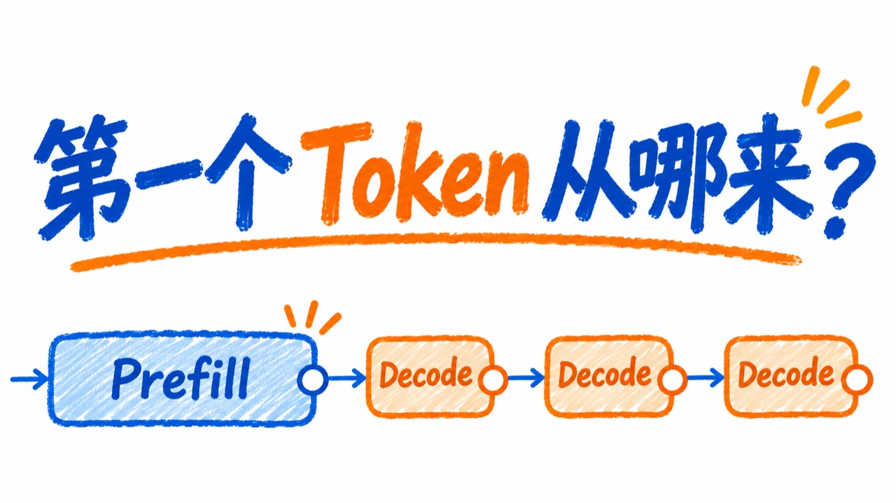
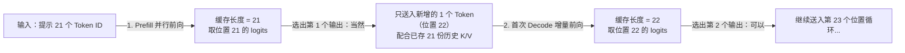

我们给报表助手发去一句「请汇总 CSV。」（CSV 即逗号分隔值文件）。经过 [F-01《Tokenizer 与 Chat Template》](f-01-tokenizer-chat-template.md) 的模板排版与分词，送进 Qwen2.5 模型的是一串整整齐齐的 **21 个整数编号（Token ID）**。如果模型接着回答「当然可以」，那打头的「当然」和紧跟的「可以」究竟是在哪两步算出来的？

> **先用大白话讲明白**：你可以把大模型写回答分成**两个完全不同步调的阶段**：
> 1. **Prefill（预填充）——「一口气通读整张试卷题干」**：在模型还没开口前，你发给它的 21 个词早就全部到齐了。模型把这 21 个词打包成一张表，一次并行过完所有网络层，顺手记好每个字的笔记（KV Cache），并直接在第 21 个位置吐出**第一个字「当然」**。
> 2. **Decode（逐步解码）——「一边念、一边憋下一个字」**：接下来就急不得了。在算出第 22 个字是不是「当然」之前，模型根本不知道第 23 个字该接什么！所以只能等「当然」选定了，**只把这 1 个新字**送回模型，结合前面记好的 21 份笔记算出第 23 个字「可以」——如此一个字一个字接力下去。



两阶段调用的是**同一个模型权重**，真正的区别在于「这一趟送进模型的输入有几个位置、以及是现算还是查旧缓存」。

## 1. 先盯住 21、21、22 这三个关键数字

模型做一次**前向计算（Forward）**，就是把输入张量沿着各层神经网络算到最后，由输出头给词表里的每个候选字打出一排原始分数（**logits**，详见 [F-02](f-02-transformer-logits.md)）。把首轮和下一轮的操作逐格排开，数字之间的因果关系一目了然：

| 操作步骤 | 这次实际送入模型的位置 | 算完后已缓存的 K/V 长度 | 这一轮产出的分数用来干嘛？ |
| --- | --- | ---: | --- |
| **Prefill 前向** | 位置 1～21（共 **21** 个） | **21** | 挑选第 22 个位置（即**首个输出「当然」**） |
| 选词规则采样 | *只比分数大小，不跑网络* | 21 | 把选出的「当然」贴到序列末尾 |
| **首次 Decode 前向** | 只送第 22 个位置（共 **1** 个） | **22** | 挑选第 23 个位置（即**第二个输出「可以」**） |
| 再选一次词 | *只比刚算出的分数* | 22 | 把选出的「可以」继续贴到末尾 |

> **容易踩的坑**：
> 1. **「只生成 1 个 Token 时，缓存长度是 21 还是 22？」—— 答案是 21！** 因为第一个输出 Token「当然」是靠 Prefill 第 21 位的分数直接挑出来的。如果只要求吐 1 个字就停下，程序根本不会把「当然」再塞回模型跑一次 Decode 前向，所以缓存里只存过已送进前向计算的那 21 个位置。
> 2. **「服务日志里的术语边界」**：有些推理服务后台的统计日志会把「Prefill 结束 + 选出首个 Token 并回传」也顺口叫作「首轮解码（first decode step）」，阅读具体框架日志时要留意它有没有包含第一个字的选词动作。

## 2. 为什么提示词能一起算，输出却非得排着队？

这个差异纯粹来自**数据依赖关系**：
- **Prefill 能并行**：你发给模型的 21 个字，在点击「发送」的那一刻就全部已知。虽然要求「第 8 个位置不能偷看第 9～21 个位置」（由 [F-02](f-02-transformer-logits.md) 的**因果遮罩**保障），但在 GPU 矩阵乘法里，可以把 21 行打包成一个大矩阵**同时一次算完**，硬件算力吃得饱饱的！
- **Decode 只能串行**：第 23 个位置要接的话，强烈依赖第 22 个位置到底选了「当然」还是「抱歉」。第 22 个字没选定之前，第 23 个字根本不存在，只能步步串行。好在确定第 22 个字后，前面 21 个字算出来的 **K（Key，匹配用的键）** 和 **V（Value，读取用的值）** 已经好好存在 **KV Cache（键值缓存）** 里，第 22 个字只需要拿自己的 **Q（Query，当前查询）** 跑一遍模型，去查这 21 份历史加上自己，就能算出第 23 个字的分数，免去了把前 21 个字重算一遍的冤枉工。

> **小提示（区分一词多义）**：工程里常把「从分数里挑词的策略（如 F-04 的 Greedy / Temperature / Top-p）」叫**解码（Decoding）**，也把「单步增量生成阶段」叫 **Decode 阶段**。在本系列里，说到「Decode 前向」特指**把新增的 1 个位置送进神经网络算下一轮分数**的计算阶段。

## 3. 在真实 Qwen 上跑两次前向，验证增量 = 整段重算

沿用 F-02 的 Python 环境（建议 Python 3.11 或 3.12，CPU 运行，首次拉取约 1 GB 权重，FP32 约占 2 GB 内存）：

```bash
python -m pip install "torch==2.11.0" "transformers[chat-template]==5.13.0" "tokenizers==0.22.2"
```

把下面代码存为 `prefill_decode.py`，运行 `python prefill_decode.py`。为了省去无效计算，参数 `logits_to_keep=1` 告诉输出头「虽然主体算完了全部位置，但只用给最后一个位置打词表分数就行」；末尾我们又加了一组控制实验 `full`——故意关掉缓存把 22 个字整段从头算一遍，再用断言检验两种算出来的下一词 logits 是否在浮点误差内完全一样！

```python
import torch
from transformers import AutoModelForCausalLM, AutoTokenizer

NAME = "Qwen/Qwen2.5-0.5B-Instruct"
REVISION = "7ae557604adf67be50417f59c2c2f167def9a775"
tokenizer = AutoTokenizer.from_pretrained(NAME, revision=REVISION)
model = AutoModelForCausalLM.from_pretrained(
    NAME, revision=REVISION, dtype=torch.float32
).eval()
messages = [
    {"role": "system", "content": "你是报表助手。"},
    {"role": "user", "content": "请汇总 CSV。"},
]
prompt = tokenizer.apply_chat_template(
    messages, add_generation_prompt=True, tokenize=True,
    return_dict=True, return_tensors="pt",
)
input_ids = prompt["input_ids"]

with torch.inference_mode():
    prefill = model(input_ids=input_ids, use_cache=True, logits_to_keep=1)
    first = prefill.logits[:, -1, :].argmax(dim=-1, keepdim=True)
    cache_length = prefill.past_key_values.get_seq_length()
    step = model(
        input_ids=first, past_key_values=prefill.past_key_values,
        use_cache=True, logits_to_keep=1,
    )
    second = step.logits[:, -1, :].argmax(dim=-1, keepdim=True)
    full = model(
        input_ids=torch.cat((input_ids, first), dim=1),
        use_cache=False, logits_to_keep=1,
    )

assert input_ids.shape == (1, 21)
assert cache_length == 21 and step.past_key_values.get_seq_length() == 22
torch.testing.assert_close(step.logits, full.logits, atol=1e-4, rtol=1e-4)
print("Prefill 输入", tuple(input_ids.shape), "缓存长度", cache_length)
print("首个输出", first.item(), repr(tokenizer.decode(first[0])))
print("Decode 输入", tuple(first.shape), "缓存长度", step.past_key_values.get_seq_length())
print("第二个输出", second.item(), repr(tokenizer.decode(second[0])))
print("增量计算和整段重算得到的下一步 logits 在容差内一致")
```

实跑输出：

```text
Prefill 输入 (1, 21) 缓存长度 21
首个输出 103942 '当然'
Decode 输入 (1, 1) 缓存长度 22
第二个输出 73670 '可以'
增量计算和整段重算得到的下一步 logits 在容差内一致
```

结果清楚明了：Prefill 吃进 `(1, 21)`，吐出 `103942 '当然'`；Decode 只吃进 `(1, 1)`，缓存变成 `22`，吐出 `73670 '可以'`，并且和整段 22 个字从头算出来的分数分毫不差。

## 4. 想看源码从哪里进？

> **想再深入一层？** 在固定版 Transformers `v5.13.0` 里顺着下面两行源码，就能看清框架在底层怎样切分 Prefill 与 Decode：
> 1. **只算最后一个位置的分数**：在 [Qwen2ForCausalLM.forward()](https://github.com/huggingface/transformers/blob/v5.13.0/src/transformers/models/qwen2/modeling_qwen2.py#L417) 中搜 `logits_to_keep`，看输出头 `lm_head` 如何用切片省去前 20 个无关位置的投影开销。
> 2. **K 和 V 如何接上旧缓存**：在 [Qwen2Attention.forward()](https://github.com/huggingface/transformers/blob/v5.13.0/src/transformers/models/qwen2/modeling_qwen2.py#L217) 里看 `past_key_values.update()`——Prefill 时存下整段 21 个位置，Decode 时只把当前 1 个新位置的 K、V 拼到末尾。
> - 官方指南：[Transformers 缓存机制说明](https://huggingface.co/docs/transformers/v5.13.0/en/cache_explanation)

## 下一篇

刚才实验里把增量结果塞回模型，全靠那个叫 `past_key_values` 的盒子。如果对话长达几万字，这个盒子会膨胀到多大？除了单条对话内部省重算，跨请求能不能共用这个盒子？请看下一篇 [F-06《KV Cache 如何加速 Decode？》](f-06-kv-cache.md)。系列入口见 [LLM 与 Agent 学习路线图](../../llm-agent-learning-roadmap.md)。

[F-04 自回归生成与采样](f-04-autoregressive-sampling.md) · [F-06 KV Cache 如何加速 Decode](f-06-kv-cache.md)
