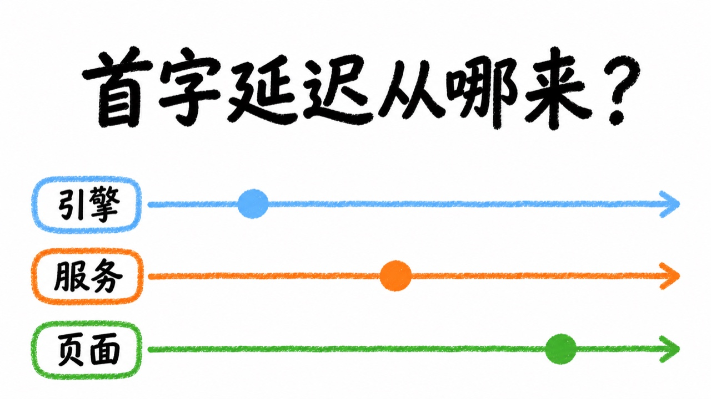

用户在聊天界面敲下「请汇总 CSV。」并点击发送。屏幕空白了好半天，他抱怨「模型太卡了」——可翻开推理引擎后台日志一看，其实第 **120 毫秒**模型就已经把第一个字算出来了！那中间丢失的时间去哪儿了？

聊大模型性能时，到处都是缩写：**TTFT、TPOT、ITL、E2E、Throughput**。如果不把「谁在什么时候掐表」对齐，同一份压测报告能报出三个完全打架的数字。

> **先用大白话讲明白**：把发一条 AI 请求当成**去餐厅点一份流式上菜的铁板烧**：
> - **TTFT（Time to First Token，首 Token 延迟）**：从你下单起，**一直干等到第一口菜端上嘴**的时间——主要花在排队和厨房一口气通读菜单（Prefill）。
> - **ITL（Inter-Token Latency，相邻 Token 间隔）**：第一口吃进去后，**第 1 口和第 2 口之间、第 2 口和第 3 口之间**各隔了多久。
> - **TPOT（Time per Output Token，平均每输出 Token 用时）**：把后面几口上菜总间隔拿来取个平均，衡量模型「吐字匀速有多快」。
> - **E2E（End-to-End 端到端延迟）**：从点下单，直到**整道菜最后一个字彻底吃完结账**的总耗时。
> - **吞吐（Throughput）**：餐厅厨师一秒钟总共能服务几桌客人（请求/秒），或者一秒能出多少口菜（Token/秒）。

```mermaid
flowchart LR
    T0["0 ms：用户点发送"] -->|网络与后端接收| T10["10 ms：服务收到"]
    T10 -->|排队等待调度| T40["40 ms：引擎开始 Prefill"]
    T40 --> T75["75 ms：先发 SSE 角色状态包<br/>此时还没有可见正文"]
    T75 --> T120["120 ms：引擎产出首 Token<br/>引擎 TTFT 终点"]
    T120 --> T128["128 ms：服务发出首个正文事件<br/>接口 TTFT 终点"]
    T128 --> T160["160 ms：页面首次显示文字<br/>用户体感 TTFT 终点"]
    T160 -->|连续 Decode 输出共 4 词| T210["210 ms：引擎产出第 4 个词"]
    T210 --> T245["245 ms：客户端收齐完成"]
```



## 1. 先定好掐表规则：三处完全不同的 TTFT 观测点

为了把公式算透，我们设计一条固定 **输入 21 Token、输出 4 Token** 的教学轨迹。下面表里先假定各处日志已经对齐到同一时钟（以点击发送为 `0 ms`）：

| 发生时刻 | 事件内容 | 由谁记录？ | 特别注意 |
| ---: | --- | --- | --- |
| 0 ms | 浏览器发出请求 | 客户端 | — |
| 10 ms | 后端服务收到请求 | 服务层 | — |
| 40 ms | 引擎排到号、开始跑 Prefill | 引擎 | `10 → 40 ms` 属于**排队等待** |
| 75 ms | 服务先推送一条只写 `role: assistant` 的 SSE 帧 | 服务层 | **坑点**：已有数据包到达，但屏幕上还是空白！ |
| **120 ms** | 引擎产出第 1 个 Token | **引擎** | 引擎视角 TTFT = `120 ms`（从调度算则是 `80 ms`） |
| **128 ms** | 服务把带着第一个字的事件推给网络 | **服务** | 接口视角首个正文事件 |
| **160 ms** | 浏览器解析 JSON 并首次在界面画出字 | **客户端** | 用户真正看见第一个字的体感耗时 |
| 210 ms | 引擎产出第 4 个（最后一个）Token | 引擎 | 4 个字时刻分别是 `120, 145, 171, 210` |
| 245 ms | 客户端收到 `[DONE]` 并渲染完毕 | 客户端 | 整趟端到端耗时 **245 ms** |

> **容易踩的坑**：
> 1. **第一包 SSE 不等于用户看到第一个字**：很多 **SSE（Server-Sent Events，服务器发送事件）** 流在第 75 ms 会先吐一包只含角色名的帧，如果客户端把「收到第一个 HTTP 字节」误当成 TTFT，就会把真实延迟算小几十毫秒。
> 2. **跨机器不能直接相减系统时钟**：真实多机部署时，浏览器电脑、网关服务器和显卡节点的系统时间可能差好几百毫秒。正确做法是**每层用自己本机单调时钟（`monotonic` / `perf_counter` / `performance.now()`）算局部耗时，再用同一个 `Request ID` 串联排查**。 [vLLM 延迟指标定义](https://docs.vllm.ai/en/latest/design/metrics/)

## 2. 首个之后怎么算？指标公式速查表

| 指标名称 | 怎么算（用上面教学轨迹代入） | 关键口径注意 |
| --- | --- | --- |
| **TTFT**（首 Token 延迟） | 本例为 **120 ms**（引擎）/ **160 ms**（页面） | **报指标必须写明起点和终点！** |
| **ITL**（相邻 Token 间隔） | 引擎记录 `120, 145, 171, 210 ms` → 相邻差值为 **`[25, 26, 39]` ms** | 若只输出 1 个 Token，没有间隔，ITL 无定义 |
| **TPOT**（平均每输出 Token 用时） | `(末字时刻 - 首字时刻) ÷ (输出数 - 1)` = `(210 - 120) / (4 - 1)` = **30.0 ms** | 分母是 **间隔数（输出数减 1）**，正好等于全部 ITL 的平均值 |
| **E2E**（端到端延迟） | 从 `0 ms` 到 `245 ms` = **245 ms** | 吃掉整份输出的总时长 |
| **吞吐（Throughput）** | 若 `0.4 秒` 窗口完成 2 条请求、各输出 4 个词 → **5 请求/秒**、**20 输出 Token/秒** | 需注明统计的是输入还是纯输出 Token |

> **小提示**：如果服务为了省网络开销，把 2～3 个字攒进同一个 SSE 事件一次发给浏览器，前端直接测到的是「事件间隔」而非单个 Token 的 ITL；若拿它近似估算 TPOT，务必在报告里写清事件粒度。 [vLLM 基准测试指标口径](https://docs.vllm.ai/en/latest/benchmarking/cli/)

## 3. 单变量对照实验：卡在哪一段，数字怎么变？

用标准库 Python 写一段极简检验脚本，存为 `latency_metrics.py` 并运行 `python3 latency_metrics.py`。它分别模拟「后台多排了 50 ms 队」和「浏览器渲染慢了 40 ms」两种情况，帮你一眼看懂各指标谁动谁不动：

```python
OUTPUT_TOKENS = 4
ENGINE_TOKENS = [120, 145, 171, 210]
SERVICE_EVENTS = [128, 155, 185, 222]


def measure(engine, events, rendered, completed):
    assert len(engine) == len(events) == OUTPUT_TOKENS
    gaps = [right - left for left, right in zip(engine, engine[1:])]
    tpot = (engine[-1] - engine[0]) / (len(engine) - 1)
    assert tpot == sum(gaps) / len(gaps)
    return engine[0], events[0], rendered, gaps, tpot, completed


baseline = measure(ENGINE_TOKENS, SERVICE_EVENTS, 160, 245)
more_queue = measure(
    [time + 50 for time in ENGINE_TOKENS],
    [time + 50 for time in SERVICE_EVENTS],
    210, 295,
)
more_ui_delay = measure(ENGINE_TOKENS, SERVICE_EVENTS, 200, 245)

for name, result in (
    ("基线", baseline), ("多排队 50 ms", more_queue), ("页面晚呈现 40 ms", more_ui_delay)
):
    engine_ttft, event_time, rendered, itl, tpot, e2e = result
    print(
        f"{name}: 引擎 {engine_ttft} ms, 首文本事件 {event_time} ms, "
        f"页面 {rendered} ms, ITL {itl}, TPOT {tpot:.1f} ms, 端到端 {e2e} ms"
    )

assert more_queue[4] == baseline[4]
assert more_ui_delay[0] == baseline[0] and more_ui_delay[2] == baseline[2] + 40
elapsed_seconds = 0.4
completed_requests = 2
print(f"{elapsed_seconds:.1f} 秒窗口: {completed_requests / elapsed_seconds:.1f} 请求/秒, "
      f"{completed_requests * OUTPUT_TOKENS / elapsed_seconds:.1f} 输出 Token/秒")
```

实跑结果：

```text
基线: 引擎 120 ms, 首文本事件 128 ms, 页面 160 ms, ITL [25, 26, 39], TPOT 30.0 ms, 端到端 245 ms
多排队 50 ms: 引擎 170 ms, 首文本事件 178 ms, 页面 210 ms, ITL [25, 26, 39], TPOT 30.0 ms, 端到端 295 ms
页面晚呈现 40 ms: 引擎 120 ms, 首文本事件 128 ms, 页面 200 ms, ITL [25, 26, 39], TPOT 30.0 ms, 端到端 245 ms
0.4 秒窗口: 5.0 请求/秒, 20.0 输出 Token/秒
```

结论非常直观：
- **排队多了 50 ms**：从引擎 TTFT 到端到端 E2E 全部整整齐齐往后平移 50 ms，但模型吐字节奏 **TPOT 还是 30.0 ms**（模型没变慢，只是前面在排队！）。
- **页面晚呈现 40 ms**：只有用户眼里看到的 `页面 200 ms` 慢了，后台引擎和接口耗时纹丝不动！

## 4. 在真实 Qwen 模型上实测一次 21 → 4

> **想再深入一层？** 沿用 [F-05](f-05-prefill-and-decode.md) 的环境，下面直接拿 `Qwen/Qwen2.5-0.5B-Instruct` 固定输入 21 个词、强制生成 4 个词（先预热 2 次排除首次编译和冷缓存干扰，再连测 5 次取中位数）。保存为 `engine_timing.py` 并运行：

```python
from statistics import median
from time import perf_counter

import torch
from transformers import AutoModelForCausalLM, AutoTokenizer

name = "Qwen/Qwen2.5-0.5B-Instruct"
revision = "7ae557604adf67be50417f59c2c2f167def9a775"
torch.set_num_threads(2)
tokenizer = AutoTokenizer.from_pretrained(name, revision=revision)
model = AutoModelForCausalLM.from_pretrained(
    name, revision=revision, dtype=torch.float32
).eval()
messages = [
    {"role": "system", "content": "你是报表助手。"},
    {"role": "user", "content": "请汇总 CSV。"},
]
prompt = tokenizer.apply_chat_template(
    messages, add_generation_prompt=True, tokenize=True,
    return_dict=True, return_tensors="pt",
)["input_ids"]
assert prompt.shape == (1, 21)


@torch.inference_mode()
def run():
    # 测固定长度。即使选中 EOS，也继续到 4 个输出位置。
    start = perf_counter()
    positions = []
    ids, cache = prompt, None
    for _ in range(4):
        step = model(input_ids=ids, past_key_values=cache, use_cache=True, logits_to_keep=1)
        ids = step.logits[:, -1, :].argmax(dim=-1, keepdim=True)
        cache = step.past_key_values
        positions.append((perf_counter() - start) * 1000)
    assert cache.get_seq_length() == 24
    return positions[0], (positions[-1] - positions[0]) / 3


for _ in range(2):
    run()
samples = [run() for _ in range(5)]
ttft, tpot = (median(column) for column in zip(*samples))
print(f"{torch.__version__} CPU FP32, 21 → 4, 预热 2 次，测量 5 次")
print(f"引擎计算 TTFT 中位数 {ttft:.1f} ms，TPOT 中位数 {tpot:.1f} ms")
```

本机 CPU 实跑记录（绝对毫秒随芯片与负载浮动，重点看比对方法）：

```text
2.11.0 CPU FP32, 21 → 4, 预热 2 次，测量 5 次
引擎计算 TTFT 中位数 142.3 ms，TPOT 中位数 82.4 ms
```

上真实生产服务做基准时，除了记中位数，**务必盯住 P95**（95% 的用户都不超过的延迟线）——因为平均数很漂亮时，可能仍有 5% 的请求在队伍后面等了好几秒。 [vLLM 生产指标](https://docs.vllm.ai/en/latest/usage/metrics/) · [W3C Performance Timeline](https://www.w3.org/TR/performance-timeline/)

## 下一篇

算力速度量清楚了，接下来最现实的工程约束是「显卡内存塞不下这么大的模型和这么长的 KV Cache 怎么办？」。下一篇 [F-08《模型精度与量化：权重怎样缩到 4 位？》](f-08-model-precision-and-quantization.md) 用游标卡尺和格子本的比喻，手算 4 位整数压缩、误差边界和两字节打包。系列入口见 [LLM 与 Agent 学习路线图](../../llm-agent-learning-roadmap.md)。

[F-14 FlashAttention 如何减少注意力的显存读写](f-14-flashattention.md) · [F-08 模型精度与量化](f-08-model-precision-and-quantization.md)
