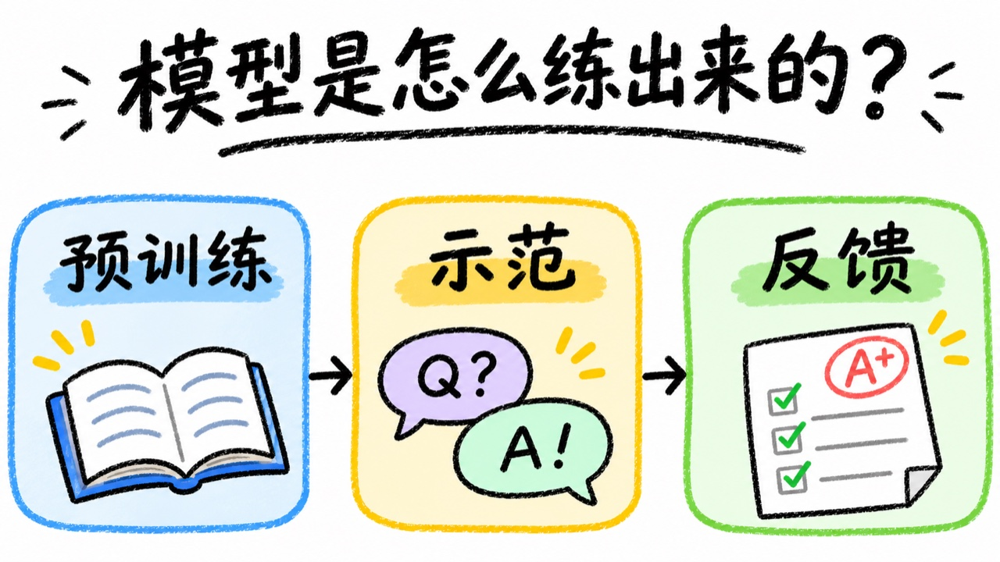
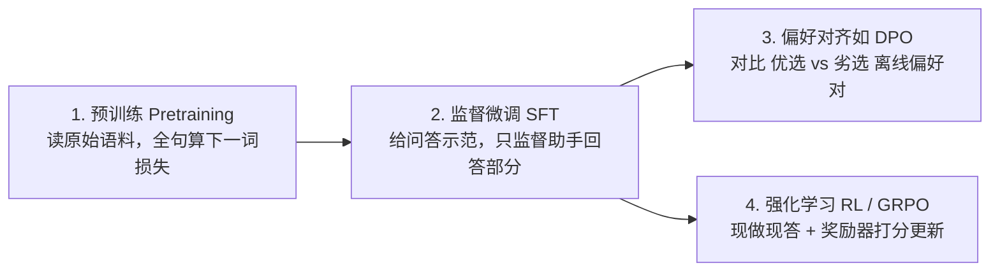
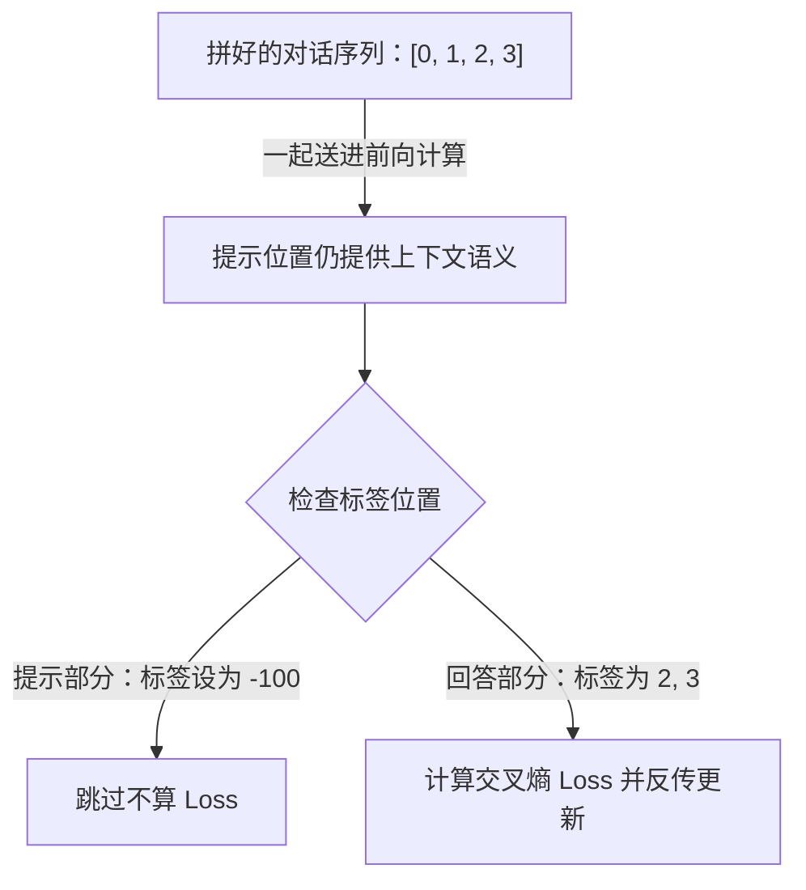

假设表里有三条退款数据 `[12, 空, 8]`，用户下达指示：「空值记为缺失，只返回合计和缺失数。」我们期望它老老实实回答：「合计 20，缺失 1」。

刚出生的大模型其实是个只会做「文章续写接龙」的话痨——你给它出这道题，它甚至可能自己往下续写「……请参考下表第 2 页」而不去算答案。它是怎样一步步被调教成「听话又靠谱」的助手的？

> **先用大白话讲明白**：调教一个大模型就像培养一位专业财务专员，通常要走四个成长阶段（且**「教它学什么」**和**「动全身多少根筋骨（全量 vs LoRA）」**是两码事）：
> 1. **预训练（Pretraining）——「海量读百科全书」**：拿几万亿字网页、文档练习完形/接龙，学会人类语言规律和世界知识，但还不懂怎么听指令回答。
> 2. **监督微调（SFT）——「照着标准例题学答题格式」**：给「提问 → 标准答案」成对教材，教它碰到指令别续写题目，老老实实按助手口吻交卷。
> 3. **偏好优化（如 DPO）——「拿一好一坏两份答卷做对比」**：告诉它哪份回答更好（Chosen）、哪份虽然像模像样但算错了（Rejected），把偏好差距拉开。
> 4. **强化学习（RL）——「自己动手做题，让阅卷老师/程序打分」**：模型先自己试着生成答案，程序现场验算对错打赏或扣分，引导模型自己往能拿高分的方向改。



## 1. 预训练：怎样拿普通文本造出「下一词考试题」？

预训练最省心的地方在于**完全不用人工标答案**：随便拿一段话，把序列整体往右挪一位，前面的词自然就成了「题目」，后面紧邻的那个词自然就是「标准答案」！

为了方便手算，把一条退款场景浓缩成四个教学 Token（ID 为 0～3）：

| 位置 | 示意内容 | 教学 ID |
| ---: | --- | ---: |
| 1 | `退款列数据` | 0 |
| 2 | `请按规则汇总` | 1 |
| 3 | `合计 20` | 2 |
| 4 | `缺失 1` | 3 |

输入喂入 `[0, 1, 2]`，目标对齐 `[1, 2, 3]`：位置 1 预测 `1`，位置 2 预测 `2`，位置 3 预测 `3`。

模型算出概率后怎么量化「答得有多差」？用**交叉熵损失（Cross-Entropy Loss）**：`Loss = -ln(正确词的预测概率 p)`。如果一开始 4 个词猜得完全一样（`p = 1/4 = 0.25`），损失就是 `-ln(0.25) = 1.3863`。训练做的事情就是通过**反向传播**算出每个权重往哪边调能把这个损失降下来，再交由**优化器（Optimizer）**去更新参数。 [Transformer 原论文](https://arxiv.org/abs/1706.03762)

## 2. SFT：怎么让模型只学「写答案」，不背「出题目」？

进入 **SFT（Supervised Fine-Tuning，监督微调）**，训练样本变成了「用户输入 + 助手标准答案」。这时如果还跟预训练一样要求「看到『退款列数据』去猜『请按规则汇总』」，模型就会把大量精力花在背诵用户的提问花样上！

工程上通常把**提示部分的标签掩盖成忽略值 `-100`**，只对助手回答的位置计算损失并扣分：

| 当前读到谁 | 下一个该预测谁 | 预训练标签 | 只监督回答的 SFT 标签 |
| --- | --- | ---: | ---: |
| `0`（数据） | `1`（规则，属于**提示**） | `1` | **`-100`（忽略不计分）** |
| `1`（规则） | `2`（合计 20，**回答开始**） | `2` | **`2`** |
| `2`（合计 20） | `3`（缺失 1，**回答后续**） | `3` | **`3`** |



> **容易踩的坑**：提示设成 `-100` 并不意味着提示在训练时没参与运算！提示依然在前向里充当背景、依然会被注意力读取，所以梯度照样会顺着注意力传回前面；`-100` 的含义仅仅是**「不要求模型去背诵/预测用户会怎么提问」**。在多轮对话 SFT 时，一定要把掩码打印出来人工核对一遍，确保只盖住了 `user` 和模板壳子、没有把 `assistant` 和结尾的 `<|im_end|>` 误盖掉！ [TRL 标签与遮罩文档](https://huggingface.co/docs/trl/sft_trainer#label-shifting-and-masking)

## 3. 四个训练阶段喂什么数据？一张表彻底分清

| 阶段 / 方法 | 喂给模型看的样本是什么？ | 放到退款案例里长什么样？ |
| --- | --- | --- |
| **继续预训练** | 特定领域的大量原始纯文本 | 一大堆财务制度原文、数据字典条文，继续做下一词接龙 |
| **SFT（监督微调）** | 成对的「问题 → 一份示范好答案」 | 提问 + 正确标准回复「合计 20，缺失 1」 |
| **DPO（直接偏好优化）** | 同一问题下的「好答案 vs 差答案」对比对 | 好：`合计 20，缺失 1` ；差：`合计 20，缺失 0` |
| **奖励式强化学习（RLHF / GRPO）** | 让模型自己先现场生成多条候选，再用人工偏好奖励模型或规则程序打分 | 写对规则的程序给 1 分，把空值当 0 的给 0 分，按分数拉高好回答概率 |

经典 **RLHF** 会先用人类对比数据单独训一个「裁判模型（Reward Model）」，再靠强化学习推着语言模型拿高分；而 **DPO** 省去了单独训裁判模型，直接拿固定好的偏好对构造数学损失拉大好坏回答概率差；到了像数学/报表统计这种有明确对错标准的任务，用可执行程序当裁判打赏的 **GRPO** 则大显身手（下一篇展开）。 [InstructGPT 论文](https://arxiv.org/abs/2203.02155) · [DPO 论文](https://arxiv.org/abs/2305.18290)

## 4. 改哪些参数？分清「训练目标」和「LoRA 手段」

很多新人容易把 **SFT** 和 **LoRA** 当成两个并列二选一的东西——**这是大误解！**
- **SFT / DPO / 继续预训练** 回答的是 **「用什么损失函数、往哪学」**（目标）；
- **全量微调 vs LoRA** 回答的是 **「训练时允许改动模型里哪些数字」**（更新范围）。你完全可以用 LoRA 来做一次 SFT，也可以用 LoRA 来做 DPO！

**LoRA（Low-Rank Adaptation，低秩适配）**的做法极巧妙：把原本庞大的原始权重矩阵 `W`（比如 `4096 × 4096`，多达 **16,777,216** 个参数）彻底冻住一个小数点都不许动；只在旁边并联两块极瘦小的矩阵 `A [8, 4096]` 和 `B [4096, 8]`（合起来只有 **65,536** 个参数，不到千分之四！）。训练只更新 `A` 和 `B` 并按比例 `B × A` 加回输出——既省下了优化器占用的海量显存，切换业务时还能只换那个几十 MB 的外挂补丁（详情到第 4 部分 [TRN-05](../04-model-training/trn-05-lora.md) 再手算）。 [LoRA 原论文](https://arxiv.org/abs/2106.09685)

## 5. 用 PyTorch 跑通「预训练 vs SFT 标签遮罩」对比

沿用已有环境装好 `torch==2.11.0`，把代码保存为 `training_mask.py` 并运行 `python training_mask.py`：

```python
import torch
import torch.nn.functional as F

tokens = torch.tensor([0, 1, 2, 3])
inputs = tokens[:-1]
pretrain_labels = tokens[1:]
sft_labels = pretrain_labels.clone()
sft_labels[0] = -100


def train_once(labels):
    table = torch.zeros(4, 4, requires_grad=True)
    loss = F.cross_entropy(table[inputs], labels, ignore_index=-100)
    loss.backward()
    updated = table.detach() - 0.5 * table.grad
    new_loss = F.cross_entropy(updated[inputs], labels, ignore_index=-100)
    changed = (table.grad.abs().sum(dim=1) > 0).nonzero().flatten().tolist()
    return loss.item(), new_loss.item(), changed


pretrain = train_once(pretrain_labels)
sft = train_once(sft_labels)
assert pretrain[2] == [0, 1, 2] and sft[2] == [1, 2]
assert pretrain[1] < pretrain[0] and sft[1] < sft[0]
print("预训练标签", pretrain_labels.tolist())
print("回答监督标签", sft_labels.tolist())
for name, (before, after, changed) in (("预训练", pretrain), ("回答监督", sft)):
    print(f"{name}: {before:.4f} → {after:.4f}, 更新输入行 {changed}")
```

实跑结果：

```text
预训练标签 [1, 2, 3]
回答监督标签 [-100, 2, 3]
预训练: 1.3863 → 1.2640, 更新输入行 [0, 1, 2]
回答监督: 1.3863 → 1.2049, 更新输入行 [1, 2]
```

> **容易踩的坑**：看结果最后一行，预训练更新了输入行 `[0, 1, 2]`，而回答监督把标签 0 位设成 `-100` 后只更新了 `[1, 2]`（真正需要输出答案的两步）。同时切记：**绝不能拿 SFT 的 `1.2049` 和预训练的 `1.2640` 比大小**，因为两者平均分母里算进去的词个数压根不一样！

> **想再深入一层？** 源码里 `ignore_index=-100` 的归约逻辑见 [PyTorch cross_entropy 文档](https://docs.pytorch.org/docs/stable/generated/torch.nn.functional.cross_entropy.html)，Transformers `v5.13.0` 内部自动做标签左移一位的写法见 [loss_utils.py](https://github.com/huggingface/transformers/blob/v5.13.0/src/transformers/loss/loss_utils.py)。

## 下一篇

监督微调教的是「抄标准答案」，但如果遇到算术、写代码这类允许有好几种解法、且程序能当场验算正误的任务，怎么让模型自己通过「多做多试、赢了涨概率」变得更聪明？请看下一篇 [F-11《GRPO 怎样用同组答案的奖励更新模型？》](f-11-grpo.md)。系列入口见 [LLM 与 Agent 学习路线图](../../llm-agent-learning-roadmap.md)。

[F-09 多模态请求如何进入模型](f-09-multimodal-input.md) · [F-11 GRPO 如何用于推理模型后训练](f-11-grpo.md)
