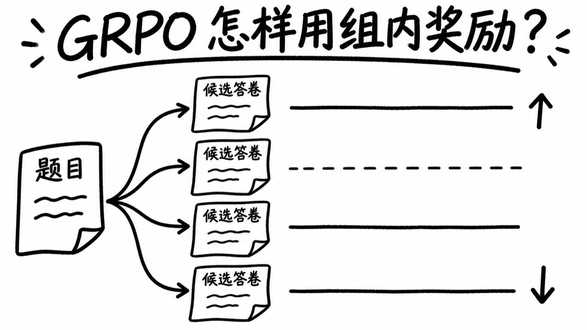
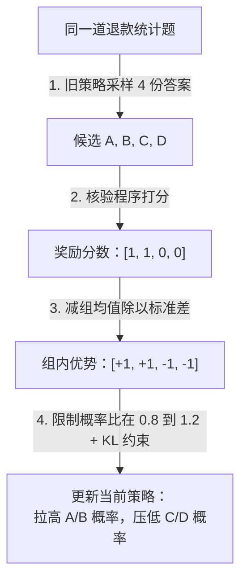

接着上一篇的问题：给模型出了一道计算题「退款金额为 12、空、8。只输出合计和缺失数。」怎样不靠人工手写一万条标准示范，而是让模型「自己做题、错了挨罚、对了加分」，越练越准？

DeepSeekMath 提出（后来又被推理模型广泛采用）的 **GRPO（Group Relative Policy Optimization，组相对策略优化）**，就是传统 PPO 强化学习算法的一个高性价比改良版。

> **先用大白话讲明白**：传统的 PPO 强化学习就像请了一位**「专职班主任」（Value Model / 价值模型）**，每次学生交卷，班主任都要靠自己另学一套本事来打绝对分「这份卷子平时大概值 0.4 分，这次考了 1 分算超常发挥」，等于要同时养两个大模型，太烧显存！
> **GRPO 彻底炒掉了这位班主任**，改成了**「同组内部横向 PK」**：同一道题让当前模型一口气答 **4 份不同草稿**（一组 Rollout），用程序现场给每份批改得分（比如 `[1, 1, 0, 0]`）。然后一算全组平均分 `0.5`——只要**高于组平均分，就是正优势（鼓励多学）**；**低于组平均分，就是负优势（以后少这么写）**！



[DeepSeekMath 原论文第 4 节](https://arxiv.org/abs/2402.03300) · [PPO 原论文](https://arxiv.org/abs/1707.06347)

## 1. 先靠可执行程序给候选答案发奖励

**策略（Policy）**就是正在按概率生成回答的语言模型。我们把刚开考那一刻的模型冻住留个影，称为**旧策略（Old Policy）**，用它为同一道题采样 4 条回答。如果任务有明确对错（如数学或统计报表），直接写一段严格正则 + 核对程序当**奖励函数（Reward Function）**：

| 候选 | 模型写出的答案 | 奖励分 | 裁判理由 |
| --- | --- | ---: | --- |
| A | `合计=20;缺失=1` | **1** | 两项对且格式合乎约定 |
| B | `合计=20；缺失=1` | **1** | 接受中英文分号，两项都对 |
| C | `合计=20;缺失=0` | **0** | 缺失数漏算 |
| D | `合计=21;缺失=1` | **0** | 合计加错 |

> **容易踩的坑（Reward Hacking / 奖励漏洞）**：如果你偷懒写了个弱校验——只用正则检查文本里有没有出现 `合计=20`——那半错的 **C** 也会轻松骗到满分 1 分！模型最擅长的就是顺着你的漏洞钻空子，所以奖励程序测试前必须先拿「全对、半错、格式乱写、夹带废话」四种反例测一遍！

## 2. 一组奖励怎么变成「组内相对优势」？

**优势（Advantage）**用来衡量「这份回答跟大伙比，到底是超常发挥还是拉胯」。把第 `i` 条的奖励记作 `r_i`，组内平均分记作 `μ`，组内标准差记作 `σ`（标准差刻画大家分数拉得有多开）：

```text
组内优势 A_i = (r_i - μ) / σ
```
（分母通常加个极小保护数防止除以零；各项单位均为无量纲标量。）

代入上面那组奖励 `[1, 1, 0, 0]` 口算一遍：
- 组均值 `μ = (1 + 1 + 0 + 0) / 4 = 0.5`；
- 每个数离均值 `0.5` 的距离都是 `0.5`，所以总体标准差 `σ = 0.5`；
- 除以 `0.5` 后得到组内优势：**`[+1, +1, −1, −1]`**！

> **一个关键盲区：整组全对或全错怎么办？**
> 假设这道题太简单（4 份全对：`[1, 1, 1, 1]`）或者太难（4 份全错：`[0, 0, 0, 0]`）。此时每个 `r_i - μ` 全都是 **0**，算出来的优势是 **`[0, 0, 0, 0]`**——**整组彻底没有梯度信号，白算一轮！** 训练过程中必须监控「无差异组占比」，一旦占比太高，就要检查是不是题目太难/太简单、或者采样温度太低导致 4 份答案写得一模一样。

## 3. 分清三个长得像的模型角色：旧策略、当前策略、参考策略

训练一轮时，后台往往同时出现三个角色的名字，千万别搞混：

| 模型身份 | 干什么用的？ | 训练中权重变不变？ |
| --- | --- | --- |
| **旧策略（Old Policy）** | 负责在本轮开始时采样 4 个答案，并记下当时挑中它们的概率做分母 | 本轮内**暂时冻住**（下轮再换最新权重） |
| **当前策略（Current Policy）** | 真正正在接受梯度更新、越来越靠近高分答案的本体 | **实时更新** |
| **参考策略（Reference Policy）** | 通常指刚做完 SFT 的初始老前辈模型，靠 **KL 散度** 惩罚牵住当前策略别乱跑偏 | **全程彻底冻死不动** |

在算更新目标时，会算出一个**概率比率** `ratio = 当前策略生成该答案的概率 ÷ 旧策略生成该答案的概率`。然后套上一根安全带（**裁剪区间 `[0.8, 1.2]`**）：比如对正优势 `A = +1` 的好答案，就算当前概率已经一下子暴涨成旧策略的 `1.3` 倍（`ratio = 1.3`），取 `min(ratio × A, clip(ratio, 0.8, 1.2) × A)` 后最多也只按 `1.2` 来算收益，防止一次步子迈太大把模型训崩。

> **想再深入一层？** 在真实语言模型里，概率比率是逐个输出 Token 计算的，GRPO 会把整句话算出来的那个优势 `A_i` 分摊到该回答的每一个输出 Token 上；下方简化演示把整条回答当成一个整体动作，只保留核心方向，省略了参考策略的 KL 惩罚项（完整公式见 [DeepSeekMath 第 4 节](https://arxiv.org/html/2402.03300#S4)）。

## 4. 用 PyTorch 跑一次更新，亲眼看概率一升一降

装好 `torch==2.11.0`，保存为 `grpo_group_demo.py` 并运行 `python grpo_group_demo.py`：

```python
import re
import torch

answers = ["合计=20;缺失=1", "合计=20；缺失=1", "合计=20;缺失=0", "合计=21;缺失=1"]
pattern = re.compile(r"合计=(-?\d+)[;；]缺失=(\d+)")


def reward(answer):
    match = pattern.fullmatch(answer)
    return float(bool(match and tuple(map(int, match.groups())) == (20, 1)))


def relative_advantages(rewards):
    scale = rewards.std(unbiased=False)
    return (rewards - rewards.mean()) / scale.clamp_min(1e-8)


rewards = torch.tensor([reward(answer) for answer in answers])
advantages = relative_advantages(rewards)
assert relative_advantages(torch.ones(4)).tolist() == [0.0] * 4
scores = torch.zeros(4, requires_grad=True)
old_probs = scores.detach().softmax(dim=0)
ratio = scores.softmax(dim=0) / old_probs
clipped = ratio.clamp(0.8, 1.2)
loss = -torch.minimum(ratio * advantages, clipped * advantages).mean()
loss.backward()
new_probs = (scores.detach() - 0.5 * scores.grad).softmax(dim=0)
assert torch.all(new_probs[:2] > old_probs[:2])
assert torch.all(new_probs[2:] < old_probs[2:])
print("奖励", rewards.tolist())
print("组内优势", advantages.tolist())
print("更新前", old_probs.tolist())
print("更新后", [round(value, 4) for value in new_probs.tolist()])
print("整组奖励相同", relative_advantages(torch.ones(4)).tolist())
```

实跑结果：

```text
奖励 [1.0, 1.0, 0.0, 0.0]
组内优势 [1.0, 1.0, -1.0, -1.0]
更新前 [0.25, 0.25, 0.25, 0.25]
更新后 [0.2811, 0.2811, 0.2189, 0.2189]
整组奖励相同 [0.0, 0.0, 0.0, 0.0]
```

原本四个回答各有 `25%` 概率；经过一次梯度下降，正确的 A、B 升到了 **`28.11%`**，出错的 C、D 跌到了 **`21.89%`**，而整组全拿 `1` 分时的优势果然全部归零。

## 5. 训完以后怎么验收？别被「刷题虚高」骗了

跑完 GRPO 绝不能拿训练题自己夸自己：
1. 拿一批**从未参加训练和调优**的退款题（包含全空值、含 0、负数相互抵消、多字段），比较训练前后的格式通过率与数值准确率。
2. 顺手跑一遍原有通用问答回归集，确认模型没有因为死磕报表统计而把正常聊天写字的能力给搞退化（能力回归）。
3. 如果想看工程里完整的多步 GRPO 代码是怎么串联「采样 → 打分 → 归一化 → 计算损失」的，可以直接翻 TRL 的 [GRPOTrainer 文档](https://huggingface.co/docs/trl/grpo_trainer)；后面第四部分的 [TRN-08](../04-model-training/trn-08-ppo-grpo.md) 还会把 PPO 与 GRPO 放进完整循环继续对照。

## 下一篇

GRPO 是在「训练阶段」教模型多思考。可一旦模型已经训完上线了，我们在**每次发请求的那一刻**，还能不能花多一点时间、多给点「草稿思考预算」让它答得更稳？请看本专题最后一篇 [F-12《推理时计算与 Reasoning 模型怎样比较？》](f-12-inference-time-reasoning.md)。系列入口见 [LLM 与 Agent 学习路线图](../../llm-agent-learning-roadmap.md)。

[F-10 模型从训练到可用的过程](f-10-model-training-stages.md) · [F-12 推理时计算与 Reasoning 模型](f-12-inference-time-reasoning.md)
