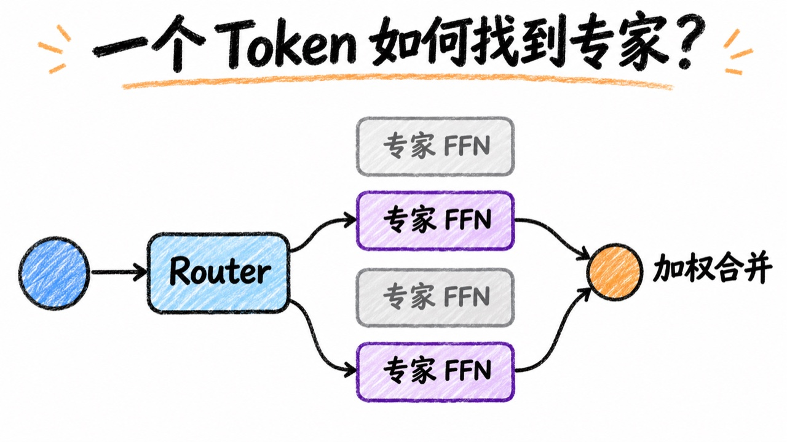
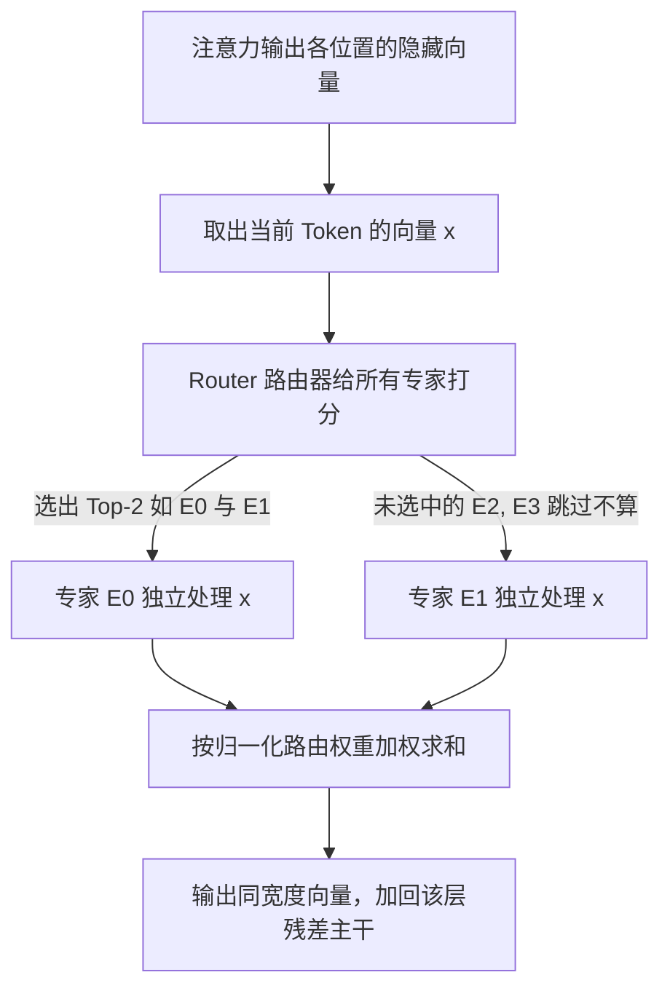
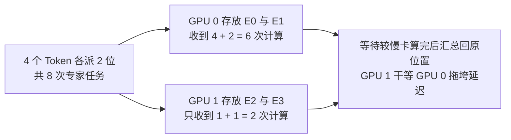

如果把一个拥有几千亿参数的大模型想成一家全科医院，以前每来一个字（Token），不管它是算账、写诗还是修代码，都要把全院所有科室的大专家全部叫起来会诊一遍——这就是传统的**稠密模型（Dense Model）**。效果虽然好，但每次推理耗电巨大、速度也慢。

能不能换一种更聪明的做法？设想把后半段的前馈网络拆成 4 个（或 8 个）小一点的专科诊室，门口设一个**分诊台**。遇到「退款金额缺失」里的「金额」，分诊台扫一眼，只派最对口的 **2 位专家（比如 `E0` 和 `E1`）** 进诊室处理，另外两位直接原地休息！这就是 **MoE（Mixture of Experts，混合专家）**。

> **先用大白话讲明白**：MoE 干的是一件非常朴素的降本增效的事——**把原本一整块巨型前馈网络（FFN），拆成好几套「专科小网络」（专家），再配一个「分诊护士」（Router 路由器）**：
> - **分诊打分**：每个词经过注意力之后，路由器快速扫一眼它的特征向量，给所有专家打分，挑出分数最高的 `k` 个（常见 `k=2`）。
> - **只跑选中的专家**：没被选中的专家不参与运算，省下了大量乘法计算（算力省了）。
> - **加权拼回一条结果**：把选中的几位专家算出的答案按刚才的信任权重拼回原尺寸，交还给残差主干继续往下走。

下面我们用「退款」「金额」「缺失」「。」四个教学 Token（对应编号 `E0`～`E3` 四位专家）把一次路由、合并与负载倾斜完整手算一遍。 [稀疏 MoE 论文](https://arxiv.org/abs/1701.06538) · [Mixtral 论文](https://arxiv.org/html/2401.04088#S2)

## 1. 专家在 Transformer 层里的什么位置？

回顾 [F-02](f-02-transformer-logits.md) 的积木结构：每一层先过注意力，再过 FFN。在 Mixtral、DeepSeek-V3 等 MoE 模型里，注意力模块一般原封不动保留，**被替换掉的是后面的那套稠密 FFN**——换成了「Router + 多个并列的专家 FFN」。



记住一点：虽然每次只挑几个专家算，但**在进入 MoE 之前，各个位置刚刚才通过注意力交换过全文信息**，所以每位专家拿到的向量里已经自带语境了。

## 2. 纸笔手算：「金额」怎么挑中专家并算出输出？

假设「金额」这个位置进入 MoE 模块时的向量只有两个数字：`x = [1, 1]`（分别记作 `a = 1, b = 1`）。

### 第一步：分诊台给 4 位专家打分（Router Logits）

Router 其实就是一张很小的线性矩阵，它拿自己的 4 组特征权重分别和 `x` 做点积：

| 专家编号 | 路由权重 | 打分公式 | 代入 `a = 1, b = 1` 得分 |
| --- | --- | --- | ---: |
| `E0` | `[2, 0]` | `2a` | **2** |
| `E1` | `[1, 0]` | `a` | **1** |
| `E2` | `[-1, 1]` | `−a + b` | **0** |
| `E3` | `[0, −1]` | `−b` | **−1** |

于是分诊台打出了一排原始分数：**`[2, 1, 0, −1]`**。这和模型最后输出头给词表打分（logits）在计算上完全是同一种投影，只不过这里每一列对应一个专家编号，叫做 **router logits（路由原始分数）**。

### 第二步：挑出前两名（Top-2）并重新算比例

现在设 `k = 2`（即 **Top-2**）。按 Mixtral 的标准顺序，先做一次 **Softmax** 把分数转成加起来等于 100% 的概率，再选出最高的两位，最后让这两位把自己的概率重新拉回 100%（**重新归一化**）：

```text
原始分数     [2,      1,      0,      −1    ]
Softmax      [0.6439, 0.2369, 0.0871, 0.0321]
专家          E0      E1      E2      E3
Top-2         ✓       ✓
```

只保留被选中的 `E0`（`0.6439`）和 `E1`（`0.2369`），它俩原本合计占 `0.8808`。分别除以 `0.8808`，得到最终分工权重：
- `E0` 权重：**`0.7311`**
- `E1` 权重：**`0.2689`**

（因为指数单调递增，先挑 Top-2 再只对这两项做 Softmax 也会算出完全一样的权重，不同架构源码写的顺序略有差异。） [Mixtral Router 源码](https://github.com/huggingface/transformers/blob/v5.13.0/src/transformers/models/mixtral/modeling_mixtral.py#L101)

### 第三步：两位专家各自算完，按权重合二为一

现在把原始向量 `x = [1, 1]` 分别抄送一份给 `E0` 和 `E1`。教学 FFN 中间宽度设为 1，先投影成 1 个数过 ReLU（负数变 0，正数不变），再投影回 2 维：

| 选中专家 | 第一次投影 | ReLU 后 | 第二次投影得到专家输出 |
| --- | --- | ---: | --- |
| `E0` | `1×1 + 1×0 = 1` | 1 | `1 × [3, 0] = [3, 0]` |
| `E1` | `1×0 + 1×1 = 1` | 1 | `1 × [0, 3] = [0, 3]` |

最后加权合体：`0.7311 × [3, 0] + 0.2689 × [0, 3]` ≈ **`[2.1932, 0.8068]`**。至于 `E2` 和 `E3`，刚才压根没让它们开机计算！

## 3. 避坑必看：「总参数」和「激活参数」不是一回事

用上面的小模块直接清点参数账本（参数即模型里需要保存的可学习数字）：

| 组成部分 | 模型总共保存的参数 | 处理 1 个 Token 实际动用的参数 |
| --- | ---: | ---: |
| Router（给 4 位专家打分） | `4 × 2 = 8` | 8（4 个分数都得算） |
| 4 套专家（每套 2 个输入 + 2 个输出权重） | `4 × 4 = 16` | `2 × 4 = 8`（只算被挑中的 2 位） |
| **合计** | **24** | **16** |

放眼到真实知名的开源 MoE 模型 **Mixtral 8×7B**（每层 8 位专家、每次挑 2 位），论文写着：
- **总参数（Total Parameters）**：约 **47B**（470 亿，B 表示十亿）
- **每 Token 激活参数（Active Parameters）**：约 **13B**（包含注意力等共用模块在内）

> **容易踩的坑**：「既然只激活 13B 参数，是不是我用一张只装得下 13B 模型的消费级显卡就能流畅部署 Mixtral 8×7B？」
> **绝对不行！** 虽然每算 1 个 Token 只动用 13B 的计算量（**推理速度接近 13B 稠密模型**），但一句话里有几十上百个 Token，第 1 个字挑 `E0/E1`，第 2 个字可能挑 `E2/E5`……只要服务开着，**整套 47B 的专家权重全都必须常驻显存或分布式多卡内存中待命**。MoE 省的是计算算力（FLOPs），却依然吃满全部参数显存！ [Mixtral 论文架构表](https://arxiv.org/html/2401.04088)

## 4. 大家都是挑 2 个，为什么有的专家忙死、有的闲死？

单看一个字可能还没感觉，现在把整句「退款」「金额」「缺失」「。」四个字塞进同一批（Batch）同时处理，继续用同一套打分公式计算每个词的去向：

| Token | 教学向量 `[a, b]` | 四位专家分数 `[2a, a, −a+b, −b]` | 选中的 Top-2 |
| --- | --- | --- | --- |
| `退款` | `[2, 1]` | `[4, 2, −1, −1]` | `E0`、`E1` |
| `金额` | `[1, 1]` | `[2, 1, 0, −1]` | `E0`、`E1` |
| `缺失` | `[1, 2.5]` | `[2, 1, 1.5, −2.5]` | `E0`、`E2` |
| `。` | `[1, −1.5]` | `[2, 1, −2.5, 1.5]` | `E0`、`E3` |

统计一下派工账单：4 个 Token 每人挑 2 位，总共分派了 **8 次**任务。理想平均每人接 2 次，可实际上：**`E0` 收到了 4 次，`E1` 2 次，`E2` 1 次，`E3` 1 次**！`E0` 的工作量直接飙到平均值的 2 倍——这就叫**负载倾斜（Load Imbalance）**。哪怕「金额」给 `E1` 的融合权重只有 `0.2689`，只要选中了，`E1` 就得实打实跑一遍完整的前馈运算。

如果在多张显卡部署，这个矛盾瞬间就会炸出来。在**专家并行（Expert Parallelism）**里，不同专家被塞到不同 GPU 上：



GPU 0 忙着算 6 份，GPU 1 早就闲着没事干却必须卡在同步点等 GPU 0 算完交卷。因此真实训练 MoE 时，除了猜对下一个词的损失外，往往还要加一个**负载均衡辅助损失（Load Balancing Loss）**，像老板定 KPI 一样强迫路由器把活尽量均匀分给每位专家（后来的 DeepSeek-V3 还演进出了无辅助损失的动态偏置调整技巧）。关于多卡通信和部署细节，后面 [SERV-10《多 GPU 与分离式推理部署》](../05-inference-serving/serv-10-distributed-inference.md) 会再展开。 [Switch Transformers 论文](https://www.jmlr.org/papers/v23/21-0998.html)

## 5. 用 Python 复算路由、融合和负载倾斜

把下面代码保存为 `moe_demo.py`，只用 Python 标准库，运行 `python3 moe_demo.py`（Softmax 里先减去最大分再求指数，防止数字太大溢出，不会改变最终概率比例）：

```python
from math import exp, isclose

# 每个专家用 (输入投影方向, 输出投影方向) 表示。
# 为了便于手算，教学 FFN 的中间宽度取 1。
experts = (
    ((1, 0), (3, 0)),
    ((0, 1), (0, 3)),
    ((1, 1), (1, 1)),
    ((1, -1), (1, -1)),
)
tokens = (
    ("退款", (2, 1)),
    ("金额", (1, 1)),
    ("缺失", (1, 2.5)),
    ("。", (1, -1.5)),
)
top_k = 2


def expert_ffn(x, expert_id):
    input_weights, output_weights = experts[expert_id]
    hidden = max(0, sum(value * weight for value, weight in zip(x, input_weights)))
    return [hidden * weight for weight in output_weights]


loads = [0] * len(experts)
for token, x in tokens:
    a, b = x
    logits = (2 * a, a, -a + b, -b)
    max_score = max(logits)
    exponentials = [exp(score - max_score) for score in logits]
    denominator = sum(exponentials)
    probabilities = [value / denominator for value in exponentials]
    ranked = sorted(range(len(experts)), key=lambda i: probabilities[i], reverse=True)
    selected = ranked[:top_k]
    selected_mass = sum(probabilities[i] for i in selected)
    weights = [probabilities[i] / selected_mass for i in selected]

    output = [0.0, 0.0]
    for expert_id, weight in zip(selected, weights):
        loads[expert_id] += 1
        expert_output = expert_ffn(x, expert_id)
        for axis, value in enumerate(expert_output):
            output[axis] += weight * value

    assert isclose(sum(weights), 1)
    ids = ", ".join(f"E{i}" for i in selected)
    print(f"{token} → {ids}")
    if token == "金额":
        print("  路由权重", [round(weight, 4) for weight in weights])
        print("  合并输出", [round(value, 4) for value in output])

assignments = len(tokens) * top_k
average = assignments / len(experts)
assert sum(loads) == assignments
assert loads == [4, 2, 1, 1]
print("各专家收到的 Token 数", loads)
print(f"分派总数 {assignments}，峰值/均值 {max(loads) / average:.1f}×")
```

实跑结果：

```text
退款 → E0, E1
金额 → E0, E1
  路由权重 [0.7311, 0.2689]
  合并输出 [2.1932, 0.8068]
缺失 → E0, E2
。 → E0, E3
各专家收到的 Token 数 [4, 2, 1, 1]
分派总数 8，峰值/均值 2.0×
```

> **动手试一试**：把「金额」的向量从 `(1, 1)` 改成 `(1, 2.5)`，并把断言改成 `assert loads == [4, 1, 2, 1]` 再跑一次。你会亲眼看到「金额」的第二个帮手从 `E1` 切换成 `E2`，合并输出也随之变成约 `[3.1888, 1.3214]`。

## 6. 到 Mixtral 源码里核对这条链路

> **想再深入一层？** 在 Transformers `v5.13.0` 里顺着下面三个类就能找到这套逻辑的真实代码实现：
> 1. **哪里接进解码层**：[MixtralDecoderLayer.forward()](https://github.com/huggingface/transformers/blob/v5.13.0/src/transformers/models/mixtral/modeling_mixtral.py#L354) 里不再调普通 MLP，而是调用 `MixtralSparseMoeBlock`。
> 2. **怎么选专家与算权重**：[MixtralTopKRouter.forward()](https://github.com/huggingface/transformers/blob/v5.13.0/src/transformers/models/mixtral/modeling_mixtral.py#L101) 输入铺平后的 `[T, hidden]`，输出分数值 `[T, E]` 和选中的专家编号 `[T, k]`、权重 `[T, k]`（本例就是 `[4, 4]` 和 `[4, 2]`）。
> 3. **算完怎么按原位置拼回去**：[MixtralExperts.forward()](https://github.com/huggingface/transformers/blob/v5.13.0/src/transformers/models/mixtral/modeling_mixtral.py#L62) 把分给同一位专家的词挑出来算完，再靠 `index_add_` 按原先顺序累加还原。
> - 负载均衡损失写法见同文件 [load_balancing_loss_func](https://github.com/huggingface/transformers/blob/v5.13.0/src/transformers/models/mixtral/modeling_mixtral.py#L489)。

## 下一篇

到这里为止，模型内部的「核心计算部件」已经全看了一遍。回到主线上：模型输出头辛辛苦苦算出整排分数（logits）后，到底怎么决定下一个说哪个字？下一篇 [F-04《自回归生成与采样：下一个 Token 怎么选？》](f-04-autoregressive-sampling.md) 会把 `Temperature`、`Top-k`、`Top-p` 和停止条件一次讲透。系列入口见 [LLM 与 Agent 学习路线图](../../llm-agent-learning-roadmap.md)。
