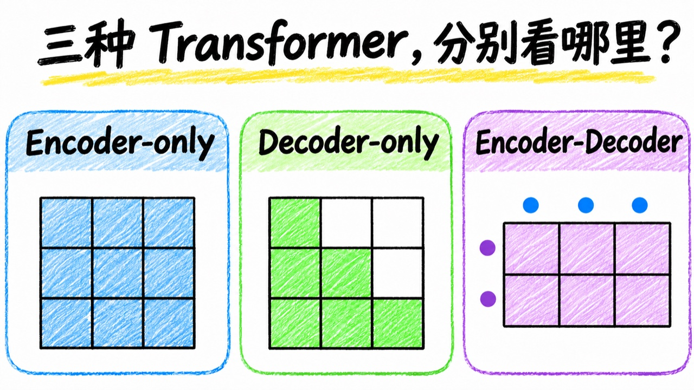
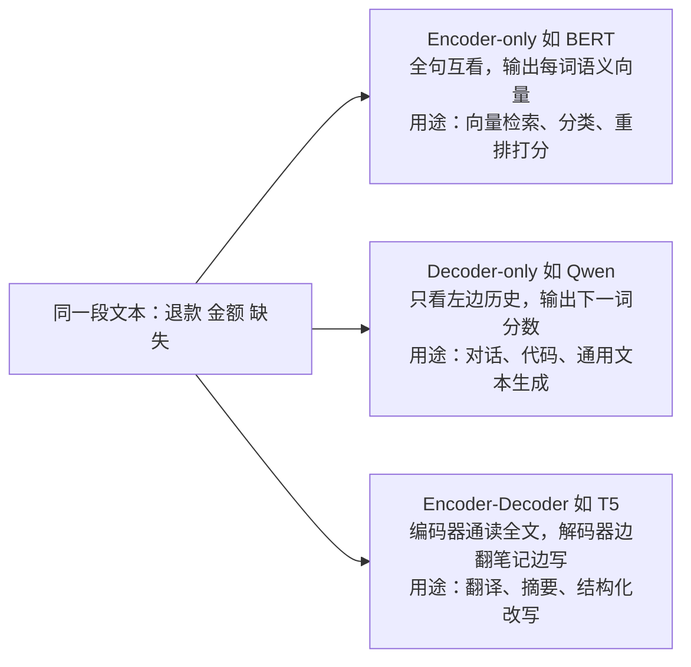
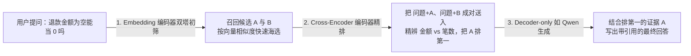

同样面对一条 CSV 备注「退款金额缺失」，你在工程里可能会提三种完全不同的需求：
1. **找相似资料**：这句话和知识库里的「空值不能算成 0」是不是意思差不多？
2. **顺着往下续写**：只给你「退款金额」，下一个最可能出现什么词？
3. **看原文写摘要**：给你一整段客户投诉备注，能不能按要求改写出一句简短摘要？

今天的大模型几乎都长在 Transformer 这棵大树上，但长出了三大分支：**Encoder-only（只编码）**、**Decoder-only（只解码）** 和 **Encoder-Decoder（编码再解码）**。很多人背过它们的名字，却分不清到底差在哪。

> **先用大白话讲明白**：这三种架构最本质的差别，就在于**「做题时让不让偷看右边」——也就是注意力能看到多少上下文**：
> 1. **Encoder-only（代表：BERT）——「做完形填空」**：整段话全摊在桌上，每个词左右两边随便看（**双向自注意力**）。适合把一段话压缩成语义指纹（向量），用来做搜索、分类、打分。
> 2. **Decoder-only（代表：Qwen / GPT）——「盲写文字接龙」**：左手按住已经写出的上文，右手拿纸盖住后面还没写的词（**因果自注意力**）。适合一字一字往下编故事、聊对话、写代码。
> 3. **Encoder-Decoder（代表：T5）——「看着参考资料写作文」**：先让编码器把整篇源材料从头到尾看懂整理好笔记，再让解码器一边遮住后面还没写的答案，一边通过**交叉注意力（Cross-Attention）**随时回头翻笔记。适合翻译、改写、摘要。



为了能用纸笔对比三种结构的差异，下面约定把原文切成三个教学 Token（实际模型会按各自词表切分）：

```text
位置       1      2      3
文本      退款   金额   缺失
教学 ID     2      3      4
```

## 1. Encoder-only：左右全看见，把词意捏准（BERT）

以 **BERT** 为代表。在它眼里，一句话没有「不能看后面」的规矩。只要不是凑长度的空白填充符，每个位置都能同时读取整句话里的所有其他位置，这叫**双向自注意力（Bidirectional Self-Attention）**。

```text
正在算谁 ↓  能看的位置 →   退款  金额  缺失
退款                        ✓     ✓     ✓
金额                        ✓     ✓     ✓
缺失                        ✓     ✓     ✓
```

注意中间那个「金额」：因为左能看「退款」、右能看「缺失」，它的最终向量把整句话的语境都吃进去了。只要把末尾的「缺失」改成「为零」，哪怕前两个字一模一样，「金额」算出来的向量也会随之改变。

BERT 当年训练时主要练习**完形填空（MLM，Masked Language Modeling，掩码语言建模）**：随机把句子里几个词抠掉换成特殊占位符 `[MASK]`（比如「退款 `[MASK]` 缺失」），逼着它同时靠左边和右边的信息猜出被遮住的是「金额」。

> **容易踩的坑**：很多人把 BERT 的 **`[MASK]` 占位符**和注意力里的 **Attention Mask（注意力遮罩）**混为一谈。`[MASK]` 是真实塞进输入里占一个词位的特殊 Token，用来制造填空题；Attention Mask 则是控制算注意力时哪些格子能互相打分（比如屏蔽无意义的补齐空位 `[PAD]`）。

直接调用 **`BertModel`**，你会拿到每个位置的隐藏向量（实验里形状是 `[1, 3, 16]`）。要填空就接个 MLM 分类头；要判断情感或做重排就接分类头；要做语义检索，就用专门按相似度对比训练过的版本把向量池化成一句一条向量。 [BERT 论文第 3.1 节](https://arxiv.org/abs/1810.04805)

## 2. Decoder-only：只许往前看，专心猜下一个词（Qwen）

以 **Qwen、GPT** 为代表。这就是 [F-02](f-02-transformer-logits.md) 里看过的**因果自注意力（Causal Self-Attention）**——每个位置只能看自己和左边已经出现的词：

```text
正在算谁 ↓  能看的位置 →   退款  金额  缺失
退款                        ✓     ·     ·
金额                        ✓     ✓     ·
缺失                        ✓     ✓     ✓
```

为什么要这么束手束脚？因为模型训练的目标就是**下一 Token 预测**：第 1 行用「退款」猜「金额」，第 2 行用「退款、金额」猜「缺失」。如果第 2 行能看见第 3 列的「缺失」，整段序列同时训练时就直接穿帮了。

那平时和 Qwen 聊天，它看得到我提问的最后一个字吗？**完全看得到！** 因为你整句提问（比如「退款金额缺失」）都在助手开口之前就已经喂齐了——回答的第一个字位置排在「缺失」的右边，它向左看能清清楚楚读完你的全部提问，只是不能向右看未来还没生成的回答。 [Qwen2.5 模型卡](https://huggingface.co/Qwen/Qwen2.5-0.5B-Instruct)

## 3. Encoder-Decoder：通读源材料，一边翻笔记一边写（T5）

以 **T5** 为代表。假设源文本是「请根据备注『退款金额缺失』写简短说明」，目标是生成「空值需复核」。它把模型拆成两半，中间架了一座桥：

| 注意力模块 | 谁发问（Q） | 去哪对暗号取值（K、V） | 能看多远 |
| --- | --- | --- | --- |
| **编码器自注意力** | 源文本 | 源文本 | 源文本全句双向互看（像 BERT） |
| **解码器自注意力** | 目标文本 | 目标文本 | 只看已写出的目标前缀（像 Qwen） |
| **解码器交叉注意力** | 目标文本 | **编码器算好的源文本笔记** | 源文本全部位置随便查阅！ |

**交叉注意力（Cross-Attention）**最容易混淆，其实逻辑特别直观：解码器负责写答案，它自己内部写草稿时依然要戴眼罩防剧透（左边 `2 × 2` 矩阵，假设已写入「起始、空值」）；但与此同时，它每次都能扭头去查阅编码器整理好的完整源文本（右边 `2 × 3` 矩阵，两行对应正在生成的 2 个字，三列对应源文本的 3 个词）：

```text
解码器自注意力（2×2）        解码器对源文本交叉注意力（2×3）
         起始  空值                   退款  金额  缺失
起始       ✓     ·          起始        ✓     ✓     ✓
空值       ✓     ✓          空值        ✓     ✓     ✓
```

T5 的经典预训练叫**片段去噪（Span Denoising）**：把「退款金额缺失」的某一段挖掉换成一个编号占位符 `<extra_id_0>` 送进编码器，让解码器还原出被挖掉的片段。这样同一个套路就能统一搞定翻译、摘要和问答。 [T5 论文图 2](https://arxiv.org/html/1910.10683#S3.SS1.SSS4)

## 4. 一张总表看清架构、任务和输出

| 代表模型 | 架构类型 | 经典训练任务 | 调用后拿到什么输出 |
| --- | --- | --- | --- |
| **BERT** | Encoder-only | 挖空完形填空（MLM） | 每个位置的上下文向量，或分类/相关性打分 |
| **Qwen** | Decoder-only | 永远预测下一个字 | 每个位置的下一词得分 `logits`，生成时取最后一行 |
| **T5** | Encoder-Decoder | 把损坏的源文本还原补全 | 解码各步的下一词 `logits`（同时看源文本和目标前缀） |

> **大白话小结**：**架构决定信息怎么流，训练任务决定模型最擅长什么活，输出头决定你能直接从它身上拿到什么数据。** 比如在本篇实验里，BERT 输出向量形状和 Qwen 输出 `logits` 都是 `[1, 3, 16]`——别被相同的数字骗了！BERT 的最后一维 `16` 是「语义特征坐标」，而 Qwen 的最后一维 `16` 是「词表里 16 个字各自的得分」。

## 5. 动手实验：换掉末尾一个词，谁的向量会跟着变？

这一节用 Transformers 创建三个极小的随机初始化单层模型（纯 CPU、完全离线，不用下载大模型权重），把「退款 金额 缺失」末尾的「缺失」换成「为零」，直接验证刚才讲的三张矩阵！

使用 Python 3.11 或 3.12（已装过 `torch` 和 `transformers` 的可直接跑）：

```bash
python -m pip install "torch==2.11.0" "transformers==5.13.0" "tokenizers==0.22.2"
```

存为 `compare_attention.py` 并运行 `python compare_attention.py`：

```python
import torch
from transformers import (
    BertConfig,
    BertModel,
    Qwen2Config,
    Qwen2ForCausalLM,
    T5Config,
    T5ForConditionalGeneration,
)

torch.manual_seed(7)
bert = BertModel(BertConfig(
    vocab_size=16, hidden_size=16, num_attention_heads=2,
    num_hidden_layers=1, intermediate_size=32, attn_implementation="eager",
)).eval()
qwen = Qwen2ForCausalLM(Qwen2Config(
    vocab_size=16, hidden_size=16, num_attention_heads=2, num_key_value_heads=2,
    num_hidden_layers=1, intermediate_size=32, attn_implementation="eager",
)).eval()
t5 = T5ForConditionalGeneration(T5Config(
    vocab_size=16, d_model=16, d_kv=8, num_heads=2, d_ff=32,
    num_layers=1, num_decoder_layers=1, decoder_start_token_id=0,
    attn_implementation="eager",
)).eval()

# 教学词表：2=退款，3=金额，4=缺失，5=为零，6=空值。
source = torch.tensor([[2, 3, 4]])
changed = torch.tensor([[2, 3, 5]])
target_prefix = torch.tensor([[0, 6]])  # 解码器起点 + 一个已知输出 Token


def check_attention(name, attention, expected):
    # 取第 1 条样本和第 1 个头。正权重显示为 1，零权重显示为 0。
    visible = (attention[0, 0] > 0).int()
    print(name, visible.tolist())
    assert visible.tolist() == expected


with torch.inference_mode():
    b = bert(source, output_attentions=True)
    q = qwen(source, output_attentions=True, use_cache=False)
    t = t5(
        input_ids=source, decoder_input_ids=target_prefix,
        output_attentions=True, use_cache=False,
    )

    print("BERT 隐藏状态", tuple(b.last_hidden_state.shape))
    print("Qwen logits", tuple(q.logits.shape))
    print("T5 logits", tuple(t.logits.shape))
    assert b.last_hidden_state.shape == (1, 3, 16)
    assert q.logits.shape == (1, 3, 16)
    assert t.logits.shape == (1, 2, 16)

    full = [[1, 1, 1], [1, 1, 1], [1, 1, 1]]
    causal = [[1, 0, 0], [1, 1, 0], [1, 1, 1]]
    check_attention("BERT 自注意力", b.attentions[0], full)
    check_attention("Qwen 自注意力", q.attentions[0], causal)
    check_attention("T5 编码器自注意力", t.encoder_attentions[0], full)
    check_attention("T5 解码器自注意力", t.decoder_attentions[0], [[1, 0], [1, 1]])
    check_attention("T5 交叉注意力", t.cross_attentions[0], [[1, 1, 1], [1, 1, 1]])

    b_changed = bert(changed).last_hidden_state
    q_changed = qwen(changed, use_cache=False).logits
    t_changed = t5(
        input_ids=changed, decoder_input_ids=target_prefix, use_cache=False,
    ).logits
    assert not torch.allclose(b.last_hidden_state[:, 1], b_changed[:, 1])
    torch.testing.assert_close(q.logits[:, :2], q_changed[:, :2])
    assert not torch.allclose(q.logits[:, 2], q_changed[:, 2])
    assert not torch.allclose(t.logits[:, 0], t_changed[:, 0])
    print("替换源序列的最后一项，三组结果均符合可见范围")
```

预期输出：

```text
BERT 隐藏状态 (1, 3, 16)
Qwen logits (1, 3, 16)
T5 logits (1, 2, 16)
BERT 自注意力 [[1, 1, 1], [1, 1, 1], [1, 1, 1]]
Qwen 自注意力 [[1, 0, 0], [1, 1, 0], [1, 1, 1]]
T5 编码器自注意力 [[1, 1, 1], [1, 1, 1], [1, 1, 1]]
T5 解码器自注意力 [[1, 0], [1, 1]]
T5 交叉注意力 [[1, 1, 1], [1, 1, 1]]
替换源序列的最后一项，三组结果均符合可见范围
```

改动最后一个词后：BERT 中间位置「金额」的向量立刻变了；Qwen 前两个位置纹丝不动、只有末尾变了；T5 虽然目标前缀没改，但解码第一个位置已经看到了源文本末尾的变化，所以输出跟着变了！

> **想再深入一层？** 在 Transformers `v5.13.0` 里验证三类遮罩的源码位置：
> - **BERT 双向遮罩**：[BertModel.forward()](https://github.com/huggingface/transformers/blob/v5.13.0/src/transformers/models/bert/modeling_bert.py#L708)
> - **Qwen 因果遮罩**：[Qwen2Model.forward()](https://github.com/huggingface/transformers/blob/v5.13.0/src/transformers/models/qwen2/modeling_qwen2.py#L389)
> - **T5 交叉注意力**：[T5Block.forward()](https://github.com/huggingface/transformers/blob/v5.13.0/src/transformers/models/t5/modeling_t5.py#L398)

## 6. 回到工程场景：RAG 里的检索、重排和生成谁负责什么？

学完三种结构有什么直接用处？假设用户来问：「退款金额为空时可以当 0 吗？」知识库里捞出来两条疑似相关的规定：
- **A · 字段字典第 3 节**：「退款金额为空时记为缺失，零金额保留。」
- **B · 报表模板第 2 节**：「退款**笔数**为空时按 0 展示。」

一条靠谱的企业问答系统，通常会把上面学到的架构接力用起来（后面第 8 章 KB-02、KB-04、KB-05 会逐篇实战）：



1. **向量检索（接 KB-02）**：用编码器（如基于 BERT 微调的 Embedding 模型 / Sentence-BERT）提前把知识库每条规则算成向量存进库。查询时只需把问题算一次向量，按余弦相似度海选候选。优点是超快，但问题和资料没放在同一句话里互相算注意力，A 和 B 容易双双入选。 [Sentence-BERT 论文](https://arxiv.org/abs/1908.10084)
2. **重排打分（接 KB-04）**：请 **Cross-Encoder（交叉编码器）** 出马——把「问题 + 候选 A」拼在同一条输入里丢进 BERT 跑一遍，再把「问题 + 候选 B」跑一遍。借助双向自注意力，问题里的「金额」直接就能盯住资料里的「笔数」做交叉比对，精准给出相关性高下。**注意区分**：Cross-Encoder 指的是「把两段文本拼成一条送入编码器成对打分」，底层依然是自注意力，和 T5 解码器读取编码器输出的那种「交叉注意力（Cross-Attention）」是两码事！ [BERT Passage Re-ranking](https://arxiv.org/abs/1901.04085)
3. **生成与引用（接 KB-05）**：把用户问题和排在第一的证据 A 拼进对话提示，交给 Qwen 这类 Decoder-only 模型，组织出「退款金额为空时记为缺失，零金额应保留（字段字典第 3 节）」这样流利又可溯源的答案（当然也可由 T5 类生成模型完成，此时把问题和证据放进编码器源文本）。 [RAG 原论文](https://arxiv.org/abs/2005.11401)

## 下一篇

弄清三种骨架的分工后，我们回到最常用的 Decoder-only 模型内部。下一篇 [F-03《MHA、MQA、GQA 与 RoPE：注意力头怎样共享 K/V？》](f-03-attention-heads-rope.md) 会拆开多个注意力头，用生活化例子算清楚为什么共享 K/V 能省掉七分之六的缓存内存，以及模型怎么用「向量旋转」记住词与词之间的相对距离。系列入口见 [LLM 与 Agent 学习路线图](../../llm-agent-learning-roadmap.md)。
