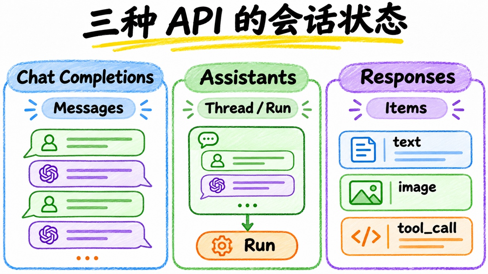
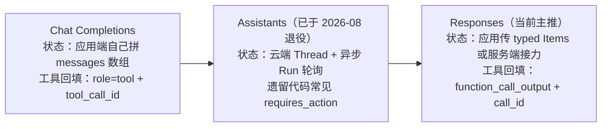
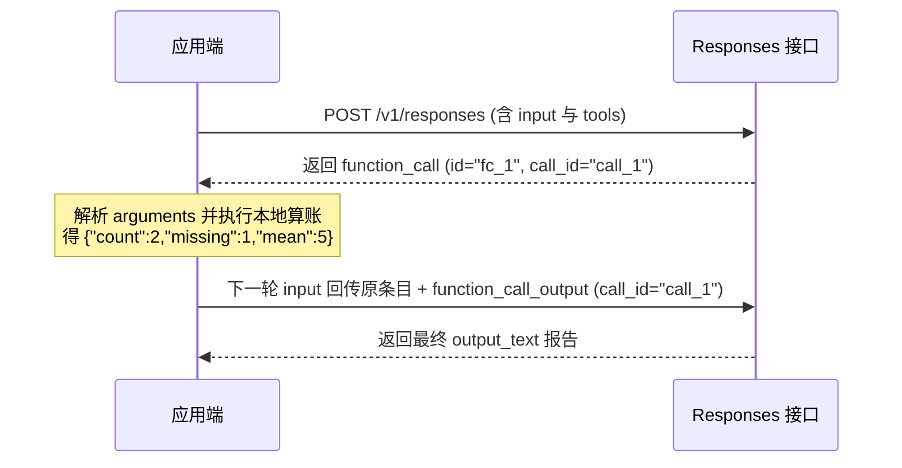

如果只看三行退款 CSV（`10, 空, 0`）的算账任务：第一轮写报告，第二轮追问「为什么均值是 5？」，中间还要调一次应用的 `summarize_refunds` 函数。业务一点没变，可翻开 OpenAI 的接口文档却冒出三套名字：**Chat Completions**、**Assistants** 和 **Responses**。

很多人搞混它们，其实看任何一家模型接口，只需要盯死两个灵魂拷问：**1. 聊天历史状态放在谁那儿？ 2. 一次调用交回来什么形状的对象？**

> **先用大白话讲明白**：OpenAI 三代接口的演变，就像**寄包裹方式的升级**：
> 1. **Chat Completions（自己拎包记账）**：应用自己拿着账本 `messages`，每聊一轮就把从头到尾全部记录打包重发过去。
> 2. **Assistants（2026-08 已退役，服务端寄存柜）**：你在云端开个 `Thread` 寄存柜把对话存那儿，再派一个 `Run` 任务去跑，程序还得轮询查它有没有停在 `requires_action` 等你交工具结果。
> 3. **Responses（现代统一接口）**：把对话里的每句话、思考、工具调用请求和工具回执全部统一叫成**带 `type` 的积木条目（Item）**！既可以像以前那样自己传 `input` 列表掌控一切，也可以只传一个 **`previous_response_id`** 或 `conversation` 让服务端续上历史——把多轮对话、工具和内置能力全都收进了一套协议里。



说明：OpenAI 已于 **2026 年 8 月 26 日**正式关闭 Assistants API，这里介绍它是为了让你读得懂公司老项目里的遗留代码。 [官方 Assistants 迁移指南](https://developers.openai.com/api/docs/assistants/migration) · [API-02 消息协议](api-02-chat-completions-messages.md)

## 1. 三代接口核心对比账本

| 接口代际 | 核心数据结构 | 第 2 轮怎么把上下文接上？ | 自定义函数由谁执行？ |
| --- | --- | --- | --- |
| **Chat Completions** | `messages` 输入数组 + `choices` 输出 | 应用端每次自己把完整历史和追问重新拼回 `messages` | **你的应用** |
| **Assistants（已退役）** | `Assistant` + `Thread`（会话容器）+ `Run`（执行记录） | 往旧 `Thread` 里塞一条新消息，再新起一个 `Run` 并轮询状态 | **你的应用**（发现 `requires_action` 后提交结果） |
| **Responses** | `input` 与 `output` 里的**类型化 Item** | 既可应用端回传 Item 数组，也可用 `previous_response_id` / Conversations API 续接 | **你的应用**（内置工具由平台按各自协议执行） |

[Responses 迁移指南](https://developers.openai.com/api/docs/guides/migrate-to-responses)

## 2. 两轮纯文本对话：字段是怎么搬家的？

对比前两篇的 Chat Completions 写法（`developer` + `user` 消息数组），改用 Responses 时，请求直接发往 `POST /v1/responses`，业务规则顶层放在 **`instructions`**，用户输入放在 **`input`**：

```json
{
  "model": "gpt-6-luna",
  "reasoning": {"effort": "none"},
  "instructions": "你是退款报表助手。忽略空金额，保留 0。",
  "input": "请用一句话报告有效金额条数、缺失条数和均值。\nid,amount\n1,10\n2,\n3,0"
}
```

服务端返回的不再是 `choices[0].message`，而是一组按顺序列在 `output` 里的 **Item**（下面是精简后的结构示意）：

```json
{
  "id": "resp_demo_1",
  "status": "completed",
  "output": [
    {
      "id": "msg_demo_1",
      "type": "message",
      "role": "assistant",
      "status": "completed",
      "content": [
        {"type": "output_text", "text": "有效金额 2 条，缺失 1 条，均值为 5。", "annotations": []}
      ]
    }
  ]
}
```

> **容易踩的坑（不要死写 `output[0]`）**：很多 SDK 会提供一个帮你拼好的快捷属性 `output_text`，但拆开原始 JSON 时，一旦模型先思考了一段（`reasoning` Item）或者先调了工具（`function_call` Item），文本消息就可能排在 `output[1]` 甚至后面！**务必遍历 `output`，按 `item["type"] == "message"` 找文本块**。

第 2 轮追问「为什么均值是 5？」时，Responses 提供了三条路：
1. **应用端全量回传（最可控、最透明）**：把首轮用户条目 + 首轮返回的完整 `output` + 新追问按顺序拼成新的 `input` 数组发出去，再带上 `instructions`。
2. **用 `previous_response_id` 省掉重传**：直接传入上一轮的 `"resp_demo_1"` 和本轮新问题就行。**注意坑点**：上一轮的 `instructions` 不会自动继承到新请求里，第 2 轮仍需自己传一遍业务规则！
3. **用 Conversations API**：适合长期持久化会话对象（记得同步评估项目的数据留存合规策略）。 [会话状态官方说明](https://developers.openai.com/api/docs/guides/conversation-state) · [Responses 创建接口](https://developers.openai.com/api/reference/resources/responses/methods/create)

## 3. 同一个退款函数 `summarize_refunds` 怎么往返一次？

如果模型不是直接猜 `5`，而是要求先调用应用里的 `summarize_refunds({"amounts":[10,null,0]})`，两套接口的字段迁移看这一张表就彻底明白：

| 工具往返阶段 | Chat Completions 写法 | Responses 写法 |
| --- | --- | --- |
| **1. 注册工具** | 嵌套放在 `tools[].function` 里面 | 扁平化：`name`、`parameters` 直接写在 `tools[]` 对象第一层 |
| **2. 模型提议调用** | 看 `choices[0].message.tool_calls[]`，用 `id`（如 `call_1`）标识 | 遍历 `output[]`，找 `type: "function_call"` 条目，用 **`call_id`** 关联结果 |
| **3. 应用回填结果** | 发一条 `{"role":"tool", "tool_call_id":"call_1", "content":"..."}` | 发一条 `{"type":"function_call_output", "call_id":"call_1", "output":"..."}` |
| **4. 触发继续信号** | 看 `finish_reason == "tool_calls"` | 在 `output` 里扫描到存在待执行的 `function_call` Item |



> **最容易踩的大坑（`id` vs `call_id`）**：看清上面图里！Responses 返回的 `function_call` 对象里**同时有两个长得极像的 ID**：一个是条目自身编号 `"id": "fc_1"`，另一个是调用匹配号 `"call_id": "call_1"`！应用构造 `function_call_output` 回填结果时，**必须把 `"call_id"` 填成 `"call_1"`**——如果不小心填成了 `"fc_1"`，服务端直接拒收！两种协议里的 `arguments` 也全都是 JSON **字符串**，用前必须先 `json.loads` 并校验。 [官方工具迁移对照](https://developers.openai.com/api/docs/guides/migrate-to-responses#5-update-function-definitions-and-outputs)

## 4. 离线跑通两轮文本与 `call_id` 迁移校验

保存为 `migration_check.py`，运行 `python3 migration_check.py`（只用标准库）：

```python
import json

rules = "忽略空金额，保留 0。"
question = "报告退款统计。\nid,amount\n1,10\n2,\n3,0"
follow_up = "为什么均值是 5？"
answer = "有效金额 2 条，缺失 1 条，均值为 5。"

chat_first = [{"role": "developer", "content": rules},
              {"role": "user", "content": question}]
chat_reply = {"choices": [{"message": {"role": "assistant", "content": answer}}]}
chat_second = [*chat_first, chat_reply["choices"][0]["message"],
               {"role": "user", "content": follow_up}]

response_items = [{
    "type": "message", "id": "msg_demo_1", "role": "assistant", "status": "completed",
    "content": [{"type": "output_text", "text": answer, "annotations": []}],
}]
responses_second = [
    {"role": "user", "content": question},
    *response_items,
    {"role": "user", "content": follow_up},
]
assert chat_second[2]["content"] == responses_second[1]["content"][0]["text"]

arguments = '{"amounts":[10,null,0]}'
chat_call = {"id": "call_1", "type": "function",
             "function": {"name": "summarize_refunds", "arguments": arguments}}
responses_call = {"type": "function_call", "id": "fc_1", "call_id": "call_1",
                  "name": "summarize_refunds", "arguments": arguments}

amounts = json.loads(responses_call["arguments"])["amounts"]
valid = [value for value in amounts if value is not None]
summary = {"count": len(valid), "missing": len(amounts) - len(valid),
           "mean": sum(valid) / len(valid) if valid else None}
text = json.dumps(summary)
chat_tool = {"role": "tool", "tool_call_id": chat_call["id"], "content": text}
responses_tool = {"type": "function_call_output", "call_id": responses_call["call_id"],
                  "output": text}

assert chat_tool["tool_call_id"] == responses_tool["call_id"]
assert responses_tool["call_id"] != responses_call["id"]
assert json.loads(chat_tool["content"]) == json.loads(responses_tool["output"])
assert summary == {"count": 2, "missing": 1, "mean": 5}
print("两轮上下文保留同一条报告，工具结果关联到", responses_tool["call_id"], summary)
```

脚本会在末尾打印 `call_1` 和 `{'count': 2, 'missing': 1, 'mean': 5.0}`。如果你故意把第 118 行的 `responses_call["call_id"]` 错写成 `responses_call["id"]`，第 121 行的断言会立刻炸出 `AssertionError` 把错误挡下来。做接口版本迁移时，用同一批夹具跑这类契约断言最靠谱。

## 下一篇

刚理清了工具调度的协议壳子，下一篇就把重点放到「怎么定义函数参数、防着模型乱传坏类型或瞎编数据、以及怎么给最终报告套上死规矩格式」。请看 [API-04《Function Calling 与 Structured Outputs》](api-04-function-calling-structured-outputs.md)。系列入口见 [LLM 与 Agent 学习路线图](../../llm-agent-learning-roadmap.md)。
