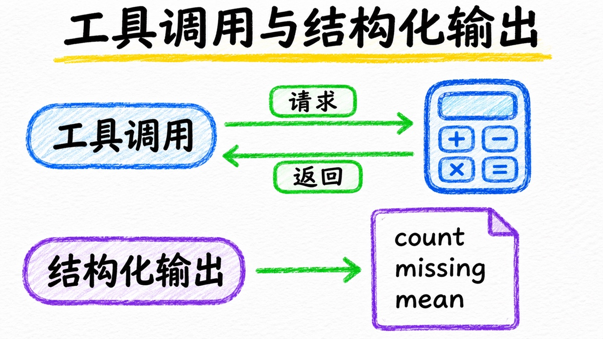
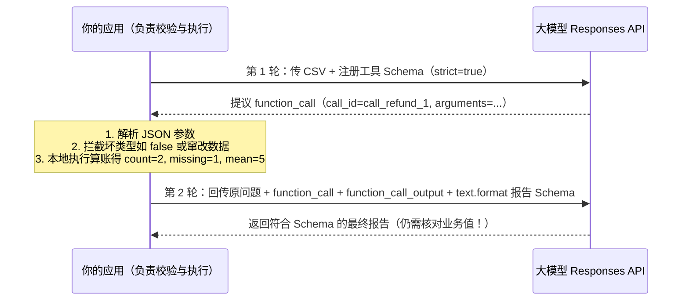

退款金额是 `10, 空, 0`。纯靠大模型口算很容易把空值算成 0 或者算错小数，最稳的做法是让模型调用我们自己写的确定性算账函数 `summarize_refunds`，算出精确的 **(10 + 0) ÷ 2 = 5** 再交给模型；同时，前端页面可能还要求模型最后吐出的回答是一个**严丝合缝的 JSON 对象**，直接塞进表格渲染。

这就引出开发里最容易混为一谈的两个机制：**Function Calling（函数调用）** 和 **Structured Outputs（结构化输出）**。

> **先用大白话讲明白**：虽然两者都用 **JSON Schema**（一套用来规定「必须有哪些字段、每个字段是数字还是文本」的图纸）来写规则，但干的是两件截然不同的事：
> 1. **Function Calling（递交计算工单）**：解决的是**「模型不会算、没数据或需要改外部系统」**的问题。模型在第一轮不直接瞎答，而是填一张**「请应用帮我跑 `summarize_refunds`」的工单**；**真正跑代码算账的是你的应用程序**，算完后带着工单号 `call_id` 把结果寄回给模型。
> 2. **Structured Outputs（给最终答卷画死表格格子）**：解决的是**「模型爱说废话、乱加代码围栏或写错字段名」**的问题。模型最后写报告给前端/下游程序读取时，必须严严格格把文字填进你画好的 JSON 格子里。



[OpenAI 函数调用指南](https://developers.openai.com/api/docs/guides/function-calling) · [Structured Outputs 指南](https://developers.openai.com/api/docs/guides/structured-outputs)

## 1. 第一步：递工具说明书与接工单（Function Calling）

沿用 [API-03](api-03-openai-api-evolution.md) 的 Responses 协议，把工具说明书放进首轮 `POST /v1/responses` 的 `tools` 数组里。注意看金额元素类型 `["number", "null"]`（空值写 `null`，真实 `0` 仍是数字）：

```json
{
  "type": "function",
  "name": "summarize_refunds",
  "description": "计算退款金额的有效条数、缺失条数和均值，保留 0，排除 null。",
  "strict": true,
  "parameters": {
    "type": "object",
    "properties": {
      "amounts": {"type": "array", "items": {"type": ["number", "null"]}}
    },
    "required": ["amounts"],
    "additionalProperties": false
  }
}
```

这里 **`strict: true`** 开启严格模式：支持的模型会尽量按这张 Schema 子集吐参数，因此规范要求把所有声明字段放进 `required`、并关闭多余字段 `additionalProperties: false`。 [严格参数模式要求](https://developers.openai.com/api/docs/guides/function-calling#strict-mode)

第一轮响应回来，在 `output` 中找到模型开出的工单 `function_call`：

```json
{
  "type": "function_call",
  "id": "fc_refund_1",
  "call_id": "call_refund_1",
  "name": "summarize_refunds",
  "arguments": "{\"amounts\":[10,null,0]}"
}
```

> **容易踩的坑（别直接拿模型传来的参数无脑算！）**：模型不是可信代码，它完全可能手滑把 `0` 写成 `false`（在 Python 里 `isinstance(False, int)` 竟然返回 **`True`**！直接拿去求和就会出大漏子），甚至在超长对话里把原 CSV 的 `[10, None, 0]` 抄成 `[10, 0, 0]`！因此应用在执行前，**既要校验严格类型（用 `type(x) is int`），还要核对来源是否真的吻合当前会话里的原始数据**；更好、更安全的工程做法是只让模型传一个你应用签发的文件 ID，由工具自己在后台直接读权威 CSV！

## 2. 第二步：带着工单号 `call_id` 交回算账结果

你的应用算完 `(10 + 0) ÷ 2 = 5` 后，把新构造的 `function_call_output` 拼在第 1 轮上下文和刚才那个 `function_call` 后面发往第二轮请求：

```json
{
  "type": "function_call_output",
  "call_id": "call_refund_1",
  "output": "{\"count\":2,\"missing\":1,\"mean\":5.0}"
}
```

如果模型同一轮一口气提出了好几个调用（哪怕调用的都是同一个函数名），只要**按各自的 `call_id` 一一对应填回各自结果**即可。万一其中某一个调用参数校不通过，不要直接让整场请求崩溃——把报错说明打包回填进那一条对应的 `function_call_output`，好让其他正常调用继续推进，甚至给模型一次自我纠错的机会！

## 3. 第三步：用 Structured Outputs 锁死最终报告格式

到了第二轮请求，如果你希望模型把最终总结直接交成程序可直接读的 JSON，在请求体的 **`text.format`** 里挂上输出 Schema（如果在 Chat Completions 里则对应 `response_format`）：

```json
{
  "text": {
    "format": {
      "type": "json_schema",
      "name": "refund_report",
      "strict": true,
      "schema": {
        "type": "object",
        "properties": {
          "count": {"type": "integer"},
          "missing": {"type": "integer"},
          "mean": {"type": ["number", "null"]}
        },
        "required": ["count", "missing", "mean"],
        "additionalProperties": false
      }
    }
  }
}
```

> **核心分水岭（千万别背混两个 `strict: true`！）**：
> - `tools[].strict = true` 约束的是**「模型提议调函数时填的入参」**；
> - `text.format.strict = true` 约束的是**「模型最终交卷给用户或前端的文本结构」**。
> 而且记住：**Structured Outputs 只保结构合法，不保业务算对！** 哪怕模型最终鬼使神差吐出了 `{"count":3,"missing":0,"mean":3.33}`，JSON Schema 照样放行绿灯！甚至在遇到拒答（`refusal`）或输出超长被砍断（`incomplete`）时，根本拿不到完整 JSON。所以线上收到输出后，**先查 `status` 和拒答标记，再对照工具刚刚算出来的真值做业务断言！** [结构化输出迁移文档](https://developers.openai.com/api/docs/guides/migrate-to-responses#6-update-structured-outputs-definitions)

## 4. 单机脚本实测：把好参数、布尔值假冒和数据篡改一次性挡全

把下面代码保存为 `tool_roundtrip.py`，只用标准库运行 `python3 tool_roundtrip.py`。它同时喂入三条同轮调用：一条正常、一条把 `0` 写成布尔值 `false`、一条把原 CSV 篡改成 `[10, 0, 0]`，验证返回字典各自按 `call_id` 精准回填：

```python
import json
import math

CSV_AMOUNTS = [10, None, 0]
TOOL_NAME = "summarize_refunds"


def is_amount(value):
    return (
        value is None
        or type(value) is int
        or (type(value) is float and math.isfinite(value))
    )


def execute(call):
    if call["name"] != TOOL_NAME:
        raise ValueError("unknown tool")
    args = json.loads(call["arguments"])
    if not isinstance(args, dict) or set(args) != {"amounts"}:
        raise ValueError("expected amounts")
    amounts = args["amounts"]
    if not isinstance(amounts, list) or not all(map(is_amount, amounts)):
        raise ValueError("amounts must contain finite numbers or null")
    if amounts != CSV_AMOUNTS:
        raise ValueError("amounts do not match this CSV")
    valid = [amount for amount in amounts if amount is not None]
    return {
        "count": len(valid),
        "missing": len(amounts) - len(valid),
        "mean": sum(valid) / len(valid) if valid else None,
    }


def respond(call):
    try:
        result = execute(call)
    except ValueError as error:
        result = {"error": str(error)}
    return {
        "type": "function_call_output",
        "call_id": call["call_id"],
        "output": json.dumps(result),
    }


calls = [
    {"type": "function_call", "call_id": "call_ok", "name": TOOL_NAME,
     "arguments": '{"amounts":[10,null,0]}'},
    {"type": "function_call", "call_id": "call_bad_type", "name": TOOL_NAME,
     "arguments": '{"amounts":[10,null,false]}'},
    {"type": "function_call", "call_id": "call_wrong_csv", "name": TOOL_NAME,
     "arguments": '{"amounts":[10,0,0]}'},
]
outputs = [respond(call) for call in calls]
by_id = {item["call_id"]: json.loads(item["output"]) for item in outputs}
expected = {"count": 2, "missing": 1, "mean": 5}
assert by_id["call_ok"] == expected
assert by_id["call_bad_type"]["error"] == "amounts must contain finite numbers or null"
assert by_id["call_wrong_csv"]["error"] == "amounts do not match this CSV"
for call_id, result in by_id.items():
    print(call_id, result)
```

> **想再深入一层？** 留意脚本第 107 行 `type(value) is int` 和第 108 行 `math.isfinite(value)`：前者防 `True`/`False` 浑水摸鱼当成 `1`/`0`，后者防 `NaN` 或 `Infinity` 偷偷流进 JSON 造成下游崩溃。

## 下一篇

我们刚刚看到了配置一个 `strict: true` 就能锁住 JSON 形状——可大模型底层是一个个吐字概率的机器，**为什么以前总是多吐代码块围栏，加了 Schema 约束之后它就能老老实实只吐合法 JSON 字符？** 下一篇 [API-09《约束解码如何生成符合 Schema 的结构化输出》](api-09-constrained-decoding.md) 带你钻进词表选词的那一步，手算每步是如何把非法 Token 踢出菜单的！系列入口见 [LLM 与 Agent 学习路线图](../../llm-agent-learning-roadmap.md)。
