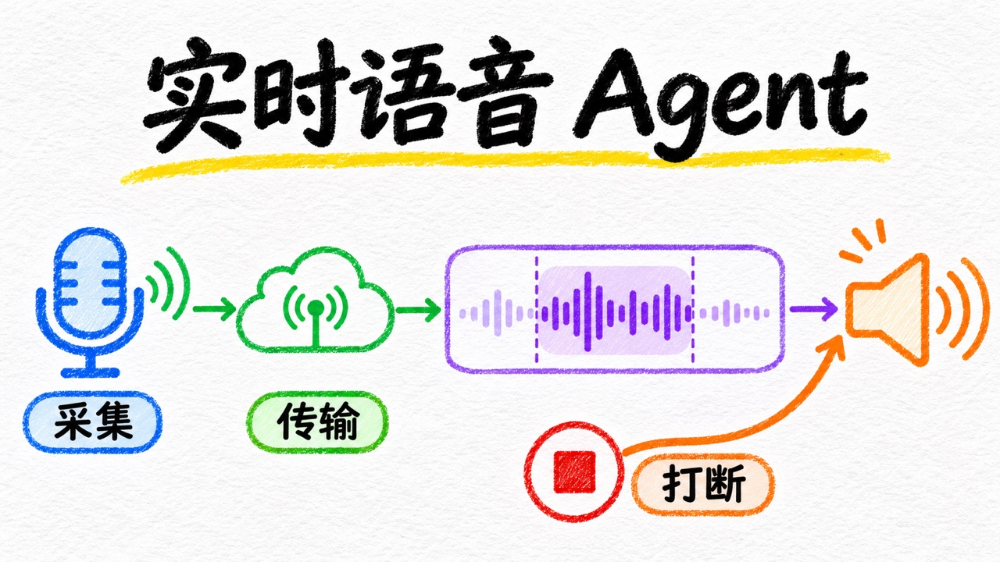
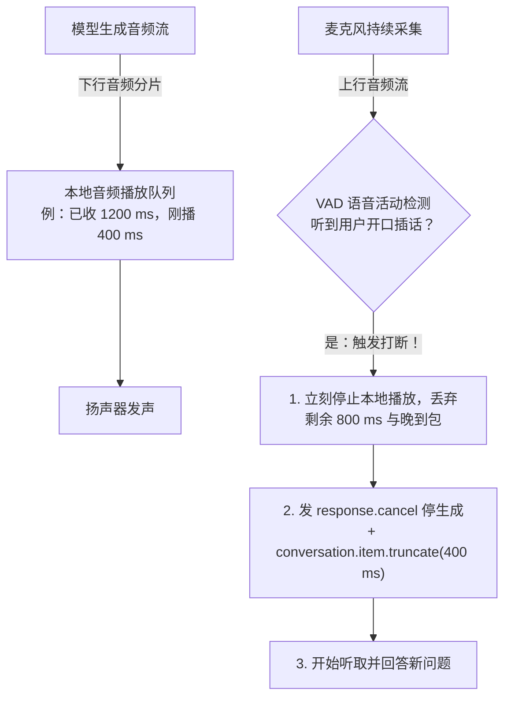

模型正在扬声器里慢慢念：「有效金额两条，缺失一条，均值为五……」话刚念到一半，用户突然开口插话：「等等，为什么是五？」

在纯文字世界里，发一条请求拿一个响应就行；可到了实时语音，系统必须**同一秒钟同时干三件事**：收麦克风里用户刚插进来的声音、把还在念的旧声音**瞬间掐断**、还要告诉服务端「用户其实只听到了前 400 毫秒，后面没放出来的字别留在上下文记忆里」！

> **先用大白话讲明白**：文字流式输出像**「发微信长文字气泡」**（你问完，等它写完，再轮到你）；而实时语音 Agent 像**「打一通真正能随时抢话的双工电话」**：
> - **上行路（你的嘴 → 模型耳朵）**：麦克风不断收音切块往外传，靠 **VAD（Voice Activity Detection，语音活动检测）** 听出「用户开口了！」。
> - **下行路（模型嘴巴 → 你的喇叭）**：模型算出来的声音不是直接传进你耳膜，而是先排队躺进**本地播放队列**里慢慢放——比如服务端已经送来了 `1200 ms` 的音频，喇叭刚放到第 `400 ms`，剩下 `800 ms` 还在队列里排队！
> - **打断四连动作（Barge-in）**：一旦检测到用户开口，**1）立刻让本地喇叭哑火并倒掉那 `800 ms` 待播存货；2）拒收半路晚到的旧音频包裹；3）发 `response.cancel` 停掉服务端生成；4）发截断指令告诉服务端把记忆精确切回第 `400 ms`**，防止 AI 以为你把整句话都听完了！



先修可对照 [F-09 多模态块](../01-llm-foundations/f-09-multimodal-input.md) 和 [API-05 流式传输](api-05-sse-streaming-tools.md)。 [OpenAI Realtime 会话指南](https://developers.openai.com/api/docs/guides/realtime-conversations)

## 1. 打断时为什么要区分「已生成、已收到、已播放」？

打断最容易出灵异现象的地方在于**网速比人耳快得多**！往往模型花了半秒就已经吐出了未来 2 秒钟的音频存进了你的手机/浏览器缓冲队列里。做延时排查与测量时，必须把三块进度分清：
1. **服务端已生成时长**（模型已经算出了多少毫秒）；
2. **客户端已收到时长**（网络传进你缓冲队列有多少毫秒，例如 1200 ms）；
3. **扬声器已播出时长**（用户耳朵真真正正听进去多少毫秒，例如 400 ms）。

一旦打断，多出来的 `800 ms` 必须从队列里彻底丢弃；而且服务端如果不修正，对话历史里会留着「我已经把 1200 ms 全念给用户听了」的假记忆，导致下一轮用户问「刚才你说的第二个数字是什么」时牛头不对马嘴！

## 2. 两条传输大路怎么选：WebRTC vs WebSocket？

| 核心要干的事 | 浏览器直连 **WebRTC** | 后端/应用自管 **WebSocket** |
| --- | --- | --- |
| **怎么握手建连？** | 浏览器建 `RTCPeerConnection` 生成 SDP Offer，**靠应用后端换取短期临时凭据**完成握手（绝不把长期 API Key 塞进网页前端！） | 服务端之间建立双向 WebSocket，后端统一保管认证与配置 |
| **怎么发麦克风声音？** | `getUserMedia` 直接拿媒体轨丢进连接，底层自动抗网络抖动与丢包 | 应用自己采集、转码成规定格式，再用 `input_audio_buffer.append` 塞 Base64 文本块 |
| **怎么放 AI 的声音？** | 浏览器收到远端媒体轨自动平滑播放，控制指令走 DataChannel | 应用自己收 `response.output_audio.delta`，解 Base64 进缓冲队列自己排着放 |
| **遇到打断怎么办？** | 配了服务端 VAD 时通常自动停止与修正；也可手动发 `output_audio_buffer.clear` | **全部自己写！** 立刻停播放器 + 清队列 + 按已播毫秒数发 `conversation.item.truncate` + 视情况发 `response.cancel` |

> **想再深入一层（PCM 音频切片手算）？** WebSocket 下常用单声道、24 kHz 采样率、16 位 **PCM（脉冲编码调制，未压缩原始声音采样）**：每秒采 `24,000` 个点，每个点占 `2` 字节，那么每切一小段 **20 ms** 的语音块，原始字节正好是 **`24,000 × 0.020 × 2 = 960` 字节**，再转成 Base64 文本发送。**踩坑提醒**：如果你读取本地 `.wav` 文件喂给流，务必先把开头的 44 字节 WAV 文件头剥掉只留纯 PCM，否则开头会发出一声刺耳的「咔哒」爆音！ [OpenAI WebRTC 文档](https://developers.openai.com/api/docs/guides/realtime-webrtc) · [WebSocket 文档](https://developers.openai.com/api/docs/guides/realtime-websocket)

## 3. WebSocket 场景下一次精准打断的四步次序

假设本地一边放着旧回答，一边手里记着它的 `item_id`、`content_index` 和 `AudioContext` 时钟进度：
1. 收到开口事件（如 `input_audio_buffer.speech_started`），立刻记录本地打断瞬间时刻和「已经真放出来了多少毫秒（如 `400 ms`）」。
2. **先掐声音再做别的**：停止本地音频节点播放，清空排队的未播切片，并把这一轮旧 ID 标成「作废」（**防止半秒后网络上飘来的迟到旧片段混进新队列复活**！）。
3. 如果旧回复还在生成中且服务端未自动取消，发出 `response.cancel`；紧跟着发出下面这个截断事件把服务器上下文对齐回 `400 ms`：

```json
{
  "type": "conversation.item.truncate",
  "item_id": "item_demo_old_answer",
  "content_index": 0,
  "audio_end_ms": 400
}
```

4. 开始收新语音、等新回答再建新队列。

## 4. 浏览器单机实测：零成本测出打断延迟和晚到拦截

把下面代码完整保存为 `interrupt.html`，直接用 Chrome / Edge / Safari 双击打开点击「开始」（只用浏览器自带 **Web Audio** 接口生成 440 Hz 合成音，不需要麦克风权限也不花 API 费用！）：

```html
<!doctype html>
<html lang="zh-CN">
<meta charset="utf-8">
<title>语音打断实验</title>
<button id="start">开始</button>
<pre id="log" aria-live="polite"></pre>
<script>
const button = document.querySelector("#start");
const log = document.querySelector("#log");
const sleep = ms => new Promise(resolve => setTimeout(resolve, ms));

button.onclick = async () => {
  button.disabled = true;
  log.textContent = "";
  const ctx = new AudioContext();
  try {
    await ctx.resume();
    const gain = ctx.createGain();
    gain.gain.value = 0.06;
    gain.connect(ctx.destination);

    const turnId = "refund-report";
    let cancelled = false;
    const queue = [];
    function enqueue(id, time) {
      if (cancelled || id !== turnId) return false;
      const oscillator = ctx.createOscillator();
      oscillator.frequency.value = 440;
      oscillator.connect(gain);
      oscillator.start(time);
      oscillator.stop(time + 0.75);
      queue.push({ oscillator, time });
      return true;
    }

    const start = ctx.currentTime + 0.05;
    for (let i = 0; i < 3; i++) enqueue(turnId, start + i * 0.75);
    const deadline = performance.now() + 3000;
    while (ctx.currentTime < start + 0.4) {
      if (performance.now() > deadline) throw new Error("音频时钟未推进");
      await sleep(10);
    }

    const interruptedAt = performance.now();
    const stopTime = ctx.currentTime;
    cancelled = true;
    const active = queue.find(({time}) => time <= stopTime && stopTime < time + 0.75);
    const queued = queue.filter(({time}) => time > stopTime);
    if (!active) throw new Error("没有正在播放的片段，请让页面保持前台重试");
    const ended = new Promise(resolve => {
      active.oscillator.onended = () => resolve(performance.now());
    });
    const played = Math.max(0, Math.round((stopTime - start) * 1000));
    [active, ...queued].forEach(({oscillator}) => oscillator.stop(stopTime));
    queue.length = 0;

    const droppedLate = !enqueue(turnId, stopTime + 1);
    const latency = (await ended) - interruptedAt;
    log.textContent = [
      "已播时长（音频图）：" + played + " ms",
      "打断信号 → ended 回调：" + latency.toFixed(1) + " ms",
      "丢弃待播片段：" + queued.length,
      "拒绝旧回答的晚到片段：" + droppedLate,
    ].join("\n");
  } catch (error) {
    log.textContent = error.message;
  } finally {
    await ctx.close();
    button.disabled = false;
  }
};
</script>
</html>
```

在无界面 Chrome 157 上一次实测的真实日志记录：**已播 `403 ms` 时触发打断，仅 `1.4 ms` 就收到了 `ended` 回调**，当场丢弃 `2` 段待播音频、并成功拦截了迟到的旧片段！在普通桌面浏览器跑还能真切听到一声「哔——」被干脆利落地掐断。注意：这 `1.4 ms` 测量的是浏览器事件派发停止的时间，若做端到端真实评测，还需要另架麦克风或环回录音来对齐物理扬声器彻底静音的毫秒数。 [Web Audio 音频节点文档](https://www.w3.org/TR/webaudio/#AudioScheduledSourceNode)

## 下一部分

第 2 专题「LLM API 与流式协议」10 篇全部收官！现在我们已经能发请求、保历史、跑多轮工具、接流式和语音。可改了一次提示词或换了一个模型后，怎么拿铁打的自动化指标证明「真变好了」而不是自我感觉良好？第三部分从 [LE-07《什么是评测，如何跑通第一条用例》](../03-llm-eval/le-07-first-eval.md) 正式起步！系列入口见 [LLM 与 Agent 学习路线图](../../llm-agent-learning-roadmap.md)。
