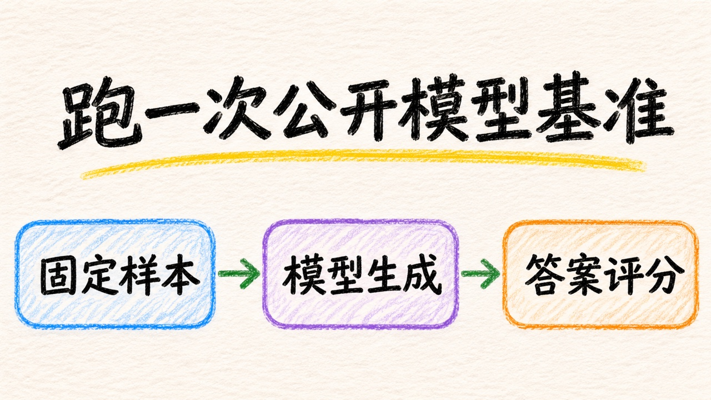
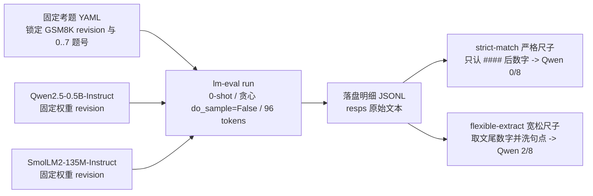

在 [LE-10](le-10-public-datasets.md) 里，我们拆解了 GSM8K 的判卷核心在于抓取末尾数值。今天咱们不再纸上谈兵，而是拉出业内最常用的开源工具 `lm-eval`，亲自跑通两款端侧小模型。

你马上就会亲眼看到一个让新手极其迷惑的现场：**模型吐出的明明是同一句一字不差的原话，怎么用一套规则算分是 0 分，换一套规则瞬间变成满分 1 分？** 一切都要先从「把考题版本、模型权重、生成上限和判卷尺子全部锁死」讲起。

> **先用大白话讲明白**：在实验室复现公开跑分，核心秘诀就四个字——**全套封印**：
> - **封考卷修订号**：数据集今天写著 8 千题，万一半年后维护者修错别字改了版本号怎么办？要把数据的 Git 提交哈希（Commit SHA）死死钉住。
> - **封考生权重与格式**：两个模型谁都不允许套额外秘制系统提示词，全用同一种裸题干文本、同样的最多吐 96 个 Token、同样的 `do_sample=False`（绝对确定性的贪心挑选，不抽风），否则考得高分也不知道是模型强还是模板占了便宜。
> - **分清「严格尺子」和「宽松尺子」**：有的小模型算对了数，但忘了按标准模板写 `#### 540`，而是写了一句 `The answer is 540.`。严格尺子直接判错；宽松尺子去文尾捞出最后一个数 `540` 就算对。所以报告里必须把两把尺子的分数一起晒出来！



**LM Evaluation Harness**（简称 Harness，命令行工具叫 `lm-eval`）是开源大模型评测的事实标准框架：你给它一份任务配置，它自动把考题拼成请求喂给模型、从废话堆里抽出答案、对完标准答案再输出成可复盘的报表。本文直接复用它内置的 GSM8K 题面与两把抽取过滤器，只额外打上一个轻量补丁，把数据集提交哈希死死锁定。[Harness 项目](https://github.com/EleutherAI/lm-evaluation-harness) · [GSM8K 任务配置](https://github.com/EleutherAI/lm-evaluation-harness/blob/ddd67220430a2470529f25fd5c05a576ca1057a0/lm_eval/tasks/gsm8k/gsm8k.yaml)

## 1. 先白纸黑字冻结这次实验的所有边界条件

跑实验最怕事后记不清参数。开工前把整场对比的每一项参数锁定如下（注意所有模型均在同一套规则下受测）：

| 实验要素 | 本次冻结配置与说明 |
| --- | --- |
| **数据集与版本** | `openai/gsm8k` 的 `main/test` 切分，锁死数据修订号 `740312add88f781978c0658806c59bc2815b9866`。 |
| **抽样范围** | 仅取原始测试集（全量 1,319 条）的前 8 条（索引 `0` 至 `7`），用来跑通并验证完整复现链路。 |
| **参赛模型** | `Qwen2.5-0.5B-Instruct` 与 `SmolLM2-135M-Instruct`，两者权重仓库的 Git revision 同样全部锁死。 |
| **输入格式协议** | 统一走任务自带的纯文本 `Question: …\nAnswer:` 题面，两款模型各自用自带分词器处理。 |
| **示例与解码策略** | **0-shot**（不给示范例子直接作答），贪心解码（`do_sample=False`，每步永远只挑概率最高的那一个 Token，消除随机性），最长生成 96 Token，随机种子 42。 |
| **双评分规则** | 同时跑框架自带的 `strict-match`（严格匹配）和 `flexible-extract`（宽松提取），随后做精确匹配 `exact_match`。 |

> **容易踩的坑**：这两款模型其实都是指令微调（Instruct）模型，平时聊天都要套各自的对话模板（Chat Template）。本文特意关闭个性化聊天模板、强迫大家用相同的纯文本题面，就是为了演示「固定唯一变量」。要是你决定在实测里打开 `--apply_chat_template`，两款模型各自收到的前导系统词立刻就变样了——请一定新开一组对照实验并单独注明！另外 8 条只是流程演练的小切片，绝不代表两款模型在全部 1,319 题上的真实能力差距。[GSM8K 数据卡](https://huggingface.co/datasets/openai/gsm8k) · [Qwen 模型卡](https://huggingface.co/Qwen/Qwen2.5-0.5B-Instruct) · [SmolLM2 模型卡](https://huggingface.co/HuggingFaceTB/SmolLM2-135M-Instruct)

## 2. 动手：复制官方任务配置并只钉死数据集修订号

在空目录下准备好 Python 3.12 虚拟环境，按下方精确锁死版本号的命令装齐依赖（首次执行会自动拉取公开数据集与模型权重）：

```bash
python -m pip install "lm_eval[hf]==0.4.13" "torch==2.11.0" \
  "transformers[chat-template]==5.13.0" "tokenizers==0.22.2"
```

接着把下面这 13 行脚本存成 `make_task.py`：它从你刚安装的 `lm_eval` 包里掏出原版 `gsm8k.yaml`，只干两件事——改名叫 `gsm8k_pinned`，然后往 `dataset_kwargs` 里塞入刚才查到的提交哈希：

```python
from importlib.resources import files
from pathlib import Path

original = files("lm_eval").joinpath("tasks", "gsm8k", "gsm8k.yaml").read_text()
assert original.count("\ntask: gsm8k\n") == 1
assert original.count("\ndataset_name: main\n") == 1
config = original.replace("\ntask: gsm8k\n", "\ntask: gsm8k_pinned\n").replace(
    "\ndataset_name: main\n",
    "\ndataset_name: main\ndataset_kwargs:\n  revision: 740312add88f781978c0658806c59bc2815b9866\n",
)
Path("tasks").mkdir(exist_ok=True)
Path("tasks/gsm8k_pinned.yaml").write_text(config, encoding="utf-8")
```

现在用一模一样的参数依次跑通两位「考生」：

```bash
python make_task.py
export OMP_NUM_THREADS=4
export TOKENIZERS_PARALLELISM=false

run_model() {
  lm-eval run --model hf \
    --model_args "pretrained=$1" "revision=$2" dtype=float32 \
    --include_path tasks --tasks gsm8k_pinned \
    --samples '{"gsm8k_pinned":[0,1,2,3,4,5,6,7]}' \
    --num_fewshot 0 --seed 42 --device cpu --batch_size 2 \
    --gen_kwargs do_sample=False max_gen_toks=96 \
    --log_samples --output_path "$3"
}

run_model Qwen/Qwen2.5-0.5B-Instruct 7ae557604adf67be50417f59c2c2f167def9a775 qwen-run
run_model HuggingFaceTB/SmolLM2-135M-Instruct 12fd25f77366fa6b3b4b768ec3050bf629380bac smol-run
```

> **想再深入一层？** 命令行参数里的两个小陷阱值得标红记住：
> - `--samples` 是按指定下标精准点名取题，**绝对不能和随机截断的 `--limit` 混用**；
> - `--log_samples` 会在输出目录生成一份总表 JSON 外加一份逐题明细 JSONL。由于 GSM8K 配置了 `strict-match` 和 `flexible-extract` 两把过滤器，**明明推理只跑了 8 题，明细 JSONL 里却会躺着 16 条判分记录**——一模一样的模型生成被批了两遍！[Harness 命令行说明](https://github.com/EleutherAI/lm-evaluation-harness/blob/ddd67220430a2470529f25fd5c05a576ca1057a0/docs/interface.md)

## 3. 同一份原始生成，为什么会跑出两张截然不同的成绩单？

以下是在本机 Apple Silicon CPU 上实际跑出的结果。**精确匹配（Exact Match）**指的是按各自规则先从回答里捞出文本、洗去前后杂物后，与标准答案做全等比对：`strict-match` 死咬必须写 `#### 数字` 才认账；`flexible-extract` 允许模型用自然语言作答，直接在最后抓一个数字出来（本配置取文中最后一处数字匹配）：

| 参测模型 | 严格抽取 (`strict-match`) | 宽松抽取 (`flexible-extract`) |
| --- | ---: | ---: |
| Qwen2.5-0.5B-Instruct | 0/8 | 2/8 |
| SmolLM2-135M-Instruct | 0/8 | 0/8 |

这可不是模型发疯，翻开明细日志一目了然！例如在 `doc_id: 3` 上，Qwen 明明算对了，但末尾写的是 `The answer is 540.`，偏偏没画 `####` 标记。结果严格抽取器两手一摊返回 `[invalid]`，给它记 0 分；而宽松抽取器一把抓住末尾的 `540.`，洗掉最后那个英文句点，正好对上标准答案 `540`，记 1 分！

排查这种怪现象时的黄金排障顺序永远是：**先去明细文件里读模型的原始发言 `resps` -> 再对比过滤器抓出来的 `filtered_resps` -> 最后才看 `exact_match` 的 0 或 1**。有时候宽松抽取器也会好心办坏事，把模型验算草稿里随手举的一个反例数字当成了最终答案——因此最负责任的做法是在评审报告里**同时保留两套口径的得分**，让看报告的人心里有底。

## 4. 只答一次的准确率 vs 允许多试几次的 pass@k

前面为了固定实验我们用的是每题只答 1 次（贪心解码）。但在真实系统里，很多团队喜欢开启随机采样让模型一道题作答很多次（比如让它写 4 段代码或解 4 遍题），再问：**「抽 `k` 次机会，里面至少有 1 次蒙对的概率有多大？」**

这就是 HumanEval 论文里著名的无偏 **pass@k** 估算公式：假设每道题总计按统一采样参数生成 `n` 个候选答案，其中跑通测试的正确候选有 `c` 个；当你从中不放回随机挑 `k` 个时，「全军覆没都没挑到正确答案」的概率等于组合数 C(n-c, k) ÷ C(n, k)，用 `1` 减去它，就是**至少挑中一个正确答案的概率**：

```python
from math import comb

n, c, k = 4, 1, 2
p = 1 - comb(n - c, k) / comb(n, k)
assert p == 0.5
print(p)
```

> **大白话小结**：看上面这行口算：`4` 个答案里只有 `1` 个对的，如果只给 `1` 次机会（`pass@1`），正确率才 **`0.25`**；给你 `2` 次筛选机会（`pass@2`），至少选中一次正确答案的概率就蹿到了 **`0.5`**！
> 千万别掉进业务幻觉里：**如果你的线上产品每次只直接把第 1 条生成抛给用户、后台根本没有单测或数值验证器去帮用户挑哪一条是对的，就绝对不能拿炫酷的 `pass@2` 或 `pass@10` 去吹嘘用户的真实首答成功率！** 另外对比任何两份评测报告时，记得顺手核对五件套：题库污染情况、题量与切分、few-shot 示范数、停词（stop sequences）以及抽取规则；看到 8 题里 2/8 的结果，赶紧去把 2 道做对的和 6 道做错的原话翻出来，真要宣布谁更强，还要拿到全量独立样本上才有说服力。[HumanEval 论文与 pass@k](https://arxiv.org/abs/2107.03374)

## 下一篇

客观计算题可以用精确匹配与单元测试批改；可要是考题变成没有标准字面解的「请用大白话给客服解释为什么退款均值算 5」，总不能让人每天盯上千条答卷吧——让大模型去批改大模型的 **LLM-as-a-Judge** 靠谱吗？[**LE-03《LLM-as-a-Judge 与人工校准》**](le-03-llm-judge-calibration.md) 会亲自做一场调换 A/B 位置就原地露馅的位置偏见实测，教你用人工标准样本校出靠谱的裁判模型。 [LLM 与 Agent 学习路线图](https://blog.lacknb.cn/articles/2026/11/19/1795058329577.html)
