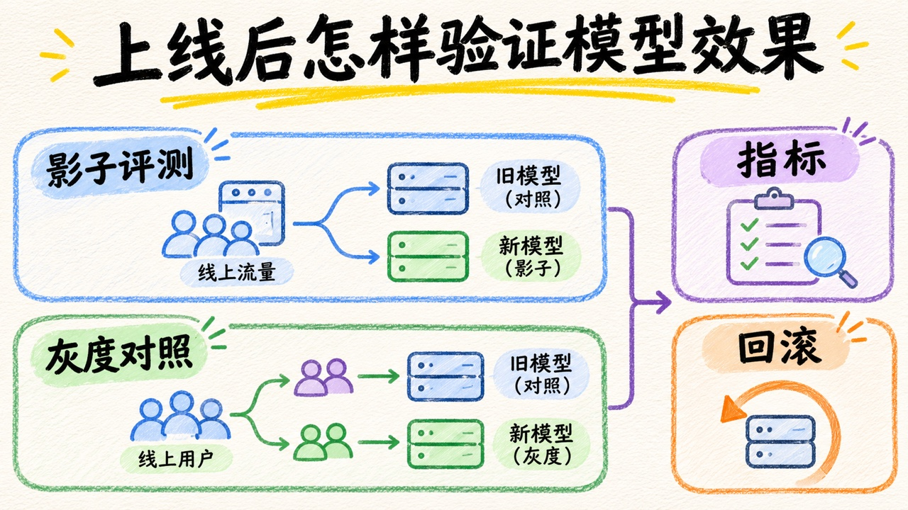
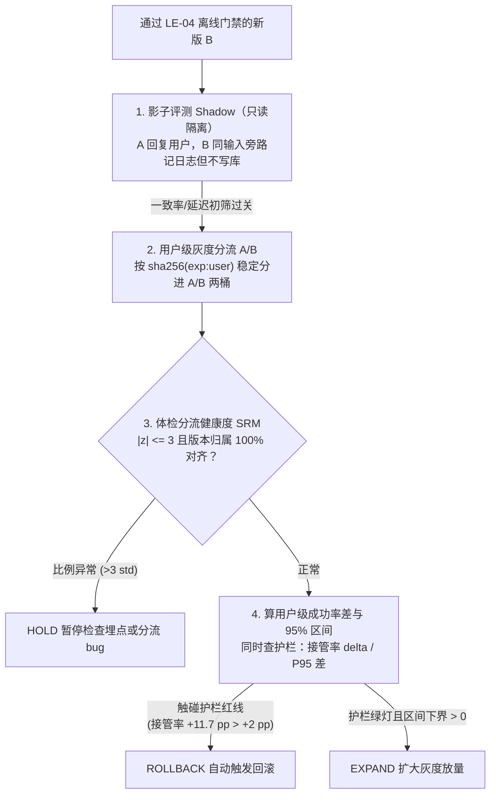

在 [LE-04](le-04-regression-gates.md) 里，我们的新版退款助手高分通过了离线回归测试门禁，团队满心欢喜准备发全量。可线下试卷过了不代表线上就高枕无忧——**真实线上流量的剧本往往反着来**：新版虽然线下算对了几道空值刁难，可到真用户手里，它一遇到略微模糊的表格就疯狂保守弹出「建议转人工客服复核」！用户烦得直接点转人工，客服团队当场爆单。

因此，**上线验收永远得同时盯紧两笔账**：一笔是「退款任务最终有没有准确办成」（主效果），另一笔是「为了让它办成，多花了用户几秒等待、额外耗费多少人力接管」（**护栏代价**）。今天带你用最安全的两步放行方案——先跑只读**影子评测**，再跑用户级 **A/B 灰度对照**——把这套验证闭环亲手跑一遍！

> **先用大白话讲明白**：放新模型见真顾客之前，分两步走最稳当：
> - **第一步：影子评测（Shadow Eval）——「新人躲在单向玻璃后面陪跑练习」**：顾客点退款时，依然由老版本 `A` 真干活并回复顾客；后台偷偷把同一份脱敏输入复制一份喂给关掉一切写入权限的新人 `B`，记下 `B` 打算算什么数、想调啥接口。顾客丝毫不受影响，我们就能低成本核对两端输出差异。缺点是：因为顾客根本没见到 `B` 的回答，点不点赞、转不转人工这些真实交互根本测不到。
> - **第二步：用户级灰度 A/B 对照 ——「把顾客按门牌号稳定分进两个门店试吃」**：靠用户名做固定哈希分流——只要你进了 `B` 组，你今天连续查 3 次账单全看到的是 `B`，绝不会第一次看到老版、第二次跳成新版（体验精分）！最后既要看 `B` 组成功率有没有超过 `A`（还得按**人**为单元摇号算置信区间，不能把同一人的 3 次请求拆成 3 个无关的人），同时盯紧接管率和 P95 时延这两条**护栏警报线**：就算成功率大涨，只要接管率多涨超过 2 个百分点，立刻拉响警报一键回滚（`ROLLBACK`）！



## 1. 影子评测：两版模型同看一份考卷，但新人不许动数据库

**影子评测（Shadow Evaluation）**让线上主服务继续由老基线 `A` 回答用户，同时异步把经脱敏、拿掉写权限（**Read-Only**）的同一份请求喂给候选 `B`，把两边的输出一起落到带同一个关联 ID 的评测日志里。针对退款助手：用户屏幕上展示的是 `A` 的结果；后台我们可以拿着关联 ID 一一比对 `B` 算出来的 `count`、`missing`、`mean` 和引用的政策是不是一致。如果原本 `A` 最后会把报表写进归档库，影子阶段一定要把 `B` 的归档工具换成「只记一条意图日志的空操作模拟（Dry-Run）」，**绝对不能让影子流量往生产库里重复写脏数据！**

影子阶段注意抽样覆盖普通表、含空表与负金额，同时设好严格的访问权限与日志留存期。牢记一点局限：**没露出界面让真人看到的东西，永远测不出人的真实点击、投诉和人工接管反应**，所以它只负责上线前做第一轮「不扰民摸底」，不能替代灰度。

## 2. 灰度对照：用「用户」作随机分流和统计的基本单位

确认影子期没有疯狂报错后，可以开启真流量**灰度（Canary / A/B Experiment）**：让小比例真实用户在一定观察窗口内真正使用 `B`。做因果实验时有三项关键规矩：
1. **稳定粘性分流**：用固定哈希函数按**用户 ID** 分进 `A` 或 `B`（代码里用 `sha256` 取前 8 字节比对阈值），保证同一个用户不管刷 1 次还是 3 次页面都始终落在同一版本里，避免用户在一次任务中途来回横跳；如果业务里多个账号会在同一家公司（租户 Tenant）里共享账本互相串数据，那就把分流单位放大到**租户级**！
2. **全链路落盘（包含失败和未曝光）**：至少埋点记录实验 ID、匿名用户标识、分配组别、实际生效版本、时间戳、请求 ID、是否最终完成、是否转人工接管、总延迟。如果只等模型调用成功才打点，就会漏掉全部挂半路的请求导致数据偏颇；原则上**按预先分配组别覆盖全部合格请求作主分析（Intention-to-Treat）**。
3. **事先定死规则**：开测前就把目标比例（例如 `1:1`）、跑几天、看哪个核心指标以及何时强停白纸黑字写清楚。[微软可信在线实验实践](https://www.microsoft.com/en-us/research/articles/patterns-of-trustworthy-experimentation-during-experiment-stage/)

## 3. 同时读取主效果与护栏，先查 SRM 再算差值

下面是本次实验定义的四项核心指标。仔细留意第 1、2 项的计算方式——它们都是**先在每个用户身上算出均值，再把所有用户求平均**（每个用户权重平等，防止重度刷请求的单个超级大户绑架全盘指标）：

| 指标名称 | 在本合成实验里的精确计算口径 |
| --- | --- |
| **报告成功率** | 先算每位用户 3 次请求里「最终完成且业务校验全对（含转人工协助完成）」的占比，再求组内所有用户的平均值。 |
| **人工接管率（护栏）** | 先算每位用户触发转人工的比例，再跨用户取均值；只要比 `A` 组暴涨超过 **`+2.0 pp`** 即亮红灯。 |
| **P95 完成时延（护栏）** | 取整组全部请求的耗时列表，用最近秩法算第 95 百分位（单位 ms）；只要比 `A` 组多 **`+100 ms`** 即亮红灯。 |
| **分配比例检查（SRM）** | 校验 `A`、`B` 两组真实收到的独立用户数是不是接近预定的 `1:1`。 |

> **容易踩的坑**：上线数据分析第一件事永远不是兴奋地看主指标涨没涨，而是先过一遍 **SRM（Sample Ratio Mismatch，样本比例不匹配）**！假如设计好 `50%/50%` 分流，回收日志却发现 A 组来了 200 人、B 组只有 150 人——说明分流器坏了、B 组前端加载崩溃根本没打上点、或者爬虫只在某一边过滤！一旦发生 SRM，算出的任何胜负全都是垃圾结论，必须立刻 `HOLD` 查埋点（下文代码用简易的 3 倍标准差作教学自检；正式工程需结合具体双边检验与显著性水平设置）。 [微软 SRM 诊断](https://www.microsoft.com/en-us/research/articles/diagnosing-sample-ratio-mismatch-in-a-b-testing/)

## 4. 在本地完整复算一次「高分却被打回」的线上决策

把下面的脚本存为 `online_demo.py` 并运行 `python3 online_demo.py`。它构造了 `400` 位合成用户、每人发 3 次请求：我们刻意让 `B` 组拥有更高的成功率（`0.94` vs `0.84` base），但暗地里偷偷调高了它的转人工倾向（`0.12` vs `0.035`）以及一点耗时（`+65 ms`），带你亲眼见证护栏是怎么在关键时刻救命的：

```python
from collections import defaultdict
from hashlib import sha256
from math import ceil, sqrt
from random import Random
from statistics import mean

EXPERIMENT = "refund-rollout-v1"
VERSIONS = {"A": "refund-v1", "B": "refund-v2"}


def arm(user):
    key = f"{EXPERIMENT}:{user}".encode()
    bucket = int.from_bytes(sha256(key).digest()[:8], "big")
    return "A" if bucket < 2**63 else "B"


rng = Random(2026)
events = defaultdict(list)
for index in range(400):
    user = f"synthetic-{index:03d}"
    group = arm(user)
    risk = rng.uniform(0.0, 0.15)
    for _ in range(3):
        success = rng.random() < (0.84 if group == "A" else 0.94) - risk
        handoff = rng.random() < (0.035 if group == "A" else 0.12) + risk / 3
        latency = rng.randint(450, 800) + (65 if group == "B" else 0)
        events[user].append((group, VERSIONS[group], success, handoff, latency))

by_group = defaultdict(list)
for user, rows in events.items():
    assert all((group, version) == (arm(user), VERSIONS[arm(user)])
               for group, version, *_ in rows)
    by_group[arm(user)].append(rows)

a_users, b_users = by_group["A"], by_group["B"]
n = len(a_users) + len(b_users)
z = (len(a_users) - n / 2) / sqrt(n / 4)
if abs(z) > 3:
    raise SystemExit("HOLD: inspect sample ratio mismatch")


def summarize(users):
    success = [mean(row[2] for row in user_rows) for user_rows in users]
    handoff = mean(mean(row[3] for row in user_rows) for user_rows in users)
    durations = sorted(row[4] for user_rows in users for row in user_rows)
    p95 = durations[ceil(0.95 * len(durations)) - 1]
    return success, handoff, p95


a_success, a_handoff, a_p95 = summarize(a_users)
b_success, b_handoff, b_p95 = summarize(b_users)
resample = Random(41)
boot = sorted(
    mean(resample.choices(b_success, k=len(b_success)))
    - mean(resample.choices(a_success, k=len(a_success)))
    for _ in range(2000)
)
low, high = boot[49], boot[1949]
delta = mean(b_success) - mean(a_success)
handoff_delta = b_handoff - a_handoff
guardrail = handoff_delta > 0.02 or b_p95 - a_p95 > 100
decision = "ROLLBACK" if guardrail else ("EXPAND" if low > 0 else "HOLD")

print(f"users A={len(a_users)} B={len(b_users)}")
print(f"success delta={delta*100:+.1f} pp; interval [{low*100:+.1f}, {high*100:+.1f}] pp")
print(f"handoff delta={handoff_delta*100:+.1f} pp; p95 A={a_p95} B={b_p95} ms")
print(decision)
assert decision == "ROLLBACK"
```

> **想再深入一层？** 跑出来的数据把这场线上惊险一幕写得明明白白：
> - **分流健康体检**：`users A=200 B=200`，完美符合 1:1 比例，通过 SRM 检查；
> - **主效果大捷**：`B` 组最终任务成功率硬生生比 `A` 高出 **`+6.5 pp`**，且以用户为单位做 2,000 轮重采样后的名义 95% 置信区间是 **`[+1.7, +11.2] pp`**——整个区间都在 0 以上，统计上看确确实实变好了！
> - **延迟预算安全**：P95 从 `781 ms` 升到 `844 ms`，差值 `+63 ms` 小于 `+100 ms` 上限，还在预算内；
> - **触发护栏回滚**：人工接管率暴涨 **`+11.7 pp`**，狠狠穿透了 `+2.0 pp` 的护栏红线，系统果断输出 **`ROLLBACK`**！原来它只是靠「遇到难题就往外推给人工客服兜底」，才把最终成功率刷上去的！

> **大白话小结**：代码印出的 `ROLLBACK` 只是给发布控制台的指令信号；真实系统里触发它以后，必须马上下发配置把路由切回 `A`、核对新进来的会话确认再也没命中旧实验桶，并记录回滚现场、样本数和典型错案作为下一步迭代输入。千万记得**别等事后看结果不好才临时挑选某个子群体翻盘**——如果产品想分客群看影响，必须提前定义好切片层级再验证。

## 下一部分

到此为止，第三部分「LLM 评测体系（LE-01～LE-10）」已经全套贯通——从写通第一条评测、建数据集、写可自测的评分器、看懂公开榜单、校准 AI 裁判、做统计区间、接入 CI 门禁，直到安全灰度上线与回滚。

接下来第四部分我们将正式进入「**模型预训练与后训练（TRN）**」，按路线图从 **TRN-01《预训练语料与 Token 数据管线》** 起步。记住咱们在评测篇锁死的那组退款考卷与评分器——它们很快就会继续派上大用场，拿来检验模型微调、对齐前后的真本事！ [LLM 与 Agent 学习路线图](https://blog.lacknb.cn/articles/2026/11/19/1795058329577.html)
