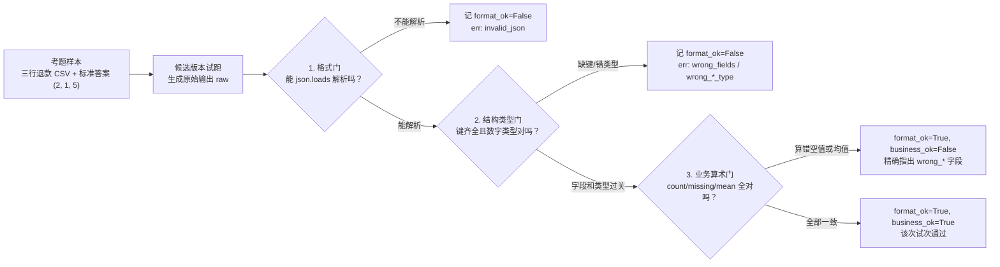

在 [API-10《Prompt Engineering 的可复现对照实验》](https://blog.lacknb.cn/articles/2026/11/21/1795268751247.html) 里，同一个模型遇到不同提示词，输出有时多了一层代码围栏（` ```json `），有时把均值错填成空值 `null`。要判断你改了提示词后到底「真的变好了」还是「只是看起来顺眼」，靠肉眼扫两眼肯定不行——最稳的起步方式，就是先固定一条任务，写出程序能自动核对的**通过条件**，让所有候选版本坐到同一位**评分器（Grader）**面前打分。

我们继续拿熟悉的三行退款 CSV（Comma-Separated Values，逗号分隔值）作考题：金额依次是 `10`、空、`0`。业务规则一句话——**排除空金额，保留真实的 0**。手算标准答案是：有效金额 **2** 条、缺失 **1** 条、均值 **(10 + 0) ÷ 2 = 5**（均值单位与输入金额相同）。

```csv
id,amount
1,10
2,
3,0
```

> **先用大白话讲明白**：**Eval（Evaluation，评测）**就像**学校考试的「考卷 + 标准答案 + 客观批改条」**，而不是老师看心情给个「还行吧」：
> - **靠感觉看回复**：你改完提示词后挑 1 条顺眼的就觉得上线没问题，就像只看了学生写得工整的第一行就给满分。
> - **做一条最小评测**：提前把「考题（三行 CSV）、标准答案（`count=2, missing=1, mean=5`）和扣分顺序（先看能不能看清字，再看有没有填错格，最后核对算术）」白纸黑字写进脚本；以后每次改提示词、换模型、调参数，全拿同一张批改条过一遍，出错了还能一眼指认是哪一步挂了。



## 1. 一条评测用例里究竟有哪些零件？

别被学术名词吓到，**Eval（Evaluation，评测）**只是把「这个模型能做对什么」拆成程序可以重复执行的 7 个清晰对象。结合上面的三行退款数据来看，每一个词都很实在：

| 术语 | 大白话理解 | 在三行退款任务里的样子 |
| --- | --- | --- |
| **任务（Task）** | 这场考试要干啥 | 读入退款 CSV，返回包含 `count`、`missing` 和 `mean` 的纯 JSON 对象。 |
| **样本（Sample / Case）** | 具体的一道题 + 标准答案 | 指定的输入三行 CSV，加上提前手算好的参考结果 `(2, 1, 5)`。 |
| **试次（Trial）** | 考生在这道题上作答了 1 次 | 某个候选版本在 `refund-mixed-01` 上的一次运行；遇到采样随机时同一道题也会连考多次。 |
| **通过条件（Pass Criteria）** | 满分要求 | 输出能直接被 JSON 解析、字段名和数据类型符合约定、且三个业务数字全对。 |
| **评分器（Grader）** | 自动批改试卷的脚本 | 接收模型原始输出 `raw` 和标准答案 `expected`，返回通过与否以及具体错因列表。 |
| **指标（Metric）** | 全班成绩汇总单 | 把多次试次打包算总账，例如「格式通过率」和「业务通过率」。 |
| **基线（Baseline）** | 拿来垫底对比的老版本 | 本例把不加仔细说明的朴素提示版本当作基线，看新版本比它强多少。 |

本例先用固定好的合成输出（`fixtures`）复现两种提示词的行为——先校准「批改工具」本身，再接真实大模型。一种朴素提示只说「统计退款」，另一种在提示里明确补上「忽略空金额，保留 0」。注意：本文重点是把评测流水线接通并验证评分逻辑；真实模型在多条样本上的稳定性，必须用实际推理记录来衡量。[评测设计与评分方式](https://developers.openai.com/api/docs/guides/evaluation-best-practices)

## 2. 预先写好判定顺序：为什么先查格式，再查算术？

**JSON（JavaScript Object Notation，JavaScript 对象表示法）**是程序之间交换数据最常用的键值对文本格式。下游业务代码收到模型回复后，通常会直接拿整个回复去解析 JSON，所以哪怕答案全对，只要外面包了一层 Markdown 代码围栏，或者前面加了句「好的，统计如下：」，第一道解析关就会直接报错挂掉。

因此，评分器一定要按照**「先解析 -> 再核字段与类型 -> 最后比业务数值」**的漏斗顺序排查，才能分清「格式错」和「业务算术错」：

| 候选输出 `raw` | 格式过关？ | 业务过关？ | 诊断原因（大白话） |
| --- | --- | --- | --- |
| `报告：2 条，平均 5` | 失败 | 未通过 | 根本不是 JSON，下游 `json.loads` 直接崩溃，算错都没机会查。 |
| `{"count":3,"missing":0,"mean":3.33}` | 通过 | 未通过 | 格式挑不出毛病，但把空行当成了 `0`，分母由 `2` 变 `3`，三项业务数全错。 |
| `{"count":2,"missing":1,"mean":5}` | 通过 | 通过 | 格式合规、类型合法、条数和均值与标准答案严丝合缝。 |

汇总成绩单时，两个核心指标各司其职：
- **格式通过率** = 格式通过次数 ÷ 已运行试次总数；
- **业务通过率** = 所有条件全对次数 ÷ 已运行试次总数。

> **容易踩的坑**：不要在发现格式错误之后还强行计入什么「部分算术分」，也别忽略**同一条错误会牵连多个字段**。比如把空值算成 `0` 时，`count`、`missing`、`mean` 三个字段其实一起错了，把它们全部记入 `errors` 列表，回查报表时一眼就能看出是同一种空值误判导致的连环错；而格式解析本身失败的试次，在业务通过率分母里照样算作一次未通过（否则就会出现「模型胡说八道导致解析不了，反而拉高了业务及格率」的统计作弊）。

> **想再深入一层？** 下面这段不到 60 行的 `first_eval.py` 只依赖 Python 标准库，完整实现了一个带三层门禁（JSON 解析 -> 字段集合与数据类型校验 -> 业务值比对）和断言自检的最小评测器。写新评测器时，拿几个已知必对、必错的 `fixtures` 用 `assert` 锁住判定行为，本身就是很好的习惯。

## 3. 用纯 Python 跑通输入、评分和汇总

把下面的代码保存为 `first_eval.py`，直接运行 `python3 first_eval.py`。目前模型输出暂由预设的 `fixtures`（固定测试夹具）提供，每条记录带独立试次编号 `trial`。后面你接 OpenAI、Anthropic 或本地 vLLM 时，只需要把请求返回的原始文本传给同一个 `score()` 函数就行：

```python
import json
import math

case = {
    "id": "refund-mixed-01",
    "csv": "id,amount\n1,10\n2,\n3,0",
    "expected": {"count": 2, "missing": 1, "mean": 5},
}
fixtures = [
    ("baseline", 1, "报告：2 条，平均 5"),
    ("baseline", 2, '{"count":3,"missing":0,"mean":3.33}'),
    ("explicit-rule", 1, '{"count":2,"missing":1,"mean":5}'),
]


def score(raw, expected):
    try:
        value = json.loads(raw)
    except json.JSONDecodeError:
        return False, ["invalid_json"]
    if not isinstance(value, dict) or set(value) != set(expected):
        return False, ["wrong_fields"]
    if type(value["count"]) is not int or type(value["missing"]) is not int:
        return False, ["wrong_count_type"]
    amount = value["mean"]
    if not (type(amount) is int or (type(amount) is float and math.isfinite(amount))):
        return False, ["wrong_mean_type"]
    errors = [f"wrong_{key}" for key in expected if value[key] != expected[key]]
    return True, errors


rows = []
for version, trial, raw in fixtures:
    format_ok, errors = score(raw, case["expected"])
    row = {
        "case": case["id"], "version": version, "trial": trial,
        "format_ok": format_ok, "business_ok": format_ok and not errors,
        "errors": errors, "raw": raw,
    }
    rows.append(row)
    print(json.dumps(row, ensure_ascii=False))

assert rows[0]["errors"] == ["invalid_json"]
assert rows[1]["format_ok"] and rows[1]["errors"] == [
    "wrong_count", "wrong_missing", "wrong_mean",
]
assert rows[2]["business_ok"]
for version in dict.fromkeys(row["version"] for row in rows):
    group = [row for row in rows if row["version"] == version]
    print(
        f"{version} format={sum(row['format_ok'] for row in group)}/{len(group)} "
        f"business={sum(row['business_ok'] for row in group)}/{len(group)}"
    )
```

程序前 3 行会打印每条试次的 JSON 明细（带 `errors` 和原始 `raw`），最后两行打印汇总成绩如下：

```text
baseline format=1/2 business=0/2
explicit-rule format=1/1 business=1/1
```

可以看到：基线版本的第 2 次试次虽然过了解析门槛（`format=1/2`），但三个业务字段全部标错，因此 `business=0/2`；而加了明确规则的版本三项一次过关。请注意，这个极简例子只有 1 条样本，且两边试次数量（2 次 vs 1 次）也不相同，它证明的是**评测流水线本身按预期运转**。想真正比较两个提示词或模型谁优谁劣，下一步一定要给两边准备同一套覆盖多种边界的数据集与相同试次。

## 4. 保留原始输出：让每一条失败都能顺藤摸瓜

细心看上面代码第 75、78 行：`type(value["count"]) is not int` 和 `math.isfinite(amount)` 都很关键：
- **为什么不用 `isinstance(x, int)`？** 在 Python 里 `bool` 是 `int` 的子类，如果模型吐出 `{"count": true, ...}`，`isinstance(True, int)` 会误判为整数！用 `type(...) is int` 才能把布尔值、字符串 `"2"`、浮点数 `2.0` 统统精准拦在 `wrong_count_type`；同样，用 `math.isfinite(amount)` 能防止 JSON 非标准扩展里偶尔混进 `NaN`（非数字）或 `Infinity`（无穷大）。
- 如果输出是 `{"count":2,"missing":1,"mean":"5"}`，人类扫一眼觉得数字好像没错，但下游数字计算代码一做加法就抛类型异常，上面的 `score()` 会立刻给你抓出 `wrong_mean_type`。

> **大白话小结**：永远记得把**样本 ID、模型/提示词版本、运行参数以及模型吐出的原始文本 `raw`**一起存进结果行里。就像留住原始答题纸一样：哪怕你下周修改了评分标准（比如新增一条公差范围），也能直接用存下来的 `raw` 重新算一次分，不用花钱重新调一次模型。

## 下一篇

只考一道 `10、空、0` 的题太单薄了，甚至写死答案的作弊程序都能考满分。[**LE-01《从业务目标到数据集、基线和评分》**](le-01-dataset-baseline.md) 会把这条退款用例扩充成带**黄金样本、边界样本和历史失败样本**的评测集，教你怎么切分调试集和保密留出集，并用哈希锁住数据版本。 [LLM 与 Agent 学习路线图](https://blog.lacknb.cn/articles/2026/11/19/1795058329577.html)
