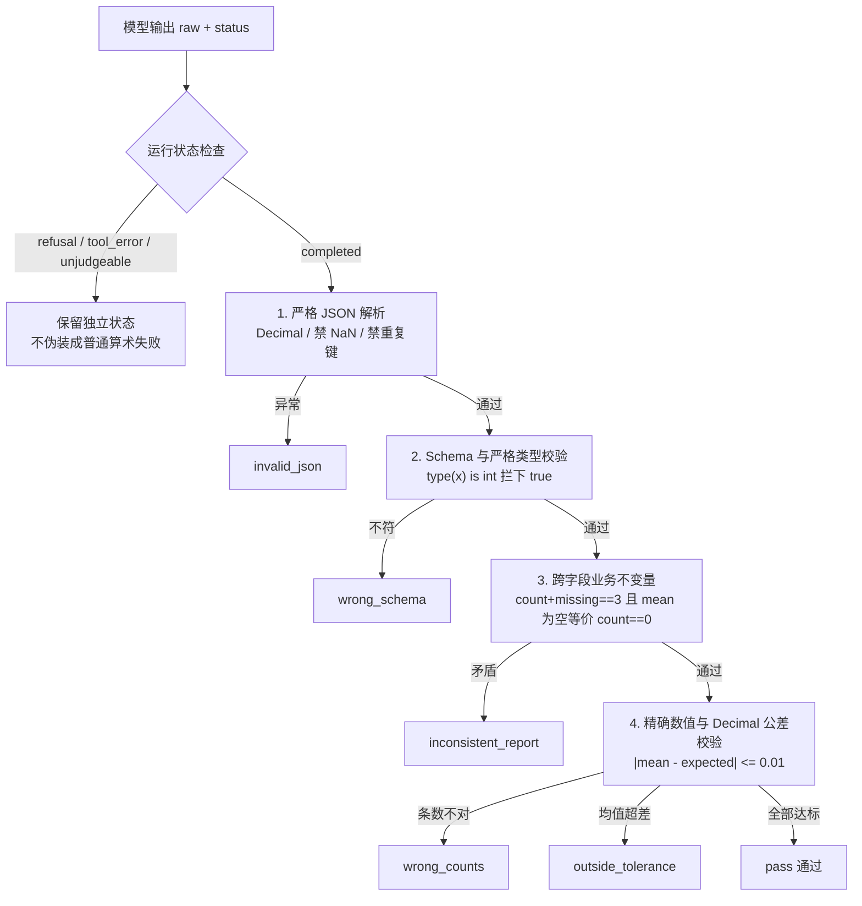

在 [LE-01](le-01-dataset-baseline.md) 里我们提起过一条真实历史翻车案例：面对 `10、空、0` 三行退款记录，模型正确算出了「有效 2 条、缺失 1 条」，结果却顺手写了个 `"mean": null`！

这组数据从纯粹的 JSON 格式来看「合法得不能再合法」——三个键都在，整数非负，`mean` 允许是数值或 `null`。但如果评分器让这种自相矛盾的答案混过去了，整个评测体系就失灵了；反过来，如果评分器自己代码写歪了（比如把 JSON 里的 `true` 当成整数 `1`、或者漏拦了重复键），那整批模型成绩单全都是假账。**所以，评分器上线给模型打分之前，自己必须先过一轮已知正误的单元测试！**

> **先用大白话讲明白**：写好一个评分器，就像**先拿已知重量的标准砝码去校准电子秤**：
> - **客观结构与算术（电子秤称重）**：把批改分成四道关卡——先看是不是干净规范的 JSON（拦截重复键和 `NaN`），再核对 JSON Schema 表格形状（拦截 `true` 冒充整数），接着检查**业务不变量**（比如有效条数 `count=2 > 0` 时均值绝不可能是 `null`，以及 `count + missing` 必须等于总行数 3），最后再用精确十进制算公差；写完后立刻喂它 12 个「提前知道应该判对还是判错」的靶子样例试称，全部命中才准上岗。
> - **主观文字解释（人工考官查清单 Rubric）**：碰到「请解释为什么均值是 5」这种开放题，别让考官凭感觉打 1～10 分，而是列一份「是否交代排除空值」「是否说明 0 算有效」「是否点明分母是 2」的 0/1 勾选清单，再约定硬算错直接一票否决。



## 1. 四道防线：格式、Schema、跨字段业务不变量、数值公差

**JSON Schema** 是描述 JSON 结构、字段必填项与类型限制的标准规范。下面这份 Schema 要求返回必须是个对象，且只允许出现 `count`、`missing`、`mean` 三个字段（`additionalProperties: false` 禁止模型多嘴夹带私货），其中条数必须是非负整数，`mean` 允许是数字或 `null`：

```json
{
  "type": "object",
  "properties": {
    "count": {"type": "integer", "minimum": 0},
    "missing": {"type": "integer", "minimum": 0},
    "mean": {"type": ["number", "null"]}
  },
  "required": ["count", "missing", "mean"],
  "additionalProperties": false
}
```

可光靠这张 Schema，形如 `{"count":2,"missing":1,"mean":null}` 的矛盾答案还是能一路绿灯闯过去！因此紧接着必须检查两条**跨字段业务不变量（Business Invariants）**——也就是不管答案具体是多少、只要数据没算悖论就永远必须成立的硬约束：
1. **总数守恒**：`count + missing` 必须严格等于输入数据的有效行数 `3`；
2. **空均值条件**：`mean is None`（均值是 `null`）与 `count == 0`（有效记录为 0 条）必须同时成立或同时不成立，绝不允许 `count=2` 却配个 `mean=null`。

最后一关才是对照人工参考答案 `(2, 1, 5)` 检查具体数值。面对小数的正常计算差异，本例设定绝对公差为 **0.01 个输入金额单位**（闭区间含边界）：参考均值是 `5` 时，预测 `5.01` 算通过，`5.011` 就算超出公差失败。正式生产系统里应按真实财务精度（例如分或厘）设定容忍度，这里主要演示十进制精准边界的写法。[JSON Schema 数值约束](https://json-schema.org/understanding-json-schema/reference/numeric)

## 2. 给评分器写自测：先喂 12 个已知正误的样本校验它自己

把下面代码保存为 `check_grader.py`，先装好指定版本的 `jsonschema` 验证库，再直接运行自测。

```bash
python -m pip install "jsonschema==4.25.1"
python check_grader.py
```

```python
from decimal import Decimal
import json

from jsonschema import Draft202012Validator

FIELDS = {
    "count": {"type": "integer", "minimum": 0},
    "missing": {"type": "integer", "minimum": 0},
    "mean": {"type": ["number", "null"]},
}
VALIDATOR = Draft202012Validator({
    "type": "object", "properties": FIELDS, "required": list(FIELDS),
    "additionalProperties": False,
})
EXPECTED = {"count": 2, "missing": 1, "mean": 5}
TOLERANCE = Decimal("0.01")


def no_duplicates(pairs):
    result = dict(pairs)
    if len(result) != len(pairs):
        raise ValueError("duplicate key")
    return result


def invalid_constant(text):
    raise ValueError(f"non-JSON constant: {text}")


def grade(raw, status="completed", expected=EXPECTED):
    if status in {"refusal", "tool_error", "unjudgeable"}:
        return status
    if status != "completed":
        raise ValueError(f"unknown status: {status}")
    try:
        data = json.loads(
            raw, parse_float=Decimal,
            parse_constant=invalid_constant, object_pairs_hook=no_duplicates,
        )
    except (ValueError, TypeError):
        return "invalid_json"
    counts = ("count", "missing")
    if not VALIDATOR.is_valid(data) or any(type(data[k]) is not int for k in counts):
        return "wrong_schema"
    expected_rows = sum(expected[k] for k in counts)
    if sum(data[k] for k in counts) != expected_rows or (
        (data["mean"] is None) != (data["count"] == 0)
    ):
        return "inconsistent_report"
    if any(data[k] != expected[k] for k in counts):
        return "wrong_counts"
    if data["mean"] is not None:
        error = abs(Decimal(data["mean"]) - Decimal(str(expected["mean"])))
        if error > TOLERANCE:
            return "outside_tolerance"
    return "pass"


cases = [
    ('{"count":2,"missing":1,"mean":5.01}', "pass"),
    ('{"count":2,"missing":1,"mean":5.011}', "outside_tolerance"),
    ('{"count":3,"missing":0,"mean":3.33}', "wrong_counts"),
    ('{"count":2,"missing":1,"mean":null}', "inconsistent_report"),
    ('{"count":2,"missing":0,"mean":5}', "inconsistent_report"),
    ('{"count":true,"missing":1,"mean":5}', "wrong_schema"),
    ('{"count":2,"missing":1,"mean":NaN}', "invalid_json"),
    ('{"count":2,"count":2,"missing":1,"mean":5}', "invalid_json"),
]
for raw, expected in cases:
    actual = grade(raw)
    assert actual == expected, (raw, expected, actual)
    print(actual)
for state in ("refusal", "tool_error", "unjudgeable"):
    assert grade("", state) == state
assert grade('{"count":0,"missing":3,"mean":null}',
             expected={"count": 0, "missing": 3, "mean": None}) == "pass"
print("12 个判定均符合预期")
```

> **想再深入一层？** 这段代码藏着 3 个极其容易在工程里踩坑的细节：
> 1. **为什么不用普通 `float` 而要用 `Decimal`？**：二进制浮点数里 `abs(5.01 - 5)` 算出来是 `0.009999999999999787`，万一遇到刚好踩在边界上的数（比如 `5.010000000000001`）容易出现微妙偏差。传入 `parse_float=Decimal` 后直接按十进制文本精确求差，公差边界零误差。
> 2. **为什么手写 `no_duplicates` 和 `invalid_constant`？**：Python 自带的 `json.loads` 默认不仅接受非标准的 `NaN` / `Infinity`，遇到 `{"count": 2, "count": 99}` 这种重复键还会悄悄拿后一个覆盖前一个！这两个钩子一挂上，重复键和非标准字面量在入口处立刻原形毕露，统一按 `invalid_json` 拦下。
> 3. **为什么保留 `refusal / tool_error / unjudgeable` 独立状态？**：模型拒答、外部工具宕机、样本缺失关键证据导致无法评判，它们和「模型算错了数学题」是完全不同的故障来源。先分门别类把状态留下来，统计汇总时再来决定：是看「全部任务端到端完成率」，还是「工具正常前提下的模型答题准确率」。

> **容易踩的坑**：在 JSON 规范里 `2.0` 合法吗？其实部分解析器甚至觉得它算数字，但在本例加了 `type(data[k]) is not int` 的严格约定后，`2.0` 与 `true` 一样会被明确标为 `wrong_schema`。此外，上面的 `grade()` 故意采用**首错即停（fail-fast）**的设计便于快速定位流水线第一环瓶颈；如果你们产品仪表盘同时想统计一份报告总共犯了几个错误，可以学 [LE-07](le-07-first-eval.md) 在结构通过后再依次把多个断言错因收进列表。

## 3. 给开放式文字解释定一套人工评分准则（Rubric）

如果产品还要求模型附带一句给人看的文字说明——「请解释为什么均值为 5」——这时候正则和 JSON Schema 就无能为力了，需要引入 **评分准则（Rubric）**，把模糊的「写得好不好」拆解成标注人员一眼能勾「是/否（1 分或 0 分）」的可观察证据条目：

| 评分条目 | 给 1 分的明确证据 |
| --- | --- |
| 空金额处理 | 文中明确写明空白金额记录已被排除在分母外。 |
| 真实零值处理 | 文中明确说明金额 `0` 作为有效退款保留计算。 |
| 分母与计算步骤 | 点明有效金额是 `10` 和 `0`、分母为 `2`，据此算出 `5`。 |

对照实际回答演练一下打分规则：
- 回复：**「忽略空金额，0 保留，所以 (10 + 0) ÷ 2 = 5」** -> 三项证据齐全，实拿 **3 分**；
- 回复：**「平均就是 5，因为有两行」** -> 既没交代排除了哪一行、也没说明保留 `0`，分母由 `10` 和 `0` 组成的证据也缺失，**3 项全拿 0 分**；
- 回复：洋洋洒洒写了两百字顺滑漂亮话，但算成均值 `3.33` -> **硬断言先判失败，再评文字质量**，绝不能允许一堆华丽修辞掩盖算错账的硬伤。[评分器与人工标注](https://developers.openai.com/api/docs/guides/evaluation-best-practices)

此外，评估文本时还有两种分工明确的比较方式：
- **逐项打分（Rubric Grading）**：就像上面填清单，最大好处是**方便诊断原因**——一眼就知道模型老是漏讲「保留 0」；
- **成对比较（Pairwise Comparison）**：把两版解释同时摆在考官面前直接二选一，例如 A 交代了分母来源，B 只甩结论，则判 A 胜；两版同样充分允许选**平局（Tie）**；原始样本本身缺证据导致神仙也判不了的直接标**无法判定（Unjudgeable）**。记住口诀：**先把评测标尺自己用正反样本校稳，再把这把尺子架进自动化评测流水线。** [LLM 评测最佳实践](https://developers.openai.com/api/docs/guides/evaluation-best-practices)

## 下一篇

我们自己搭建的小考卷写好了，可外面每天都在刷榜：MMLU 85%、C-Eval 82%、GSM8K 90%、HumanEval 75%……这些公开成绩单到底怎么出炉的，哪一个才对咱们的退款助手选型真有参考价值？[**LE-10《常用 LLM 评测数据集测什么，应该怎么选》**](le-10-public-datasets.md) 会亲自打开四类主流基准的真实原题与判定代码带你一探究竟。 [LLM 与 Agent 学习路线图](https://blog.lacknb.cn/articles/2026/11/19/1795058329577.html)
