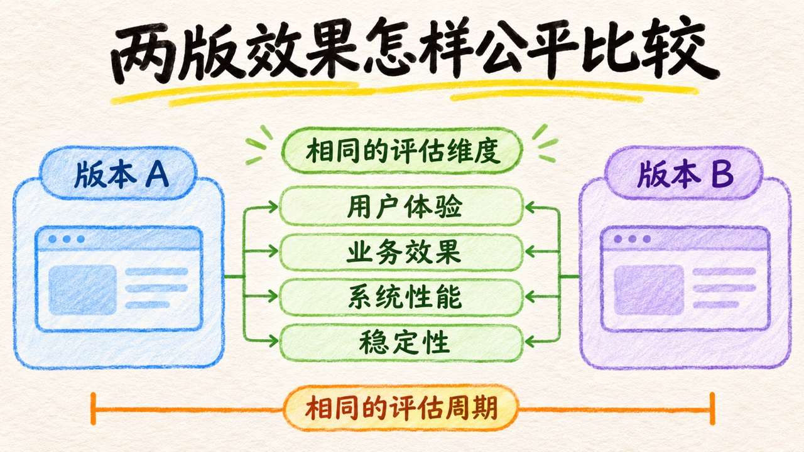
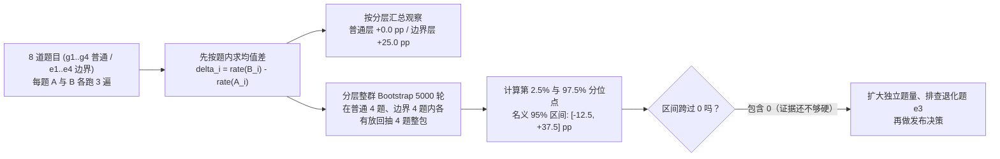

改完提示词、明确写上「排除空金额，保留真实的 0」之后，你在 8 道退款测试题上让模型各答 3 遍，结果总通过率从 **62.5%** 涨到了 **75.0%**，足足高出 **12.5 个百分点**！

先别急着开香槟发全员喜报——上线前冷静三秒追问自己三个灵魂问题：
1. A 和 B 考的真的是同一批题、用的同一把尺子吗？
2. 到底哪些题改好了、有没有原本做得对的题反而退步了？
3. 考卷一共才 8 道题，这 +12.5 个百分点的涨幅，有多大把握不是碰巧撞上大运？

今天沿用 [LE-01](le-01-dataset-baseline.md) 的退款分层（普通样本 vs 边界样本）：A 是基线，B 加了一句明确空值规则。下面直接用合成好的 `0/1` 通过记录（三位字符串例如 `"110"` 代表这题跑 3 次过了前 2 次、挂了第 3 次）带你亲手算出答案。

> **先用大白话讲明白**：判断模型改版「是真变强还是蒙对了」，核心靠两招——**「同一道题贴脸单挑」**和**「以题为单位摇号晃一晃（Cluster Bootstrap）」**：
> - **成对比较（Paired Comparison）**：让 A 和 B 做完全相同的 8 道题，每道题先算出「B 比 A 多对了几成」，这样每道题自身的难易波动就被直接抵消了。
> - **为什么不能把 8 题 × 3 次当成 24 道独立题算误差？**：同一道退款题跑 3 次，难就难在同一个空值陷阱上，三次作答之间息息相关！如果按 24 个独立样本来算误差范围，区间会被人为缩得特别窄、显得信心爆棚（假阳性飙升）。正确的**整群重采样（Cluster Bootstrap）**必须连题带它的 3 次作答**整道题打包**一起抽，看看换批同类型考题时，这个 +12.5 个百分点的领先还能稳住吗？



## 1. 控制单变量：固定比较单位和实验条件

**成对比较（Paired Comparison）**要求 A（基线）和 B（候选）跑在同一套题目上，各自在每题内部做减法 `rate(B) - rate(A)`。为了确保差值干净，业务合同、数据集切分、模型权重版本、解码随机参数、最大输出预算和评分器必须全套对齐，唯一允许变动的只有你想测试的 Prompt。如果跑线上实时 API 担心不同时段服务抖动，建议**交替请求 A 和 B**（例如跑一题 A 接着跑同一题 B），并把时间戳和超时故障另行记账。

把题集拆层对比也非常重要：

| 样本层 | 这组题用来盯住什么 |
| --- | --- |
| **普通层（`normal`）** | 没有空值或怪异数字的常规统计，盯死改完提示后千万别把原本会的题改退化了。 |
| **边界层（`edge`）** | 专门卡空金额、全空、真实 `0` 和负数，盯着看新提示有没有真正把这块短板补起来。 |

计分时记住：**先把每道题的 3 次试次平均成这道题自己的通过率**——比如 `e1` 题 A 过了 `0/3`、B 过了 `2/3`，这道题的净提升就是 `+2/3`；然后把 8 道题各自的净提升求平均（8 题等权）。同题连考 3 遍提供了「答题稳不稳定」的信息，**但 3 次试次共享同一张 CSV 和同一种陷阱，绝不能拿去冒充 3 道互相独立的考题！**

## 2. 分层整群重采样：以「题」为单位摇 5,000 次骰子

**Bootstrap（自助重采样）**的想法非常直观：手里目前只有这 8 道考题，想知道「万一重换一份同等结构的 8 题考卷，差值大约会在哪儿晃悠」，我们就从手头已有的题目池里**有放回地随机抽取同样多的题目**，重新算一次整体 `B - A` 均值差；反复摇它 `5,000` 遍，把算出来的 5,000 个平均差从低到高排成一排，掐头去尾取第 **2.5%** 和第 **97.5%** 位置的值，这就是一个**名义 95% 的参考不确定区间**。

为了守住实验设计，代码做两重锁定：**分层采样**（每次都在普通层里抽 4 题、边界层里抽 4 题，保证层占比不变）且**整题打包**（抽中哪题就把这题里 A 和 B 的全套结果一起带走，保留同题配对关系）。

> **容易踩的坑**：注意这个区间反映的是「在当前 50% 普通题 + 50% 边界题的配比下，受制于仅 8 道题有限规模的不确定性」。
> 1. **小样本偏乐观警报**：当总题目只有个位数（每层才 4 题）时，Bootstrap 算出的区间本身也相当粗糙，往往还会稍微**低估**真正的未知误差；
> 2. **考题配比 != 线上流量配比**：假设真实线上流量里 90% 是普通表、只有 10% 是边界表，你想估计上线后的整体大盘提升，必须按 `0.9` 和 `0.1` 的业务流量权重重新加权，绝对不能直接套这份 50/50 考卷的均值！[Bootstrap 方法](https://academic.oup.com/biomet/article-abstract/68/3/589/218600) · [集群重采样研究](https://pmc.ncbi.nlm.nih.gov/articles/PMC5965657/)

## 3. 纯标准库 Python 复算同题差值与区间

把下面脚本存成 `paired_eval.py` 并执行 `python3 paired_eval.py`。注意输出单位 **pp（Percentage Points，百分点）**代表两个百分数直接相减的差——比如 `75.0%` 减去 `62.5%` 等于 **`+12.5 pp`**，千万别和相对涨幅（+20%）搞混：

```python
from collections import defaultdict
from random import Random
from statistics import mean

# 题号、分层、A 的三次结果、B 的三次结果。
trials = [
    ("g1", "normal", "111", "111"),
    ("g2", "normal", "111", "110"),
    ("g3", "normal", "110", "111"),
    ("g4", "normal", "111", "111"),
    ("e1", "edge", "000", "110"),
    ("e2", "edge", "100", "010"),
    ("e3", "edge", "110", "100"),
    ("e4", "edge", "010", "111"),
]


def rate(bits):
    return bits.count("1") / len(bits)


def percentile(ordered, p):
    index = (len(ordered) - 1) * p
    lower = int(index)
    upper = min(lower + 1, len(ordered) - 1)
    return ordered[lower] + (ordered[upper] - ordered[lower]) * (index - lower)


by_layer = defaultdict(list)
for key, layer, a, b in trials:
    assert len(a) == len(b) == 3
    delta = rate(b) - rate(a)
    by_layer[layer].append(delta)
    print(key, layer, f"{delta * 100:+.1f} pp")

a_score = mean(rate(a) for _, _, a, _ in trials)
b_score = mean(rate(b) for _, _, _, b in trials)
for name, values in by_layer.items():
    print(name, f"{mean(values) * 100:+.1f} pp", f"n={len(values)}")

rng = Random(2026)
values = sorted(mean(
    rng.choice(group)
    for group in by_layer.values()
    for _ in group
) for _ in range(5000))
low, high = percentile(values, 0.025), percentile(values, 0.975)
assert round(a_score, 3) == 0.625 and round(b_score, 3) == 0.750
assert low < 0 < high
print(f"A={a_score:.1%} B={b_score:.1%} delta={(b_score-a_score)*100:+.1f} pp")
print(f"interval=[{low*100:+.1f}, {high*100:+.1f}] pp")
```

> **想再深入一层？** 拆开逐题和分层成绩单，你会立刻看到总分里看不见的真相：
> - **普通层平均差**：`0.0 pp`（`g2` 退步一次、`g3` 进步一次，刚好抵消）；
> - **边界层平均差**：**`+25.0 pp`**（`e1` 和 `e4` 猛涨，但 **`e3` 居然从 `2/3` 退化到了 `1/3`**！）；
> - **总体差值与区间**：总分看似涨了 **`+12.5 pp`**，可摇出 5,000 次重采样的名义 95% 区间却是 **`[-12.5, +37.5] pp`**——**这个区间稳稳跨过了 `0`！**
> 这句话的大白话翻译就是：虽然 5,000 次摇号算出的百分位边界本身是确定的，但原本只有 8 道题的信息量摆在那儿，凭这 8 道题你既可能实际上大幅变强（+37.5 pp），也完全有可能其实稍微退化（-12.5 pp）！

## 4. 离真正拍板上线，还差哪几道硬门槛？

统计区间只是看个趋势，真正做工程发布拍板时记住四条纪律：
1. **先写好最小值得上线门槛（MDE）**：比如先约定「至少有 +5 pp 才值得折腾上线」；像上面区间覆盖了 `-12.5 pp` 这种可能退化的范围，就该赶紧补充更多独立考题，并把退化的 `e3` 样本原文调出来查明具体犯了啥错；
2. **硬红线一票否决（Zero Tolerance）**：哪怕总平均分涨得再高，碰到诸如「把空表乱写成财务入账归档」之类的绝对红线失败，也必须设置专门的零容忍门禁直接拦死；
3. **盯紧成本与延迟预算**：同时对比每条 Token 消耗与尾部时延，别让「准确率多涨一点但费用和耗时翻倍」偷偷混过关；
4. **切忌边偷看边加题（Peeking）**：在真实长周期测试里，如果今天偷看一次不够显著、明天再多补几道题继续看直到出现想要的结果，那显著性就全废了，必须预先定死停止条件与样本量上限。

## 下一篇

单次试验的统计推断学会了，怎样把「数据版本 SHA-256 核验、平均通过率、红线关键样本必过、Token 增幅上限、P95 延迟预算」全部打包成一条自动化流水线，**只要有一项越界就自动给出退出码 1 拦停代码合并**？[**LE-04《把效果评测接入 Prompt 和模型回归》**](le-04-regression-gates.md) 将写完整条 CI 回归发布门禁。 [LLM 与 Agent 学习路线图](https://blog.lacknb.cn/articles/2026/11/19/1795058329577.html)
