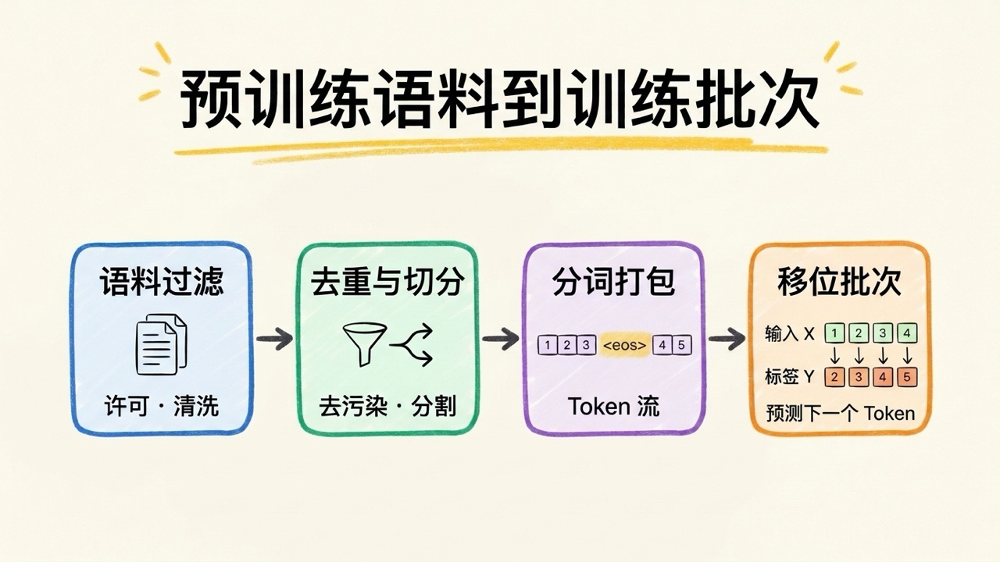
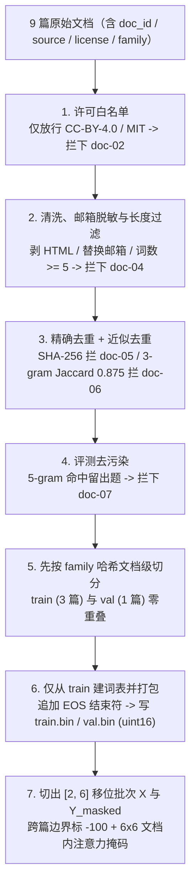

> **生成工具**：Antigravity\
> **生成模型**：Gemini 4 Neon

在 [F-10《模型从预训练到会按要求回答》](https://blog.lacknb.cn/articles/2026/11/20/1795161450059.html) 里，我们看到**预训练（Pretraining）**的核心任务是让模型读海量文本并不断预测下一个 Token（分词后的基本处理单位）。可真实训练开始前，硬盘里躺着的往往只是一堆从网上爬下来的乱七八糟网页、用户手册、代码和日志——既可能混着禁止商业训练的专有文档，也可能夹着十份一模一样的转载文章，甚至意外泄露了将来考试要考的原题！

把原始文档变成模型能一口吞下去的规范数字批次，这套流水线就叫做 **Token 数据管线（Data Pipeline）**。

> **先用大白话讲明白**：搭预训练数据管线，就像**编一套大型《大百科全书》之前在收书库房里设了五道安检**：
> 1. **版权安检（许可白名单）**：没拿到合法授权的内部机密账本（`proprietary-no-train`），门都不准进，直接退货；
> 2. **擦洗污渍与打码（清洗与 PII 脱敏）**：把网页里的 HTML 尖括号杂草拔掉，把客服邮箱打上马赛克（`redacted_email`），太短凑字数的垃圾按钮（`Click here OK`）也扫出门；
> 3. **踢掉盗版和洗稿（精确/近似去重）**：内容完全一样只是多几个空格的镜像页退掉；末尾偷偷加了一两个字水长度的转载洗稿页，算算 **Jaccard 重合度**超过 80% 照样退掉，别让模型把废话背了一遍又一遍；
> 4. **防考前泄题（测试集去污染）**：把留出评测卷里的原题切成连续 5 词窗口逐篇扫描，谁沾上一点原题碎片立刻清退；
> 5. **先分好卷子再装订成块（文档级切分 + 打包）**：剩下的好文章，必须**先以完整文章为单位按 `family` 哈希分成训练集和验证集**（绝不能把同一篇文章前半截放训练集、后半截放验证集），再追加 `<eos>` 接成一维 `uint16` 二进制长条，切块时遇到跨篇缝隙用 `-100` 和文档隔离掩码彻底焊死！



这一篇准备 9 篇合成文档和 1 条来自 [LE-01](https://blog.lacknb.cn/articles/2026/11/21/1795270270258.html) 的退款测试题，全篇脚本只用 Python 3 标准库，让你能手算验算每一张输出清单。

## 1. 先给语料记账，再过滤、清洗、去重和去污染

预训练使用的原始文本集合叫做**语料（Corpus）**。任何加工之前，第一铁律是先给每篇文档贴好**来源与许可元数据（Provenance & License）**：唯一编号 `doc_id`、来源 `source`、协议 `license`、同源案例族 `family` 和正文 `text`。把这份来源台账连同每篇「为什么被丢弃」一起记入 `manifest.json`，日后模型一旦出现版权纠纷或幻觉故障，就能顺着哈希版本号精准溯源。

下面 9 篇文档围绕退款口径构筑，故意混进了 5 种现实网页抓取中最讨厌的脏样本，同时锁定 1 条留出测试题 `eval-01`：`refund csv test amount 10 empty 0 expected count 2 mean 5`。管线依次经过五关筛查：

1. **许可白名单（License Gate）**：本例只放行 `CC-BY-4.0` 与 `MIT`。`doc-02` 标着 `proprietary-no-train`（未授权内部账本），入口直接拒收。
2. **清洗、脱敏与质量过滤（Cleaning & Quality Filter）**：先剥离 `<p>`、`<div>` 标签，把 **PII（Personally Identifiable Information，个人可识别信息）** 里的邮箱 `ops@example.com` 打码成 `redacted_email`，再折叠连续空格并抽小写词元。这里设最少词数 `MIN_WORDS = 5`，像 `<div>Click here OK</div>` 这种清完仅剩 3 个词的页面垃圾（`doc-04`）顺手扔掉。
3. **精确去重（Exact Deduplication）**：对洗干净的规范文本算 **SHA-256（256 位安全散列摘要）**。`doc-05` 只是在 `doc-01` 前后加了几个空格，规范化后指纹与 `doc-01` 一模一样，抓为精确重复。
4. **近似去重（Near-Deduplication）**：网上转载文章常常在结尾加个「updated」或换个落款日期，导致 SHA-256 完全变样。管线把每篇文本切成长为 3 个词的连续滑动窗口，叫 **3-gram（3 元词组，去重工程里常叫 shingle / 文本瓦片）**，再用 **Jaccard 相似度**算集合重合比例：

```text
J(A, B) = |A ∩ B| ÷ |A ∪ B|
```

公式里 `A`、`B` 分别为两篇文档的 3-gram 集合，`|A ∩ B|` 是两边共有的 3-gram 个数（单位：个），`|A ∪ B|` 是合并去重后的总个数（单位：个），比值 `J(A, B)` 为 0 到 1 的无量纲小数。咱们亲手算一算 `doc-01`（9 个词，产出 `9 - 3 + 1 = 7` 个 3-gram）与结尾多了一个词 `updated` 的 `doc-06`（10 个词，共 `8` 个 3-gram）：
- `doc-01` 的 7 个 3-gram 全部出现在 `doc-06` 中，所以交集 `|A ∩ B| = 7`；
- `doc-06` 仅仅多出 1 个末尾新窗口 `(zero, amounts, updated)`，并集 `|A ∪ B| = 8`；
- 相似度 **`J(doc-01, doc-06) = 7 ÷ 8 = 0.875`** >= 阈值 `0.80` -> 成功抓成近似重复丢弃！

> **想再深入一层？** 真实预训练有上亿篇网页，两两硬算 Jaccard 的计算量呈平方爆炸。大型工业管线（比如 Hugging Face 的 FineWeb 与 AI2 的 Dolma）都会使用 **MinHash（最小哈希，把庞大词组集合压成极短固定长度数字签名以近似 Jaccard）** 配合 **LSH（Locality-Sensitive Hashing，局部敏感哈希，把高度相似的签名扔进同一个桶里）**，只拿同一个桶里的候选文档做复核。[FineWeb 论文](https://arxiv.org/abs/2406.17557) · [Dolma 论文](https://arxiv.org/abs/2402.00159)

5. **评测去污染（Decontamination）**：要是训练集混进了考卷原题，模型直接靠死记硬背考满分，所有榜单都失去意义。管线把 `eval-01` 切成全部连续 **5-gram**，只要候选文章命中任意一条就拦截——`doc-07` 因包含 `("refund", "csv", "test", "amount", "10")` 等窗口被准确捉出。GPT-3 论文在更大数据集上使用 **13-gram** 重叠排查泄漏，这里用 5-gram 方便逐条心算验证。[GPT-3 论文（13-gram 去污染）](https://arxiv.org/abs/2005.14165)

9 篇文档过完五关后的总账单如下：

| 文档 ID | 来源 / 许可 | 原始正文摘录 | 处置结果 | 原因或最终去向 |
| --- | --- | --- | --- | --- |
| `doc-01` | `docs-wiki` / `CC-BY-4.0` | `Refund policy excludes empty cells and keeps zero amounts.` | 保留 | `train`（9 词） |
| `doc-02` | `internal-erp` / `proprietary-no-train` | `Internal refund ledger contains private customer balances.` | 丢弃 | `disallowed_license` |
| `doc-03` | `web-crawl` / `CC-BY-4.0` | `<p>CSV export   rules: keep zero. Contact ops@example.com</p>` | 清洗保留 | 邮箱脱敏，进入 `train`（7 词） |
| `doc-04` | `web-crawl` / `CC-BY-4.0` | `<div>Click here OK</div>` | 丢弃 | `too_short`（仅 3 词） |
| `doc-05` | `mirror-site` / `CC-BY-4.0` | `  Refund   policy excludes empty cells and keeps zero amounts. ` | 丢弃 | `exact_duplicate` |
| `doc-06` | `blog-repost` / `CC-BY-4.0` | `Refund policy excludes empty cells and keeps zero amounts updated.` | 丢弃 | `near_duplicate(0.875)` |
| `doc-07` | `forum-dump` / `MIT` | `Guide note: refund csv test amount 10 empty 0 expected count 2 mean 5.` | 丢弃 | `eval_contaminated` |
| `doc-08` | `docs-wiki` / `MIT` | `Audit log keeps zero csv cells after export.` | 保留 | `val`（8 词） |
| `doc-09` | `docs-wiki` / `MIT` | `Batch check splits each doc before packing.` | 保留 | `train`（7 词） |

## 2. 先做文档级切分，再建词表、分词和打包

经过重重安检留下来的 4 篇合格文章，接下来划分为**训练集（`train`）**和**验证集（`val`）**。

> **容易踩的坑**：有一条新手最容易犯反的顺序铁律——**必须先做文档级切分，再做序列打包！** 要是你偷懒先把 4 篇文章首尾拼接成一大条长文本流，再去切出最后 10% 当验证集，某篇文章的前半截进训练集、后半截进验证集，验证集损失会虚假地漂亮得一塌糊涂！本例沿用 [LE-01](https://blog.lacknb.cn/articles/2026/11/21/1795270270258.html) 的思想，按同源标识 `family` 算确定性哈希 `sha256("trn01-v1:" + family) % 4`：余数为 3 归入 `val`，其余归 `train`。最终 `doc-01`、`doc-03`、`doc-09` 进 `train`，`doc-08` 进 `val`，并在脚本里死断言两边 `family` 和 `3-gram` 均零重叠。

### 词表、特殊 Token 与 `<unk>` 带来的重要启示

为了让你手动追踪每个整数 ID，脚本**只许翻阅 `train` 的 3 篇文档**统计词表（绝不准偷看 `val` 建词表），预留两个特殊 Token：`0` 是 **`<eos>`（End of Sequence，文档结束符）**，`1` 是 **`<unk>`（Unknown，词表里不认识的新词占位符）**，其余词按 `train` 里第一次露面的次序编为 `2..23`，词表大小恰好 **`24`**。

回头拿这本词表去编码验证集 `doc-08`（`audit log keeps zero csv cells after export`）时，`keeps(8)`、`zero(9)`、`csv(11)`、`cells(6)`、`export(12)` 都能对上号，而 `train` 里没出现过的 `audit`、`log`、`after` 全都坍缩成了 `1`（`<unk>`）。亲眼看见这个现象，你就立刻彻悟了为什么现代 LLM 绝不用简单整词词表，而是使用 [F-01](https://blog.lacknb.cn/articles/2026/11/19/1795068393122.html) 讲过的字节级 **BPE（Byte Pair Encoding，字节对编码）**：再罕见的生僻词也能切成认识的子词或底层 UTF-8 字节，绝不会退化成一团 `<unk>`。

### 样本打包与 `uint16` / `uint32` 二进制分片陷阱

GPU 做矩阵乘法要求同一个批次里每一行序列都等长（设上下文窗口长度 `T = 6`）。要是每篇短文档单独塞一大堆空白补齐符 `<pad>`，大量算力全都在空转浪费。**样本打包（Sequence Packing）**非常干脆：在每篇文档 Token 末尾啪地贴上一个 `<eos>`（ID `0`），接着直接把下一篇文档粘上去，串成一条紧凑无废料的一维流：
- `train` 流长度 = `doc-01`(9+1) + `doc-03`(7+1) + `doc-09`(7+1) = **26 个 Token**；
- `val` 流长度 = `doc-08`(8+1) = **9 个 Token**。

把这一维整数组按紧实二进制字节流写进磁盘文件（比如 `train.bin` 和 `val.bin`），训练时用 **内存映射（`memmap`）** 从硬盘随机按需切片读取，避免把上百 GB 数据一次性全塞进内存。二进制体积口算极简：

```text
文件字节数（Byte） = Token 总数 × 单个 Token 占用字节数
```

本例词表大小 `24 ≤ 65,535`（即 `2^16 - 1`），用 **`uint16`（16 位无符号整数，每项占 2 字节，小端字节序）** 存储即可：`train.bin` 占 `26 × 2 = 52` 字节，`val.bin` 占 `9 × 2 = 18` 字节。真实工程里要按目标分词器的最大 ID 选数据类型：GPT-2 词表大小 50,257（最大 ID 50,256 ≤ 65,535），nanoGPT 的 `prepare.py` 正是如此；而 Qwen2.5 词表超过 15 万（大于 65,535），存储分片时必须升到 **`uint32`（32 位无符号整数，每项占 4 字节）**，否则高位截断会直接把 ID 写坏。

## 3. 一个 `[2, 6]` 训练批次的输入、移位标签与跨文档边界

现在从 `26` 个 Token 的 `train` 串里切出 1 个训练批次：设批大小 **`B = 2`**（并行 2 条样本）、窗口长度 **`T = 6`**（每条含 6 个 Token），输入 `X` 与目标标签 `Y` 的张量形状同为 **`[B, T] = [2, 6]`**——第 0 轴为批内行号 `b ∈ {0, 1}`，第 1 轴为句内步数 `t ∈ {0, 1, 2, 3, 4, 5}`。

因为语言模型是拿第 `t` 位预测下一位置 `t + 1`，构造一条长度为 `T` 的训练样例其实要向右切片取 **`T + 1`** 个 Token：
- 输入 `X[b] = stream[start : start + T]`
- 原始移位标签 `Y_raw[b] = stream[start + 1 : start + 1 + T]`

本例按无重叠步长 `T = 6` 取第 0 行 `start = 0`、第 1 行 `start = 6`。（对照工程细节：步长 `T` 取批不漏掉任何词间转移；nanoGPT `get_batch` 在 `[0, len - T)` 随机挑起点同样算满 `T` 个目标；而部分 Hugging Face 脚本先切成独立块再模型内错一位 `logits[:-1]` vs `labels[1:]`，每块会少算 1 个位置）。逐格摊开这两行，真相全部都在第 1 行的缝隙处：

| 样本行 | 步 `t` | 输入 `X`（ID / 词） | 原始标签 `Y_raw` | 掩码后 `Y_masked` | 文档编号 `doc_ids` | 重置位置 `position_ids` |
| --- | ---: | --- | --- | --- | ---: | ---: |
| `row 0` | 0 | `2` (`refund`) | `3` (`policy`) | `3` (`policy`) | 1 | 0 |
| `row 0` | 1 | `3` (`policy`) | `4` (`excludes`) | `4` (`excludes`) | 1 | 1 |
| `row 0` | 2 | `4` (`excludes`) | `5` (`empty`) | `5` (`empty`) | 1 | 2 |
| `row 0` | 3 | `5` (`empty`) | `6` (`cells`) | `6` (`cells`) | 1 | 3 |
| `row 0` | 4 | `6` (`cells`) | `7` (`and`) | `7` (`and`) | 1 | 4 |
| `row 0` | 5 | `7` (`and`) | `8` (`keeps`) | `8` (`keeps`) | 1 | 5 |
| `row 1` | 0 | `8` (`keeps`) | `9` (`zero`) | `9` (`zero`) | 1 | 0 |
| `row 1` | 1 | `9` (`zero`) | `10` (`amounts`) | `10` (`amounts`) | 1 | 1 |
| `row 1` | 2 | `10` (`amounts`) | `0` (`<eos>`) | **`0`（保留算损失）** | 1 | 2 |
| `row 1` | 3 | `0` (`<eos>`) | `11` (`csv`) | **`-100`（忽略）** | 1 | 3 |
| `row 1` | 4 | `11` (`csv`) | `12` (`export`) | `12` (`export`) | 3 | **0** |
| `row 1` | 5 | `12` (`export`) | `13` (`rules`) | `13` (`rules`) | 3 | **1** |

盯牢 `row 1` 的 **`t = 2`** 与 **`t = 3`**，打包训练里两个最金贵的细节就全懂了：
1. **为什么 `t = 2` 要算损失，而 `t = 3` 设为 `-100`？** 在 `t = 2` 时，模型刚读完文档 1 最后一个词 `amounts(10)`，正要学着输出这篇文档自己的句号 **`<eos>(0)`**（教模型啥时候懂得闭嘴收尾！）；可到 `t = 3` 时，输入已经是文档 1 的 `<eos>`，而 `Y_raw` 却指着毫不相干的文档 3 第一个词 `csv(11)`（`doc_ids` 从 `1` 跨到 `3`）！从前一篇写完根本猜不到下一篇开头讲啥，硬算损失就是让模型学瞎猜，于是设成 PyTorch 默认忽略索引 **`-100`**，不计损失也不传梯度！
2. **为什么还要多做一张文档内注意力掩码 `6 × 6` 和重置 `position_ids`？** 把 `t = 3` 的标签设为 `-100` 只阻止了这一步算错分，可前向传播算 Self-Attention 时，如果不加控制，文档 3 的 `csv(t=4)` 和 `export(t=5)` 一回头依然看得到前一篇文档 1 的单词！如果在旁记录 `doc_ids`，规定**当且仅当 `k ≤ q` 且 `doc_ids[q] == doc_ids[k]` 时允许关注（填 `1`），否则屏蔽（填 `0`）**，`row 1` 就会切出下面这张**分块下三角矩阵**（左上 4×4 和右下 2×2 之间彻底堵死）：

```text
q \ k    0(doc1) 1(doc1) 2(doc1) 3(doc1) │ 4(doc3) 5(doc3)
0(doc1)     1       0       0       0    │    0       0
1(doc1)     1       1       0       0    │    0       0
2(doc1)     1       1       1       0    │    0       0
3(doc1)     1       1       1       1    │    0       0
─────────────────────────────────────────┼────────────────
4(doc3)     0       0       0       0    │    1       0
5(doc3)     0       0       0       0    │    1       1
```

同时，配合 [F-03](https://blog.lacknb.cn/articles/2026/11/20/1795154536776.html) 讲的 **RoPE（旋转位置编码）** 时，新文档开头的 `position_ids` 会果断重新从 `0` 起步（`[0, 1, 2, 3, 0, 1]`），免得新文章开头误会自己已经写到了第 4 个词。早年 GPT-2 / nanoGPT 为了图省事省略了这层隔离、仅靠 `<eos>` 软间隔；而 Llama 3 技术报告明确指出，在超长上下文训练阶段，把不同文档注意力彻底隔离对保住结构界线非常关键。[Llama 3 论文（文档注意力掩码）](https://arxiv.org/abs/2407.21783)

## 4. 用标准库 Python 跑通完整管线

把下面代码存为 `pretrain_pipeline.py`，放在空目录下运行 `python3 pretrain_pipeline.py`。脚本纯使用 Python 3 标准库，会在本目录生成 `train.bin`、`val.bin` 和 `manifest.json`，再用严格 `assert` 依次核验五关去重、跨划分零重叠、小端序读写一致、`-100` 忽略位及 6×6 文档隔离矩阵：

```python
from array import array
from hashlib import sha256
import json
from pathlib import Path
import re
import sys

ALLOWED_LICENSES = {"CC-BY-4.0", "MIT"}
MIN_WORDS = 5
NEAR_DUP_THRESHOLD = 0.80
EVAL_NGRAM = 5
CONTEXT_LEN = 6
BATCH_SIZE = 2
IGNORE_INDEX = -100

# 格式：doc_id、来源、许可、案例族、原始正文。
RAW_SPECS = [
    ("doc-01", "docs-wiki", "CC-BY-4.0", "policy",
     "Refund policy excludes empty cells and keeps zero amounts."),
    ("doc-02", "internal-erp", "proprietary-no-train", "erp",
     "Internal refund ledger contains private customer balances."),
    ("doc-03", "web-crawl", "CC-BY-4.0", "html-clean",
     "<p>CSV export   rules: keep zero. Contact ops@example.com</p>"),
    ("doc-04", "web-crawl", "CC-BY-4.0", "noise",
     "<div>Click here OK</div>"),
    ("doc-05", "mirror-site", "CC-BY-4.0", "policy-mirror",
     "  Refund   policy excludes empty cells and keeps zero amounts. "),
    ("doc-06", "blog-repost", "CC-BY-4.0", "policy-repost",
     "Refund policy excludes empty cells and keeps zero amounts updated."),
    ("doc-07", "forum-dump", "MIT", "forum",
     "Guide note: refund csv test amount 10 empty 0 expected count 2 mean 5."),
    ("doc-08", "docs-wiki", "MIT", "audit",
     "Audit log keeps zero csv cells after export."),
    ("doc-09", "docs-wiki", "MIT", "batch-note",
     "Batch check splits each doc before packing."),
]
RAW_DOCS = [
    dict(zip(("doc_id", "source", "license", "family", "text"), row))
    for row in RAW_SPECS
]
EVAL_CASES = ["refund csv test amount 10 empty 0 expected count 2 mean 5"]

TAG_RE = re.compile(r"<[^>]+>")
EMAIL_RE = re.compile(r"[A-Za-z0-9._%+-]+@[A-Za-z0-9.-]+\.[A-Za-z]{2,}")
WORD_RE = re.compile(r"[a-z0-9_]+")


def clean_words(raw):
    text = EMAIL_RE.sub("redacted_email", TAG_RE.sub(" ", raw))
    return WORD_RE.findall(text.lower())


def ngrams(words, n):
    return {tuple(words[i : i + n]) for i in range(len(words) - n + 1)}


def jaccard(a, b):
    union = a | b
    return len(a & b) / len(union) if union else 0.0


def assign_split(family):
    bucket = int.from_bytes(sha256(f"trn01-v1:{family}".encode()).digest()[:4], "big") % 4
    return "val" if bucket == 3 else "train"


def write_uint16(path, ids):
    buf = array("H", ids)
    if sys.byteorder != "little":
        buf.byteswap()
    data = buf.tobytes()
    Path(path).write_bytes(data)
    return data


def read_uint16(path):
    buf = array("H")
    buf.frombytes(Path(path).read_bytes())
    if sys.byteorder != "little":
        buf.byteswap()
    return buf.tolist()


eval_ngrams = set().union(*(ngrams(clean_words(item), EVAL_NGRAM) for item in EVAL_CASES))
seen_hashes, kept_shingles, kept, dropped = set(), [], [], []

for doc in RAW_DOCS:
    if doc["license"] not in ALLOWED_LICENSES:
        dropped.append({"doc_id": doc["doc_id"], "reason": "disallowed_license"})
        continue
    words = clean_words(doc["text"])
    if len(words) < MIN_WORDS:
        dropped.append({"doc_id": doc["doc_id"], "reason": "too_short"})
        continue
    digest = sha256(" ".join(words).encode("utf-8")).hexdigest()
    if digest in seen_hashes:
        dropped.append({"doc_id": doc["doc_id"], "reason": "exact_duplicate"})
        continue
    shingles = ngrams(words, 3)
    best = max((jaccard(shingles, prev) for prev in kept_shingles), default=0.0)
    if best >= NEAR_DUP_THRESHOLD:
        dropped.append({"doc_id": doc["doc_id"], "reason": f"near_duplicate({best:.3f})"})
        continue
    if ngrams(words, EVAL_NGRAM) & eval_ngrams:
        dropped.append({"doc_id": doc["doc_id"], "reason": "eval_contaminated"})
        continue
    seen_hashes.add(digest)
    kept_shingles.append(shingles)
    kept.append({**doc, "words": words, "split": assign_split(doc["family"])})

train_docs = [doc for doc in kept if doc["split"] == "train"]
val_docs = [doc for doc in kept if doc["split"] == "val"]
assert {d["family"] for d in train_docs}.isdisjoint({d["family"] for d in val_docs})
train_3grams = set().union(*(ngrams(d["words"], 3) for d in train_docs))
val_3grams = set().union(*(ngrams(d["words"], 3) for d in val_docs))
assert train_3grams.isdisjoint(val_3grams)

vocab = {"<eos>": 0, "<unk>": 1}
for doc in train_docs:
    for word in doc["words"]:
        vocab.setdefault(word, len(vocab))
id_to_token = {idx: tok for tok, idx in vocab.items()}


def pack_docs(docs):
    stream, doc_tags = [], []
    for doc in docs:
        num = int(doc["doc_id"].split("-")[1])
        encoded = [vocab.get(w, 1) for w in doc["words"]] + [0]
        stream.extend(encoded)
        doc_tags.extend([num] * len(encoded))
    return stream, doc_tags


train_ids, train_doc_tags = pack_docs(train_docs)
val_ids, val_doc_tags = pack_docs(val_docs)
train_bytes = write_uint16("train.bin", train_ids)
val_bytes = write_uint16("val.bin", val_ids)
assert read_uint16("train.bin") == train_ids
assert read_uint16("val.bin") == val_ids


def make_batch(ids, doc_tags, offsets, seq_len):
    x_rows, y_raw_rows, y_masked_rows, doc_rows = [], [], [], []
    for start in offsets:
        x = ids[start : start + seq_len]
        y_raw = ids[start + 1 : start + 1 + seq_len]
        x_docs = doc_tags[start : start + seq_len]
        y_docs = doc_tags[start + 1 : start + 1 + seq_len]
        y_masked = [
            tok if dx == dy else IGNORE_INDEX
            for tok, dx, dy in zip(y_raw, x_docs, y_docs)
        ]
        x_rows.append(x)
        y_raw_rows.append(y_raw)
        y_masked_rows.append(y_masked)
        doc_rows.append(x_docs)
    return x_rows, y_raw_rows, y_masked_rows, doc_rows


offsets = [i * CONTEXT_LEN for i in range(BATCH_SIZE)]
x_batch, y_raw, y_masked, doc_batch = make_batch(train_ids, train_doc_tags, offsets, CONTEXT_LEN)

assert len(vocab) == 24
assert len(train_ids) == 26 and len(train_bytes) == 52
assert len(val_ids) == 9 and len(val_bytes) == 18
assert y_raw[1][3] == vocab["csv"] and y_masked[1][3] == IGNORE_INDEX
assert y_masked[1][2] == vocab["<eos>"]

row1_docs = doc_batch[1]
row1_mask = [
    [1 if k <= q and row1_docs[q] == row1_docs[k] else 0 for k in range(CONTEXT_LEN)]
    for q in range(CONTEXT_LEN)
]
assert row1_mask[4] == [0, 0, 0, 0, 1, 0]
assert row1_mask[5] == [0, 0, 0, 0, 1, 1]

manifest = {
    "pipeline_version": "trn-01-v1",
    "allowed_licenses": sorted(ALLOWED_LICENSES),
    "raw_docs": len(RAW_DOCS),
    "dropped": dropped,
    "kept": [
        {"doc_id": d["doc_id"], "source": d["source"], "license": d["license"],
         "family": d["family"], "split": d["split"], "tokens_with_eos": len(d["words"]) + 1}
        for d in kept
    ],
    "vocab_size": len(vocab),
    "shards": {
        "train.bin": {"dtype": "uint16", "tokens": len(train_ids), "bytes": len(train_bytes),
                      "sha256": sha256(train_bytes).hexdigest()},
        "val.bin": {"dtype": "uint16", "tokens": len(val_ids), "bytes": len(val_bytes),
                    "sha256": sha256(val_bytes).hexdigest()},
    },
}
Path("manifest.json").write_text(json.dumps(manifest, ensure_ascii=False, indent=2) + "\n", encoding="utf-8")

print("dropped:", [(item["doc_id"], item["reason"]) for item in dropped])
print("splits:", "train=", [d["doc_id"] for d in train_docs], "val=", [d["doc_id"] for d in val_docs])
print("vocab_size=", len(vocab), "train_tokens=", len(train_ids), "val_tokens=", len(val_ids))
print("train.bin sha256=", manifest["shards"]["train.bin"]["sha256"][:16])
print("val.bin   sha256=", manifest["shards"]["val.bin"]["sha256"][:16])
for row_idx in range(BATCH_SIZE):
    x_toks = [id_to_token[i] for i in x_batch[row_idx]]
    y_toks = ["<IGNORE>" if i == IGNORE_INDEX else id_to_token[i] for i in y_masked[row_idx]]
    print(f"row {row_idx} X={x_batch[row_idx]} {x_toks}")
    print(f"row {row_idx} Y_raw={y_raw[row_idx]} Y_masked={y_masked[row_idx]} {y_toks}")
```

实跑输出如下（`train.bin` SHA-256 前 16 位为 `8197763aa571157c`，`val.bin` 为 `b2b50b18eb4a3059`）：

```text
dropped: [('doc-02', 'disallowed_license'), ('doc-04', 'too_short'), ('doc-05', 'exact_duplicate'), ('doc-06', 'near_duplicate(0.875)'), ('doc-07', 'eval_contaminated')]
splits: train= ['doc-01', 'doc-03', 'doc-09'] val= ['doc-08']
vocab_size= 24 train_tokens= 26 val_tokens= 9
train.bin sha256= 8197763aa571157c
val.bin   sha256= b2b50b18eb4a3059
row 0 X=[2, 3, 4, 5, 6, 7] ['refund', 'policy', 'excludes', 'empty', 'cells', 'and']
row 0 Y_raw=[3, 4, 5, 6, 7, 8] Y_masked=[3, 4, 5, 6, 7, 8] ['policy', 'excludes', 'empty', 'cells', 'and', 'keeps']
row 1 X=[8, 9, 10, 0, 11, 12] ['keeps', 'zero', 'amounts', '<eos>', 'csv', 'export']
row 1 Y_raw=[9, 10, 0, 11, 12, 13] Y_masked=[9, 10, 0, -100, 12, 13] ['zero', 'amounts', '<eos>', '<IGNORE>', 'export', 'rules']
```

两个有意思的小实验推荐你自己改两行试试：
1. **感受近似去重阈值权衡**：往 `doc-06` 末尾再多添几个新词（比如 `updated yesterday morning`，共 12 词 10 个 3-gram），Jaccard 会降到 `7 ÷ 10 = 0.700 < 0.80` 而逃过拦截；
2. **模拟测试集跨界泄漏**：把 `doc-08`（验证集）里那句话悄悄贴进 `doc-09`（训练集），即使两者的 `family` 不同，`assert train_3grams.isdisjoint(val_3grams)` 照样瞬间把你拦下来。

## 5. 从教学管线到真实开源实现

本篇把 9 篇短文的清洗与打包浓缩进了两百行纯标准库 Python；真正上万亿 Token 的工业系统依然是这同一套骨架，只是每一步换上了高吞吐并行工具：
1. **二进制分片与随机移位取批**：打开 [nanoGPT 的 `prepare.py`](https://github.com/karpathy/nanoGPT/blob/master/data/openwebtext/prepare.py) 对照它是如何拿 `tiktoken` GPT-2 BPE 编码追加 `eot_token` 写出 `uint16` 的 `train.bin` / `val.bin`，再到 `train.py` 的 `get_batch()` 对照 `x = data[i:i+block_size]` 与 `y = data[i+1:i+1+block_size]`。
2. **大规模网页清洗与去重配方**：精读 [FineWeb 论文](https://arxiv.org/abs/2406.17557) 与 [Dolma 论文](https://arxiv.org/abs/2402.00159)，关注它们如何先用小模型做消融实验证明每条清洗规则是真正提高了下游分数而不只是单纯删掉数据。
3. **长上下文变长注意力打包隔离**：看 [Llama 3 论文](https://arxiv.org/abs/2407.21783) 的预训练章节，真实 GPU 集群并不会傻傻构造动辄几万乘几万的稠密二维掩码矩阵，而是直接把每篇文档的起止位置偏移交给 FlashAttention 变长内核 `cu_seqlens` 在底层硬件上原生隔离。

## 下一篇

二进制分片 `train.bin`、`val.bin` 和 `[B, T]` 批次已经躺好在硬盘里。[**TRN-02《从随机权重预训练一个微型语言模型》**](trn-02-tiny-language-model.md) 会亲手搭建一个 `14,496` 参数的微型 decoder-only Transformer，直接吞下这批分片跑通前向传播、交叉熵损失、正确加权的梯度累积、AdamW 更新与严丝合缝的断点续训，并到 nanoGPT 源码里逐行认亲。

[LE-05 模型改了，线上效果真的变好了吗](https://blog.lacknb.cn/articles/2026/11/21/1795270264488.html) · [LLM 与 Agent 学习路线图](https://blog.lacknb.cn/articles/2026/11/19/1795058329577.html)
