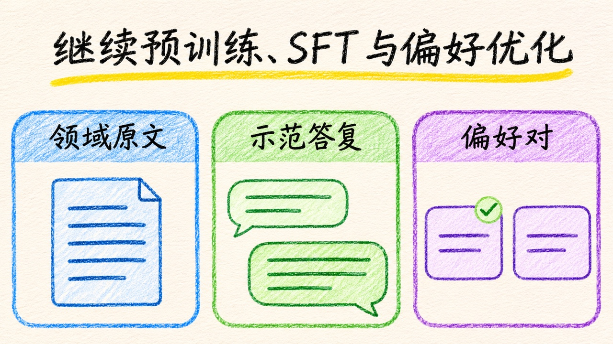
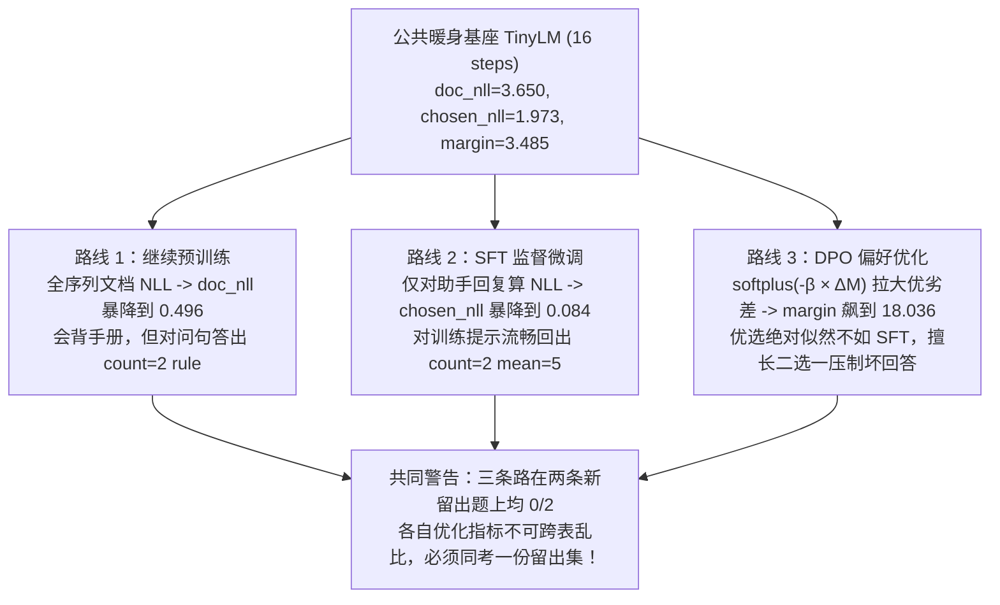

> **生成工具**：Codex\
> **生成模型**：gpt-6.2-sol

还是熟悉的退款 CSV：三行金额 `10、空、0`，规矩是排除空值保留 `0`（有效 `2` 条、均值 `5`）。在真实项目里，刚拉下来的大模型往往同时闹三种不同的别扭：
1. 它压根没学过你们公司的内部退款口径黑话（**领域知识缺**）；
2. 它其实明白意思，可一让它作答就喜欢长篇大论聊家常，就是不乖乖回指定格式（**交互规范缺**）；
3. 两种算术方案它都会写，可每次面对模糊边界总是偏偏挑错的那一种（**取舍偏好歪**）。

今天沿用 [TRN-02](trn-02-tiny-language-model.md) 建好的微型 `TinyLM`，先暖身 16 步练出一个公共初始基座，再当场分出**继续预训练、SFT（监督微调）、DPO（直接偏好优化）**三条岔路各更新 20 步，亲眼看看这三种完全不同的信号各自推着模型往哪边拐，顺便把「**学什么目标（Objective）**」跟「**动哪几个参数（PEFT / 全参）**」两件常被初学者混成一团的概念彻底剥开！

> **先用大白话讲明白**：把微调大模型比作**训练一位新入职的客服助理**：
> - **继续预训练（Continued Pretraining）=「发给他一沓企业《业务制度汇编》，自己从头读熟接下一句」**：整本无标签纯文档从左到右每个字都预测算分；最擅长让他记住生僻行话和内部规章，但**没人教他该怎么按问答格式回答问题**（问他题他可能顺着背下一段法规条文！）。
> - **SFT（监督微调）=「发给他一本带红笔答案的《标准问答练习册》」**：前面用户的提问（`<user>...<assistant>`）看清楚但不扣分（遮成 `-100`），只要求他把示范回复连同闭嘴句号 `<eos>` 一字不差背出来——瞬间教会他「看到这类提问按什么格式回答」。
> - **DPO（偏好优化）=「同时摊开『好答卷 vs 差答卷』让他学会往好那边偏、把差那边踩下去」**：光背标准答案不够时，把正确回答 `count=2 mean=5` 和易错诱饵 `count=3 mean=3.33` 摆在一起做减法比较，逼他不断拉开两者的概率差距！



## 1. 同一个退款任务，对应准备三种完全不同的数据

| 训练阶段 / 目标 | 你得给模型喂什么样的数据？ | 这一步从数据里吸取什么养分？ | 参考文献 |
| --- | --- | --- | --- |
| **继续预训练** | 纯领域原文，如 `退款手册：空金额排除，零金额保留` | 用上文猜下文，专门把内部术语、业务语境吃透。 | [领域适配预训练](https://arxiv.org/abs/2004.10964) |
| **SFT（监督微调）** | 成对的「用户问句 + 标准示范答复」 | 记住提问与示范输出之间的对应格式、语气与停止位（仅助手机器回复段算损失）。 | [TRL SFTTrainer](https://huggingface.co/docs/trl/sft_trainer) |
| **偏好优化（DPO）** | 同一个提问配一对「优选 `chosen` vs 劣选 `rejected`」 | 学会避开看似像模像样其实犯错的诱饵答案（通过相对冻结参考模型拉开优劣间隔）。 | [InstructGPT 论文](https://arxiv.org/abs/2203.02155) |

关于利用环境校验奖惩的在线强化学习路线，我们留到后面 **TRN-07**（DPO 深度拆解）和 **TRN-08**（PPO / GRPO）再展开。

## 2. 拆开看：每条样本里，损失到底打在哪些 Token 上？

假设我们按教学习惯把 `count=2` 等算一个完整词。让 `7` 个 Token 齐刷刷排进同样的左右移位结构（前 `6` 个预测后 `6` 个）：

```text
手册片段   <doc>  refund  empty  skip         zero     keep    <eos>
示范样本   <user> refund  mixed  <assistant>  count=2  mean=5  <eos>
SFT 计损失         否      否      否           是       是      是
```

- **继续预训练（NLL）**：手册片段从第 2 个位置起**全员 6 个移位目标全部计入负对数似然（Negative Log-Likelihood, NLL）**——也就是对正确词的概率取 `-ln(p)`，单位 **nat/Token**；
- **SFT（带掩码 NLL）**：虽然 `<user> refund mixed <assistant>` 全送进前向计算让模型看到，但只把 **`count=2`、`mean=5` 和结束标记 `<eos>`** 这 3 个助手位置放进损失均值里。要是这三步预测概率都为 `0.5`，SFT 平均损失就是 `-ln(0.5) ≈ 0.693 nat/Token`；
- **DPO（比较相对对数概率差）**：同一条 Prompt 配对优选 `CHOSEN` 与劣选 `REJECTED`。分别把两串回复段每个 Token 的对数概率加总，得到整串对数概率，再定义偏好间隔 `M = log P(优选 | Prompt) - log P(劣选 | Prompt)`（单位 `nat`）。DPO 计算当前可训练模型相对于冻结起点参考模型的增量 **`ΔM = M_current - M_ref`**，代入平滑损失函数：
  `loss = softplus(-β × ΔM) = ln(1 + exp(-β × ΔM))`
  这里 `β = 0.5` 为控制偏离惩罚力度的无量纲超参。刚开始权重和参考一模一样时 `ΔM = 0`，初始损失正好精准等于 **`ln(2) ≈ 0.693147`**！随训练扩大 `ΔM` 损失一路下降——既可能靠把优选概率推上去实现，也可能靠把劣选概率猛踩进地板来实现！[DPO 原论文](https://arxiv.org/abs/2305.18290) · [TRL 的 DPO](https://huggingface.co/docs/trl/dpo_trainer)

## 3. 从完全同一份权重分叉实跑 20 步看差异

在空目录里先把下面的微型 `TinyLM` 存为 `train_tiny.py`（只包含模型结构）：

```python
import torch
from torch import nn
from torch.nn import functional as F

T, WIDTH, HEADS = 6, 32, 4


class TinyLM(nn.Module):
    def __init__(self, vocab):
        super().__init__()
        self.token = nn.Embedding(vocab, WIDTH)
        self.position = nn.Embedding(T, WIDTH)
        self.norm_attn = nn.LayerNorm(WIDTH)
        self.qkv = nn.Linear(WIDTH, 3 * WIDTH)
        self.merge = nn.Linear(WIDTH, WIDTH)
        self.norm_ffn = nn.LayerNorm(WIDTH)
        self.ffn = nn.Sequential(nn.Linear(WIDTH, 4 * WIDTH), nn.GELU(),
                                 nn.Linear(4 * WIDTH, WIDTH))
        self.final = nn.LayerNorm(WIDTH)
        self.head = nn.Linear(WIDTH, vocab, bias=False)

    def forward(self, x, allowed):
        h = self.token(x) + self.position(torch.arange(T))
        b = x.shape[0]
        q, k, v = (part.reshape(b, T, HEADS, WIDTH // HEADS).transpose(1, 2)
                   for part in self.qkv(self.norm_attn(h)).chunk(3, dim=-1))
        z = F.scaled_dot_product_attention(q, k, v, attn_mask=allowed, dropout_p=0.0)
        h = h + self.merge(z.transpose(1, 2).reshape(b, T, WIDTH))
        h = h + self.ffn(self.norm_ffn(h))
        return self.head(self.final(h))
```

接着同目录存第二份对照脚本 `compare_objectives.py`，装好 `torch==2.11.0` 运行 `python compare_objectives.py`。脚本先用 `WARMUP` 通用片段热身 16 步造出一份完全统一的基座 `base`，再深拷贝出三个完全一模一样的分身各自单独接 AdamW 训练 20 步，随后拿两条从未训练过的全空（`all_empty`）和全零（`all_zero`）留出题考它们，检查模型是不是只会死记硬背复读训练样本里的 `count=2 mean=5`：

```python
from copy import deepcopy
import json
from pathlib import Path

import torch
from torch.nn import functional as F

from train_tiny import T, TinyLM

# 每行 7 个教学 Token，包含序列结束标记。
WARMUP = [
    "<doc> export text columns keep header <eos>",
    "<doc> ledger rows keep date text <eos>",
    "<user> export standard <assistant> count=2 mean=4 <eos>",
    "<user> ledger standard <assistant> count=1 mean=7 <eos>",
]
DOCUMENTS = [
    "<doc> refund empty skip zero keep <eos>",
    "<doc> refund mixed count=2 mean=5 rule <eos>",
]
PROMPT = "<user> refund mixed <assistant>"
CHOSEN = PROMPT + " count=2 mean=5 <eos>"
REJECTED = PROMPT + " count=3 mean=3.33 <eos>"
HOLDOUT = [
    ("<user> refund all_empty <assistant>", "count=0 mean=null <eos>"),
    ("<user> refund all_zero <assistant>", "count=2 mean=0 <eos>"),
]
# 教学词表固定，留出数据不参与构建。
vocab = (
    "<assistant> <doc> <eos> <user> all_empty all_zero columns count=0 "
    "count=1 count=2 count=3 date empty export header keep ledger mean=0 "
    "mean=3.33 mean=4 mean=5 mean=7 mean=null mixed refund rows rule skip "
    "standard text zero "
).split()
ids = {word: i for i, word in enumerate(vocab)}
CAUSAL = torch.ones(T, T, dtype=torch.bool).tril()[None, None]
BETA = 0.5


def encode(text):
    return [ids[word] for word in text.split()]


def token_logps(model, texts):
    sequence = torch.tensor([encode(text) for text in texts])
    assert sequence.shape[1] == T + 1
    logits = model(sequence[:, :-1], CAUSAL)
    return logits.log_softmax(-1).gather(-1, sequence[:, 1:, None]).squeeze(-1)


def answer_logps(model):
    first_answer = len(PROMPT.split()) - 1  # 输入位置 3 预测首个答复 Token。
    return token_logps(model, [CHOSEN, REJECTED])[:, first_answer:].sum(-1)


def fit(model, objective, steps):
    opt = torch.optim.AdamW(model.parameters(), lr=0.003, foreach=False)
    with torch.no_grad():
        before = float(objective(model))
    for _ in range(steps):
        opt.zero_grad(set_to_none=True)
        objective(model).backward()
        opt.step()
    with torch.no_grad():
        return before, float(objective(model))


@torch.no_grad()
def generate(model, prompt):
    tokens = encode(prompt)
    result = []
    for _ in range(3):
        padded = (tokens + [ids["<eos>"]] * T)[:T]
        logits = model(torch.tensor([padded]), CAUSAL)
        pick = int(logits[0, len(tokens) - 1].argmax())
        result.append(vocab[pick])
        tokens.append(pick)
        if vocab[pick] == "<eos>":
            break
    return " ".join(result)


@torch.no_grad()
def evaluate(model):
    logps = answer_logps(model)
    predictions = [generate(model, prompt) for prompt, _ in HOLDOUT]
    return {
        "document_nll": round(float(-token_logps(model, DOCUMENTS).mean()), 6),
        "chosen_nll": round(float(-logps[0] / 3), 6),
        "pair_margin": round(float(logps[0] - logps[1]), 6),
        "heldout_correct": sum(pred == gold for pred, (_, gold) in zip(predictions, HOLDOUT)),
        "heldout_outputs": predictions,
        "training_prompt_output": generate(model, PROMPT),
    }


def main():
    torch.set_num_threads(1)
    torch.use_deterministic_algorithms(True)
    torch.manual_seed(2026)
    base = TinyLM(len(vocab))
    fit(base, lambda model: -token_logps(model, WARMUP).mean(), steps=16)
    reference = deepcopy(base).requires_grad_(False)
    ref_good, ref_bad = answer_logps(reference)
    ref_margin = ref_good - ref_bad

    def dpo(model):
        good, bad = answer_logps(model)
        return F.softplus(-BETA * (good - bad - ref_margin))

    objectives = {
        "continued": lambda model: -token_logps(model, DOCUMENTS).mean(),
        "sft": lambda model: -answer_logps(model)[0] / 3,
        "dpo": dpo,
    }
    results = {"torch": str(torch.__version__), "vocab_size": len(vocab),
               "parameters": sum(p.numel() for p in base.parameters()),
               "warmup_steps": 16, "branch_steps": 20,
               "base": evaluate(base), "branches": {}}
    for name, objective in objectives.items():
        model = deepcopy(base)
        before, after = fit(model, objective, steps=20)
        assert after < before
        row = {"objective_before": round(before, 6),
               "objective_after": round(after, 6), **evaluate(model)}
        results["branches"][name] = row

    assert abs(results["branches"]["dpo"]["objective_before"] - 0.693147) < 1e-6
    assert results["branches"]["dpo"]["pair_margin"] > results["base"]["pair_margin"]
    assert evaluate(base) == evaluate(reference) == results["base"]
    output = json.dumps(results, indent=2)
    Path("objective-runs.json").write_text(output + "\n")
    print(output)


if __name__ == "__main__":
    main()
```

> **想再深入一层？** 本机 Apple Silicon CPU 实跑这 4 组模型交出的成绩单对比非常戏剧化：

| 分支模型 | 文档 NLL (`nat/Token`) | 优选回复 NLL (`nat/Token`) | 偏好间隔 M (`nat`) | 新留出题 (`all_empty / all_zero`) |
| --- | ---: | ---: | ---: | ---: |
| 暖身基座 (`base`) | `3.650` | `1.973` | `3.485` | `0/2` |
| **继续预训练** | **`0.496`**（暴降！） | `0.953` | `6.425` | `0/2` |
| **SFT** | `3.548` | **`0.084`**（暴降！） | `11.903` | `0/2` |
| **DPO** | `3.656` | `0.747` | **`18.036`**（狂涨！） | `0/2` |

结果戳中了训练里三个极真实的现象：
1. **继续预训练确实学会了背手册**（文档损失掉到 `0.496`），但真拿问答提示 `<user> refund mixed <assistant>` 去考它，它张口背出了 `count=2 rule`（混杂手册用语），根本没按问答格式答完！
2. **SFT 和 DPO 都能对训练里的 `mixed` 吐出完美答案 `count=2 mean=5`**，但两者的侧重点截然不同：DPO 的损失从 `0.693147` 掉到了 `0.000692`、把优劣差距推到了疯狂的 `18.036 nat`，可它对好答案本身的绝对概率（NLL `0.747`）远不如 SFT（NLL `0.084`）高——因为它很大一部分梯度顺便用来踩低劣选了！
3. **两条没见过的留出题（全空、全零）全员 `0/2`**——三个分身全在复读见过的 `count=2 mean=5`！这也警醒我们：两条样例远不足以泛化推理，**并且千万不能拿着各自训练损失数字去比「谁更强」，必须拉回同一批未见过的业务考题上比真本事！**

## 4. 把「训练目标」与「更新哪些参数」彻底解耦

刚才三条路线全都解锁更新了全模型参数。但工程上这是两个完全正交的开关——你既可以拿全参数跑 SFT，也可以只挂 LoRA 跑 DPO！选型时对照下面这张参数范围账单：

| 参数更新范围 | 到底改模型里的哪些张量？ | 质量基线与内存/计算开销怎么算 |
| --- | --- | --- |
| **全参数（Full Fine-tuning）** | 模型所有权重一起开锁更新 | 算力、显存与数据充沛时的天花板基线；梯度与 AdamW 动量覆盖全部参数。 |
| **部分层（Partial Layers）** | 锁死主体层，只改最后几层或输出投影头 | 例如给本 `TinyLM` 只放开最后输出头，可训练参数一下子缩成 **`31 × 32 = 992`** 个！ |
| **Adapter / LoRA** | 基座参数全面冰封，只给线性层旁挂一对超窄低秩矩阵 | 设 `32 × 32` 矩阵配 `r=4` 的 LoRA，新增仅仅 **`4 × (32 + 32) = 256`** 个可训练参数！不过算前向和回传梯度时，基座权重和层间激活依然要老实算完占空间。[LoRA 论文](https://arxiv.org/abs/2106.09685) |
| **软提示（Soft Prompt）** | 基座纹丝不动，只在输入最前面加一小段可优化虚拟前缀向量 | 例如学 4 个宽度 `32` 的提示向量仅需 **`4 × 32 = 128`** 参数，且按任务无缝切换，但会占用一点输入上下文槽位。[Prompt Tuning 论文](https://arxiv.org/abs/2104.08691) |

> **大白话小结**：实战拿到具体任务先按症状开方：
> - 领域黑话/规章一问三不知 -> 先拿合法授权原文走**继续预训练**（同时顺带跑通用问答基准防遗忘）；
> - 懂道理但回答格式乱七八糟 -> 上覆盖各种边界情形的高质量示范对走 **SFT**；
> - 格式对了、好坏回答都会写，但在微妙口吻和规则偏好间老摇摆 -> 准备对比明显且控长短的优劣对走 **DPO**；
> 且每次提交选型报告，别只扔一个孤零零的分数，务必一并附上业务通过率、错误分布、可训练参数比、显存峰值和实际花费时长。

## 下一篇

在上一节的表格里，SFT 只监督助手的那一小段话而把用户提问遮成 `-100`。可真到了用 Hugging Face 给多轮真实聊天做 SFT 时，聊天模板里的 `<|im_start|>` 到底算不算监督、不小心一刀截断超长会话把结尾 EOS 切飞了模型就会变成停不下来的复读机！[**TRN-04《SFT 怎么把对话变成监督信号》**](trn-04-sft-supervision.md) 会拎起真实 Qwen2.5 分词器，逐个 Token 解剖多轮掩码、截断保护与实跑效果。 [LLM 与 Agent 学习路线图](https://blog.lacknb.cn/articles/2026/11/19/1795058329577.html)
