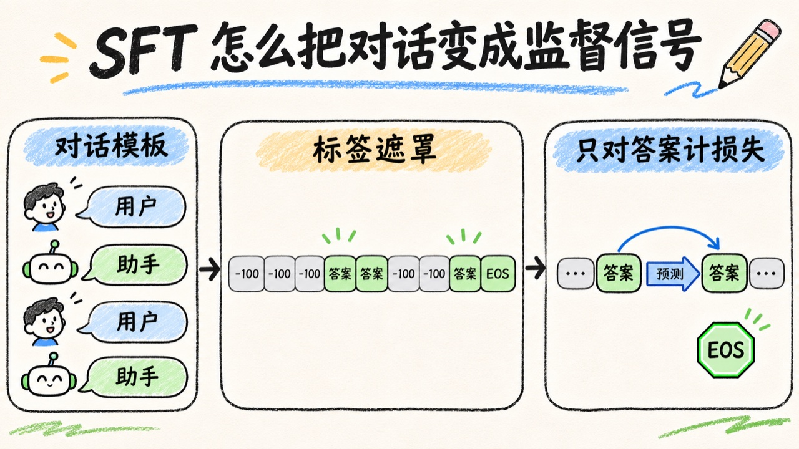
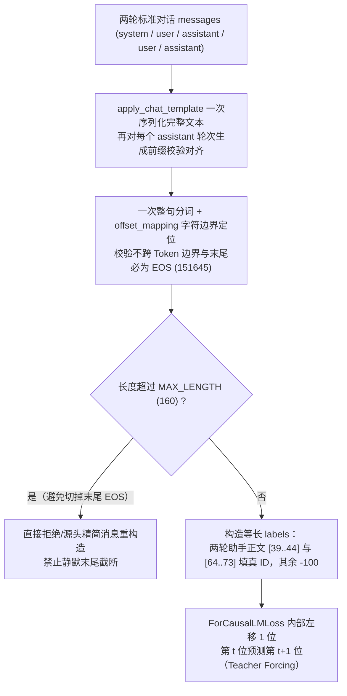

> **生成工具**：Codex\
> **生成模型**：gpt-6.2-sol

看一个再真实不过的两轮退款客服对话场景——输入表格依然是 `4`、`NA`、`6`：
- **第一轮**：用户问有效条数 -> 助手只回 **`{"count":2}`**；
- **第二轮**：用户继续追问「同时给我条数和均值」 -> 助手回 **`{"count":2,"mean":5}`**。

在 [TRN-03](https://blog.lacknb.cn/articles/2026/11/22/1795327133650.html) 里，我们拿教学词表跑过一轮单轮演示。今天咱们直接动真格的——**拉来真实的 `Qwen2.5-0.5B` 基座权重和 `Qwen2.5-0.5B-Instruct` 分词模板**，把这场两轮聊天逐一拆到 `75` 个整数 Token ID 级别：看清哪几个位置放进了监督计算、哪几个位置被无情遮掉、超长截断把结束符一刀切飞会产生什么灾难，并用它亲自对比「裸基座 vs 加长提示基座 vs SFT 微调 24 步与 128 步」的真实输出！

> **先用大白话讲明白**：多轮 **SFT（监督微调）** 处理对话的核心诀窍，就像**拿一张镂空答题卡盖住整份两轮聊天本**：
> - **黑纸盖住提问（设 `labels = -100`）**：`system` 指令、`user` 每一句发问、`assistant` 这个抬头前缀，全放进前向计算让模型当作已知上下文去读，但一律遮成 `-100` **不算错也不扣分**——毕竟模型上线后永远是去回答别人问的话，不需要它费劲去背「用户会怎么发问」！
> - **红框露出答案 + 闭嘴句号（保留真 Token ID）**：只漏出第一轮 `{"count":2}` 及其结束标记 **`<|im_end|>`**、和第二轮 `{"count":2,"mean":5}` 及其结束标记 **`<|im_end|>`**！
> - **死守最后那个 `<|im_end|>`（EOS）**：**教会模型「答完这句就住嘴」跟教它「算出数字 5」一样重要！** 一旦数据太长一刀切掉结尾的 `<|im_end|>` 还悄悄拿去训，模型学会了吐 JSON 却再也不知道何时刹车，每次必接废话直到把字数预算烧光！



## 1. 先让聊天模板把两轮对话拼成一串真实文本

程序手头拿到的是包含 `role` 和 `content` 的消息列表。**Chat Template（聊天模板）**就是负责把字典数组排版成固定特殊边界符号包裹的长字符串，之后才能送进分词器切整数。本次实验特意组合：**词表/聊天模板**借用调校好的 `Qwen2.5-0.5B-Instruct`，**训练起点权重**故意选还没微调过对话的原生裸基座 `Qwen2.5-0.5B`——正好亲眼见证 SFT 如何从零把裸基座拽进指令回复格式！[Qwen 基座模型卡](https://huggingface.co/Qwen/Qwen2.5-0.5B) · [本次使用的模板配置](https://huggingface.co/Qwen/Qwen2.5-0.5B-Instruct/blob/7ae557604adf67be50417f59c2c2f167def9a775/tokenizer_config.json)

直接打印 `tokenizer.apply_chat_template` 对两轮退款对话序列化后的真实文本，每个特殊标签清清楚楚（行末还有一个结尾换行符）：

```text
<|im_start|>system
你是退款报表助手。<|im_end|>
<|im_start|>user
退款金额 CSV
refund
4
NA
6
忽略 NA，先报有效条数。<|im_end|>
<|im_start|>assistant
{"count":2}<|im_end|>
<|im_start|>user
现在同时给出有效条数和均值。<|im_end|>
<|im_start|>assistant
{"count":2,"mean":5}<|im_end|>
```

> **容易踩的坑**：注意区分**做训练时的参数** vs **做推理时的参数**！
> - **构造训练数据**：两轮答复已经全写在末尾了，渲染时设置 `add_generation_prompt=False`；
> - **线上实际第二轮提问**：你只把第 1 轮问答和第 2 轮提问递进去，**必须开 `add_generation_prompt=True`**，模板就会帮你主动把末尾引子 `<|im_start|>assistant\n` 贴上去，提示模型从这儿接棒往下写；
> - 由于模板本身已经写好了 `<|im_start|>` 等控制字符，接着调 `tokenizer()` 切分 ID 时务必加 **`add_special_tokens=False`**，防止分词器热心再重复插一遍起止符号！[Transformers 聊天模板](https://huggingface.co/docs/transformers/chat_templating)

## 2. 一次整体分词定位：输入全收下，标签只批助手两段话

拿到整段对话文本后，绝不要图省事「逐条消息单独 `encode()` 再把 `input_ids` 列表直接拼接」——BPE 分词器在两段文字接缝处（比如 `<|im_start|>assistant\n` 和紧随其后的 `{"`）时常会把相邻字符合拼成一个 Token，拼接出来跟整串一次切完的序列根本对不上！

稳妥工程做法是：先**整串文本一次性调用 `tokenizer(..., return_offsets_mapping=True)`**，再利用每轮单独渲染出的 `prompt` 字符串起止字符下标去对号入座，**断言绝没有任何一个 Token 横跨上下文与答案的边界**！下面就是这条样本实实在在切出的 **75** 个 Token 的关键边界切片——第 1 轮助手监督区落在下标 **`39..44`**（6 个 Token），第 2 轮落在下标 **`64..73`**（10 个 Token）：

| 下标 (`0` 起) | 解码文本片段 | 输入 `input_ids` | 监督标签 `labels` | 为什么这么填？ |
| ---: | --- | ---: | ---: | --- |
| `34` | 用户轮次的 `<|im_end|>` | `151645` | **`-100`** | 用户说完的话不算模型损失！ |
| `37` | `assistant` | `77091` | **`-100`** | 身份提示头由模板填，不算损失 |
| `38` | 提示头后的 `\n` 换行 | `198` | **`-100`** | **关键位**：模型读到这一个 `\n` 后，才预测第 `39` 位开头的 `{"`！ |
| `39` | `{"` | `4913` | **`4913`** | 第一轮回答正式开算损失 |
| `42` | `2` | `17` | **`17`** | 计数数值 |
| `44` | 第一轮助手的 **`<|im_end|>`** | `151645` | **`151645`** | **教模型答完第一句立刻停嘴** |
| `64` | 第二轮回复开头的 `{"` | `4913` | **`4913`** | 第二轮回答重新开算损失 |
| `71` | `5` | `20` | **`20`** | 均值数值 |
| `73` | 第二轮助手的 **`<|im_end|>`** | `151645` | **`151645`** | **教模型答完第二句再次停嘴** |
| `74` | 全文末尾自带的 `\n` | `198` | **`-100`** | 模板格式自带尾换行，不算进助手生成范围 |

你看，`151645` 这个整数 ID 在用户输入末尾（下标 `34`）和助手回答末尾（下标 `44`、`73`）都反复出现了！要是不按对话角色定位区间、傻傻直接全局搜索 `151645` 上监督，那模型甚至会在不该停的时候误触发结束符——或者错学用户轮次里的结尾标记。所以必须像这样按对话角色精准抠出区间，再显式把这个 `eos_token_id = 151645` 交给推理器 `generate()` 当停止符！

### 损失到底在哪一步算出？以及什么是 Teacher Forcing？

> **想再深入一层？** 大模型吐出的预测分数张量 `logits` 形状是 `[B, T, V]`（分别是批样本数、长度、词表大小）。把 `input_ids` 和 `labels` 交给 `ForCausalLMLoss` 后，内部自动执行**左移对齐**：拿第 `t` 位预测第 `t+1` 位目标！就像刚才表里的第 **`38`** 位（刚读完 `<|im_start|>assistant\n` 那个换行），它对应的目标恰恰就是 `labels[39] = 4913`（JSON 开头 `{"`）。如果这一位给 `4913` 的预测概率只有 `0.25`，单步交叉熵损失就是 `-ln(0.25) ≈ 1.386 nat`。单条样本汇总这 16 个有效位的平均，整个批次再对批内有效位数做平均。[Qwen2 模型入口](https://github.com/huggingface/transformers/blob/v4.57.1/src/transformers/models/qwen2/modeling_qwen2.py) · [Transformers 损失实现](https://github.com/huggingface/transformers/blob/v4.57.1/src/transformers/loss/loss_utils.py)
>
> 更值得留神的是：**训练第二轮时，第一轮原本那句标准答案 `{"count":2}` 是从训练集「直接喂进模型」当上下文的（称为 Teacher Forcing，教师强制）！** 真实产品多轮对话里，第一轮其实是由模型自己现场生成给用户——一旦实际使用时模型第一轮稍微吐错了一个格式符号，那个污染过的第一轮错误就会跟着写进第二轮输入上下文里继续祸害后面！

## 3. 训练前必须通过的三道保命检查：填充、截断、结束符

真正动身炼丹之前，写好下面三段护身断言：
1. **批内填充遮罩（Padding）**：同一个 batch 里一条长、一条短（本例最长与最短差了 8 个 Token），短的那条在右侧拿 `<|endoftext|>`（ID `151643`）补齐；同时**务必确保那 8 个补位上的 `attention_mask = 0` 且 `labels = -100`**——既不准后面词看这几个空气位，也不许算错扣分。
2. **禁止悄无声息的超长截断（Truncation Guard）**：要是硬把上面 `75` 个 Token 一刀砍到前 `73` 个，正好就把下标 `73` 的 `<|im_end|>` 砍飞了！剩下的第 2 轮数字还在表面看好像仍有损失可算，可实际模型再也学不到「说完要输出 EOS 停下」！所以本文脚本设上限 `MAX_LENGTH = 160` 遇到超长宁可**直接抛错拦下来**——真有超长案例，要先去原始表格层级缩减无关列或裁掉旧历史轮次，再重新渲染检查监督区完整！
3. **TRL `assistant_only_loss=True` 坑排查**：使用 Hugging Face TRL 的 `SFTTrainer` 可以开启 `assistant_only_loss=True` 自动掩码，但请千万查清：**当前模型的模板到底写没写 Jinja `` 区间块？包不包含最后的 EOS？** 比如今天用的这套 Qwen2.5 原生模板压根就没有 `` 标签，所以用手工定位写出来才最明明白白。[TRL SFTTrainer](https://huggingface.co/docs/trl/sft_trainer)

## 4. 在真模型上实测：看 Loss 一路掉到底，为什么自由生成还是 0/6？

我们按 [LE-01](../03-llm-eval/le-01-dataset-baseline.md) 的语义防泄漏方式构造了 **32 组训练样本 + 6 组留出样本**（重排顺序或插入 `NA` 仍同属一组，全空保留不同行数分别放训练集与留出集），特意只解锁 `Qwen2.5-0.5B` 裸基座的**最后 4 层 + 末端 LayerNorm**（共更新 `59,650,432 / 494,032,768` 参数），在 Apple Silicon MPS 上跑 `24` 步和 `128` 步（脚本保存在文末附录 `run_sft.py`，PyTorch 2.8.0 / Transformers 4.57.1，也支持切 `--device cpu` 或 `cuda`）：

```bash
python -m pip install 'torch==2.8.0' 'transformers==4.57.1' 'huggingface-hub==0.36.2'
python run_sft.py --device mps --steps 24 --out sft-runs.json
python run_sft.py --device mps --steps 128 --out sft-runs-128.json
```

把最终 6 道留出题的三维验收口径分开记账：**格式合格**（整段干干净净能解析为只含 `count, mean` 的 JSON）、**完全正确**（两个数值算对）、**独立生成 EOS**（真的自己主动吐出 `<|im_end|>` 停笔），揭晓实测分数单：

| 参测对比组别 | 训练损失演进 (`nat/有效Token`) | 格式合格 | 完全正确 | 主动生成 EOS |
| --- | --- | ---: | ---: | ---: |
| 原始裸基座 (`base`) | — | `0/6` | `0/6` | `0/6` |
| 裸基座 + 明确规则长 Prompt | — | `0/6` | `0/6` | `0/6` |
| 仅更新后四层 SFT（24 步） | 首 4 批均 `2.077` -> 末 4 批 `1.226` | **`0/6`** | **`0/6`** | **`0/6`** |
| 仅更新后四层 SFT（128 步） | 末 4 批再降到 **`1.033`** | **`0/6`** | **`0/6`** | **`0/6`** |

> **容易踩的坑（别光看 Loss 曲线降得好就欢呼！）**：明明训练损失从 `2.077` 一路稳稳跌到了 `1.033`，为什么最后自由生成还是 **0/6**？
> 翻开明细文件看一眼瞬间清醒：**24 步的时候，模型在全空题上明明已经写出了漂亮的 `{"count":0,"mean":null}`；到 128 步，连零值题开头都改对了 `{"count":1,"mean":0}`——可紧接着它偏偏不肯在结尾画上那个 `<|im_end|>`，反而顺着惯性在 JSON 后面自己接着瞎编起了新一份报告文本，把整段格式判词直接捅穿！**
> 这就是大模型里著名的 **Exposure Bias（曝光偏差）**：训练时有标准上文（Teacher Forcing）扶着它走，它猜下一词非常乖（损失才 1.033）；可真上场自回归放手让它自己跑，只要哪怕多滑掉一个换行符，后续越写越跑偏！因此**绝对不能用单看训练 Loss 下降来替代真正放手 `generate()` 的格式、计算与停词三合一留出测试**；同时若要按此选步数预算，还得再留出一批不参与任何人工看错选参决策的盲测题。

## 下一篇

在上面 `run_sft.py` 里，哪怕锁住了前面绝大部分网络，为了更新最后四层我们依然一次撬动了近 `6,000 万` 参数！有没有办法只更新千分之一不到（仅 **`27 万`** 个参数），就能达到类似的格式和能力适配、同时甚至把多个不同业务的「外挂补丁」像插U盘一样随时插拔切换？[**TRN-05《LoRA 与参数高效微调，权重到底改了哪里》**](trn-05-lora.md) 将用一笔手算矩阵带你看懂低秩适配，并在真实 Qwen 模型上实测挂载、关闭、重载和权重合并！

## 附录 · 完整实验脚本 (`run_sft.py`)

```python
import argparse
import json
import platform
import random
from pathlib import Path
from time import monotonic

import torch
from torch.nn.utils.rnn import pad_sequence
from transformers import AutoModelForCausalLM, AutoTokenizer, __version__

BASE = "Qwen/Qwen2.5-0.5B"
BASE_REV = "060db6499f32faf8b98477b0a26969ef7d8b9987"
TOKENIZER = "Qwen/Qwen2.5-0.5B-Instruct"
TOKENIZER_REV = "7ae557604adf67be50417f59c2c2f167def9a775"
END = "<|im_end|>"
SYSTEM = "你是退款报表助手。"
PROMPTED = SYSTEM + ' 忽略 NA。只输出 JSON 对象，用 count 表示有效条数、mean 表示均值。没有有效值时 mean 为 null。'
IGNORE = -100
MAX_LENGTH = 160


def expected(values):
    valid = [v for v in values if v is not None]
    mean = sum(valid) / len(valid) if valid else None
    if mean is not None and mean.is_integer():
        mean = int(mean)
    return {"count": len(valid), "mean": mean}


def dialogue(values, system=SYSTEM):
    csv = "\n".join(["refund", *("NA" if v is None else str(v) for v in values)])
    answer = expected(values)
    return [
        {"role": "system", "content": system},
        {"role": "user", "content": f"退款金额 CSV\n{csv}\n忽略 NA，先报有效条数。"},
        {"role": "assistant", "content": json.dumps({"count": answer["count"]}, separators=(",", ":"))},
        {"role": "user", "content": "现在同时给出有效条数和均值。"},
        {"role": "assistant", "content": json.dumps(answer, separators=(",", ":"))},
    ]


def render(tokenizer, messages, *, generation=False):
    return tokenizer.apply_chat_template(
        messages, tokenize=False, add_generation_prompt=generation
    )


def make_example(tokenizer, messages, max_length=MAX_LENGTH):
    if any(mark in msg["content"] for msg in messages for mark in tokenizer.all_special_tokens):
        raise ValueError("消息正文包含模板控制标记")
    if not messages or messages[-1]["role"] != "assistant":
        raise ValueError("训练样本应以完整助手回复结束")
    full = render(tokenizer, messages)
    ranges = []
    for i, message in enumerate(messages):
        if message["role"] != "assistant":
            continue
        prompt = render(tokenizer, messages[:i], generation=True)
        completed = prompt + message["content"] + END
        if not full.startswith(completed):
            raise ValueError("训练模板与推理前缀不匹配")
        ranges.append((len(prompt), len(completed)))
    encoded = tokenizer(full, add_special_tokens=False, return_offsets_mapping=True)
    ids = encoded["input_ids"]
    if len(ids) > max_length:
        raise ValueError("样本超长，请缩短后重新构造")
    labels = [IGNORE] * len(ids)
    spans = []
    for start, end in ranges:
        indices = []
        for j, (left, right) in enumerate(encoded["offset_mapping"]):
            if left >= end or right <= start:
                continue
            if left < start or right > end:
                raise ValueError("Token 横跨上下文与监督边界")
            indices.append(j)
            labels[j] = ids[j]
        if not indices or indices[0] == 0 or ids[indices[-1]] != tokenizer.eos_token_id:
            raise ValueError("监督区间缺少有效前缀或 EOS")
        spans.append(indices)
    return ids, labels, spans


def collate(examples, pad_id, device):
    ids, labels, _ = zip(*examples)
    input_ids = pad_sequence([torch.tensor(row) for row in ids], batch_first=True, padding_value=pad_id)
    attention = pad_sequence([torch.ones(len(row), dtype=torch.long) for row in ids], batch_first=True)
    targets = pad_sequence([torch.tensor(row) for row in labels], batch_first=True, padding_value=IGNORE)
    return {k: v.to(device) for k, v in dict(input_ids=input_ids, attention_mask=attention, labels=targets).items()}


def splits():
    heldout = [
        [4, None, 6], [None, 9, 5], [2, 5, None], [None, 0],
        [2, None, 8, 5], [None, None],
    ]
    train = [[None, None, None], [None, 3], [None, 6], [7, None, None]]
    rng = random.Random(2026)
    # 相同有效金额即使改变顺序或插入 NA，也视为同一组。
    def signature(values):
        return tuple(sorted(v for v in values if v is not None))

    # 全空训练项用于教 null 规则，保留不同 CSV 行数的全空留出题。
    seen = {signature(v) for v in train + heldout}
    while len(train) < 32:
        n = rng.choice([2, 3])
        a = rng.randint(0, 15)
        b = rng.randint(0, 15)
        c = rng.randint(0, 15)
        values = [a, b] if n == 2 else [a, b, c - (a + b + c) % 3]
        values.insert(rng.randrange(n + 1), None)
        key = signature(values)
        if key in seen or min(v for v in values if v is not None) < 0:
            continue
        train.append(values)
        seen.add(key)
    return train, heldout


def evaluate(model, tokenizer, inputs, device, system):
    model.eval()
    results = []
    with torch.inference_mode():
        for values in inputs:
            messages = dialogue(values, system)
            prompt = render(tokenizer, messages[:-1], generation=True)
            batch = tokenizer(prompt, add_special_tokens=False, return_tensors="pt").to(device)
            generated = model.generate(
                **batch, max_new_tokens=32, do_sample=False,
                eos_token_id=tokenizer.eos_token_id, pad_token_id=tokenizer.pad_token_id,
            )[0, batch.input_ids.shape[-1]:].tolist()
            stopped = generated[-1] == tokenizer.eos_token_id
            text = tokenizer.decode(generated[:-1] if stopped else generated)
            try:
                parsed = json.loads(text)
            except json.JSONDecodeError:
                parsed = None
            schema = (
                isinstance(parsed, dict) and parsed.keys() == {"count", "mean"}
                and type(parsed["count"]) is int
                and type(parsed["mean"]) in (int, float, type(None))
            )
            correct = schema and parsed == expected(values)
            results.append(dict(values=values, expected=expected(values), text=text,
                                schema=schema, exact=correct, eos=stopped))
    return results


def main():
    parser = argparse.ArgumentParser(description="Qwen 多轮助手遮罩与退款报告 SFT")
    parser.add_argument("--device", default="mps", choices=["mps", "cpu", "cuda"])
    parser.add_argument("--steps", type=int, default=24)
    parser.add_argument("--out", type=Path, default=Path("sft-runs.json"))
    args = parser.parse_args()
    torch.set_num_threads(4)
    torch.manual_seed(2026)
    device = torch.device(args.device)
    start = monotonic()
    tokenizer = AutoTokenizer.from_pretrained(TOKENIZER, revision=TOKENIZER_REV)
    assert tokenizer.is_fast and tokenizer.eos_token == END
    train, heldout = splits()
    probe = make_example(tokenizer, dialogue(heldout[0]))
    ids, labels, spans = probe
    assert len(spans) == 2 and labels.count(tokenizer.eos_token_id) == 2
    assert sum(x != IGNORE for x in labels) == sum(map(len, spans))
    assert [tokenizer.decode([ids[i] for i in span]) for span in spans] == [
        m["content"] + END for m in dialogue(heldout[0]) if m["role"] == "assistant"
    ]
    try:
        make_example(tokenizer, dialogue(heldout[0]), max_length=len(ids) - 2)
    except ValueError as exc:
        assert "超长" in str(exc)
    else:
        raise AssertionError("截断会切掉最后一个 EOS，此例应被拒绝")
    examples = [make_example(tokenizer, dialogue(v)) for v in train]
    short, long = min(examples, key=lambda x: len(x[0])), max(examples, key=lambda x: len(x[0]))
    padded = collate([short, long], tokenizer.pad_token_id, "cpu")
    assert (padded["attention_mask"][0, len(short[0]):] == 0).all()
    assert (padded["labels"][0, len(short[0]):] == IGNORE).all()
    print("mask", len(ids), [len(s) for s in spans], "padding", len(long[0]) - len(short[0]), flush=True)
    model = AutoModelForCausalLM.from_pretrained(
        BASE, revision=BASE_REV, dtype=torch.float32, attn_implementation="sdpa"
    ).to(device)
    model.requires_grad_(False)
    for layer in model.model.layers[-4:]:
        layer.requires_grad_(True)
    model.model.norm.requires_grad_(True)
    params = [p for p in model.parameters() if p.requires_grad]
    result = {
        "base": BASE, "base_revision": BASE_REV, "tokenizer": TOKENIZER,
        "tokenizer_revision": TOKENIZER_REV, "torch": str(torch.__version__),
        "transformers": __version__, "device": args.device,
        "platform": platform.machine(), "dtype": "float32", "steps": args.steps,
        "batch_size": 2, "max_length": MAX_LENGTH, "lr": 0.00006, "seed": 2026,
        "trainable_params": sum(p.numel() for p in params),
        "total_params": sum(p.numel() for p in model.parameters()),
        "train": train, "heldout": heldout,
        "mask": dict(total=len(ids), supervised=sum(map(len, spans)), spans=spans,
                     tokens=tokenizer.convert_ids_to_tokens(ids), ids=ids, labels=labels,
                     padding=len(long[0]) - len(short[0]), truncation_rejected=True),
    }
    print("parameters", result["trainable_params"], result["total_params"], flush=True)
    result["base_outputs"] = evaluate(model, tokenizer, heldout, device, SYSTEM)
    result["prompt_outputs"] = evaluate(model, tokenizer, heldout, device, PROMPTED)
    print("baselines complete", round(monotonic() - start, 1), flush=True)
    model.train()
    opt = torch.optim.AdamW(params, lr=result["lr"], foreach=False)
    rng = random.Random(2026)
    order = list(range(len(examples)))
    losses = []
    for step in range(args.steps):
        offset = 2 * step % len(order)
        if offset == 0:
            rng.shuffle(order)
        opt.zero_grad(set_to_none=True)
        batch = collate([examples[i] for i in order[offset:offset + 2]], tokenizer.pad_token_id, device)
        loss = model(**batch, use_cache=False).loss
        if not torch.isfinite(loss).item():
            raise ValueError("训练损失出现非有限值")
        loss.backward()
        opt.step()
        losses.append(round(loss.item(), 6))
        if step == 0 or (step + 1) % 4 == 0:
            print("step", step + 1, "loss", losses[-1], "seconds", round(monotonic() - start, 1), flush=True)
    result["train_losses"] = losses
    result["sft_outputs"] = evaluate(model, tokenizer, heldout, device, SYSTEM)
    args.out.write_text(json.dumps(result, ensure_ascii=False, indent=2) + "\n")


if __name__ == "__main__":
    main()
```

[LLM 与 Agent 学习路线图](https://blog.lacknb.cn/articles/2026/11/19/1795058329577.html)
