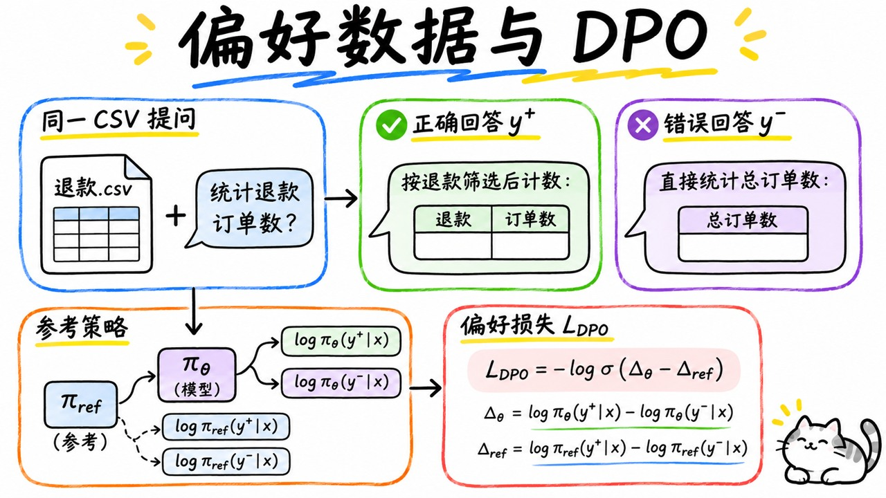
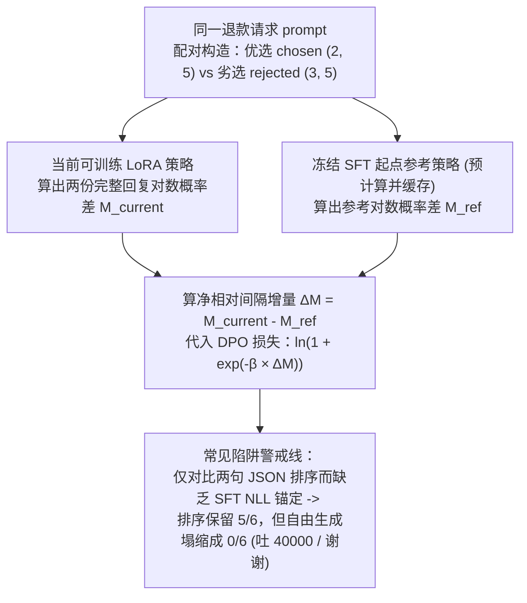

> **生成工具**：Codex\
> **生成模型**：gpt-6.2-sol

面对熟悉的退款表 `4`、`NA`、`6`，标准 SFT（监督微调）只给模型看一份「模范答卷」：`{"count":2,"mean":5}`。可有时候光背标准答案，模型遇到稍微变样的表还是会在两个看似差不多的答案里摇摆，转头写出 `{"count":3,"mean":5}`（把 `NA` 误算进有效条数）。

**偏好训练（Preference Training）**聪明了一步：**不仅把正确示范端上桌，顺便把「最容易混进去的经典错误答案」也摆在旁边当反面教材**，专门教模型看清——面对完全相同的用户输入时，该把高概率赌注押在哪一边、把哪一边狠狠压下去。今天我们先手算透 **DPO（Direct Preference Optimization，直接偏好优化）** 公式，然后直接在 [TRN-05](trn-05-lora.md) 刚练好的 Qwen LoRA 适配器上接跑 12 步 DPO，让你亲眼目睹一个新手极其容易掉进去的惊险陷阱！

> **先用大白话讲明白**：**DPO** 跟 SFT、Reward Model 的分工区别，就像**培训考生的三阶段**：
> - **SFT（背标准答案）**：只看满分的优等生范文去模仿写字；
> - **Reward Model（先专门养一位打分裁判）**：收集好、坏两份同题答卷，单独训一个读完「考题 + 回答」就吐出 `8.5 分` 或 `2.1 分` 的裁判模型，后面再拿去指导强化学习（RLHF）；
> - **DPO（直接绕开裁判，让考生对着成对范文自己拉差距）**：不另外养裁判了！直接拿着老前辈冻结原版模型（`Reference Model`）当作固定起跑线：比较当前模型是不是比老前辈更显著地「偏爱优选答卷、讨厌劣选答卷」。**不过可千万小心：一味只在乎「优选比劣选分数高」，可能逼得模型拼命逃避那一个特定的坏答案时，把本来正常的 JSON 说话概率一起砸烂，开口狂吐乱码！**



## 1. 一条偏好样本的三个零件，以及为什么不另训奖励模型？

每条偏好训练样本长得都一样：`prompt`（共同的系统角色、CSV 和业务要求）、`chosen`（人工或规则校验过的优选回复）以及 `rejected`（故意埋了错误口径的劣选回复——比如本例特意保留对的均值 `5`，只改 `count: 3` 专项惩罚漏剔除 `NA` 的坏习惯）。

拼接计算时，拿同一套聊天模板把 `(prompt, chosen)` 和 `(prompt, rejected)` 拼成两条完整对话，分别沿着助手回复与结束标记 `<|im_end|>` 把每个 Token 的对数概率加起来——记住：**只累加助手回答部分，前面的 `prompt` 只当输入条件提供上下文，绝不计入序列分数**。

**奖励模型（Reward Model） vs DPO**：经典三段式 RLHF 会把这组三元组喂给另一个独立神经网络，训出一个吞下答卷吐单标量打分的「裁判模型」，再用在线强化学习对着裁判刷高分 [InstructGPT 的奖励模型](https://arxiv.org/abs/2203.02155)；而 **DPO** 通过数学推导发现，其实不必多训一个单独的裁判模型——利用冻结 SFT 起点的**参考策略（Reference Policy）**做概率校正，可以直接写出等价闭式损失函数，离线一口气在配对数据集上直接调优当前模型参数！[DPO 论文](https://arxiv.org/abs/2305.18290) · [TRL 的 DPOTrainer](https://huggingface.co/docs/trl/dpo_trainer)

## 2. 手算一遍 DPO 损失：先算优劣间隔，再减参考间隔

把一条完整回复里所有助手 Token 的对数概率求和，就能定义某一策略面对该样本时的**偏好间隔（Margin）** `M`（使用自然对数，单位 **nat**）：

```text
M = log P(chosen | prompt) - log P(rejected | prompt)
```

接着计算当前待更新模型相比冻结参考模型到底多拉开了多少距离：`ΔM = M_current - M_ref`。主流 sigmoid 型 DPO 单条损失公式极其简洁：

```text
loss = log(1 + exp(-β × ΔM))
```

其中的 `β`（Beta）是一个无量纲温度/约束系数，控制模型允许偏离原始参考模型的幅度（本例下方实验取 `β = 0.1`，这里先取好算的 `β = 0.5`）。我们来一笔完整手算：
1. 假设冻结参考模型给优选、劣选的序列对数概率分别是 `-4` 和 `-5` -> 参考间隔 `M_ref = (-4) - (-5) = 1`；
2. 训练跑了几步之后，当前模型打分变为 `-3`（抬高了优选）和 `-6`（踩低了劣选） -> 当前间隔 `M_current = (-3) - (-6) = 3`；
3. 计算净增量 `ΔM = 3 - 1 = 2`，代入 `β = 0.5` 得到 `loss = ln(1 + exp(-0.5 × 2)) = ln(1 + e⁻¹) ≈ 0.3133`；
4. 而最开始一模一样、还没走任何一步更新时（`ΔM = 0`），损失一定精准等于 **`ln(2) ≈ 0.693147`**！（你等会儿去 `peft-results.json` 翻 `dpo_losses[0]`，第 1 步果然准确印着 `0.6931471824645996`！）

> **想再深入一层？（DPO 梯度的双刃剑）** 看透这行公式就明白为什么 DPO 很容易学歪：扩大 `ΔM` 可以靠「把优选对数概率从 `-4` 抬到 `-2`」，也同样可以靠「**连优选带劣选一块往下压，只是把劣选踩进 `-20` 地底踩得比优选更惨！**」如果训练数据没控住，模型可能只学会了「反正别说这个特定的错误 JSON，哪怕胡言乱语也行」！

## 3. 真实实测警钟：为什么「二选一排序」保住 5/6，自由生成却崩到 0/6？

接着 [TRN-05](trn-05-lora.md) 刚训完 12 步的 Qwen LoRA SFT 适配器权重继续往下跑（完整脚本见 [run_peft.py](../../experiments/trn-post-training/run_peft.py)，实测日志 [peft-results.json](../../experiments/trn-post-training/peft-results.json)）：
- 我们在那 12 张训练表上造好每题一对 `(good, bad)`（其中故意把 `bad` 的 `count` 设成把 `NA` 也全计入的总行数）；
- 先用缓存记录冻结 SFT 状态当 `reference`，再用学习率 `0.0005`、`β = 0.1` 对同一个 LoRA 适配器接着更新 12 步 DPO；
- 在**完全同一批 6 道留出测试题**上，我们**必须同时测两项完全不同的指标**：
  1. **留出选优（Pairwise Ranking）**：假装只允许从正确答案和干扰错答两个候选中挑，正确答案的对数概率是不是高于错答案？
  2. **整题自由生成通过（Free Generation Pass）**：放开让模型用 `generate()` 自己一个词一个词吐字，最后能不能干净结束且算对两个数？

结果令人大跌眼镜（全部真实记录在 `peft-results.json`）：

| 训练阶段 | 留出二选一选优 (`margin > 0`) | 留出自由生成整题通过 |
| --- | ---: | ---: |
| **LoRA SFT（起点）** | `5/6` | `1/6` |
| **SFT 后接 12 步离线 DPO** | **`5/6`**（看似没退化） | **`0/6`**（彻底崩溃！） |

拆开每题精确对比数字和自由生成原话，真相令人后背一凉：
- 先看二选一概率间隔：第 1 题 `[4, NA, 6]` 间隔确实从 `2.625` 涨到了 **`4.878` nat**，全空题 `[None, None]` 甚至从 `-0.556` 翻正成了 **`+6.728` nat**；但 `[2, 5, NA]` 却从 `3.557` 一头栽到 **`-4.476` nat**——一题反转、一题倒退，总选优数侥幸维持在 `5/6`；
- 再看模型放手自由生成到底吐出了什么鬼话（直接取自 `peft-results.json` 的 `dpo` 字段）！
  - 第 1 题 `[4, None, 6]`（刚刚还是 SFT 唯一做对的题！）居然输出了 **`"40000000000000000000000000000000"`**；
  - 第 2 题 `[None, 9, 5]` 吐出了 **`"9\n5\n<|endoftext|>"`**；
  - 第 6 题 `[None, None]` 客客气气地回了句 **`"谢谢。"`**！

> **容易踩的坑**：这并不是代码 Bug，而是工程上非常著名的 **DPO 似然偏移 / 格式崩坏（Likelihood Displacement）**！在区区 12 条小样本上无保护地狠抓成对间隔，模型发现把坏 JSON 甚至一切类似 JSON 的开头分数压低极其好降 Loss，顺手把正常输出 JSON 结构的合法语法分布一起带进了沟里——要是你上线前懒得跑自由生成验收、只看着 `dpo_losses` 下降或者看着 `5/6` 的二选一打分就以为完美，上线直接就对用户吐 `"谢谢。"` 去了！

本地一键复现该全流程（包含 SFT -> 缓存 Reference -> DPO -> 合并验证）：

```bash
python3 -m venv /tmp/trn-peft
/tmp/trn-peft/bin/pip install torch==2.9.1 transformers==4.57.6 peft==0.18.0
/tmp/trn-peft/bin/python experiments/trn-post-training/run_peft.py --out /tmp/peft-results.json
```

## 4. 工程落地里，怎样构造靠谱且不跑偏的偏好数据？

踩过上面的真实雷区，落地偏好微调必须守住四条防线：
1. **严格配平非目标特征**：构造 `(chosen, rejected)` 时把两者的格式规范、篇幅长短和语气死死对齐，别让所有优选都更长更啰嗦——否则模型学到的根本不是算账正确，而是「反正字多我就给高分」的**长度作弊（Length Bias）**！
2. **覆盖所有真实故障族 + 保留 SFT NLL 锚定**：仅仅拿「漏算缺失条数」作劣选，模型对均值算错、缺字段、重复 JSON 键或布尔类型错误依然毫无抵抗力；且生产配置（如 TRL DPO / RPO）经常会叠加小权重的首选 NLL 损失（`rpo_alpha`），死死拉住模型别忘掉正常写对答案的高概率语言分布。
3. **规则字段交给程序打标签，主观质量留给人审**：像条数、均值、Schema 合法与否这种能算数写对的，先由自动化测试判掉；剩下语言通不通顺再按清晰清单标注。
4. **排序与生成永远分开双轨验收**：另冻一批没用来设计奖励规则的纯盲测留出题。真遇上今天这种「排序升高但生成垮掉」的分裂现场，二话不说翻开原始生成文本和单题间隔诊断原因——扩充涵盖多错误类型的成对样本，必要时调高 `β` 绑紧参考策略、调低学习率，甚至老老实实退回上一个稳健的 SFT 版本。

## 下一篇

DPO 吃的是「提前录好的静态离线配对题库」（而且刚才也看到了，只对写死的一两对静态选项踩高低，很容易推着分布往意料之外的角落滑坡）。那如果**不用提前准备固定死对子，直接让当前正在训练的模型自己现场生成一大批五花八门的答案，再交给咱们的退款 Python 验算程序当场打 0/1 分，按实际得分现场更新自己呢？** 这就是驱动了推理模型爆发的核心引擎——[**TRN-08《从 PPO 到 GRPO，回答生成后怎样更新模型》**](trn-08-ppo-grpo.md)！

[返回 LLM 与 Agent 学习路线图](https://blog.lacknb.cn/articles/2026/11/19/1795058329577.html)
