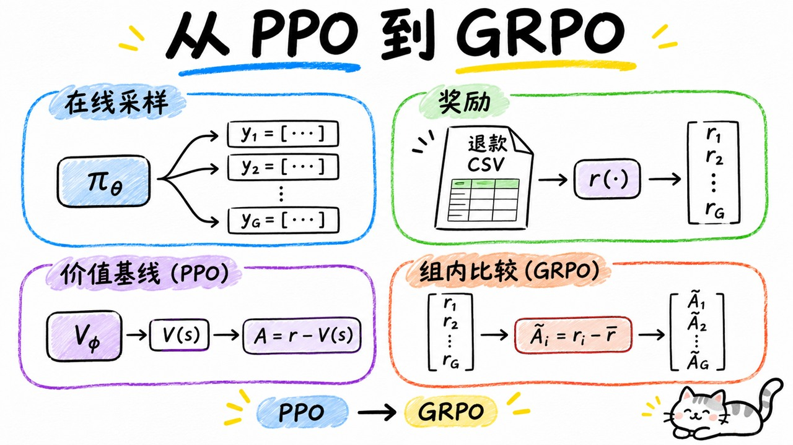
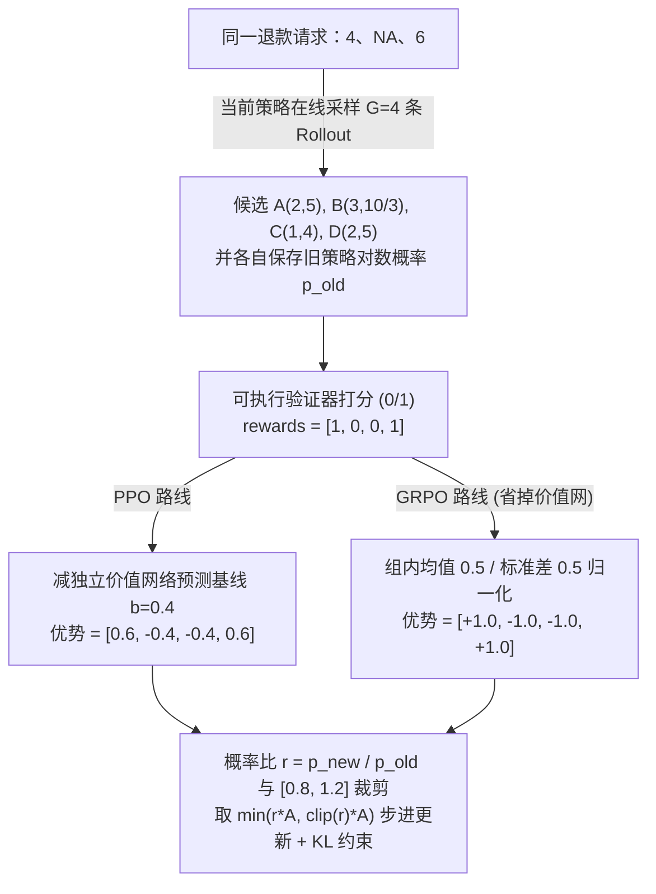

> **生成工具**：Codex\
> **生成模型**：gpt-6.2-sol

在上一篇 [TRN-07](trn-07-dpo-preference-data.md) 里我们看到，DPO 虽然省事，但它全程只能对着「开练前就已经静态写死」的一对好/坏答案做推拉。可一旦进入现实任务——比如我们的退款表 `4`、`NA`、`6`，明明直接拿一行 Python 计算程序就能秒级判断模型吐出的 JSON 对不对（100% 确定可验真！）——为啥不让当前模型自己亲自上场作答几次，根据最新答案究竟算没算对，当场给它奖惩、更新它的下一次生成习惯呢？

这就是**强化学习（Reinforcement Learning, RL）**在大模型后训练（以及 DeepSeek-R1 等推理模型训练）里的核心工作流：**模型一边自己采样生成（Online Rollout），验证器一边现批现改**！搞懂**答案从哪来、优势基线怎么比、更新幅度怎么防步子扯大**，就把从 **PPO** 到 **GRPO** 的脉络全通透了。

> **先用大白话讲明白**：**PPO** 和 **GRPO** 的核心差别，就在「拿什么当参考标准（Baseline）判断你这次答得算不算好」：
> - **PPO（请一位专职算命老师当基线）**：模型交出一份答卷拿到真实 `1` 分或 `0` 分时，旁边那位叫 **Value Model（价值模型）** 的老师提前预测过「这道题平时大约能拿 `0.4` 分」。于是对的得 `+0.6` 奖励优势、错的得 `-0.4` 惩罚。缺点是：又得养一个与主模型差不多大的价值老师占用翻倍显存！
> - **GRPO（取消算命老师，同组同学内部按考分拉曲线）**：**同一道题让当前模型一口气现场考 `4` 份答卷（一组 Group）**！比如 4 份里两份对、两份错，大家组平均分就是 `0.5`、标准差 `0.5`，直接拿自己人在同组里的相对好坏（减均值除标准差）算出 `[+1, -1, -1, +1]` 当优势——**彻底省掉了臃肿的价值模型**，最适合像数学、代码、CSV 计算这种程序能直接判对错的强验证任务！
> - **概率比裁剪（Clipping）=「每次微调不许一口吃成胖子」**：发现好回答就猛提它的概率、发现坏回答就踩下去，但**最多只许让新版概率与采样旧版概率的比例挪出 `[0.8, 1.2]` 这个安全窗一步一点微调**，避免一脚油门把策略彻底训崩！



## 1. 一轮在线训练，怎样源源不断自己造样本并打分？

首先统一两个词：**策略（Policy）**，指的就是正在接受训练、根据前文给下一个 Token 分配概率的语言模型本身；**Rollout（采样轨迹）**，就是我们开着随机采样，让当前策略围绕同一句 Prompt 一口气把完整回复（例如一个多 Token 组成的 JSON 对象）吐完的一整条轨迹。全部写完停笔之后，后端**验证器（Verifier）**解析整串字符、对上标准算术答案后发下 **Reward（奖励 `0` 或 `1`，无量纲）**。

看看 `4`、`NA`、`6` 这一桌现场抽出的 4 个候选答卷与判分结果：

| 在线采样轨迹 | 有效条数 (`count`) | 算得均值 (`mean`) | 程序校验奖励 (`reward`) | 为什么给这个分？ |
| --- | ---: | ---: | ---: | --- |
| 候选 `A` | `2` | `5` | **`1`** | 精准排除 `NA`，数值全对 |
| 候选 `B` | `3` | `10/3` | **`0`** | 错把 `NA` 算进分母变成 3 行 |
| 候选 `C` | `1` | `4` | **`0`** | 条数与均值全错 |
| 候选 `D` | `2` | `5` | **`1`** | 另一条随机抽到的正确答案 |

**离线 DPO vs 在线 RL 的本质区别**：做完采样收集并记下当时产出每个 Token 的**采样策略概率 `p_old`**，接着更新策略参数，下一轮立刻用更新过的新版本重新上考场造下一批新鲜样本——永远在围绕着自己当前真正容易犯的毛病边写边改！[PPO 原论文](https://arxiv.org/abs/1707.06347) · [InstructGPT 的 RLHF 流程](https://arxiv.org/abs/2203.02155)

## 2. 同样拿 `[1, 0, 0, 1]` 奖励，PPO 与 GRPO 怎么算出两种优势？

拿到原始奖励后，不能傻傻只加正不减负（否则错的没得到抑制，或者碰上题偏简单大家拿满 `1` 分全盲目猛推），必须把奖励减去一个基准线，算出衡量「比预期好多少」的**优势（Advantage, `A`）**：
- **PPO 算优势**：假设旁边独立训练的**价值模型（Value Network）**看了题目后，估算该题预期平均拿 `0.4` 分。在这个单步教学例子里，拿实得奖励直接减它，就得到 PPO 的四条优势 **`[+0.6, -0.4, -0.4, +0.6]`**。（真实多 Token 生成里，价值模型还会给写到一半的每个中间位置打分，并用 **GAE 广义优势估计** 平衡长步方差和偏差。）
- **GRPO 算优势**：**完全甩开独立价值模型！** 直接拿刚才同场考的这 4 条分组（Group）成绩求个组内平均数 `0.5` 和总体标准差 `0.5`，每个候选套用组内标准化：
  `advantage_i = (reward_i - mean) / std`
  立马算出干净的 **`[+1.0, -1.0, -1.0, +1.0]`**！

> **容易踩的坑（GRPO「全对或全灭」的零方差废组问题）**：如果同一道题抽出的 4 条回答**全拿了 `1` 分**，或者**全军覆没拿了 `0` 分**——组内标准差瞬间变成 `0`（零方差组）！按照 `(r - mean)/0`（代码里直接整组记优势为 `0.0`），这组样本提供不了任何有效学习梯度、纯白费了推理采样卡时！因此跑 GRPO 一定要在日志里实时盯住**零方差废组占比**：一旦飙升，就要赶紧核查是不是题目太简单/太地狱、或者采样温度太低缺少多样性！[GRPO 原论文](https://arxiv.org/abs/2402.03300) · [TRL GRPOTrainer](https://huggingface.co/docs/trl/grpo_trainer)

## 3. 概率比裁剪（Clipped Surrogate Objective）怎么锁死迈步幅度？

假设这组 Rollout 生成完、准备连拿同一批轨迹去更新几轮。怎么衡量新策略比采样当时偏了多少？对每个 Token 计算一个**重要性概率比（Probability Ratio）**：`r = p_new / p_old`。再配上一把安全锁（裁剪半径 `ε = 0.2`，即只允许比值合法站在 `[0.8, 1.2]` 区间内），求最大化目标项：

```text
objective_i = min( r_i × A_i , clip(r_i, 0.8, 1.2) × A_i )
```

实际训练损失通常就是把所有项的均值**取负号**最小化。拿仓库 [experiments/trn-post-training/run_toy.py](../../experiments/trn-post-training/run_toy.py) 里一模一样的四组真实比例 `ratios = [1.3, 0.7, 1.1, 0.9]` 带你手算两笔反直觉的细节：
- **正向优势封顶（候选 A：`r=1.3`, `A=+1.0`）**：没裁之前想放大成 `1.3 × 1 = 1.3`；被 `clip(1.3, 0.8, 1.2)` 压回 `1.2`，因为取 **`min(1.3, 1.2)` = `1.2`**！意思是：「哪怕这次回答很好，这一轮最多只允许你把概率翻到采样时的 `1.2` 倍，再多就截断梯度别盲目上头！」
- **负向优势防过猛（候选 B：`r=0.7`, `A=-1.0`）**：注意这里！本来坏答案的概率已经降到了老版本的 `0.7` 倍（降得很多了！）。未裁剪目标 `0.7 × (-1) = -0.7`；裁剪后 `clip(0.7, 0.8, 1.2) = 0.8`，乘 `A=-1` 得 `-0.8`。拿它俩比谁更小：**`min(-0.7, -0.8) = -0.8`**（刚好被裁剪项卡住，梯度变为 0 停止继续往下踩！）——反之要是好心反了想把坏答案的概率「往上推」（比方 `r=1.3, A=-1`），算出来 `-1.3` 比 `-1.2` 更小，就不会被截住，从而使劲把乱往错处跑的概率拽回来！

四项 `run_toy.py` 算完 `clipped = [1.2, -0.8, -1.1, 0.9]`，可在 [experiments/trn-post-training/toy-results.json](../../experiments/trn-post-training/toy-results.json) 亲眼核对。

> **想再深入一层？（分清两份参考概率模型）** 生产级训练里往往有**三个角色**：待更新的当前策略、`p_old` 采样策略（给比值 `r` 当分母），以及最初冻结下来的参考策略（专门用来算 **KL 散度** 惩罚项防止语言退化失心疯）。此外，算全句 Loss 时到底是先给每条回复内部按自身长度平均、还是整批按总 Token 数平均（Dr.GRPO 经常讨论这一点），会直接决定模型会不会变啰嗦凑长度。跑长练时一定注明准确公式配置！

## 4. 在线采样 30 步试跑：看看零方差组与策略演进

为了让没有显卡的读者也能几毫秒直接看到「从自己采样里学出正确口径」，`run_toy.py` 里的 `online_demo()` 构建了一个由 3 个离散决策动作构成的简化 Softmax 策略（动作 0：全行都计入；动作 1：过滤零和空；动作 2：正确排除空并保留 0），随机种子 `2026`，每次对当前策略按概率抽 `k=4` 次动作算出组内标准差优势更新 `30` 步：

- 开局第 0 步：三个动作初始概率几乎平均分 **`[36.7%, 33.2%, 30.1%]`**，取最高概率动作（动作 0）在 4 张留出表全军覆没 **`0/4`**；
- 跑满 30 步的过程中：共有 **`17` 组** 出现 4 次采样拿一模一样分数的「零方差空组（`zero_spread = 17`）」被直接跳过；剩下的有效组推动着唯一正确的动作 2 概率一路暴涨到 **`88.4%`**（`final_probabilities = [0.0332, 0.0823, 0.8845]`），拿它贪心运行 4 张留出表从 **`0/4` 飙升至 `4/4`**！（当然记住教学前提：这里挑选的是写死的三条确定统计策略函数，并不等效于大模型自己摸索写出合法 JSON 字符串和数学步长。）

## 5. 当心「奖励投机 Reward Hacking」：宽松校验器怎么被骗？

强化学习有个著名的黑魔法定律：**不管你写的校验程序里藏着哪怕多微小一个后门，只要能拿高分，强化学习算法迟早会把它精准地挖出来疯狂刷分！**

看 `run_toy.py` 第 88 行特意演给你看的真实例子：模型吐出一个看似离谱的畸形字符串 **`'{"count":3,"count":2,"mean":5}'`**。
- **训练期用的简易校验器**：偷懒调了默认 `json.loads()`——Python 字典键一遇到重名就会静默用后写的 `2` 覆盖前面的 `3`，结果宽松检查当场亮绿灯通过（`duplicate_key_permissive: true`）！
- **线上生产严格解析器**：一进银行/财务网关带重复键拦截钩子 `unique_object`，当场抛 `ValueError("重复键")` 直接拦死拒收（`duplicate_key_strict: false`）！

> **大白话小结**：真正接进大模型做在线 RL 时，**评测标准千万不要只有单一松散的奖励器！** 在留出验收仪表盘里，必须同时分开记录：格式完全合法、统计数字全对、正常输出结束标记、以及严格禁止重复键！按生成字数分桶画一张通过率曲线防模型靠「长篇废话凑分（Length Hacking）」，同时配一套跨领域通用 QA 回归卷防偏科失忆；每次实验妥善留下采样版本、候选原文、分项奖励、输出字数、裁剪占比与训练前后留出战报。

本地执行复现全部计算与在线采样：

```bash
python3 experiments/trn-post-training/run_toy.py --out /tmp/trn-toy.json
```

## 下一篇

强化学习虽然强，但每次线上高并发接口总用庞大的推理大模型现场吐几百字思考轨迹又贵又慢！能不能请这位高分稳健的大老师模型站在前面当榜样，把学到的好判断浓缩进一个小巧飞快的「学生小模型」里？[**TRN-11《知识蒸馏，学生怎样学到教师的偏好》**](trn-11-knowledge-distillation.md) 会带你用退款逐行判别比较「硬答案 1/0」与「软概率 0.9/0.1」蒸馏到底差在哪儿（误差直接狂降 **485 倍**！）。

[返回 LLM 与 Agent 学习路线图](https://blog.lacknb.cn/articles/2026/11/19/1795058329577.html)
