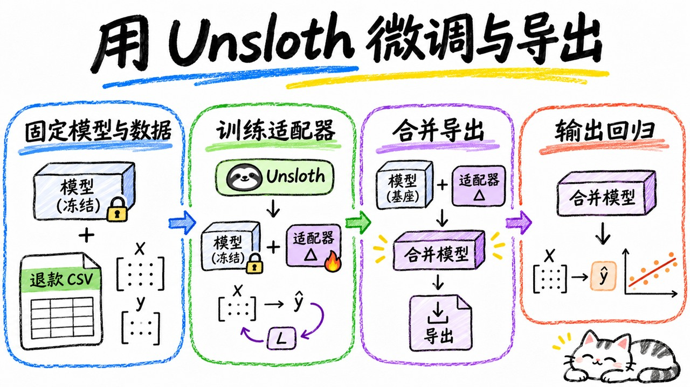
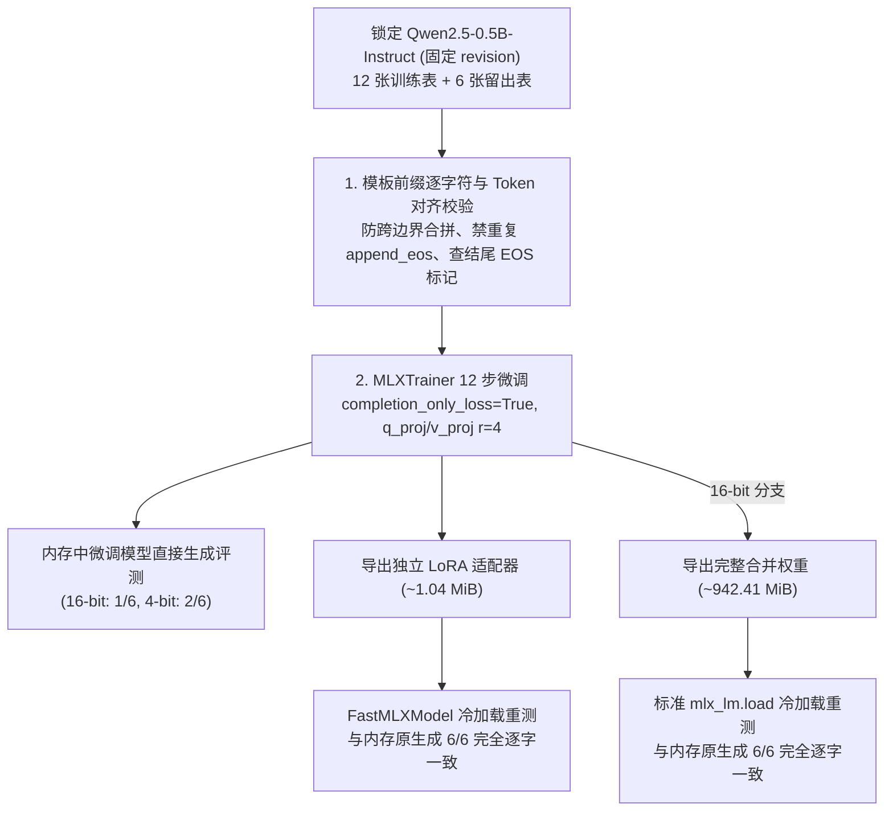

> **生成工具**：Codex\
> **生成模型**：gpt-6.2-sol

学完了前面一整套训练兵器谱，现在终于来到真正出厂交货的收官一步：**怎么在主流微调框架里，稳稳跑完「加载 -> 模板对齐检查 -> LoRA/QLoRA 微调 -> 打包导出适配器与完整合并权重 -> 重新拉起并对照推理一致性」全流程？**

继续拿着老朋友退款 CSV `4`、`NA`、`6`（期望 `{"count":2,"mean":5}`）。今天要盯住两件极其现实的交接拷问：
1. 你训练完甩给同事一个只有 1 MB 的 LoRA 适配器文件夹，**同事拉起来跑的结果，跟你当时在训练脚本内存里最后测的到底是不是一字不差？**
2. 如果线上负责兜底的推理引擎（比如 `mlx_lm.load` 或其它标准引擎）只认完整权重不认外挂适配器，你合并（Merge）导出一整个大模型文件后，**它吐出来的结果跟内存刚训完那会儿还一样吗？**

本次在 Apple Silicon M1（arm64）上实测使用 [Unsloth 项目](https://github.com/unslothai/unsloth) 旗下针对 Mac 生态的 `unsloth-zoo` + **MLX**（Apple 官方为自家芯片打造的轻量高性能数组和机器学习框架）训练后端完成全套端到端闭环。[Unsloth 官方 Apple Silicon 测试流程](https://github.com/unslothai/unsloth/blob/f242fb9a248e200ba830bec42df3125a155511e2/.github/workflows/mlx-ci.yml)

> **先用大白话讲明白**：用 **Unsloth** 跑端到端微调和交付，就像**一家高度集成的「现代精密中央烘焙工厂」**：
> - **以前拼散装机床（原生拼凑栈）**：自己去 Transformers 买烤箱、PEFT 买模具、TRL 请流水线工头，接口一换版本就对不上；**Unsloth** 等于帮你把这套工序包成了顺滑一体机，底层无论接 CUDA GPU 还是 Apple Silicon 里的 `mlx-lm`，对外全是统一的 `Fast*Model.from_pretrained -> get_peft_model -> Trainer -> save_pretrained_merged`！
> - **出厂两重严格自检（缺一不可！）**：
>   1. **入炉前先拿卡尺量边框对齐（`training_row` 边界守护）**：绝不把半个文字和结束符拆散成两半 Token，并关掉多余重复 `append_eos`；
>   2. **打包出厂后再自己拆箱试吃一遍（导出-重加载一致性测试）**：不仅测刚刚停在内存里还没关机的模型，更要把写进硬盘里的 **LoRA 小文件夹** 和 **Merged 合并大文件夹** 全都删光内存后从磁盘**重新冷启动加载回来**，对着那 6 道留出考卷逐字符重跑一遍——确认 `6/6` 完全一致才准签字交付！



## 1. 先钉死生态栈分工、模型和训练前缀护城河

很多新人看着各种库眼花缭乱，一张表帮你理清：
- **标准 CUDA / PyTorch 路线**：**Transformers** 供模型结构和分词器 + **PEFT** 管 LoRA 读写与合并 + **TRL** 提供 `SFTTrainer` 训练循环；[TRL 的 SFTTrainer](https://huggingface.co/docs/trl/sft_trainer)
- **Unsloth 一体化接口**：在上面或专用底层之上包装高速融合内核与一站式 API。今天跑的 Apple Silicon 进程底层由 **`mlx-lm`** 驱动纯文本计算，上层由 `unsloth-zoo` 的 **`FastMLXModel`** 和 **`MLXTrainer`** 接管注入和训练，Transformers 依旧负责统一精确的分词器与对话模板。[Unsloth MLX 训练器源码](https://github.com/unslothai/unsloth-zoo/blob/f0be6ab5930fda798956f2f8fce0cfbb018ebdbf/unsloth_zoo/mlx/trainer.py)（不管后端是谁，两家适配器常采用标准的 **Safetensors** 安全张量容器保存，交接时均需按加载器规格核对配置命名和矩阵方向。）

先把整场实验的所有可控参数写死入表（同仓库脚本 [experiments/trn-post-training/run_unsloth.py](../../experiments/trn-post-training/run_unsloth.py)）：

| 锁定维度 | 本次实验准确口径 |
| --- | --- |
| **基座与分词器** | `Qwen/Qwen2.5-0.5B-Instruct`，严格钉死 revision `7ae557604adf67be50417f59c2c2f167def9a775` |
| **训练集与留出集** | `12` 张训练表，`6` 张留出表（覆盖全空和零金额边界） |
| **模板边界规则** | 模型自带模板：训练渲染含回复，推理前置只附助手提示起始符 |
| **更新步长与随机性** | `batch_size = 1`，共跑 `12` 步（学习率 `0.001`、种子 `2026`、关闭训练器编译等变量干扰） |
| **LoRA 注入配置** | `q_proj`、`v_proj`，秩 `r = 4`，缩放 `lora_alpha = 8` |

> **想再深入一层？（`run_unsloth.py` 里极其老道的模板边界保护）**
> 哪怕全交给高级框架去训，老手也一定会先自己跑一遍类似下面第 57～70 行的硬核校验再送进 `MLXTrainer`！先分别渲染「只到提问结尾的推理前缀 `prompt`」和「包含标准答案的完整对话 `full`」，不仅要求字符串开头能对齐，**更要验证把 `full` 分词成整数数组之后，前面的前缀 ID 列表跟单独分词 `prompt` 完全一致**，然后把答案剥出来放进 `completion`，**顺手在配置里关闭 `append_eos=False`**（因为模板里已经自带了结尾标志 `<|im_end|>`，要是不关再叠一个 `<|endoftext|>` 上去，模型学会两次停顿或乱停就麻烦了！）

```python
prompt = tokenizer.apply_chat_template(messages(values), tokenize=False, add_generation_prompt=True)
full = tokenizer.apply_chat_template(messages(values, expected=True), tokenize=False)
prompt_ids = tokenizer.encode(prompt, add_special_tokens=False)
full_ids = tokenizer.encode(full, add_special_tokens=False)
if full_ids[:len(prompt_ids)] != prompt_ids or len(full_ids) > 128:
    raise ValueError("训练回复跨越分词边界或超过长度限制")
completion = full[len(prompt):].removesuffix("\n")
if not completion.endswith("<|im_end|>"):
    raise ValueError("训练回复缺少模板结束标记")
```

## 2. 独立虚拟环境复现：分别运行 16-bit 与 4-bit 并双轨导出

下列命令行在 Apple Silicon 上直接起一个 Python 3.12 隔离沙箱环境，严格锁死 `unsloth-zoo` 的精确 Git commit 哈希、以及 `mlx==0.32.4`、`mlx-lm==0.32.2`、`transformers==5.18.0`（首次执行会自动拉取基座权重，之后纯靠本地缓存高速复跑）。16-bit 与 4-bit 分开跑两个干净进程，免得内存分配器历史残留干扰峰值统计：

```bash
python3.12 -m venv /tmp/trn-mlx
/tmp/trn-mlx/bin/pip install \
    'unsloth-zoo[mlx] @ git+https://github.com/unslothai/unsloth-zoo.git@f0be6ab5930fda798956f2f8fce0cfbb018ebdbf' \
    mlx==0.32.4 mlx-lm==0.32.2 transformers==5.18.0 torch==2.9.1
/tmp/trn-mlx/bin/python experiments/trn-post-training/run_unsloth.py --bits 16 --work-dir /tmp/trn-fp16
/tmp/trn-mlx/bin/python experiments/trn-post-training/run_unsloth.py --bits 4 --work-dir /tmp/trn-q4
```

两条分支均调用 `save_pretrained_merged(..., save_method="lora")` 保存独立适配器文件，随后直接新建调用 `FastMLXModel.from_pretrained` 从刚写盘的适配器目录冷启动重新加载验证；其中 16-bit 分支额外调用 `save_method="merged_16bit"`，把所有低秩补丁彻底合入基座写出一套标准独立权重，再直接脱开 Unsloth、交由纯正原生的 **`mlx_lm.load()`** 冷加载跑完一次推理解码！[Unsloth MLX 导出实现](https://github.com/unslothai/unsloth-zoo/blob/f0be6ab5930fda798956f2f8fce0cfbb018ebdbf/unsloth_zoo/mlx/utils.py) · [MLX LM 的适配器与融合说明](https://github.com/ml-explore/mlx-lm/blob/main/mlx_lm/LORA.md)

（至于 4-bit 分支到底该在什么节点合并、合并完用不用换个格式重新量化，永远取决于你最终生产引擎吃哪套格式——只要改了导出合并路径，务必当成全新产物单独再跑一轮验收！）

## 3. 同一份 6 题考卷对照：导出前后真的一字不差吗？

直接查阅实测输出 JSON（[16-bit 结果](../../experiments/trn-post-training/unsloth-fp16-results.json) 与 [4-bit 结果](../../experiments/trn-post-training/unsloth-q4-results.json)），所有 6 题生成文本全部按原样保存：

| 检验路径 | 留出业务通过 (`0..6`) | 与同组内存刚训完的模型输出完全逐字一致率 |
| --- | ---: | ---: |
| 16-bit 未微调基座 | `0/6` | — |
| 16-bit 微调刚结束（内存中） | `1/6` | `6/6`（参照基准） |
| 16-bit 写盘并**冷加载独立 LoRA 适配器** | `1/6` | **`6/6`**（完全一模一样！） |
| 16-bit 写盘并用**原生 `mlx_lm.load` 加载合并权重** | `1/6` | **`6/6`**（完全一模一样！） |
| 4-bit 未微调基座 | `0/6` | — |
| 4-bit 微调刚结束（内存中） | `2/6` | `6/6`（参照基准） |
| 4-bit 写盘并**冷加载独立 LoRA 适配器** | `2/6` | **`6/6`**（完全一模一样！） |

在磁盘文件体量上，两边的纯 LoRA Safetensors 补丁权重都只有约 **`1.04 MiB`**（`1,091,411` 字节）；而 16-bit 完整合并出来的全量权重文件则是 **`942.41 MiB`**（`988,185,248` 字节）——相差了将近 900 倍！

> **容易踩的坑（别把「导出一致 6/6」当成了「业务可以上线了」！）**：
> 一边看着两边清一色 `6/6` 逐字符一字不差（证明保存、模板、重新加载整条工程交付链路彻底走通毫无偏差），另一边也要老老实实承认业务本身仅在 12 步短跑里过了 `1/6` 与 `2/6`——例如两组在 `[4, None, 6]` 上都交出了 `{"count":2,"mean":4}` 这种只学会了输出干净 JSON 格式却没练熟心算除法的答案！这充分说明本次短程运行只作全流程「工程联调与导出一致性验真」之用：要真让模型扛大梁，除了按前面几篇扩大训练语料覆盖和更新预算外，**像精确求均值这种任务最明智的生产架构，依然是让模型调用工具或交由确定性 Python 程序把数字稳稳算出来！**

> **大白话小结（交付交接四件套检查单）**：当你真正把微调好的权重目录交接给后端推理工程师，准备丢进下周就要学的 vLLM 或 SGLang 推理引擎之前，包里务必贴上四张出厂合格证：
> 1. 原始基座模型准确仓库名与精确 Git revision；
> 2. 匹配的分词器与聊天模板版本（以及明确的停止 Token ID）；
> 3. 适配器配置、权重文件 SHA-256 校验码；
> 4. 冷加载后在**目标真实推理引擎**（重跑模板和停词测试）上的最新留出回归测试战报！

## 下一部分

恭喜，到这里我们已经彻底走完了第四部分「**模型预训练与后训练（TRN-01～TRN-12 共 12 篇）**」——从洗出一粒干净的语料 Token、手搓预训练循环、搞定分布式分片显存、亲历 SFT 遮罩、LoRA/QLoRA、DPO 偏移陷阱、GRPO 在线强化采样、蒸馏与合成数据，直到导出随时可部署的洁净 Safetensors 权重！

接下来，模型总不能天天躺在 Jupyter 笔记本里一次接待一个用户吧？第五部分将重磅迈入「**推理引擎与模型部署（SERV-01～SERV-16 共 16 篇）**」，从 [**SERV-01《用 Qwen 0.5B 搭一个极简 vLLM Server》**](../05-inference-serving/serv-01-vllm-server.md) 起步，看看真正的工业级大模型服务引擎是怎么用 Continuous Batching 和 PagedAttention 扛住成千上万并发请求的！ [LLM 与 Agent 学习路线图](https://blog.lacknb.cn/articles/2026/11/19/1795058329577.html)
